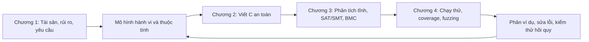

# Chương 0. Tổng quan học phần và cách sử dụng tài liệu

## 0.1 Phạm vi của bộ tổng hợp

Bộ tài liệu này hệ thống hóa nội dung học phần **CSE703093 - An toàn phần mềm** từ thư mục `Safe Application`: bài giảng, giáo trình, đề cương, hướng dẫn thực hành, mã nguồn C/Python, dữ liệu JSON/CSV, đề ôn tập HTML và mẫu đặc tả/báo cáo. Nội dung được viết lại theo mạch kiến thức để có thể tự học, đồng thời giải thích quan hệ giữa lý thuyết và các chương trình thực tế trong thư mục.

Kiểm kê đầu vào ngày **09/10/2026**:

| Nhóm | Số lượng | Cách xử lý |
| --- | ---: | --- |
| PDF | 25 file, 1.095 trang | Trích xuất toàn bộ trang; lập chỉ mục trang; kiểm tra hình ảnh đại diện cho đồ thị, bố cục bộ nhớ và bảng |
| Mã Python | 53 file | Phân tích cú pháp, hàm/lớp, import, luồng dữ liệu và các giới hạn của thuật toán |
| Mã C và header | 30 `.c`, 1 `.h` | Đối chiếu quản lý bộ nhớ, điều kiện biên, harness, kiểm chứng và test |
| JSON và CSV | 35 JSON, 9 CSV | Đọc mô hình, đầu vào, đặc tả và kết quả lưu sẵn |
| Word và Excel | 2 DOCX, 1 XLSX | Đọc đoạn văn, bảng và toàn bộ 10 sheet của mẫu đặc tả |
| HTML | 2 file trùng nội dung | Lấy dữ liệu câu hỏi trong JavaScript: 1.257 câu |
| ZIP | 13 file, 186 thành viên | Đối chiếu SHA-256; tất cả thành viên đều có bản giống hệt đã giải nén |
| EXE | 2 file | Kiểm kê kích thước, hash và cấu trúc PE; không có mã nguồn của ứng dụng tương ứng trong thư mục |
| Tài liệu, Makefile, cache, file phụ | Các file còn lại | Phân loại và đưa vào danh mục nguồn |

Tổng đầu vào là **222 file**, khoảng **319,5 MB** theo đơn vị thập phân. Số trang 1.095 có tính cả hai bản PDF giới thiệu trùng nhau; số file không bao gồm tài liệu tổng hợp và file tạm tạo trong quá trình xử lý.

**Giới hạn cần hiểu chính xác:** trích xuất hết trang PDF không đồng nghĩa đã kiểm tra bằng mắt mọi hình trên cả 1.095 trang. Phần lý thuyết, công thức, mục lục, bảng văn bản và mã nguồn là cơ sở chính; những sơ đồ quan trọng đã được kiểm tra hình ảnh đại diện. Hai chương trình EXE chỉ được phân tích ở mức file nhị phân và tài liệu đầu vào đi kèm. Bộ tổng hợp không khẳng định đã kiểm toán đầy đủ cách cài đặt bên trong EXE.

## 0.2 Bốn trụ cột kiến thức

Mỗi bước trả lời một câu hỏi khác nhau:

1. **Cần bảo vệ gì?** Xác định tài sản, đối thủ, ranh giới tin cậy và thuộc tính mong muốn.
2. **Code có thể sai thế nào?** Xem quyền truy cập, dữ liệu đầu vào, kiểu số và vòng đời bộ nhớ.
3. **Mọi hành vi được mô hình hóa có thỏa thuộc tính không?** Dùng kiểm chứng hình thức và phân tích tĩnh.
4. **Khi chạy thật, input nào gây lỗi?** Dùng test, đo coverage, sanitizer và fuzzing.
5. **Sau khi sửa có tái phát không?** Giữ phản ví dụ thành regression test.

Không có một công cụ đơn lẻ thay thế toàn bộ chuỗi này. Một warning chưa chắc là lỗ hổng khai thác được; một lần chạy sạch chưa chứng minh mọi đầu vào đều an toàn; một mô hình đúng chưa đảm bảo code triển khai đúng mô hình.

## 0.3 Mục tiêu học tập

Đề cương nêu học phần 3 tín chỉ, gồm lý thuyết và thực hành. Hai chuẩn đầu ra được nhấn mạnh trong tài liệu bài tập lớn là:

- **LO.03:** đánh giá kỹ thuật thẩm định, kiểm chứng và kiểm thử.
- **LO.04:** thực hiện giải quyết lỗ hổng bằng những kỹ thuật phù hợp.

Để đáp ứng, cần làm được cả ba việc: giải thích nguyên lý, áp dụng trên một chương trình cụ thể và diễn giải bằng chứng. Học thuộc tên công cụ hoặc chỉ dán log vào báo cáo chưa đủ.

## 0.4 Kiến thức nền cần có

| Kiến thức | Dùng ở đâu |
| --- | --- |
| C: mảng, con trỏ, chuỗi, struct, malloc/free | Chương 2, lab 3-4, harness fuzzing |
| Python: hàm, lớp, dict/set, file, subprocess | Mô hình Kripke, trình chạy công cụ và dữ liệu lab |
| Đồ thị, BFS/DFS, độ phức tạp | Reachability, phản ví dụ, CFG và model checking |
| Logic Boolean, kéo theo, lượng từ | CTL/LTL, SAT/SMT, điều kiện an toàn |
| Kiểu số, biểu diễn bit, endianness | Overflow, bit-vector và parsing dữ liệu nhị phân |
| Kiểm thử tự động | Oracle, baseline, regression và kết quả thực nghiệm |

## 0.5 Cách học và cách đọc nguồn

Đọc lần lượt Chương 1-4, rồi làm các lab tương ứng. Khi học một khái niệm, luôn ghi lại **định nghĩa - điều kiện áp dụng - ví dụ - phản ví dụ - giới hạn**. Ví dụ với BMC: định nghĩa là tìm đường vi phạm tới một giới hạn; điều kiện là mô hình và giả thiết đã mã hóa; phản ví dụ là input cụ thể; giới hạn là chưa bao phủ mọi độ sâu.

Số trang dẫn trong tài liệu là **thứ tự trang PDF, tính từ 1**, không phải số trang in ở chân giáo trình. Giáo trình có phần đầu đánh số La Mã nên hai cách đánh số khác nhau. Slide mỗi phần có 100 trang và số trang PDF thường trùng số slide.

Một số tên module trong slide/giáo trình, như `ch3_staticsat`, `memory_trace`, `sat_solver` hoặc `bounded_checker`, không có file tương ứng trong bản toolkit đã giải nén. Chúng vẫn được giải thích về mặt kiến thức; bản đồ code chỉ liệt kê API thật sự tồn tại. Mã minh họa in trong giáo trình và mã trên ổ đĩa là hai nguồn cần đối chiếu, không được mặc nhiên coi là cùng một phiên bản.

## 0.6 Bằng chứng đã kiểm tra trong lần tổng hợp

Đã chạy các ví dụ Python về Kripke, chấm rủi ro, SMT và BMC; đã chạy một tập test có sẵn trong bản sao tạm: **19 test đạt, 5 test tự bỏ qua do thiếu CBMC, 7 test liên quan C được chủ động loại khỏi lượt chạy Python**. Đây là kiểm tra có chọn lọc cho các kết luận trong tài liệu, không phải tuyên bố toàn bộ bộ test của thư mục đã đạt.

Môi trường hiện có GCC/gcov nhưng chưa có cppcheck, CBMC hoặc Clang trong PATH. Vì vậy kết quả ASan, cppcheck, CBMC và fuzzing C lưu sẵn được ghi rõ là **kết quả nguồn**, không trình bày như thực nghiệm mới đã chạy lại. Các file nguồn ban đầu không bị sửa.

## 0.7 Nguồn chính

- `An toàn phần mềm.pdf`, trang 1-10; `CSE703093 - An toàn phần mềm.docx`: đề cương.
- `Chương 0_Gioi_thieu_hoc_phan.pdf`, trang 1-12; `Giới thiệu học phần.pdf`: cùng nội dung.
- `CSE703093_An_toan_phan_mem_Giao_trinh.pdf`, trang 1-8: lời nói đầu và mục lục; trang 81-141: phụ lục code, bài tập, đề mẫu, bài tập lớn và thuật ngữ.
- Tất cả nguồn có đường dẫn và trạng thái xử lý trong [Danh mục nguồn](10_Danh_muc_nguon.md).
