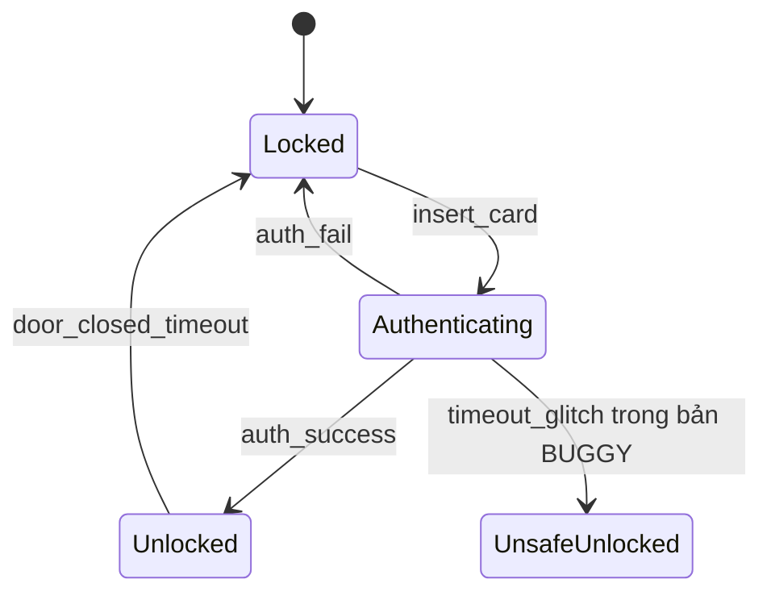

# Chương 1. Nền tảng an toàn phần mềm

## 1.1 Security, safety và reliability

**Software security** là khả năng bảo vệ tài sản và duy trì các thuộc tính mong muốn khi có hành vi tấn công. Đối thủ có thể cố tình chọn input, thứ tự thao tác hoặc thời điểm thực thi gây bất lợi cho hệ thống.

| Khái niệm | Câu hỏi chính | Ví dụ |
| --- | --- | --- |
| Security | Đối thủ có làm hệ thống vi phạm quyền hoặc lộ dữ liệu không? | Giả mạo phiên đăng nhập để đọc dữ liệu người khác |
| Safety | Hệ thống có gây nguy hiểm hoặc thiệt hại không chấp nhận được không? | Lệnh điều khiển sai làm thiết bị vận hành nguy hiểm |
| Reliability | Hệ thống có cung cấp chức năng đúng ổn định trong điều kiện xác định không? | Dịch vụ xử lý đơn hàng duy trì hoạt động trong thời gian yêu cầu |

Các thuộc tính giao nhau. Một tấn công có thể gây hậu quả safety; một hệ thống hoạt động ổn định với người dùng bình thường vẫn có thể dễ bị khai thác. Safety không chỉ giới hạn ở lỗi ngẫu nhiên, và security không chỉ là mã hóa.

### CIA và các thuộc tính mở rộng

- **Confidentiality:** thông tin chỉ được tiết lộ cho chủ thể được phép. Đọc trộm token, dữ liệu cá nhân hoặc bộ nhớ tiến trình là vi phạm.
- **Integrity:** dữ liệu và hành vi chỉ được thay đổi theo quyền và quy tắc hợp lệ. Sửa giá đơn hàng hoặc số dư trái phép là vi phạm.
- **Availability:** người dùng hợp lệ có thể tiếp cận dịch vụ khi cần. Crash, hang hoặc cạn tài nguyên có thể vi phạm.
- **Authenticity:** có cơ sở tin cậy để xác nhận nguồn gốc hoặc danh tính.
- **Accountability:** hành động có thể được truy vết tới chủ thể chịu trách nhiệm.
- **Non-repudiation:** có bằng chứng thích hợp để hạn chế khả năng chối bỏ hành động. Một log thông thường có thể bị sửa không tự động tạo ra tính không chối bỏ.

**Authentication** xác minh danh tính; **authorization** quyết định quyền thực hiện thao tác. Một user đã đăng nhập vẫn có thể không được phép đọc tài nguyên của user khác. Kiểm tra quyền phải gắn với tài nguyên và hành động cụ thể, không chỉ với trạng thái “đã đăng nhập”.

### Các thuật ngữ trong một chuỗi tấn công

| Thuật ngữ | Ý nghĩa | Ví dụ trong parser C |
| --- | --- | --- |
| Asset | Tài sản cần bảo vệ | Dữ liệu bí mật và quyền của tiến trình |
| Threat | Khả năng/sự kiện có thể gây hại | Đối thủ gửi gói tin độc hại |
| Vulnerability | Điểm yếu cho phép vi phạm thuộc tính | Tin độ dài khai báo mà không kiểm tra dữ liệu thật |
| Attack | Hành động cụ thể để gây hại | Gửi trường length lớn hơn payload |
| Exploit | Cách khai thác điểm yếu | Input kích hoạt đọc ngoài vùng nhớ |
| Risk | Mức rủi ro trong bối cảnh triển khai | Khả năng khai thác kết hợp với hậu quả |

Không phải mọi bug đều là lỗ hổng có thể khai thác trong một môi trường cụ thể. Nhưng lỗi chưa khai thác được hiện tại vẫn có thể trở nên nguy hiểm khi quyền tiến trình, cấu hình hoặc bề mặt đầu vào thay đổi.

## 1.2 Rủi ro, mô hình đe dọa và kiểm soát truy cập

### Đánh giá rủi ro

Mô hình đơn giản của học phần:

\[
Risk = Likelihood \times Impact
\]

Likelihood phụ thuộc mức tiếp xúc, điều kiện khai thác, quyền cần có và khả năng kiểm soát input. Impact phụ thuộc tài sản, quyền tiến trình và ảnh hưởng CIA. Điểm ma trận 1-5 là thang thứ bậc để ưu tiên; tích của chúng không tự động là xác suất hoặc thiệt hại tiền tệ chính xác.

Ví dụ: overflow trong parser nhận dữ liệu mạng và chạy với quyền cao thường đáng ưu tiên hơn lỗi tương tự trong tiện ích thử nghiệm không có dữ liệu nhạy cảm. Cần ghi giả thiết thay vì gán mức “cao” chỉ từ tên lỗi.

Giáo trình mở rộng phân tích định lượng với:

\[
SLE = AssetValue \times ExposureFactor,\qquad ALE = SLE \times ARO
\]

SLE là tổn thất ước tính cho một sự kiện; ARO là số lần xảy ra kỳ vọng mỗi năm; ALE là tổn thất năm kỳ vọng. Các con số hữu ích khi có dữ liệu và giả thiết phù hợp. CVSS đo mức nghiêm trọng kỹ thuật theo một phiên bản quy tắc, còn ưu tiên sửa lỗi thực tế vẫn cần bối cảnh tài sản và triển khai.

### STRIDE

| Nhóm | Ý nghĩa | Kiểm soát có thể áp dụng |
| --- | --- | --- |
| Spoofing | Giả danh chủ thể hoặc nguồn | Xác thực, bảo vệ thông tin định danh |
| Tampering | Sửa dữ liệu trái phép | Kiểm tra quyền, tính toàn vẹn, kiểm tra input |
| Repudiation | Chối bỏ hành động | Audit log có bảo vệ và nhận diện chủ thể |
| Information disclosure | Lộ dữ liệu | Phân quyền, hạn chế lỗi chi tiết, bảo vệ bí mật |
| Denial of service | Làm dịch vụ không khả dụng | Giới hạn tài nguyên, timeout, rate limit |
| Elevation of privilege | Đạt quyền ngoài phạm vi cho phép | Least privilege, kiểm tra quyền tại mỗi thao tác |

STRIDE là cách đặt câu hỏi có hệ thống. Không phải cứ có sáu chữ STRIDE trong báo cáo là đã mô hình hóa đầy đủ. Cần gắn mỗi đe dọa với một thành phần, luồng dữ liệu, tài sản và cách kiểm chứng.

Quy trình: mô tả hệ thống và data-flow diagram → xác định trust boundary → liệt kê đe dọa → đánh giá rủi ro → chọn kiểm soát → kiểm tra hiệu quả. Một luồng nội bộ không tự động đáng tin; mỗi lần thay đổi mức tin cậy, quyền hoặc chủ thể đều có thể cần kiểm tra lại.

**Attack tree** đặt mục tiêu tấn công ở gốc. Nút OR thể hiện các cách thay thế; nút AND yêu cầu kết hợp nhiều bước. Ví dụ “chiếm tài khoản” có thể qua đánh cắp mật khẩu OR chiếm token OR bypass xác thực. Nó giúp tìm những đường còn thiếu kiểm soát.

### Nguyên tắc thiết kế và mô hình quyền

- **Least privilege:** chỉ cấp quyền tối thiểu cần thiết; giảm hậu quả khi một thành phần bị xâm phạm.
- **Defense in depth:** các lớp kiểm soát bổ sung nhau, như validation, phân quyền, kiểm tra bộ nhớ và log.
- **Fail-closed:** khi không xác minh được điều kiện cấp quyền, giữ trạng thái từ chối. Phải thiết kế thêm khả năng phục hồi để tránh mất availability không cần thiết.
- **Security by design:** yêu cầu bảo mật được đưa vào thiết kế, đặc tả và test từ đầu.

| Mô hình | Quyền quyết định hoặc mục tiêu |
| --- | --- |
| DAC | Chủ sở hữu tài nguyên có quyền phân quyền theo chính sách |
| MAC | Chính sách phân loại tập trung áp đặt quyền truy cập |
| RBAC | Quyền gắn với vai trò và người dùng được gán vai trò |
| Bell-LaPadula | Bảo vệ confidentiality: dạng cơ bản “no read up, no write down” |
| Biba | Bảo vệ integrity: dạng strict integrity cơ bản “no read down, no write up” |

Các mô hình trên có giả thiết và biến thể. RBAC không loại bỏ nhu cầu kiểm tra sở hữu từng đối tượng; Biba và Bell-LaPadula không giải quyết mọi thuộc tính availability hoặc logic nghiệp vụ.

## 1.3 Các lớp lỗ hổng và hệ thống phân loại

**CWE** phân loại điểm yếu; **CVE** định danh một lỗ hổng cụ thể trong sản phẩm/phiên bản. Một warning CWE-416 trong code học tập không tự động có CVE. **OWASP Top 10** là tập nhóm rủi ro của một bản phát hành cụ thể, không phải bảng đầy đủ mọi lỗi. Giáo trình dùng danh mục minh họa; không coi thứ hạng hoặc số lượng trong tài liệu là số liệu cập nhật tự động.

| Lớp lỗi | Nguyên nhân | Hậu quả và phòng ngừa |
| --- | --- | --- |
| Out-of-bounds read/write | Chỉ số hoặc độ dài vượt object | Lộ dữ liệu/ghi hỏng bộ nhớ; kiểm tra cả biên dưới và biên trên |
| Use-after-free | Truy cập sau khi object hết vòng đời | Crash, dữ liệu sai; ownership và thứ tự thao tác đúng |
| Double free | Giải phóng một allocation nhiều lần | Hỏng trạng thái allocator; một owner chịu trách nhiệm giải phóng |
| Memory leak | Mất tham chiếu trước khi giải phóng | Cạn tài nguyên; quản lý mọi đường thoát |
| Integer overflow | Kết quả vượt miền kiểu | Cấp phát thiếu, sai bounds; kiểm tra trước phép toán |
| SQL/command injection | Dữ liệu bị diễn giải thành lệnh | Dùng truy vấn tham số hóa hoặc API không đi qua shell |
| Broken access control/IDOR | Thiếu kiểm tra quyền với object | Truy cập dữ liệu người khác; kiểm tra ở server |
| Path traversal | Input điều khiển đường dẫn ngoài phạm vi | Dùng định danh và kiểm soát đường dẫn/tài nguyên hợp lệ |
| Race condition/TOCTOU | Kiểm tra và sử dụng không nguyên tử | Trạng thái thay đổi giữa hai bước; dùng thao tác nguyên tử, đồng bộ đúng |
| Improper error handling | Lộ chi tiết hoặc bỏ qua lỗi | Rò rỉ cấu trúc hệ thống, fail-open; phản hồi phù hợp và log nội bộ |

Ví dụ SQL: nối trực tiếp username vào câu truy vấn khiến ký tự đặc biệt thay đổi cấu trúc SQL. Prepared statement giữ cấu trúc lệnh và giá trị tham số tách biệt. Với command injection, truyền danh sách đối số cho API tiến trình còn cần kiểm tra chính lệnh đó chấp nhận đối số nào.

Heartbleed là **đọc vượt vùng nhớ** do thiếu kiểm tra bounds trong xử lý TLS heartbeat, không phải ví dụ ghi tràn stack. Xem [bản ghi CVE gốc](https://cve.mitre.org/cgi-bin/cvename.cgi?name=cve-2014-0160). Một slide đầu chương diễn đạt không chính xác, còn slide case study sau đó mô tả đúng; phần đính chính giữ cách phân loại đúng.

## 1.4 Verification, validation và testing

**Verification:** sản phẩm có tuân thủ đặc tả không? **Validation:** sản phẩm có đáp ứng nhu cầu thực tế không? **Testing:** thiết kế và thực hiện các kiểm tra để tìm sai lệch, cung cấp bằng chứng về chất lượng. Trong học phần, “kiểm chứng hình thức” thường chỉ các phương pháp dùng mô hình và suy luận toán học.

| Hoạt động | Có chạy chương trình mục tiêu không? | Bằng chứng |
| --- | --- | --- |
| Review, static analyzer, formal proof | Không cần chạy chương trình mục tiêu | Warning, điều kiện, chứng minh hoặc phản ví dụ mô hình |
| Unit/integration/system/acceptance test | Có với kiểm thử động | Input, expected, actual, pass/fail |
| Fuzzing | Có | Crash, hang, sanitizer finding và input tái hiện |
| Debugging | Thường có hoặc dùng trace | Nguyên nhân gốc và cơ chế gây lỗi |

Một analyzer hay solver vẫn là chương trình được chạy; gọi nó “tĩnh” có nghĩa không thực thi **chương trình đang được phân tích** theo input cụ thể như test động.

Mô hình chữ V liên hệ yêu cầu với acceptance test, thiết kế hệ thống với system test, thiết kế thành phần với integration test và code với unit test. Mỗi mức cần oracle phù hợp. Quy trình test gồm lập kế hoạch → phân tích/thiết kế → chuẩn bị và thực thi → đánh giá exit criteria → lưu kết quả và kết thúc.

Một test case tối thiểu có ID, yêu cầu liên quan, điều kiện trước, input, bước thực hiện, kết quả mong đợi và kết quả thực tế. **Retest** xác nhận bug cụ thể đã sửa; **regression test** phát hiện tác động phụ hoặc lỗi tái xuất hiện.

### Kỹ thuật black-box

1. **Equivalence partitioning:** chia input thành các lớp được kỳ vọng xử lý tương tự; chọn đại diện của mỗi lớp.
2. **Boundary value analysis:** ưu tiên giá trị sát ranh giới vì dễ có off-by-one.
3. **Decision table:** liệt kê tổ hợp điều kiện và hành động; phát hiện thiếu hoặc mâu thuẫn quy tắc.
4. **State-transition testing:** kiểm tra chuỗi sự kiện, transition hợp lệ và không hợp lệ.
5. **Use-case testing:** kiểm tra một kịch bản người dùng gồm nhiều bước.
6. **Experience-based testing:** error guessing và exploratory testing có mục tiêu, ghi nhận kết quả.

Với độ dài mật khẩu hợp lệ `[8,20]`: ba lớp là `<8`, `[8,20]`, `>20`; bốn biên tối thiểu trong ví dụ nguồn là `7,8,20,21`. Có thể bổ sung `9,19`, input rỗng và kiểu không hợp lệ tùy đặc tả. Lớp theo độ dài không thay thế lớp theo ký tự, encoding hoặc trạng thái tài khoản.

## 1.5 White-box, CFG và chất lượng bộ test

CFG biểu diễn các khối/lệnh và cạnh chuyển điều khiển. Từ đó đo những mục đã được thực thi:

\[
Coverage=\frac{Số\ mục\ đã\ bao\ phủ}{Tổng\ số\ mục\ trong\ phạm\ vi}\times100\%
\]

| Độ đo | Mục cần bao phủ | Giới hạn |
| --- | --- | --- |
| Statement | Câu lệnh | Có thể bỏ qua kết quả false của một điều kiện |
| Line | Dòng mã thực thi theo công cụ | Một dòng có thể chứa nhiều câu lệnh |
| Branch/decision | Kết quả của quyết định | Chưa chắc bao phủ mọi điều kiện nguyên tử |
| Condition | True/false của từng điều kiện nguyên tử | Chưa chắc thay đổi kết quả quyết định |
| MC/DC | Mỗi điều kiện có thể độc lập thay đổi quyết định | Cần thiết kế cặp test và quy tắc short-circuit rõ |
| Edge | Cạnh đồ thị điều khiển theo instrumentation | Phụ thuộc đồ thị và cách gán ID |
| Path | Đường thực thi | Vòng lặp có thể tạo vô hạn đường |

Với `D=a && b`, các test `(T,T)`, `(F,T)`, `(T,F)` minh họa MC/DC ở mô hình logic: cặp đầu/giữa cho thấy ảnh hưởng của `a`; cặp đầu/cuối cho thấy ảnh hưởng của `b`. Khi đo trên C có short-circuit, cần dùng quy tắc MC/DC của công cụ và xét việc điều kiện có được đánh giá không.

Ví dụ đúng theo bộ đếm trong `softsec-toolkit/ch1_models/testing.py`:

```python
def f(a, b):
    if a > 0:
        if b > 0:
            return 1
        return 2
    return 0
```

Một test `(5,3)` đi qua 3/5 mục `check_a`, `check_b`, `return1`, `return2`, `return0`: **60% statement coverage theo bộ đếm này**, và 2/4 kết quả quyết định: **50% branch coverage**. Thêm `(5,-3)` và `(-5,0)` đạt 100% cả hai trong mô hình đó. Tỉ lệ statement trên một CFG khác phải tính lại mẫu số; không dùng số 3/4 bất nhất trong slide làm đáp án chung.

**Cyclomatic complexity:**

\[
V(G)=E-N+2 P
\]

Với CFG một thành phần, `P=1`. Ví dụ trên có `E=7`, `N=6`, nên `V=3`. Với những quyết định nhị phân được mô hình hóa phù hợp, có thể tính số quyết định +1. Đây là số chiều của tập đường cơ sở trong đồ thị, không phải mọi đường thực thi đều khả thi và không phải số test luôn đủ cho mọi tiêu chí.

**Mutation testing:** thay đổi nhỏ code, xem test có phát hiện sự khác biệt không. Mutation score thường tính mutant bị diệt trên số mutant không tương đương được xét. Mutant tương đương về hành vi không thể bị diệt bằng test quan sát cùng đặc tả.

**Oracle problem:** với một input bất kỳ, khó xác định output đúng. Các cách bổ sung gồm oracle độc lập, so sánh hai implementation, metamorphic relation và invariant. Ví dụ sắp xếp: kết quả phải có thứ tự và bảo toàn multiset đầu vào. Hai implementation trả lời giống nhau vẫn có thể cùng sai.

## 1.6 Cấu trúc Kripke và logic thời gian

\[
K=(S,S_0,R,L)
\]

- `S`: tập trạng thái; một trạng thái mô tả đủ thông tin liên quan tới thuộc tính.
- `S0 ⊆ S`: tập trạng thái ban đầu, cần ít nhất một trạng thái trong bài toán thông thường.
- `R ⊆ S×S`: quan hệ chuyển trạng thái, có thể không xác định.
- `L:S→2^AP`: các mệnh đề nguyên tử đúng tại từng trạng thái.

Kripke chuẩn dùng quan hệ chuyển **total**, mỗi trạng thái có ít nhất một successor. Có thể thêm self-loop ở trạng thái kết thúc để định nghĩa hành vi vô hạn; nhưng nên phát hiện và giải thích deadlock trên mô hình gốc trước khi totalize, tránh che mất lỗi thiết kế.



Tên state là định danh, còn label là mệnh đề. State `Unlocked` có thể mang `unlocked` và `authenticated`. Nếu chỉ có state tên “transaction” mà không lưu trạng thái xác thực, khó phát biểu một invariant xác thực đúng; phải bổ sung thông tin hoặc xét thuộc tính theo đường.

### Reachability và BFS

Khởi đầu từ tất cả trạng thái trong `S0`, đưa vào queue; lấy từng trạng thái, thăm successor chưa thăm; lưu parent để dựng đường đi. Độ phức tạp `O(|S|+|R|)` cho đồ thị biểu diễn bằng adjacency list. BFS tìm đường ngắn nhất theo số cạnh trong đồ thị không trọng số. Một witness có thể không duy nhất khi dùng set và có nhiều đường bằng nhau.

Safety mô tả điều xấu không xảy ra; khi vi phạm thường có prefix hữu hạn chứng minh. Liveness mô tả tiến triển cuối cùng; phản ví dụ thường gồm prefix và chu trình vô hạn không có tiến triển. Không có deadlock chưa đảm bảo liveness: hệ thống có thể retry mãi trong self-loop.

### CTL và LTL

CTL kết hợp định lượng đường `A` (mọi đường), `E` (tồn tại đường) với toán tử `X` (bước kế), `F` (cuối cùng), `G` (luôn), `U` (until).

| Công thức | Cách đọc |
| --- | --- |
| `AG(!violation)` | Trên mọi đường, không bao giờ tới trạng thái vi phạm |
| `AG(unlocked -> authenticated)` | Mọi trạng thái đạt được có mở khóa thì có xác thực |
| `EF(unlocked)` | Tồn tại đường tới trạng thái mở khóa |
| `AF(done)` | Mọi đường cuối cùng đều tới `done` |
| `AG(request -> AF(response))` | Mọi yêu cầu phát sinh đều cuối cùng được đáp ứng trên mọi diễn tiến |
| `AG(EF(reset))` | Từ mọi trạng thái đạt được vẫn tồn tại cách tới `reset` |
| `EX(error)` | Có ít nhất một successor mang `error` |

`EF(done)` không bảo đảm hoàn thành trên mọi đường. `AG EF reset` không bằng `AG AF reset`. Khi có nhiều initial states, cần nói rõ “mô hình thỏa công thức” nghĩa là mọi initial state thỏa hay chỉ một initial state; các helper trong thư mục không dùng hoàn toàn cùng quy ước.

LTL mô tả một đường thời gian bằng `G,F,X,U`; khi kiểm chứng hệ thống thường yêu cầu mọi đường của mô hình thỏa công thức. CTL có thể phân biệt các lựa chọn tương lai tại một trạng thái. Không thay toán tử `E` thành `A` chỉ vì “đường nào đó tìm được bằng BFS”.

### Thuật toán gán nhãn CTL

Mỗi công thức được ánh xạ tới tập trạng thái thỏa:

- Atom `p`: những state có `p` trong `L(s)`.
- `!p`: phần bù trong `S`; `p && q`: giao hai tập.
- `EX p`: state có một successor trong `Sat(p)`.
- `EF p`: điểm cố định nhỏ nhất `Z = Sat(p) ∪ PreE(Z)`.
- `EG p`: điểm cố định lớn nhất `Z = Sat(p) ∩ PreE(Z)`.
- `AF p`: dùng predecessor phổ quát `PreA` trong điểm cố định nhỏ nhất.
- `AG p`: có thể tính `!EF(!p)` trên ngữ nghĩa đã chọn.

Với đồ thị không total, `PreA` ở state không có successor và ngữ nghĩa path cần được định nghĩa rõ. Không ghép các công thức điểm cố định với cách xử lý dead-end tùy ý.

### Đồng thời, công bằng và bùng nổ trạng thái

Hai tiến trình có `m` và `n` trạng thái cục bộ có thể tạo tới `m×n` trạng thái kết hợp, chưa tính tài nguyên chung. Mutex đúng cần ngăn `p1_critical && p2_critical`, nhưng starvation freedom còn cần mô hình scheduler và fairness. Không thể suy ra fairness chỉ từ việc đã thêm mutex.

Các cách giảm bùng nổ: chọn abstraction phù hợp, giới hạn miền dữ liệu, kiểm tra module, symbolic model checking, partial-order reduction. **Bisimulation** là quan hệ mô phỏng hai chiều giữa trạng thái và transition, dùng để chứng minh tương đương hành vi theo các điều kiện phù hợp; gộp state chỉ vì cùng tên hoặc cùng label không tự động là bisimulation.

## 1.7 Bài học nối với code

- Lab 1: BFS và phản ví dụ `S0 → S1 → S5` cho mở khóa không xác thực.
- Lab 2: PIN 6 chữ số, biên số lần sai và oracle C/Python.
- Toolkit `testing.py`: EP/BVA, CFG, decision table, bộ đếm coverage minh họa.
- Toolkit `kripke.py`: counter, đèn giao thông, vending machine, ATM; các helper chỉ hỗ trợ một phần logic.
- `atpm/ch1_concepts/kripke.py`: invariant, reachability, kiểm tra total và xuất DOT.

**Tự kiểm tra:** phân biệt được asset/threat/vulnerability; chuyển một yêu cầu thành thuộc tính; tính coverage với mẫu số rõ; dựng Kripke từ một luồng trạng thái; giải thích witness và phản ví dụ; nhận biết tính đúng do tiền đề chưa bao giờ xảy ra.

## 1.8 Nguồn theo trang

- `Chuong1_Phan1_ATPM.pdf`: trang 3-37 nền tảng/rủi ro/STRIDE; 38-66 lớp lỗi; 67-92 V&V và kỹ thuật test.
- `Chuong1_Phan2_ATPM.pdf`: trang 4-39 white-box và quản lý test; 40-78 Kripke/logic thời gian; 86-94 ôn tập.
- Giáo trình: trang PDF 9-30, bao gồm OWASP/CWE, rủi ro định lượng, CTL labeling và BFS.
- Code và dataset: xem [Bản đồ mã nguồn](09_Ban_do_ma_nguon.md) và [8 bài lab](05_Phan_tich_8_bai_lab.md).
