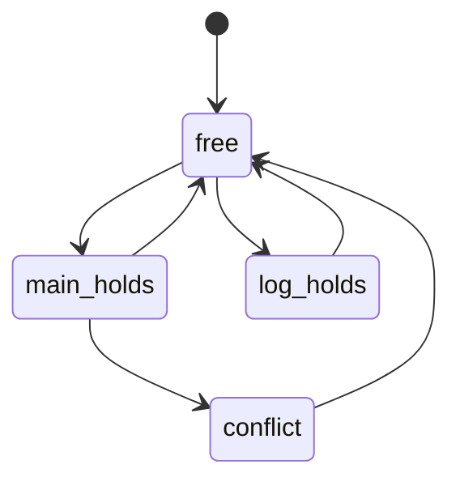

# Chương 6. Đặc tả, mô hình JSON/Excel và bài tập lớn

## 6.1 Vì sao đặc tả là trung tâm của kiểm chứng?

Một công cụ chỉ kiểm tra được điều đã được mô tả. Yêu cầu tự nhiên, mô hình trạng thái, công thức logic, mã nguồn và test phải cùng nói về một hành vi. Nếu yêu cầu là “không mở cửa khi chưa xác thực”, nhưng mô hình không gắn nhãn `authenticated` đúng thời điểm, kết quả kiểm chứng có thể đúng về công thức và sai về hệ thống cần bảo vệ.

Một chuỗi truy vết hợp lý là:


Mỗi yêu cầu cần có tiêu chí chấp nhận. “Nhanh”, “an toàn”, “dễ dùng” chưa thể kiểm thử; “từ chối ID dài hơn 16 ký tự ASCII, không ghi ngoài bộ đệm” có thể chuyển thành test và thuộc tính bộ nhớ.

Phân biệt bốn loại:

- **Yêu cầu chức năng:** hệ thống phải làm gì, ví dụ xác thực thiết bị hoặc ghi log.
- **Yêu cầu phi chức năng:** mức hiệu năng, độ sẵn sàng, tính bảo trì, độ bền dữ liệu.
- **Ràng buộc:** giới hạn đầu vào, nền tảng, kiểu dữ liệu, giao thức hay điều kiện môi trường.
- **Thuộc tính an toàn/sống còn:** những trạng thái bị cấm hoặc tiến triển phải xảy ra.

## 6.2 Cấu trúc mẫu Excel: toàn bộ 10 sheet

Mẫu `Template_Software_Security_iot_gateway_spec.xlsx` có 10 sheet sau. Tên sheet và cột là một giao diện dữ liệu; đổi tên tùy ý có thể khiến ứng dụng đọc sai hoặc bỏ qua thông tin.

| Sheet | Cột chính trong mẫu | Ý nghĩa |
| --- | --- | --- |
| `ThongTin` | `Truong`, `GiaTri` | Tên hệ thống, mô tả và thông tin tổng quan |
| `YeuCauChucNang` | `ID`, `MoTa`, `DanhMuc`, `MucUuTien` | Chức năng cần thực hiện; mẫu có REQ-1 đến REQ-9 |
| `YeuCauPhiChucNang` | `ID`, `MoTa`, `MucUuTien` | Hiệu năng, độ trễ, tính bền vững; mẫu có 3 NFR |
| `RangBuoc` | `ID`, `MoTa`, `MucUuTien` | Miền đầu vào, tài nguyên, giả thiết; mẫu có 3 CON |
| `MoHinhTrangThai` | `TrangThai`, `KhoiTao`, `Nhan`, `ChuyenDenCacTrangThai` | Tập trạng thái, trạng thái đầu, nhãn và cạnh |
| `ThuocTinhAnToan` | `CongThucCTL` | Công thức thời gian như `AG(!violation)` |
| `LoaiTruLanNhau` | `MenhDe1`, `MenhDe2` | Hai mệnh đề không được đồng thời đúng |
| `HamSinhMa` | `Ten`, `NgonNgu`, `Loai`, `ThamSo`, `KichThuocBuffer`, `Loi`, `GiaTriBiMat1`, `GiaTriBiMat2` | Tham số tạo ví dụ C/Python có lỗi hoặc điều kiện đặc biệt |
| `KiemTraSoHoc` | `Ten`, `BienSoNguyen`, `DieuKien`, `BieuThucTran` | Biến, ràng buộc và biểu thức cần kiểm tra |
| `TestCase` | `ID`, `YeuCauLienQuan`, `TieuDe`, `DieuKienTienQuyet`, `CacBuoc`, `KetQuaMongDoi`, `MucUuTien` | Test có truy vết đến yêu cầu |

Hướng dẫn Excel yêu cầu giữ cấu trúc 10 sheet. Đây là yêu cầu của **định dạng workbook**. Một đặc tả JSON có `state_machine: null` không tự động sai: dữ liệu JSON có thể biểu diễn bài chỉ tập trung bộ nhớ và số học, như `resource_pool_spec.json`. Không được áp dụng máy móc yêu cầu workbook cho mọi file JSON.

### Kiểm tra hợp lệ trước khi chạy công cụ

1. ID yêu cầu/test không trùng; ID được test tham chiếu phải tồn tại.
2. Trạng thái đích của cạnh phải nằm trong tập trạng thái.
3. Có ít nhất một trạng thái khởi tạo khi bài có mô hình trạng thái.
4. Nhãn trong công thức phải có ý nghĩa đã định nghĩa; phát hiện nhãn gõ sai.
5. Cách tách danh sách nhãn/cạnh và cách biểu diễn Boolean tuân thủ hướng dẫn nhập.
6. Kích thước buffer là số byte; giới hạn chuỗi phải nêu có tính NUL hay không.
7. Miền biến số khớp kiểu thực tế: `Int` vô hạn khác `int32_t`.
8. Các cột chứa công thức hoặc biểu thức là dữ liệu để công cụ diễn giải, không tự nhiên trở thành công thức Excel.

## 6.3 Mô hình IoT gateway: phân tích từ yêu cầu đến phản ví dụ

Hệ thống mẫu có worker chính và worker ghi log dùng chung khóa cấu hình. Các trạng thái:

| Trạng thái | Nhãn | Chuyển tới |
| --- | --- | --- |
| `free` | Không worker nào giữ khóa | `main_holds`, `log_holds` |
| `main_holds` | `main_locked` | `free`, `conflict` |
| `log_holds` | `log_locked` | `free` |
| `conflict` | `main_locked`, `log_locked`, `violation` | `free` |



**Safety:** `AG(!(main_locked && log_locked))`, hoặc `AG(!violation)` nếu và chỉ nếu nhãn `violation` được gắn đúng cho mọi trạng thái đồng thời giữ khóa. Mô hình hiện tại vi phạm với đường ngắn nhất:

```text
free → main_holds → conflict
```

**Reachability:** `EF(main_locked)` đúng, vì `main_holds` đạt được từ `free`. Điều đó không làm safety đúng; một hệ thống có thể thực hiện được công việc và vẫn tồn tại đường mất an toàn.

**Phân biệt tập trạng thái:** chỉ `conflict` trực tiếp vi phạm loại trừ lẫn nhau. Cả bốn trạng thái đều có đường đi tới `conflict`, nên cả bốn thuộc tập thỏa `EF(violation)`. Báo cáo Word mẫu gọi cả bốn là trạng thái nguy hiểm cần được hiểu hoặc sửa theo sự phân biệt này; không nên nói `free` đang đồng thời giữ hai khóa.

### Sửa mô hình và sửa chương trình

Bỏ cạnh `main_holds → conflict` và làm thao tác chiếm khóa nguyên tử là một hướng sửa mô hình. Trong code thật, cần kiểm tra vị trí acquire/release, đường lỗi, thứ tự khóa và trạng thái dùng chung; chỉ xóa nhãn `violation` sẽ che lỗi thay vì loại bỏ hành vi.

Sau sửa, kiểm lại safety và các thuộc tính tiến triển. Loại trừ lẫn nhau đúng chưa đảm bảo worker không bị starvation. Với ticket lock, điều kiện công bằng và việc holder cuối cùng trả khóa là giả thiết cần nêu; tên file hoặc mô tả “công bằng” không thay thế chứng minh liveness.

## 6.4 Các hàm và bài toán số học trong đặc tả IoT

`HamSinhMa` và JSON mô tả các ví dụ dự kiến:

| Hàm | Mục tiêu học tập | Điều cần quan sát |
| --- | --- | --- |
| `parse_device_id` | Buffer overflow | Bộ đệm 16 byte và dữ liệu dài |
| `write_log_entry` | Memory leak | Cấp phát 32 byte rồi có giải phóng trên mọi đường không? |
| `close_session` | Double free | Một vùng 4 byte không được giải phóng hai lần |
| `release_session_buffer` | Use-after-free | Vùng 8 byte không được sử dụng sau free |
| `token_ratio` | Chia cho 0 | Kiểm tra mẫu số trước phép chia |
| Hàm kiểm tra hai magic value | Sinh đầu vào theo ràng buộc | Giá trị mẫu 7421 và 3390 |

Đây là **đặc tả để tạo mã**; không phải mọi hàm trên đã có mã C/Python thực tế trong các thư mục lab. Không suy đoán nội bộ bộ sinh mã của EXE từ tên trường.

### Mâu thuẫn giới hạn chuỗi

Nếu CON cho phép ID tối đa 16 ký tự ASCII mà code dùng `char id[16]` làm chuỗi C, trường hợp 16 ký tự cần **17 byte** gồm NUL. Hai cách sửa nhất quán:

- Giữ giới hạn 16 ký tự, tăng buffer tối thiểu thành 17 byte.
- Giữ buffer 16 byte, giới hạn payload tối đa 15 ký tự.

Với UTF-8, số ký tự còn khác số byte. Cần chỉ rõ quy tắc mã hóa và đơn vị độ dài.

### Số học hữu hạn

Điều kiện `sent_bytes >= 0`, `queued_bytes >= 0`, `sent_bytes + queued_bytes > 2000000000` có thể tìm số tổng lớn, nhưng **vượt 2 tỷ chưa có nghĩa tràn signed 32-bit**. Giới hạn trên của `int32_t` là 2.147.483.647. Một phép kiểm tra đúng trên miền không âm cần:

```text
0 ≤ sent_bytes ≤ 2147483647
0 ≤ queued_bytes ≤ 2147483647
sent_bytes + queued_bytes > 2147483647
```

Nếu dùng `Int` của SMT, tổng là số nguyên toán học; phải so với giới hạn kiểu. Nếu dùng bit-vector 32-bit, tổng đã wrap, cần thuộc tính overflow riêng hoặc mở rộng trước cộng. Trong C signed overflow là undefined behavior; đừng cộng rồi mới kiểm tra bằng một biểu thức vốn đã tràn.

### Phi chức năng cần bằng chứng riêng

Mẫu yêu cầu ít nhất 500 request/s, độ trễ trung bình dưới 50 ms và log bền vững. CTL và test không crash không chứng minh những điều này. Cần workload, cấu hình máy, thời lượng đo, cách đo độ trễ, tỉ lệ lỗi và cơ chế đảm bảo log sau sự cố. Trung bình dưới 50 ms cũng không nói gì đầy đủ về p95/p99.

## 6.5 Toàn bộ nhóm 7 đặc tả JSON

| File trong `specs/specs` | Bài toán | Điểm kiến thức |
| --- | --- | --- |
| `auth_rate_limit_spec.json` | Xác thực và khóa tạm sau nhiều lần sai | Phân biệt vòng xác thực và vòng lockout; 4 trạng thái chính |
| `elevator_control_spec.json` | Thang máy, ghi log và đếm lượt | Safety chuyển động/cửa; ví dụ bộ nhớ và số học; 4 trạng thái |
| `file_upload_auth_spec.json` | Hai worker tranh khóa upload | Product automaton 7 trạng thái; leak và magic input |
| `iot_gateway_spec.json` | Worker chính và worker log | 4 trạng thái, lỗi mutex trực tiếp tại `conflict` |
| `resource_pool_spec.json` | Pool tài nguyên động | Bài bộ nhớ/số học; không có mô hình trạng thái chính |
| `session_manager_spec.json` | Hai tiến trình dùng phiên | Mô hình lỗi 4 trạng thái; trạng thái đồng thời sử dụng tài nguyên |
| `session_manager_fixed_spec.json` | Bản sửa quản lý phiên | 3 trạng thái; đối chiếu loại bỏ hành vi tranh chấp |

Các flow riêng lẻ trong JSON cũng đã được đọc. Kiểm tra mỗi worker riêng lẻ không đủ kết luận an toàn sau kết hợp: hành vi xen kẽ tạo trạng thái mà từng worker độc lập không biểu diễn.

## 6.6 Toàn bộ nhóm 15 mô hình kiểm chứng

| File trong `verification/verification` | Ý tưởng và câu hỏi cần học |
| --- | --- |
| `dining_philosophers_deadlock.json` | Hai triết gia giữ đũa trái rồi cùng chờ; đồ thị kết hợp có deadlock `hasleft_hasleft` |
| `elevator_system.json` | Thang máy; biểu diễn nhãn chuyển động/cửa và thuộc tính cấm |
| `linear_terminating_chain.json` | Chuỗi tiến triển; phân biệt kết thúc hữu hạn với quy ước đường vô hạn trong CTL |
| `multi_initial_boot_modes.json` | Nhiều trạng thái khởi tạo; phải ghi rõ thuộc tính áp dụng cho một hay tất cả trạng thái đầu |
| `mutex_fixed.json` | Product automaton 3 trạng thái; không có trạng thái cả hai ở vùng tới hạn |
| `mutex_two_process.json` | Product automaton 4 trạng thái có lỗi; đối chiếu bản fixed |
| `nondeterministic_branch.json` | Nhiều đường từ một trạng thái; `EF` khác `AF` |
| `producer_consumer.json` | Buffer dung lượng 1; chỉ có các `flows`, đồ thị kết hợp 2 trạng thái |
| `readers_writers.json` | Reader/writer phối hợp; chỉ có các `flows`, đồ thị kết hợp 4 trạng thái |
| `self_loop_retry_livelock.json` | Có thể retry mãi: không deadlock nhưng có đường không tiến triển |
| `session_login_lifecycle.json` | Vòng đời đăng nhập, đăng xuất và phiên; 5 trạng thái chính |
| `ticket_lock_mutex.json` | Xếp hàng lấy khóa; 7 trạng thái; safety và fairness là hai vấn đề |
| `traffic_light.json` | Không cho xe và người đi bộ cùng đi; mô hình chính 3 trạng thái và flow kết hợp 4 trạng thái là hai cách biểu diễn |
| `unreachable_legacy_state.json` | 4 trạng thái, chỉ 3 reachable; `legacy_debug_mode` tự lặp nhưng không đạt được từ đầu |
| `vending_machine.json` | Có thể chọn rồi hủy mãi; `EF(dispensing)` đúng nhưng `AF(dispensing)` sai |

Ba hiện tượng khác nhau:

- **Deadlock:** một trạng thái không có chuyển tiếp ra trong quan hệ đang xét.
- **Livelock:** vẫn chuyển tiếp nhưng không đạt tiến triển yêu cầu.
- **Unreachable:** không có đường từ trạng thái khởi tạo đến trạng thái đó; tự lặp không làm nó reachable.

Trong CTL cổ điển, thường yêu cầu quan hệ chuyển tiếp total để mọi đường vô hạn. Nếu thêm self-loop vào deadlock để total hóa, phải giữ thuộc tính đánh dấu deadlock gốc; nếu chỉ kiểm tra số cạnh ra sau khi total hóa thì sẽ bỏ mất vấn đề.

Số trạng thái và reachability trong tài liệu được đối chiếu bằng duyệt đồ thị. Không tuyên bố đã đưa mọi công thức của 22 file qua một model checker CTL đầy đủ; những kết luận CTL minh họa được suy từ đường đi cụ thể và ngữ nghĩa đã trình bày.

## 6.7 Năm hướng bài tập lớn trong tài liệu đề tài

`BTL_01_HuongDan_DeTai.pdf` gợi ý các hướng:

1. **Mô hình Kripke kết hợp BMC:** mô hình yêu cầu ở mức hành vi rồi kiểm tra một hàm C tương ứng.
2. **Kiểm toán bộ nhớ:** tìm overflow, UAF, leak, double free; sửa và chạy lại bằng chứng.
3. **SAT/SMT cho điều kiện hoặc số học:** tìm phản ví dụ tối ưu hóa sai, miền chỉ số hoặc overflow.
4. **Fuzzing:** harness, seed, mutation, coverage, crash triage và regression.
5. **Chuỗi kiểm tra từ đặc tả đến code:** kết hợp nhiều kỹ thuật, truy vết yêu cầu và so sánh trước/sau.

Hướng dẫn đề tài yêu cầu áp dụng ít nhất hai phần kỹ thuật; phần Chương 1 là nền tảng, không được tính thay cho hai phần ứng dụng. Quy mô gợi ý khoảng 100-500 dòng code, thời gian 3-4 tuần. Các con số là quy mô của hướng dẫn đó, không phải giới hạn bản chất của kỹ thuật.

Ví dụ đề tài vừa sức: parser gói tin C có header, chiều dài và payload. Dùng kiểm tra bộ nhớ để phát hiện phép copy sai; SMT/BMC để kiểm tra `length <= available` và số học kích thước; fuzzing để tìm input thực tế. Sản phẩm cần có bug thật, điều kiện kích hoạt, bản sửa, regression và giới hạn bằng chứng.

## 6.8 Thiết kế thực nghiệm có thể kiểm tra lại

Ghi phiên bản code, compiler, công cụ, flags, kiến trúc, seed, budget và dữ liệu. Một bảng trước/sau hữu ích:

| Hạng mục | Bản có lỗi | Bản sửa | Điều kiện đo |
| --- | --- | --- | --- |
| Thuộc tính mutex | Có phản ví dụ | Không còn phản ví dụ trong mô hình | Cùng trạng thái đầu và cùng công thức |
| Sanitizer | Stack trace cụ thể | Input cũ không gây lỗi | Cùng compiler/flags |
| BMC | Vi phạm tại bước cụ thể | Không vi phạm tới bound đã nêu | Cùng giả thiết và kiểm tra unwind |
| Fuzzing | Crash duy nhất sau phân nhóm | Không tái hiện crash cũ | Cùng input và ngân sách chiến dịch |
| Coverage | Số dòng/nhánh đã chạy | Số dòng/nhánh đã chạy | Cùng đối tượng đo, reset dữ liệu đếm |

Không ghép kết quả từ chương trình khác nhau như thể là cùng một thí nghiệm. Không dùng số lần thử hoặc thời gian lịch sử trong mẫu Word làm kết quả của lần chạy hiện tại. Không coi “không crash” là kết quả đã chứng minh không có lỗ hổng.

## 6.9 Cấu trúc báo cáo và các phiên bản hướng dẫn

`BTL_02_HuongDan_BaoCao.pdf` hướng dẫn phần chính 10-20 trang, chữ 12 pt, giãn dòng 1,5; nội dung đi từ giới thiệu, hệ thống, phương pháp, kết quả, giới hạn đến kết luận, tài liệu tham khảo và phụ lục. Cách viết tốt là mỗi kết quả trả lời: **đã kiểm tra gì, bằng cách nào, bằng chứng nào, kết luận tới đâu**.

`report_guide.pdf` dùng cấu trúc tám phần bắt buộc: bìa, tổng quan, phương pháp, lỗi và bản vá, trước/sau, bằng chứng, phản tư, phụ lục. Hướng dẫn này không cho đổi tên/gộp các phần. `lab_report_template.pdf` là mẫu báo cáo lab ngắn, không thay thế toàn bộ cấu trúc BTL. Mẫu Word IoT có thêm chương CWE/CVE; đây là chương của **báo cáo mẫu**, không tạo thêm một chương lý thuyết thứ năm của học phần.

Các thang chấm trong nguồn cũng khác nhau:

| Nguồn | Các trọng số được nêu |
| --- | --- |
| Hướng dẫn đề tài BTL_01 | Mô hình 30%, kỹ thuật 30%, kết quả 25%, báo cáo 15% |
| Hướng dẫn báo cáo BTL_02 | Cấu trúc 15%, hệ thống/phương pháp 25%, bằng chứng 35%, giới hạn 15%, trình bày 10% |
| `report_guide.pdf` | Khung tám phần và tiêu chí bằng chứng riêng; không trộn với thang BTL_02 |

Phụ lục D giáo trình mô tả lịch dự án tám tuần và phần bảo vệ, trong khi slide/hướng dẫn khác nêu thời gian ngắn hơn và hình thức đánh giá khác. Không có đủ căn cứ trong file để quyết định bản nào đang áp dụng cho lớp hiện tại. Khi nộp, đối chiếu văn bản được giảng viên chỉ định; khi tự học, giữ các hướng dẫn như những phương án tổ chức khác nhau.

## 6.10 Checklist nội dung trước khi nộp

- Yêu cầu có ID và liên kết đến thuộc tính/test/code.
- Mô hình có chú giải nhãn, miền biến và giả thiết môi trường.
- Có input hoặc đường đi tái hiện lỗi, giải thích nguyên nhân ở mức code.
- Bản sửa loại bỏ nguyên nhân và không chỉ làm biến mất báo cáo lỗi.
- So sánh trước/sau có điều kiện đo tương đương.
- Log/ảnh có chú thích, không thay cho diễn giải.
- Kết quả nguồn và kết quả tự chạy được phân biệt.
- Nêu phần chưa kiểm tra, giới hạn bound, oracle và môi trường.
- Tài liệu tham khảo, mã nguồn và dữ liệu đủ để người khác kiểm tra lại.

## 6.11 Nguồn đối chiếu

Nguồn chính: `Hướng dẫn tạo Spec file dạng excel.pdf` (28 trang); toàn bộ workbook và hai mẫu Word/đề cương; `specs/specs/*.json`; `verification/verification/*.json`; `BTL_01_HuongDan_DeTai.pdf` và `BTL_02_HuongDan_BaoCao.pdf` (27 trang mỗi file); `report_guide.pdf` (9 trang); `lab_report_template.pdf` (2 trang); phụ lục D giáo trình (trang PDF 132-135).

Xem [bản đồ mã nguồn](09_Ban_do_ma_nguon.md), [danh mục toàn bộ file](10_Danh_muc_nguon.md) và [đính chính](08_Dinh_chinh_va_gioi_han.md) để truy vết chi tiết.
