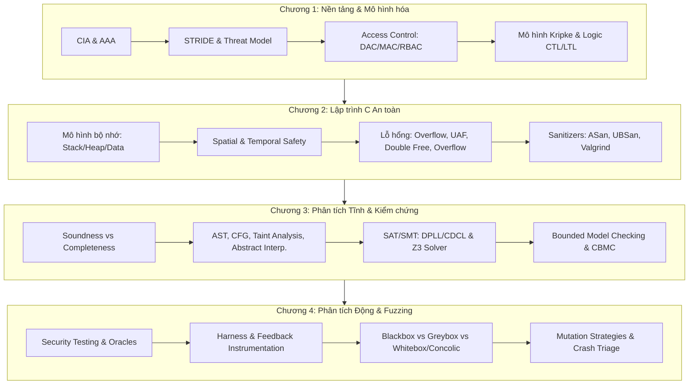
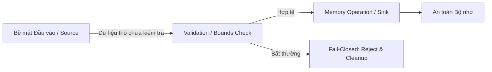
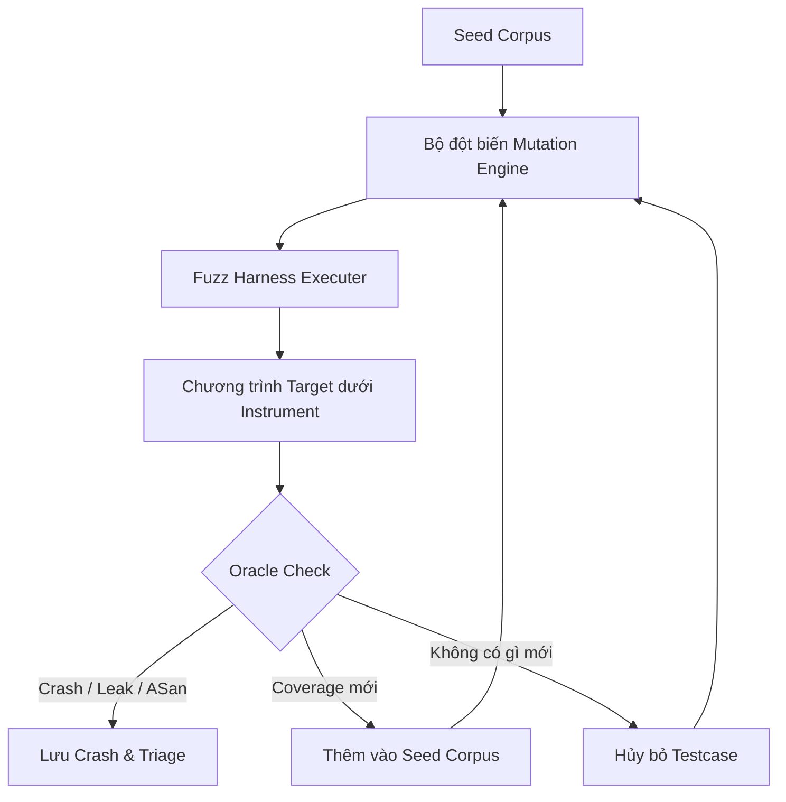
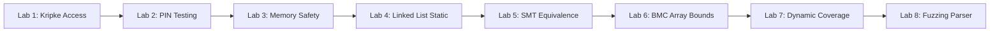
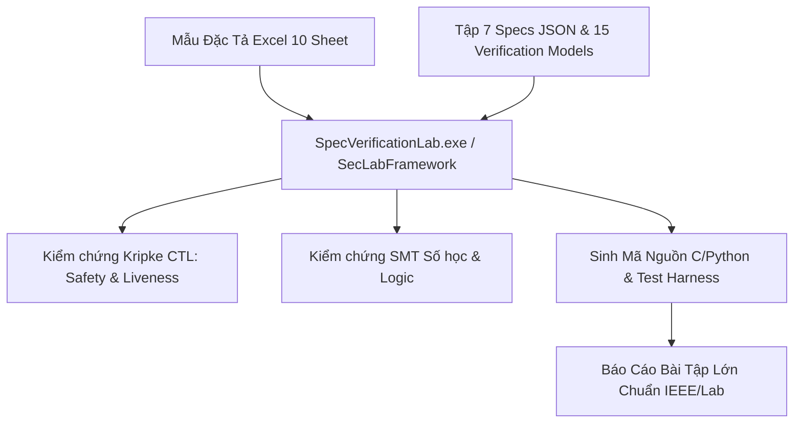

# BẢN PHÂN TÍCH TOÀN DIỆN HỌC PHẦN: AN TOÀN PHẦN MỀM (CSE703093)

Tài liệu này hệ thống hóa và phân tích chuyên sâu **toàn bộ tri thức, mã nguồn, tài liệu PDF, bộ đặc tả và hệ thống kiểm thử** trong thư mục `d:\Downloads\Safe Application`. Toàn bộ dữ liệu đã được đối chiếu chéo giữa giáo trình, slide bài giảng (Chương 1–4), 8 bài lab thực hành, hệ thống mô hình kiểm chứng hình thức, công cụ thực nghiệm và ngân hàng 1.257 câu hỏi trắc nghiệm.

---

## MỤC LỤC TỔNG QUAN

1. [Bản Đồ Kiến Trúc Hệ Thống & Cấu Trúc Thư Mục](#1-bản-đồ-kiến-trúc-hệ-thống--cấu-trúc-thư-mục)
2. [Trụ Cột Lý Thuyết Cốt Lõi (Chương 1 – Chương 4)](#2-trụ-cột-lý-thuyết-cốt-lõi-chương-1--chương-4)
   - [Chương 1: Nền tảng An toàn Phần mềm & Mô hình hóa](#chương-1-nền-tảng-an-toàn-phan-mềm--mô-hình-hóa)
   - [Chương 2: Lập trình C An toàn & Quản lý Bộ nhớ](#chương-2-lập-trình-c-an-toàn--quản-lý-bộ-nhớ)
   - [Chương 3: Phân tích Tĩnh & Kiểm chứng Hình thức (Formal Verification)](#chương-3-phân-tích-tĩnh--kiểm-chứng-hình-thức-formal-verification)
   - [Chương 4: Phân tích Động, Coverage & Fuzz Testing](#chương-4-phân-tích-động-coverage--fuzz-testing)
3. [Mổ Xẻ Chi Tiết Toàn Bộ 8 Bài Lab Thực Hành](#3-mổ-xẻ-chi-tiết-toàn-bộ-8-bài-lab-thực-hành)
   - [Lab 1: Kripke Access Model](#lab-1-mô-hình-hóa-kiểm-soát-truy-cập-với-cấu-trúc-kripke)
   - [Lab 2: PIN Validator Testing](#lab-2-kiểm-thử-hộp-đen--hộp-trắng-cho-bộ-xác-thực-mã-pin)
   - [Lab 3: Memory Safety & Risk Assessment](#lab-3-quản-lý-bộ-nhớ-an-toàn--đánh-giá-rủi-ro-lỗ-hổng)
   - [Lab 4: Linked List & Static Analysis Cppcheck](#lab-4-phân-tích-tĩnh-danh-sách-liên-kết-với-cppcheck)
   - [Lab 5: SAT/SMT Verification với Z3](#lab-5-chứng-minh-tương-đương-điều-kiện-bảo-mật-với-smt-z3)
   - [Lab 6: Bounded Model Checking cho Mảng C](#lab-6-bounded-model-checking-cho-truy-cập-mảng-bmc)
   - [Lab 7: Dynamic Coverage & Combinatorial Testing](#lab-7-phân-tích-độ-đo-coverage-động--kiểm-thử-tổ-hợp)
   - [Lab 8: Fuzzing Parser Lệnh](#lab-8-xây-dựng-cơ-chế-fuzzing-cho-bộ-phân-tích-lệnh-parser)
4. [Hệ Thống Đặc Tả (Specs), Mô Hình Hình Thức & Bài Tập Lớn (BTL)](#4-hệ-thống-đặc-tả-specs-mô-hình-hình-thức--bài-tập-lớn-btl)
5. [Hệ Thống Mã Nguồn Bổ Trợ: `softsec-toolkit` & `atpm_project`](#5-hệ-thống-mã-nguồn-bổ-trợ-softsec-toolkit--atpm_project)
6. [Cẩm Nang Ôn Luyện, Phương Pháp Giải Bài Tập & Danh Mục Đính Chính (Errata)](#6-cẩm-nang-ôn-luyện-phương-pháp-giải-bài-tập--danh-mục-đính-chính-errata)

---

## 1. BẢN ĐỒ KIẾN TRÚC HỆ THỐNG & CẤU TRÚC THƯ MỤC

Hệ thống tài liệu bao gồm **25 tệp PDF** (~1.095 trang), **84 tệp mã nguồn C/Python/Header**, **15 mô hình JSON kiểm chứng**, **7 tệp đặc tả hệ thống**, **1 mẫu bảng tính Excel 10 sheet**, **2 bộ công cụ thực thi** (`SpecVerificationLab.exe`, `SecLabFramework.exe`) và **1.257 câu hỏi trắc nghiệm**.

```
d:\Downloads\Safe Application\
├── [TÀI LIỆU LÝ THUYẾT & GIÁO TRÌNH]
│   ├── CSE703093_An_toan_phan_mem_Giao_trinh.pdf  (Giáo trình chuẩn, 137 trang)
│   ├── Chương0_Gioi_thieu_hoc_phan.pdf             (Cấu trúc & chuẩn đầu ra môn học)
│   ├── Chuong1_Phan1_ATPM.pdf & Chuong1_Phan2_ATPM.pdf (Slide lý thuyết Ch.1)
│   ├── Chuong2_Phan1_ATPM.pdf & Chuong2_Phan2_ATPM.pdf (Slide lý thuyết Ch.2)
│   ├── Chuong3_Phan1_ATPM.pdf & Chuong3_Phan2_ATPM.pdf (Slide lý thuyết Ch.3)
│   └── Chuong4_Phan1_ATPM.pdf & Chuong4_Phan2_ATPM.pdf (Slide lý thuyết Ch.4)
├── [BÀI TẬP LỚN & ĐẶC TẢ HỆ THỐNG]
│   ├── BTL_01_HuongDan_DeTai.pdf & BTL_02_HuongDan_BaoCao.pdf (Hướng dẫn BTL)
│   ├── Hướng dẫn tạo Spec file dạng excel.pdf (Quy chuẩn thiết kế 10 sheet Excel)
│   ├── Template_Software_Security_iot_gateway_spec.xlsx (Mẫu đặc tả gốc 10 sheet)
│   ├── Template_Report_iot_gateway_auth.docx (Mẫu báo cáo khoa học)
│   ├── specs/ (7 tệp đặc tả hệ thống dạng JSON: IoT, Auth, Session, Resource Pool...)
│   ├── verification/ (15 mô hình Kripke/Automaton kiểm chứng: Mutex, Deadlock, Livelock...)
│   └── SpecVerificationLab.exe (Ứng dụng nạp Spec Excel/JSON để kiểm chứng & sinh mã)
├── [BỘ 8 BÀI LAB THỰC HÀNH C/PYTHON]
│   ├── lab1_kripke_access_model/            (Lab 1: Kripke Model & Logic CTL cho Access Control)
│   ├── lab2_testing_verification/          (Lab 2: Black-box EP/BVA & White-box Line Coverage PIN)
│   ├── lab3_secure_memory/                 (Lab 3: Lỗ hổng bộ nhớ Heap/Stack & Chấm điểm CVSS)
│   ├── lab4_data_structures_static_analysis/(Lab 4: Linked List an toàn & Static Analysis Cppcheck)
│   ├── lab5_sat_smt_verification/          (Lab 5: SMT Z3 Solver chứng minh tương đương logic)
│   ├── lab6_bounded_model_checking/        (Lab 6: Bounded Model Checking cho truy cập mảng C)
│   ├── lab7_dynamic_coverage/              (Lab 7: Đo lường Coverage động & Kiểm thử tổ hợp)
│   └── lab8_fuzzing/                       (Lab 8: Xây dựng Fuzzer: Blackbox vs Coverage-guided)
├── [KHO THỰC NGHIỆM MỞ RỘNG]
│   ├── softsec-toolkit/                    (Bộ script chuyên sâu: Kripke, Memory, SMT, Concolic)
│   ├── atpm_project/                       (Dự án khung tích hợp đầy đủ kiểm thử PyTest)
│   └── Tong_hop_kien_thuc/                 (Hệ thống 15 văn bản tổng hợp tri thức & ngân hàng câu hỏi)
```

---

## 2. TRỤ CỘT LÝ THUYẾT CỐT LÕI (CHƯƠNG 1 – CHƯƠNG 4)



---

### CHƯƠNG 1: NỀN TẢNG AN TOÀN PHẦN MỀM & MÔ HÌNH HÓA

#### 1. Phân biệt Khái niệm Nền tảng
- **Security (Bảo mật):** Khả năng duy trì các thuộc tính an toàn trước sự tấn công chủ đích có trí tuệ của đối thủ (*adversary*).
- **Safety (An toàn vận hành):** Đảm bảo hệ thống không gây ra các thảm họa, thiệt hại vật lý hoặc tổn thất không thể chấp nhận được (ngay cả khi gặp lỗi ngẫu nhiên hoặc môi trường bất lợi).
- **Reliability (Độ tin cậy):** Khả năng hệ thống thực thi đúng chức năng trong điều kiện xác định suốt một khoảng thời gian dự kiến.

#### 2. Tam giác CIA & Mô hình AAA
- **Confidentiality (Bảo mật thông tin):** Chỉ chủ thể được ủy quyền mới được đọc thông tin.
- **Integrity (Toàn vẹn dữ liệu):** Dữ liệu và trạng thái chỉ được thay đổi thông qua cơ chế hợp lệ.
- **Availability (Tính sẵn sàng):** Dịch vụ luôn phản hồi người dùng hợp lệ kịp thời.
- **Mở rộng:** **Authenticity** (xác thực nguồn gốc), **Accountability** (trách nhiệm giải trình), **Non-repudiation** (chống chối bỏ hành vi).
- **AAA:** **Authentication** (Tôi là ai?) $\rightarrow$ **Authorization** (Tôi được làm gì trên tài nguyên cụ thể?) $\rightarrow$ **Accounting/Auditing** (Tôi đã làm gì vào thời điểm nào?).

#### 3. Chuỗi Tấn Công & Đánh Giá Rủi Ro
- Chuỗi quan hệ: $\text{Asset} \xrightarrow{\text{bị nhắm tới}} \text{Threat} \xrightarrow{\text{khai thác}} \text{Vulnerability} \xrightarrow{\text{thực thi qua}} \text{Exploit} \xrightarrow{\text{gây ra}} \text{Risk}$.
- **Công thức Rủi ro định tính:** $\text{Risk} = \text{Likelihood} \times \text{Impact}$.
- **Phân tích Rủi ro định lượng:**
  $$\text{SLE} = \text{Asset Value (AV)} \times \text{Exposure Factor (EF)}$$
  $$\text{ALE} = \text{SLE} \times \text{ARO (Annualized Rate of Occurrence)}$$
  *Ví dụ:* Máy chủ giá trị 500 triệu, một sự cố làm tổn thất 20% ($\text{EF} = 0,2 \Rightarrow \text{SLE} = 100 \text{ triệu}$). Trung bình xảy ra 2 lần/năm ($\text{ARO} = 2 \Rightarrow \text{ALE} = 200 \text{ triệu/năm}$). Nếu triển khai giải pháp WAF giá 80 triệu/năm giảm ARO xuống 0,2 lần/năm, tổn thất kỳ vọng mới là 20 triệu/năm $\rightarrow$ Lợi ích ròng = $(200 - 20) - 80 = 100 \text{ triệu/năm}$.

#### 4. Mô hình Hóa Đe Dọa (STRIDE) & Cây Tấn Công (Attack Tree)
- **STRIDE:** **S**poofing (Giả mạo) | **T**ampering (Sửa đổi) | **R**epudiation (Chối bỏ) | **I**nformation Disclosure (Lộ lọt thông tin) | **D**enial of Service (Từ chối dịch vụ) | **E**levation of Privilege (Leo thang đặc quyền).
- **Attack Tree:** Nút gốc là mục tiêu tấn công; các nút con phân nhánh theo toán tử **AND** (cần thực hiện tất cả các bước) hoặc **OR** (các phương thức thay thế).

#### 5. Mô hình Kiểm Soát Truy Cập
- **DAC (Discretionary Access Control):** Chủ sở hữu tài nguyên quyết định quyền truy cập.
- **MAC (Mandatory Access Control):** Hệ thống gán nhãn bảo mật tập trung cho chủ thể và đối tượng.
  - **Bell-LaPadula (Bảo vệ bí mật):** *"No Read Up, No Write Down"* (Không đọc tài liệu cấp cao hơn, không ghi xuống tài liệu cấp thấp hơn).
  - **Biba (Bảo vệ tính toàn vẹn):** *"No Read Down, No Write Up"* (Không đọc từ nguồn kém tin cậy, không ghi làm bẩn nguồn tin cậy cao hơn).
- **RBAC (Role-Based Access Control):** Quyền được gán theo Vai trò (Role); người dùng nhận vai trò tương ứng.

#### 6. Mô hình Hình Thức: Cấu Trúc Kripke & Logic Thời Gian CTL
- **Cấu trúc Kripke:** Bộ 4 thành phần $M = (S, S_0, R, L)$:
  - $S$: Tập trạng thái hữu hạn.
  - $S_0 \subseteq S$: Tập trạng thái khởi tạo.
  - $R \subseteq S \times S$: Quan hệ chuyển trạng thái (bắt buộc phải là quan hệ *total*: $\forall s \in S, \exists s': (s, s') \in R$).
  - $L: S \rightarrow 2^{AP}$: Hàm gắn nhãn các mệnh đề nguyên tử ($AP$).
- **Computation Tree Logic (CTL):**
  - Định lượng đường đi: **A** (*All paths* - Mọi đường đi), **E** (*Exists path* - Tồn tại đường đi).
  - Toán tử thời gian: **X** (*neXt* - Trạng thái kế tiếp), **F** (*Future* - Tương lai đạt tới), **G** (*Globally* - Luôn luôn duy trì), **U** (*Until* - Điều kiện thỏa mãn cho đến khi), **W** (*Weak until*).
  - **Safety Property:** $AG(\neg \text{bad})$ (Không bao giờ rơi vào trạng thái nguy hiểm).
  - **Liveness / Progress Property:** $AF(\text{good})$ hoặc $AG(req \rightarrow AF(ack))$ (Mọi yêu cầu gửi đi cuối cùng đều sẽ nhận được phản hồi).
  - **Reachability:** $EF(\text{target})$ (Tồn tại kịch bản dẫn đến đích).
  - **Cạm bẫy Vacuous Truth (Chân lý rỗng):** Công thức $AG(p \rightarrow q)$ sẽ luôn đúng nếu $p$ không bao giờ xảy ra trên bất kỳ trạng thái nào đạt tới được ($p = \text{False} \Rightarrow \text{False} \rightarrow q \equiv \text{True}$). Cần bổ sung kiểm tra $EF(p)$ để tránh ngộ nhận.

---

### CHƯƠNG 2: LẬP TRÌNH C AN TOÀN & QUẢN LÝ BỘ NHỚ



#### 1. Mô hình Bộ nhớ Tiến trình C
- **Text/Code Segment:** Chứa mã máy nhị phân, chỉ đọc (Read-only).
- **Data Segment:** Biến toàn cục / tĩnh đã khởi tạo giá trị khác 0.
- **BSS Segment:** Biến toàn cục / tĩnh chưa khởi tạo (được hệ điều hành zero-init).
- **Heap Segment:** Cấp phát động qua `malloc`, `calloc`, `realloc`. Tăng trưởng từ địa chỉ thấp lên cao (trên kiến trúc phổ biến).
- **Stack Segment:** Biến cục bộ, địa chỉ trả về (Return Address), Frame Pointer. Tăng trưởng từ địa chỉ cao xuống thấp.

#### 2. Spatial Safety vs Temporal Safety
- **Spatial Safety (An toàn không gian):** Mọi thao tác đọc/ghi con trỏ chỉ được diễn ra trong phạm vi kích thước của object được cấp phát: $0 \le \text{offset} < \text{size}$.
- **Temporal Safety (An toàn thời gian):** Chỉ thao tác với object khi nó còn trong vòng đời hợp lệ (chưa bị giải phóng bởi `free`).

#### 3. Bảng Phân Tích Toàn Bộ Các Lỗ Hổng Bộ Nhớ C Điển Hình

| Lỗ hổng | Mã CWE | Cơ chế phát sinh mã nguồn | Hậu quả bảo mật | Giải pháp phòng vệ chuẩn |
| :--- | :---: | :--- | :--- | :--- |
| **Stack Buffer Overflow** | **CWE-121** | Ghi vượt kích thước mảng cục bộ trên Stack (ví dụ: `strcpy`, `gets`, `sprintf`). | Ghi đè Saved EIP/RIP, chiếm quyền điều khiển luồng thực thi (RCE). | Dùng `snprintf`, bounds checking, bật Stack Canaries (`-fstack-protector`). |
| **Heap Buffer Overflow** | **CWE-122** | Ghi vượt kích thước vùng nhớ được cấp phát bởi `malloc(size)`. | Phá vỡ metadata của Heap (glibc chunks), ghi đè function pointers. | Tính toán kích thước chính xác, kiểm tra độ dài trước khi copy. |
| **Buffer Over-read** | **CWE-125 / CWE-126** | Đọc vượt quá độ dài dữ liệu hợp lệ (Điển hình: **Heartbleed CVE-2014-0160**). | Rò rỉ thông tin bộ nhớ riêng tư (private keys, tokens, session ID). | Kiểm tra độ dài payload thực tế khớp với trường length khai báo. |
| **Use-After-Free (UAF)** | **CWE-416** | Sử dụng con trỏ trỏ tới vùng nhớ Heap đã bị `free()`. Con trỏ trở thành *Dangling Pointer*. | Attacker phun dữ liệu (Heap Spraying) vào vùng nhớ cũ để điều hướng vtable/hàm. | Gán con trỏ bằng `NULL` ngay sau khi `free(p)`, quản lý ownership rõ ràng. |
| **Double Free** | **CWE-415** | Gọi `free()` hai lần trên cùng một địa chỉ con trỏ mà không có cấp phát mới xen kẽ. | Phá hỏng danh sách quản lý Heap (fastbin dup), tạo điều kiện cho UAF/RCE. | Gán `p = NULL` sau khi giải phóng (`free(NULL)` là an toàn không làm gì). |
| **Memory Leak** | **CWE-401** | Cấp phát vùng nhớ động nhưng mất toàn bộ con trỏ trỏ tới đó mà không giải phóng. | Tiêu hao kiệt quệ tài nguyên RAM, gây treo máy hoặc Từ chối dịch vụ (DoS). | Quy tắc RAII, bảo đảm giải phóng trên mọi đường dẫn rẽ nhánh (error paths). |
| **Uninitialized Variable** | **CWE-457** | Đọc dữ liệu từ biến cục bộ hoặc vùng `malloc` trước khi gán giá trị khởi tạo. | Rò rỉ dữ liệu cũ trên Stack/Heap, rẽ nhánh logic không đoán trước. | Khởi tạo biến ngay khi khai báo; dùng `calloc` nếu cần zero-memory. |
| **Integer Overflow / Wraparound** | **CWE-190** | Tính toán vượt ngưỡng tối đa của kiểu số (ví dụ: `size_t`, `int32_t`). Signed overflow là **UB**. | Tràn số thành giá trị nhỏ, cấp phát bộ đệm quá nhỏ dẫn đến Buffer Overflow tiếp theo. | Kiểm tra phép nhân: `if (count > SIZE_MAX / elem_size) return ERROR;`. |
| **Off-By-One** | **CWE-193** | Dùng điều kiện vòng lặp `<=` thay vì `<`, quên tính 1 byte kết thúc chuỗi `\0` (NUL). | Ghi đè 1 byte (Null-byte poison hoặc ghi đè LSB của Saved EBP). | Luôn cộng thêm 1 byte cho NUL terminator trong chuỗi ký tự C. |
| **Struct Alignment & Padding Leaks** | **CWE-200** | Cấu trúc dữ liệu có padding bytes do căn lề phần cứng (alignment). | Lộ dữ liệu rác trên Stack/Heap khi gọi `fwrite(&struct_var, ...)`. | Dùng `memset` xóa toàn bộ struct trước khi gán trường; serialize từng trường. |

#### 4. Các Công Cụ Kiểm Tra Động (Sanitizers)
- **AddressSanitizer (ASan - `-fsanitize=address`):** Đặt các vùng *Redzone* bao quanh các biến Stack/Heap và dùng *Shadow Memory* để phát hiện tức thì lỗi tràn biên (OOB), UAF, Double Free với overhead hiệu năng chỉ ~2x.
- **UndefinedBehaviorSanitizer (UBSan - `-fsanitize=undefined`):** Phát hiện tràn số nguyên có dấu (Signed Integer Overflow), dịch bit vượt phạm vi, chia cho 0, con trỏ NULL dereference.
- **LeakSanitizer (LSan - `-fsanitize=leak`):** Quét đồ thị con trỏ khi tiến trình kết thúc để phát hiện thất thoát bộ nhớ Heap.
- **Valgrind Memcheck:** Máy ảo mô phỏng CPU và theo dõi từng byte bộ nhớ; không cần biên dịch lại mã nguồn nhưng làm chậm ứng dụng 10x–30x.

---

### CHƯƠNG 3: PHÂN TÍCH TĨNH & KIỂM CHỨNG HÌNH THỨC (FORMAL VERIFICATION)

#### 1. Cơ Sở Lý Thuyết Về Khả Năng Tính Toán
- **Định lý Rice:** Bất kỳ thuộc tính ngữ nghĩa không tầm thường nào của một chương trình tổng quát (Turing-complete) đều là **không thể quyết định (Undecidable)**.
- **Đánh đổi cốt lõi giữa Soundness và Completeness:**

| Thuộc tính | Định nghĩa theo kiểm chứng Bug-Finding | Đặc điểm | Phương pháp tương ứng |
| :--- | :--- | :--- | :--- |
| **Soundness** | **Không bỏ sót lỗi thực tế** (*No False Negatives* - $B \subseteq A$). | Nếu công cụ báo an toàn $\rightarrow$ Hệ thống chắc chắn không có lỗi trong phạm vi. | **Over-approximation** (Xấp xỉ trên), Abstract Interpretation. Có thể sinh ra *False Positives* (cảnh báo giả). |
| **Completeness** | **Mọi cảnh báo đều là lỗi thật** (*No False Positives* - $A \subseteq B$). | Nếu công cụ báo có lỗi $\rightarrow$ Lỗi đó chắc chắn tái hiện được trên thực tế. | **Under-approximation** (Xấp xỉ dưới), Fuzzing, Testing, Symbolic Execution đường cụ thể. |

#### 2. Các Cấp Độ Phân Tích Tĩnh
- **AST (Abstract Syntax Tree):** Duyệt cây cú pháp để tìm kiếm các hàm nguy hiểm (`gets`, `strcpy`).
- **CFG (Control Flow Graph):** Đồ thị luồng điều khiển thể hiện các khối cơ bản (Basic Blocks) và các cạnh rẽ nhánh.
- **Taint Analysis (Phân tích lan truyền vết bẩn):** Theo dõi luồng dữ liệu từ nguồn không tin cậy (**Source**) $\rightarrow$ qua các thao tác truyền dẫn (**Propagation**) $\rightarrow$ đến hàm xử lý nhạy cảm (**Sink**). Nếu dữ liệu chưa đi qua bộ lọc (**Sanitizer**), cảnh báo lỗ hổng injection/overflow.
- **Abstract Interpretation:** Thay thế giá trị cụ thể bằng các miền trừu tượng (Interval domain: $x \in [a, b]$). Sử dụng phép toán **Join** ($\sqcup$), **Widening** ($\nabla$) để làm hội tụ vòng lặp và **Narrowing** ($\Delta$) để tinh chỉnh độ chính xác.

#### 3. SAT Solver & Giải Thuật DPLL / CDCL
- **SAT (Boolean Satisfiability Problem):** Tìm phép gán chân trị cho các biến Boolean để biểu thức logic dạng CNF (Conjunctive Normal Form - Hội của các Tuyển) có giá trị `True`.
- **Giải thuật DPLL (1962):**
  1. *Unit Propagation:* Nếu mệnh đề chỉ còn 1 literal chưa gán, bắt buộc gán literal đó = `True`.
  2. *Pure Literal Elimination:* Nếu biến chỉ xuất hiện ở một cực (chỉ khẳng định hoặc chỉ phủ định), gán để làm đúng mệnh đề.
  3. *Backtracking Search:* Thử rẽ nhánh và quay lui khi gặp mâu thuẫn.
- **Giải thuật CDCL (Conflict-Driven Clause Learning):**
  - Khi gặp mâu thuẫn (Conflict), phân tích đồ thị suy diễn (**Implication Graph**) để học mệnh đề mới (**Learned Clause**).
  - Nhảy lùi phi tuần tự (**Non-chronological Backjumping**) vượt qua nhiều tầng quyết định.
  - Sử dụng cấu trúc **2-Watched Literals** để theo dõi unit propagation cực nhanh.

#### 4. SMT Solver (Z3) & Chứng Minh Tương Đương Logic
- **SMT (Satisfiability Modulo Theories):** Tích hợp SAT solver với các bộ giải lý thuyết bậc nhất chuyên biệt:
  - $\mathcal{T}_{\text{LIA}}$ (Số nguyên tuyến tính), $\mathcal{T}_{\text{BV}}$ (Bit-vectors 8/16/32/64 bit mô phỏng tràn số máy tính), $\mathcal{T}_{\text{A}}$ (Mảng / Bộ nhớ), $\mathcal{T}_{\text{EUF}}$ (Hàm không diễn giải).
- **Phương pháp kiểm tra tương đương 2 điều kiện bảo mật:**
  Để chứng minh điều kiện cũ $P$ và điều kiện mới $Q$ hoàn toàn tương đương trên miền đầu vào $D$, ta thiết lập công thức XOR:
  $$\Phi_{\text{equiv}} = D \land (P \oplus Q)$$
  - **UNSAT:** Không tồn tại bất kỳ input nào làm $P$ và $Q$ khác giá trị $\Rightarrow$ **Hai điều kiện tương đương tuyệt đối**.
  - **SAT:** Solver trả về **Model** chính là **Phản ví dụ (Counterexample)** chỉ ra input cụ thể mà tại đó $P \neq Q$.
  - **UNKNOWN:** Vượt quá thời gian/bộ nhớ hoặc ngoài khả năng quyết định của lý thuyết.

#### 5. Bounded Model Checking (BMC) & K-Induction
- Mở rộng (*unroll*) đồ thị trạng thái hoặc vòng lặp của chương trình đến độ sâu $k$ bước:
  $$\Phi_{\text{BMC}} = I(s_0) \land \bigwedge_{i=0}^{k-1} T(s_i, s_{i+1}) \land \bigvee_{i=0}^k \neg P(s_i)$$
  Nếu công thức là **SAT**, Solver xuất ra chuỗi trạng thái từ $s_0 \rightarrow s_k$ vi phạm thuộc tính $P$ (Witness/Counterexample). Nếu **UNSAT**, ta chỉ kết luận chương trình an toàn trong phạm vi $k$ bước đầu tiên.
- **K-Induction:** Kỹ thuật toán học dùng để chứng minh an toàn cho mọi bước vô hạn:
  - *Base case:* Chứng minh $P$ đúng từ bước 0 đến $k-1$.
  - *Inductive step:* Chứng minh nếu $P$ đúng liên tục $k$ bước liên tiếp bất kỳ, thì bước thứ $k+1$ cũng bắt buộc phải đúng.
- **CBMC (C Bounded Model Checker):** Công cụ dịch mã nguồn C sang biểu thức SMT để kiểm tra tràn mảng, NULL pointer, assertion trong giới hạn unroll loops.

---

### CHƯƠNG 4: PHÂN TÍCH ĐỘNG, COVERAGE & FUZZ TESTING



#### 1. Security Testing & Hệ Thống Test Oracles
Security testing tìm kiếm sự vi phạm các thuộc tính bảo mật với input bất thường. Các Oracle phát hiện lỗi gồm:
- **Crash Oracle:** Tiến trình nhận tín hiệu chết (`SIGSEGV`, `SIGABRT`).
- **Sanitizer Oracle:** ASan/UBSan phát hiện OOB/UAF/UB ngay cả khi chương trình chưa bị crash.
- **Differential Oracle:** Gửi cùng một input vào 2 bộ parser khác nhau (ví dụ: OpenSSL vs LibreSSL), nếu kết quả sai khác $\rightarrow$ có lỗi logic.
- **Metamorphic Oracle:** Kiểm tra mối quan hệ bất biến giữa các lần chạy với input bị biến đổi theo quy luật.

#### 2. Fuzz Harness
Hàm cầu nối chuyển byte ngẫu nhiên từ fuzzer vào API mục tiêu:
```c
int LLVMFuzzerTestOneInput(const uint8_t *Data, size_t Size) {
    if (Size < 4) return 0; // Tránh xử lý kích thước vô nghĩa
    parse_packet(Data, Size);
    return 0;
}
```
*Yêu cầu bắt buộc:* Harness phải chạy trong tiến trình tốc độ cao (hàng nghìn exec/s), không bị rò rỉ tài nguyên giữa các lần gọi, và phải có tính xác định (deterministic).

#### 3. Ba Trường Phái Fuzzing Cốt Lõi

| Tiêu chí | Black-box Fuzzing | Grey-box Fuzzing (Coverage-Guided) | White-box Fuzzing (Concolic Execution) |
| :--- | :--- | :--- | :--- |
| **Thông tin nội bộ** | Không có thông tin cấu trúc mã hay luồng chạy. | Thu thập phản hồi nhẹ: Bitmap cạnh rẽ nhánh (Edge coverage). | Đọc mã nguồn / mã máy, xây dựng công thức logic ràng buộc. |
| **Cơ chế chính** | Đột biến ngẫu nhiên hoặc dựa trên định dạng (Grammar). | Giữ lại các input khám phá ra Basic Block / Transition mới. | Chạy chương trình kết hợp thu thập Path Constraints, đảo ngược nhánh bằng SMT Z3. |
| **Tốc độ thực thi** | Cực nhanh ($10.000+$ exec/s). | Rất nhanh ($1.000 - 5.000+$ exec/s). | Chậm (vài chục đến vài trăm exec/s) do chi phí giải SMT. |
| **Khả năng qua Magic Bytes** | Rất thấp (xác suất $256^{-m}$ với chuỗi $m$ bytes). | Khó khăn nếu thiếu Dictionary hoặc CmpLog. | Rất mạnh: SMT Solver giải chính xác giá trị magic string/constant. |
| **Công cụ tiêu biểu** | Radamsa, zzuf. | AFL, AFL++, libFuzzer. | KLEE, SAGE, Triton, angr. |

#### 4. Kỹ Thuật Đột Biến (Mutation) & Vượt Rào Cản
- **Toán tử Đột biến:** Bit-flip (đảo bit), Byte replacement (thay byte), Block deletion (xóa khối), Block insertion (chèn khối), Dictionary token injection (chèn từ khóa cú pháp).
- **Vấn đề Magic Bytes:** Khi gặp điều kiện `if (header == 0x53454355) // "SECU"`, xác suất fuzzer đen đột biến đúng 4 byte là $\frac{1}{256^4} \approx 2.3 \times 10^{-10}$.
- **Giải pháp:** Sử dụng **Dictionary** (từ điển), hoặc **CmpLog / Comparison Tracing** (theo dõi đối số trong lệnh so sánh `cmp` để tự động nhét giá trị mong đợi vào bộ đột biến).

#### 5. Crash Triage, Deduplication & Minimization
- **Deduplication:** Hàng nghìn crash có thể bắt nguồn từ cùng một bug. Gom nhóm crash dựa trên **Stack Backtrace Hash** (thường lấy 3 frame trên cùng của Call Stack khi ASan báo lỗi).
- **Testcase Minimization:** Rút ngắn kích thước input gây crash đến mức tối thiểu mà vẫn kích hoạt đúng lỗi tại dòng lệnh đó (giúp kỹ sư debug dễ dàng).

---

## 3. MỔ XẺ CHI TIẾT TOÀN BỘ 8 BÀI LAB THỰC HÀNH



---

### LAB 1: MÔ HÌNH HÓA KIỂM SOÁT TRUY CẬP VỚI CẤU TRÚC KRIPKE
* **Thư mục:** `lab1_kripke_access_model/lab1_kripke_access_model/`
* **Tệp chính:** `python/kripke_model.py`, `c/access_simulator.c`, `dataset/access_system_model.json`, `dataset/access_system_model_BUGGY.json`

```
        insert_card            verify_pin
[S0: IDLE] -------> [S1: CARD_IN] -------> [S2: UNLOCKED]
    ^                     |                        |
    | timeout_glitch      |                        | auto_lock
    | (Bản BUGGY)         v                        v
    +---------------- [S5: GLITCH]           [S3: LOCKED]
                          ^                        |
                          | (unlocked)             |
                          +------------------------+
```

* **Mục tiêu & Cơ chế:**
  - Xây dựng lớp `KripkeModel` biểu diễn đồ thị chuyển trạng thái và nhãn nguyên tử.
  - Kiểm tra 3 thuộc tính CTL bằng thuật toán duyệt đồ thị BFS:
    1. **P1 (Safety):** `AG !(unlocked AND !authenticated)` — Cửa không bao giờ mở khi chưa xác thực.
    2. **P2 (Safety/Invariant):** `AG (tamper -> alarm)` — Mọi trạng thái bị can thiệp vật lý đều phải kích hoạt còi báo động.
    3. **P3 (Reachability/Liveness):** `EF (unlocked)` — Hệ thống có thể đạt tới trạng thái mở khóa.
* **Chi tiết Lỗi (Buggy vs Safe):**
  - Trong bản **SAFE**: Quá trình xác thực tuân thủ tuần tự $S_0 \rightarrow S_1 \rightarrow S_2$. Cả P1, P2, P3 đều đạt.
  - Trong bản **BUGGY**: Tồn tại chuyển tiếp bất thường `timeout_glitch` từ $S_1 \rightarrow $S_5$, tại $S_5$ có nhãn `unlocked` nhưng không có nhãn `authenticated`.
* **Kết quả Kiểm chứng:**
  - P1 bị **VI PHẠM (FAIL)** trên bản BUGGY. Trace phản ví dụ tìm được qua BFS: $S_0 \xrightarrow{\text{insert\_card}} S_1 \xrightarrow{\text{timeout\_glitch}} S_5$.
  - P3 **PASS** (Witness: $S_0 \rightarrow S_1 \rightarrow S_2$).
  - **Điểm bẫy (Gotcha) tại P2:** Trên bản BUGGY, P2 vẫn trả về **PASS**! Lý do: sự kiện `tamper_sensor` bị trỏ ngược về $S_0$ mà không tới trạng thái $S_4$ (nơi mang nhãn `tamper`). Trạng thái $S_4$ trở thành **Unreachable**, dẫn đến tiền đề `tamper` luôn `False` $\Rightarrow$ **Vacuous Truth**. Cần thêm kiểm thử `EF(tamper)` để phát hiện lỗ hổng ẩn này.

---

### LAB 2: KIỂM THỬ HỘP ĐEN & HỘP TRẮNG CHO BỘ XÁC THỰC MÃ PIN
* **Thư mục:** `lab2_testing_verification/lab2_testing_verification/`
* **Tệp chính:** `c/pin_validator.c`, `python/black_box_tester.py`, `python/white_box_coverage.py`
* **Mục tiêu & Cơ chế:**
  - Hàm C `validate_pin(const char* pin, int failed_attempts)` kiểm tra mã PIN 6 số với các mã lỗi có thứ tự ưu tiên:
    1. Kiểm tra NULL $\rightarrow$ `NULL_INPUT` (1).
    2. Kiểm tra số lần sai $\ge 3$ $\rightarrow$ `ACCOUNT_LOCKED` (2).
    3. Kiểm tra độ dài khác 6 $\rightarrow$ `WRONG_LENGTH` (3).
    4. Kiểm tra chứa ký tự không phải số $\rightarrow$ `NON_DIGIT` (4).
    5. Kiểm tra chuỗi số liên tiếp tăng/giảm (`123456`, `654321`) $\rightarrow$ `SEQUENTIAL_WEAK` (5).
    6. Hợp lệ $\rightarrow$ `VALID` (0).
* **Kiểm thử Hộp đen (Black-box):**
  - Áp dụng phân vùng tương đương (**Equivalence Partitioning - EP**) và phân tích giá trị biên (**Boundary Value Analysis - BVA**):
  - Kiểm tra độ dài: chuỗi 5 ký tự (`48291`), 6 ký tự (`482913`), 7 ký tự (`4829137`).
  - Kiểm tra failed_attempts tại biên: 2 lần (chưa khóa) và 3 lần (bị khóa).
* **Kiểm thử Hộp trắng & Đo Coverage:**
  - Biên dịch bằng `gcc -fprofile-arcs -ftest-coverage`, phân tích báo cáo `gcov`.
  - **Điểm bẫy (Gotcha):** Hàm `compute_branch_coverage()` trong mã nguồn thực tế chỉ đếm tỷ lệ **dòng mã thực thi (Line Coverage)** đạt 90%, chứ chưa bóc tách bản ghi nhánh quyết định (*Branch Coverage* thực sự của gcov). Nếu có short-circuit evaluation trong biểu thức điều kiện, Line Coverage cao không bảo đảm mọi nhánh rẽ đều đã được chạy.

---

### LAB 3: QUẢN LÝ BỘ NHỚ AN TOÀN & ĐÁNH GIÁ RỦI RO LỖ HỔNG
* **Thư mục:** `lab3_secure_memory/lab3_secure_memory/`
* **Tệp chính:** `c/vulnerable_inventory.c`, `c/secure_inventory.c`, `python/risk_assessor.py`, `dataset/vulnerabilities.json`
* **Mục tiêu & Cơ chế:**
  - Mô phỏng 4 lỗi bộ nhớ điển hình trong quản lý kho sách:
    1. **VULN-001:** Tràn bộ đệm Heap (`add_book_title_UNSAFE_HEAP` dùng `malloc(32)` nhưng `strcpy` chuỗi 39 bytes).
    2. **VULN-002:** Use-After-Free (`demo_use_after_free` gọi `free(b)` rồi đọc trường `b->year`).
    3. **VULN-003:** Thất thoát bộ nhớ Heap (`demo_memory_leak` cấp phát danh sách struct `Book` nhưng không gọi `free`).
    4. **VULN-004:** Tràn mảng tĩnh cục bộ (`title[32]` bị copy đè).
* **Đánh giá Rủi ro (CVSS-like Scoring):**
  - Script Python tính toán điểm số dựa trên chỉ số Exploitability và Impact:
    - **VULN-001 (Heap Overflow):** 9.8 điểm $\rightarrow$ **CRITICAL**
    - **VULN-002 (Use-After-Free):** 6.9 điểm $\rightarrow$ **MEDIUM**
    - **VULN-003 (Memory Leak):** 5.4 điểm $\rightarrow$ **MEDIUM**
    - **VULN-004 (Buffer Overflow):** 2.5 điểm $\rightarrow$ **LOW**
* **Điểm bẫy (Gotcha):**
  - Tệp cấu hình gốc gắn nhãn VULN-001 là `CWE-121` (Stack Overflow), nhưng mã nguồn thực tế cấp phát bằng `malloc` trên Heap $\rightarrow$ Chuẩn xác phải là **CWE-122** (Heap-based Buffer Overflow).
  - Thuật toán tính điểm của script dùng phép làm tròn `round(..., 1)` của Python thay vì hàm `Roundup()` của chuẩn **CVSS v3.1**, và bỏ qua xử lý Scope đổi bậc. Do đó đây là điểm số mô phỏng phục vụ học tập, không dùng thay thế CVSS Base Score chính thức.

---

### LAB 4: PHÂN TÍCH TĨNH DANH SÁCH LIÊN KẾT VỚI CPPCHECK
* **Thư mục:** `lab4_data_structures_static_analysis/lab4_data_structures_static_analysis/`
* **Tệp chính:** `c/booklist_v1_buggy.c`, `c/booklist_v2_fixed.c`, `python/static_analysis_runner.py`
* **Mục tiêu & Cơ chế:**
  - Tự động hóa gọi công cụ phân tích tĩnh `cppcheck --enable=all --xml`, phân tích tệp XML xuất ra để phân loại cảnh báo.
  - So sánh mã nguồn trước và sau khi tối ưu hóa an toàn.
* **Chi tiết Lỗi được Cài Cắm:**
  - `list_count_UNSAFE()`: Biến đếm `int count;` không được khởi tạo giá trị ban đầu (`0`) trước vòng lặp duyệt `while` $\rightarrow$ Đọc rác trên Stack (**CWE-457: Uninitialized Variable**).
  - `list_insert_front()`: Không kiểm tra con trỏ trả về từ `malloc()` có bằng `NULL` hay không trước khi gán dữ liệu.
  - `list_remove_by_title()`: Gỡ node ra khỏi liên kết (`prev->next = curr->next`) nhưng bỏ quên lệnh `free(curr)` $\rightarrow$ **Memory Leak (CWE-401)**.
* **Kết quả Phân tích Tĩnh:**
  - Bản **Buggy**: Cppcheck bắt được cảnh báo `uninitvar`, `uninitdata`, `unassignedVariable`.
  - Bản **Fixed**: Khởi tạo biến `count = 0;`, kiểm tra `malloc == NULL`, giải phóng đúng node bị xóa $\rightarrow$ **0 finding lỗi nghiêm trọng**.
  - **Điểm bẫy (Gotcha):** Phân tích cú pháp tĩnh không thể bắt hết mọi lỗi rò rỉ bộ nhớ trên các luồng rẽ nhánh phức tạp. Bản Fixed dù vượt qua kiểm tra của Cppcheck vẫn cần kiểm thử động với ASan/Valgrind để chứng minh an toàn tuyệt đối.

---

### LAB 5: CHỨNG MINH TƯƠNG ĐƯƠNG ĐIỀU KIỆN BẢO MẬT VỚI SMT (Z3)
* **Thư mục:** `lab5_sat_smt_verification/lab5_sat_smt_verification/`
* **Tệp chính:** `python/smt_equivalence_checker.py`, `c/brute_force_checker.c`, `dataset/condition_pairs.json`
* **Mục tiêu & Cơ chế:**
  - Sử dụng Z3 Solver để kiểm tra tính tương đương ngữ nghĩa của 6 cặp điều kiện bảo mật thông qua công thức phủ định tương đương: $\Phi = P \oplus Q$.
* **Bảng Kết quả Phân tích 6 Cặp Điều Kiện:**

| Mã | Biểu thức P | Biểu thức Q | Kết quả SMT | Phân tích & Phản ví dụ (Model) |
| :---: | :--- | :--- | :---: | :--- |
| **COND-01** | `!(is_locked \|\| alarm_active)` | `!is_locked && !alarm_active` | **EQUIVALENT (UNSAT)** | Đúng theo luật De Morgan trong logic mệnh đề. |
| **COND-02** | `failed_attempts >= 3` | `failed_attempts > 3` | **NOT EQUIVALENT (SAT)** | **Counterexample:** `failed_attempts = 3`. Tại giá trị này $P = \text{True}$ (khóa tài khoản) nhưng $Q = \text{False}$ (chưa khóa) $\rightarrow$ Sai sót bảo mật nghiêm trọng. |
| **COND-03** | `auth && valid_token && !expired` | `!expired && auth && valid_token` | **EQUIVALENT (UNSAT)** | Tính giao hoán và kết hợp của toán tử AND logic. |
| **COND-04** | `!tamper \|\| alarm` | `!tamper \|\| (alarm && tamper)` | **EQUIVALENT (UNSAT)** | Biến đổi tương đương đại số Boolean. |
| **COND-05** | `authenticated` | `authenticated \|\| (is_admin && bypass_flag)` | **NOT EQUIVALENT (SAT)** | **Counterexample:** `authenticated = False, is_admin = True, bypass_flag = True`. Xuất hiện cửa sau (Backdoor/Bypass logic) cho admin chưa xác thực. |
| **COND-06** | `borrowed <= max_limit` | `!(borrowed > max_limit)` | **EQUIVALENT (UNSAT)** | Tính tương đương trên miền số nguyên toán học của lý thuyết $\mathcal{T}_{\text{LIA}}$. |

---

### LAB 6: BOUNDED MODEL CHECKING CHO TRUY CẬP MẢNG (BMC)
* **Thư mục:** `lab6_bounded_model_checking/lab6_bounded_model_checking/`
* **Tệp chính:** `python/bmc_engine.py`, `c/array_access.c`, `dataset/bmc_programs.json`
* **Mục tiêu & Cơ chế:**
  - Xây dựng mô hình Z3 để kiểm chứng tính an toàn của thao tác truy cập mảng có kích thước cố định $N = 10$ (`catalog[10]`).
  - Chỉ số truy cập được tính theo công thức: $\text{index} = \text{base} + i$, với $i$ chạy từ $0$ đến $\text{unwind\_bound} - 1$.
  - Thuộc tính an toàn cần kiểm tra: $0 \le \text{index} < N$. Bộ giải tìm kiếm vi phạm bằng cách giải: $\bigvee_{i} (\text{index}_i < 0 \lor \text{index}_i \ge N)$.
* **Bảng Phân Tích 4 Trường Hợp Thí Nghiệm:**

| Kịch bản | Thiết lập mô hình | Kết quả BMC | Ý nghĩa & Bằng chứng |
| :--- | :--- | :---: | :--- |
| **BMC-01** | Full scan chuẩn: `base = 0`, bound = 10. | **SAFE** | Mọi chỉ số $i \in [0, 9]$ đều thỏa mãn $0 \le i < 10$. |
| **BMC-02** | Lỗi kinh điển Off-By-One: bound = 11 (vòng lặp duyệt $i \le N$). | **UNSAFE** | Solver tìm thấy vi phạm tại bước $i = 10 \rightarrow \text{index} = 10 \ge 10$. |
| **BMC-03** | Chỉ số cơ sở ký hiệu: `symbolic base`, bound = 2. | **UNSAFE** | **Counterexample:** `base = 9, i = 1` $\rightarrow \text{index} = 10$ vượt biên mảng. |
| **BMC-04** | Kiểm tra biên điều kiện tiên quyết: tiền đề $0 \le \text{base} \le 5$, bound = 5. | **SAFE** | Chỉ số lớn nhất có thể đạt được là $5 + 4 = 9 < 10$. An toàn tuyệt đối. |

* **Bài học:** Kiểm tra điều kiện `base < 10` là chưa đủ nếu bên trong vòng lặp còn cộng thêm độ lệch (offset). Cần ràng buộc chuẩn xác: $\text{base} \le N - \text{bound}$.

---

### LAB 7: PHÂN TÍCH ĐỘ ĐO COVERAGE ĐỘNG & KIỂM THỬ TỔ HỢP
* **Thư mục:** `lab7_dynamic_coverage/lab7_dynamic_coverage/`
* **Tệp chính:** `c/order_processor.c`, `python/coverage_runner.py`, `python/test_case_generator.py`
* **Mục tiêu & Cơ chế:**
  - Đánh giá chất lượng của bộ kiểm thử đối với module định giá đơn hàng phức tạp có nhiều nhánh rẽ:
    - Ràng buộc: $1 \le \text{quantity} \le 100$, $\text{unit\_price} > 0$.
    - Chiết khấu Member: $\text{qty} \ge 10 \rightarrow 15\%$, ngược lại $\rightarrow 5\%$.
    - Chiết khấu Non-member: $\text{qty} \ge 20 \rightarrow 10\%$, ngược lại $\rightarrow 0\%$.
    - Đơn hàng có tổng tiền sau chiết khấu $> 10.000.000$ VNĐ yêu cầu cờ duyệt đặc biệt (`needs_approval`).
* **So Sánh 3 Bộ Kiểm Thử:**
  1. **Partial Suite (2 testcases):** Chỉ kiểm tra trường hợp thông thường. Đạt **79.69% Line Coverage** (51/64 dòng). Bỏ sót hoàn toàn nhánh lỗi và nhánh chiết khấu cao.
  2. **Full Suite (9 testcases):** Bổ sung các giá trị biên (số lượng âm, giá tiền 0, các mức chiết khấu). Đạt **92.19% Line Coverage** (59/64 dòng) $\rightarrow$ Tăng **12.5% coverage**.
  3. **Combinatorial Suite (48 testcases):** Sinh tích Descartes của các lớp tương đương ($6 \text{ levels quantity} \times 4 \text{ levels price} \times 2 \text{ levels member}$).
* **Điểm bẫy (Gotcha):** Bộ kiểm thử Full Suite dù đạt >92% vẫn chưa bao phủ 100% vì còn các nhánh xử lý lỗi mở file trong hàm `main()`, các giá trị đầu vào là số thực `NaN`, `Infinity` (vì biểu thức `price <= 0` trong C không tự động từ chối `NaN`).

---

### LAB 8: XÂY DỰNG CƠ CHẾ FUZZING CHO BỘ PHÂN TÍCH LỆNH (PARSER)
* **Thư mục:** `lab8_fuzzing/lab8_fuzzing/`
* **Tệp chính:** `c/fuzz_target.c`, `python/blackbox_fuzzer.py`, `python/whitebox_fuzzer.py`
* **Mục tiêu & Lỗ hổng Cài Cắm:**
  - Chương trình C nhận chuỗi lệnh và xử lý:
    - Nếu chuỗi bắt đầu bằng `"ORDER:"`: sao chép an toàn bằng `snprintf`.
    - Nếu chuỗi bắt đầu bằng `"ADMIN:"`: kiểm tra ký tự tiếp theo. Nếu là chữ `'X'`, chương trình gọi `strcpy(cmd, payload)` vào bộ đệm `char cmd[16]` mà không kiểm tra độ dài.
  - **Điều kiện kích hoạt crash:** Chuỗi đầu vào phải có dạng `ADMIN:X<chuỗi dài hơn 15 ký tự>`.
* **So Sánh Thuật Toán Giữa 2 Fuzzer:**
  - **Blackbox Fuzzer:**
    - Lấy ngẫu nhiên seed từ kho ban đầu, áp dụng đột biến (chèn, xóa, thay thế byte).
    - Không đo lường phản hồi thực thi. Với ngân sách 1.000 lần chạy: **0 crash** được phát hiện do xác suất vô tình tạo ra chuỗi khớp chính xác cả tiền tố `"ADMIN:"` và ký tự `'X'` là cực kỳ thấp.
  - **Coverage-Guided Fuzzer (Đặt tên là `whitebox_fuzzer.py`):**
    - Sử dụng phản hồi dòng lệnh từ `gcov`. Bất kỳ đột biến nào đi sâu hơn vào nhánh `ADMIN:` đều sinh ra coverage mới và được lập tức nạp vào Seed Corpus.
    - Với ngân sách chỉ 500 lần chạy: **Tìm thấy 3 crashes**, phát hiện crash đầu tiên tại lượt chạy thứ **402**.
  - **Chuỗi Input Gây Crash Điển Hình:**
    ```text
    ADMIN:XAAAAAAAAAAAAAAAAAAAAAAAAAAAAAA
    ```
* **Điểm bẫy (Gotcha):** Tệp `whitebox_fuzzer.py` trong lab thực chất là **Coverage-guided Grey-box Fuzzer**, không phải White-box Fuzzer theo định nghĩa học thuật (vì nó không dùng Symbolic Execution hay giải SMT để phân tích mã nguồn).

---

## 4. HỆ THỐNG ĐẶC TẢ (SPECS), MÔ HÌNH HÌNH THỨC & BÀI TẬP LỚN (BTL)



### 1. Cấu Trúc Mẫu Đặc Tả Excel 10 Sheet (`Template_Software_Security_iot_gateway_spec.xlsx`)
Mẫu bảng tính đóng vai trò là bản thiết kế hệ thống hoàn chỉnh mà công cụ `SpecVerificationLab.exe` đọc vào để kiểm chứng:
1. `ThongTin`: Tên dự án, phiên bản, nhóm tác giả, mô tả tổng quan.
2. `YeuCauChucNang`: Danh sách yêu cầu chức năng (REQ-1 đến REQ-9).
3. `YeuCauPhiChucNang`: Yêu cầu hiệu năng (Throughput, Latency, MTBF).
4. `RangBuoc`: Các giới hạn về kích thước bộ nhớ, kiểu dữ liệu, phần cứng.
5. `MoHinhTrangThai`: Bảng khai báo đồ thị trạng thái: Trạng thái bắt đầu, Nhãn, Các trạng thái chuyển tiếp đến.
6. `ThuocTinhAnToan`: Khai báo các công thức CTL kiểm chứng hình thức (ví dụ: `AG(!violation)`).
7. `LoaiTruLanNhau`: Khai báo các cặp mệnh đề không được đồng thời xảy ra (Mutual Exclusion).
8. `HamSinhMa`: Khai báo các hàm C/Python cần sinh mã tự động (chứa tham số buffer size, lỗi cài cắm).
9. `KiemTraSoHoc`: Khai báo biến nguyên và biểu thức kiểm tra tràn số (Overflow check).
10. `TestCase`: Bộ ca kiểm thử truy vết trực tiếp tới các ID yêu cầu chức năng.

### 2. Dự Án Mẫu: Hệ Thống IoT Gateway Authentication
- **Mô hình trạng thái:** Hệ thống gồm luồng xử lý chính (`main`) và luồng ghi log (`log`) dùng chung tài nguyên cấu hình:
  - `free`: Không worker nào giữ khóa cấu hình.
  - `main_holds`: Worker chính đang giữ khóa (nhãn: `main_locked`).
  - `log_holds`: Worker ghi log đang giữ khóa (nhãn: `log_locked`).
  - `conflict`: Cả 2 worker cùng giữ khóa (nhãn: `main_locked, log_locked, violation`).
- **Lỗi vi phạm Mutual Exclusion:**
  - Tồn tại đường đi: $\text{free} \rightarrow \text{main\_holds} \rightarrow \text{conflict}$.
  - Công thức an toàn $AG(\neg(\text{main\_locked} \land \text{log\_locked}))$ bị **VI PHẠM**.
  - **Cách sửa mô hình:** Loại bỏ cạnh chuyển tiếp sang `conflict`, bắt buộc thao tác xin khóa phải nguyên tử (*atomic*) và tuần tự.

### 3. Tập 7 Đặc Tả JSON (`specs/`) & Tập 15 Mô Hình Kiểm Chứng (`verification/`)
- **Tập 7 Specs:** Bao gồm các ca kiểm chứng thực tế: `auth_rate_limit_spec.json` (khóa tài khoản tạm thời), `elevator_control_spec.json` (an toàn thang máy), `file_upload_auth_spec.json` (xác thực tải tệp), `resource_pool_spec.json` (quản lý vùng nhớ động), `session_manager_spec.json` & `session_manager_fixed_spec.json`.
- **Tập 15 Mô hình verification:** Minh họa xuất sắc các hiện tượng trong hệ thống phân tán và đồng thời:
  - **Deadlock:** `dining_philosophers_deadlock.json` — Trạng thái mà tại đó đồ thị không còn cạnh chuyển tiếp ra ngoài ($S_{\text{out}} = \emptyset$).
  - **Livelock:** `self_loop_retry_livelock.json` — Hệ thống vẫn liên tục chuyển trạng thái (vòng lặp thử lại vô hạn) nhưng không tạo ra tiến triển (*progress*).
  - **Unreachable State:** `unreachable_legacy_state.json` — Trạng thái tồn tại trong tập $S$ nhưng không có bất kỳ đường đi nào xuất phát từ $S_0$ dẫn tới được.

### 4. Năm Hướng Đề Tài Bài Tập Lớn (BTL) & Quy Chuẩn Báo Cáo
Theo văn bản `BTL_01_HuongDan_DeTai.pdf` và `BTL_02_HuongDan_BaoCao.pdf`:
1. **Hướng 1: Mô hình Kripke kết hợp Bounded Model Checking (BMC)**.
2. **Hướng 2: Kiểm toán & Vá lỗi an toàn bộ nhớ C (Sanitizers & Refactoring)**.
3. **Hướng 3: SAT/SMT Verification cho điều kiện bảo mật & logic nghiệp vụ**.
4. **Hướng 4: Xây dựng giải pháp Fuzzing chuyên sâu cho bộ phân tích giao thức/tệp**.
5. **Hướng 5: Chuỗi kiểm chứng tích hợp từ Đặc tả hình thức đến Mã nguồn (End-to-End)**.
* **Yêu cầu nộp bài:** Báo cáo 10–20 trang, tuân thủ cấu trúc khoa học: Bìa $\rightarrow$ Đặt vấn đề $\rightarrow$ Kiến trúc hệ thống & Mô hình $\rightarrow$ Kỹ thuật kiểm chứng $\rightarrow$ Bằng chứng thực nghiệm (Logs, Traces, Screenshots) $\rightarrow$ Đánh giá giới hạn & Biện pháp khắc phục.

---

## 5. HỆ THỐNG MÃ NGUỒN BỔ TRỢ: `softsec-toolkit` & `atpm_project`

Hai thư mục này cung cấp toàn bộ mã nguồn thực thi để tái hiện các khái niệm chuyên sâu trong giáo trình:

```
softsec-toolkit/
├── ch1_models/
│   ├── kripke.py                 (Engine Kripke tổng quát, kiểm tra CTL bằng ma trận kề)
│   └── testing.py                (Mô phỏng bộ đếm độ đo Statement và Branch Coverage)
├── ch2_memsafe/
│   ├── 01_linked_list_uaf.c      (Minh họa chi tiết lỗ hổng Use-After-Free trong danh sách liên kết)
│   ├── 02_memory_leak.c          (Minh họa thất thoát bộ nhớ trong vòng lặp)
│   ├── 03_ub_signed_overflow.c   (Hành vi bất định Undefined Behavior khi tràn số nguyên có dấu)
│   ├── 06_struct_alignment.c     (Rò rỉ thông tin bộ nhớ do Struct Alignment và Data Padding)
│   ├── 07_cppcheck_demo.c        (Mã nguồn thử nghiệm các quy tắc bắt lỗi của Cppcheck)
│   └── pattern_scanner.py        (Công cụ quét mã nguồn tĩnh dựa trên Regex/Pattern)
├── ch3_verify/
│   ├── 01_sat_manual.py          (Cài đặt thuật toán giải SAT DPLL nguyên bản bằng Python)
│   ├── 02_smt_examples.py        (Các ví dụ kiểm chứng Bit-vectors và Integer với Z3)
│   ├── 03_bmc_manual.py          (Thuật toán Bounded Model Checking tự phát triển)
│   └── 04_cbmc_unwind_demo.c     (Mã nguồn minh họa mở vòng lặp với công cụ CBMC)
└── ch4_dynafuzz/
    ├── 01_malicious_input.py     (Chiến lược sinh dữ liệu khai thác)
    ├── 03_edge_coverage.py       (Cơ chế tạo bitmap ghi nhận Edge Coverage như AFL)
    ├── 04_concolic_execution.py  (Minh họa thực thi biểu tượng kết hợp cụ thể - Concolic)
    └── 09_dictionary_probability.py (Mô phỏng xác suất vượt qua Magic Bytes có và không có từ điển)
```

---

## 6. CẨM NANG ÔN LUYỆN, PHƯƠNG PHÁP GIẢI BÀI TẬP & DANH MỤC ĐÍNH CHÍNH (ERRATA)

### 1. Phương Pháp Giải Các Dạng Bài Tập Kinh Điển

#### Dạng 1: Tính Độ Đo Coverage & Xác Định Ca Kiểm Thử MC/DC
* **Công thức Coverage:**
  $$\text{Statement Coverage} = \frac{\text{Số câu lệnh đã thực thi}}{\text{Tổng số câu lệnh}} \times 100\%$$
  $$\text{Branch Coverage} = \frac{\text{Số nhánh điều khiển đã đi qua}}{\text{Tổng số nhánh điều khiển (mỗi if tính 2 nhánh)}} \times 100\%$$
* **MC/DC (Modified Condition/Decision Coverage):** Với quyết định gồm nhiều điều kiện $D = C_1 \land C_2 \dots \land C_n$, cần chọn $n + 1$ ca kiểm thử sao cho mỗi điều kiện $C_i$ được chứng minh làm thay đổi trực tiếp kết quả của $D$ khi giữ nguyên toàn bộ các điều kiện còn lại.

#### Dạng 2: Tìm Tập Trạng Thái Thỏa Mãn CTL Bằng Thuật Toán Điểm Bất Động (Fixed-Point)
* Để tính tập trạng thái thỏa mãn $EF(p)$ (tồn tại đường đi đến trạng thái có nhãn $p$):
  - Bắt đầu với tập ban đầu: $Z_0 = \{s \in S \mid p \in L(s)\}$.
  - Lặp công thức: $Z_{k+1} = Z_k \cup \{s \in S \mid \exists s': (s, s') \in R \land s' \in Z_k\}$.
  - Thuật toán dừng khi $Z_{k+1} = Z_k$ (Least Fixed-Point).

#### Dạng 3: Tính Toán Căn Lề Cấu Trúc (Struct Alignment & Padding) Trên Kiến Trúc 64-bit
* **Quy tắc:**
  1. Mỗi trường dữ liệu có kiểu kích thước $k$ bytes phải được đặt tại địa chỉ là bội số của $k$ (Alignment requirement).
  2. Kích thước toàn bộ struct (`sizeof`) phải là bội số của alignment lớn nhất trong các trường.
* *Ví dụ:*
  ```c
  struct StudentRecord {
      uint32_t id;      // 4 bytes (offset 0..3)
      char name[37];    // 37 bytes (offset 4..40)
      uint8_t flags;    // 1 byte (offset 41)
      // Padding: 2 bytes (offset 42..43) để trường kế tiếp căn lề 4 bytes
      uint32_t gpa;     // 4 bytes (offset 44..47)
      Node *next;       // 8 bytes (offset 48..55, yêu cầu căn lề 8 bytes)
  }; // Tổng sizeof = 56 bytes (thay vì 4 + 37 + 1 + 4 + 8 = 54 bytes).
  ```

---

### 2. Danh Mục Đính Chính Quan Trọng (Errata Cần Lưu Ý Khi Làm Bài)

Khi nghiên cứu slide và đáp án câu hỏi trắc nghiệm, cần đặc biệt lưu ý các điểm nhầm lẫn kỹ thuật sau:

1. **Lỗ hổng Heartbleed (CVE-2014-0160):**
   - *Điểm nhầm lẫn trong tài liệu cũ:* Một số câu hỏi gọi nhầm là "Buffer Overflow".
   - *Đính chính chuẩn xác:* Heartbleed là lỗ hổng **Buffer Over-read** (**CWE-126**). Kẻ tấn công gửi gói tin TLS Heartbeat khai báo trường length lớn nhưng payload thực tế ngắn, khiến máy chủ đọc tràn dữ liệu nhạy cảm trên bộ nhớ gửi ngược lại cho kẻ tấn công.
2. **Lỗ hổng Dirty COW (CVE-2016-5195):**
   - *Điểm nhầm lẫn trong tài liệu cũ:* Được xếp vào nhóm ví dụ về Integer Overflow.
   - *Đính chính chuẩn xác:* Dirty COW là lỗ hổng tranh chấp điều khiển (**Race Condition - CWE-362**) trong cơ chế Copy-On-Write của nhân Linux, không phải lỗi tràn số.
3. **Phân Loại CWE Trong Lab 3 (`vulnerabilities.json`):**
   - *Điểm nhầm lẫn:* Ghi mã `CWE-121` cho lỗi cấp phát bằng `malloc`.
   - *Đính chính chuẩn xác:* `CWE-121` là Stack-based Buffer Overflow; lỗi cấp phát động trên Heap trong bài phải định danh là **CWE-122** (Heap-based Buffer Overflow).
4. **Phân Loại Fuzzing:**
   - *Đính chính chuẩn xác:* Các fuzzer sử dụng phản hồi bitmap như AFL hay script Lab 8 thực chất là **Coverage-Guided Grey-Box Fuzzing**, không phải White-Box Fuzzing thuần túy. White-box Fuzzing đòi hỏi kỹ thuật phân tích biểu thức ràng buộc (Symbolic/Concolic Execution).
5. **Độ Đo Branch Coverage Trong Lab 2:**
   - *Đính chính chuẩn xác:* Hàm `compute_branch_coverage` trong script thực tế đang đếm số dòng mã (Line coverage). Khi trình bày kết quả cần gọi đúng là Line Coverage để đảm bảo tính khoa học.

---

### 3. Cấu Trúc Ngân Hàng 1.257 Câu Hỏi Trắc Nghiệm Ôn Tập
Toàn bộ ngân hàng câu hỏi gốc đã được bảo toàn nguyên vẹn trong thư mục `Tong_hop_kien_thuc/cau_hoi/`:
* **Chương 1 (267 câu):** Tập trung vào CIA, AAA, STRIDE, ma trận rủi ro ALE/SLE, mô hình Kripke, toán tử CTL $AG/EF/AF$, Bell-LaPadula, Biba.
* **Chương 2 (270 câu):** Tập trung vào quản lý bộ nhớ C, `malloc/free`, Stack Frame, EIP overwrite, Heap corruption, UAF, Double Free, Integer Overflow, căn lề cấu trúc dữ liệu và AddressSanitizer.
* **Chương 3 (360 câu):** Tập trung vào Soundness/Completeness, giải thuật DPLL/CDCL, định dạng CNF, bộ giải Z3, kỹ thuật chứng minh tương đương $P \oplus Q$, Bounded Model Checking và công cụ CBMC.
* **Chương 4 (360 câu):** Tập trung vào các kỹ thuật Fuzzing, Test Oracles, cấu trúc AFL Bitmap, đột biến gen, phân loại crash và kỹ thuật Concolic Execution.

---

## TỔNG KẾT

Kho lưu trữ `Safe Application` là một hệ sinh thái học tập hoàn chỉnh, kết hợp chặt chẽ giữa **nền tảng lý thuyết hình thức** (Formal Methods, Kripke, CTL, SAT/SMT) và **kỹ năng kỹ thuật thực chiến** (Lập trình C an toàn, Sanitizers, Phân tích mã nguồn và Fuzzing hiện đại). Việc nắm vững mối quan hệ giữa các mô hình trạng thái, mã nguồn C/Python và các công cụ kiểm chứng tự động sẽ giúp bạn tự tin giải quyết xuất sắc mọi bài thi lý thuyết cũng như hoàn thành trọn vẹn đồ án môn học.
