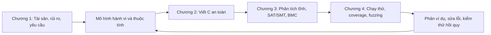
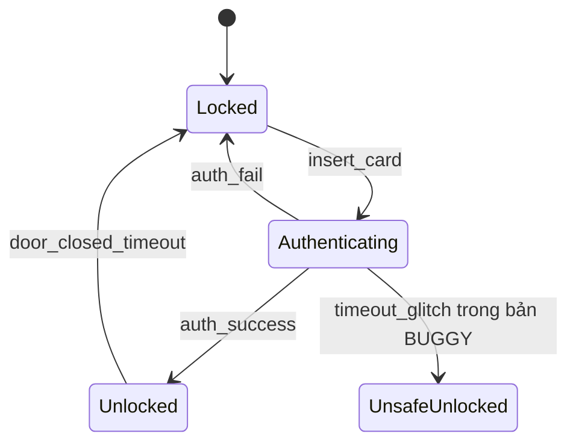
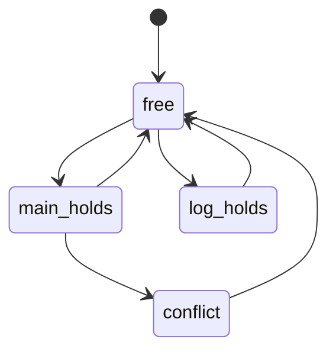

# An toàn phần mềm — bộ kiến thức tổng hợp đầy đủ

Tổng hợp và đối chiếu toàn thư mục `Safe Application` ngày 09/10/2026. Tài liệu gồm lý thuyết bốn chương, 8 lab, đặc tả/dự án, bài giải, đính chính và danh mục nguồn. Đây là bản liền mạch; các chương riêng và ngân hàng1.257 câu hỏi được liên kết để tra cứu.

[Mục lục theo file](README.md) · [Chỉ mục trang PDF](CHI_MUC_PDF_THEO_TRANG.md) · [Toàn bộ ngân hàng câu hỏi](11_Ngan_hang_cau_hoi.md)

## Mục lục

- [Chương 0. Tổng quan học phần và cách sử dụng tài liệu](#chuong-0)
- [Chương 1. Nền tảng an toàn phần mềm](#chuong-1)
- [Chương 2. Lập trình C an toàn và quản lý bộ nhớ](#chuong-2)
- [Chương 3. Phân tích tĩnh, SAT/SMT và kiểm chứng hình thức](#chuong-3)
- [Chương 4. Phân tích động, coverage và fuzzing](#chuong-4)
- [Chương 5. Phân tích và hướng dẫn hiểu 8 bài lab](#chuong-5)
- [Chương 6. Đặc tả, mô hình JSON/Excel và bài tập lớn](#chuong-6)
- [Chương 7. Hệ thống ôn tập, bài tập có lời giải và thuật ngữ](#chuong-7)
- [Chương 8. Đính chính, khác biệt giữa nguồn và giới hạn kết luận](#chuong-8)
- [Chương 9. Bản đồ toàn bộ mã nguồn và dữ liệu liên quan](#chuong-9)
- [Chương 10. Danh mục toàn bộ nguồn và khả năng truy vết](#chuong-10)
- [Chương 11. Ngân hàng câu hỏi gốc theo từng chương](#chuong-11)

---

<a id="chuong-0"></a>

## Chương 0. Tổng quan học phần và cách sử dụng tài liệu

### 0.1 Phạm vi của bộ tổng hợp

Bộ tài liệu này hệ thống hóa nội dung học phần **CSE703093 - An toàn phần mềm** từ thư mục `Safe Application`: bài giảng, giáo trình, đề cương, hướng dẫn thực hành, mã nguồn C/Python, dữ liệu JSON/CSV, đề ôn tập HTML và mẫu đặc tả/báo cáo. Nội dung được viết lại theo mạch kiến thức để có thể tự học, đồng thời giải thích quan hệ giữa lý thuyết và các chương trình thực tế trong thư mục.

Kiểm kê đầu vào ngày **09/10/2026**:

| Nhóm | Số lượng | Cách xử lý |
| --- | ---: | --- |
| PDF | 25 file, 1.095 trang | Trích xuất toàn bộ trang; lập chỉ mục trang; kiểm tra hình ảnh đại diện cho đồ thị, bố cục bộ nhớ và bảng |
| Mã Python | 53 file | Phân tích cú pháp, hàm/lớp, import, luồng dữ liệu và các giới hạn của thuật toán |
| Mã C và header | 30 `.c`, 1 `.h` | Đối chiếu quản lý bộ nhớ, điều kiện biên, harness, kiểm chứng và test |
| JSON và CSV | 35 JSON, 9 CSV | Đọc mô hình, đầu vào, đặc tả và kết quả lưu sẵn |
| Word và Excel | 2 DOCX, 1 XLSX | Đọc đoạn văn, bảng và toàn bộ 10 sheet của mẫu đặc tả |
| HTML | 2 file trùng nội dung | Lấy dữ liệu câu hỏi trong JavaScript: 1.257 câu |
| ZIP | 13 file, 186 thành viên | Đối chiếu SHA-256; tất cả thành viên đều có bản giống hệt đã giải nén |
| EXE | 2 file | Kiểm kê kích thước, hash và cấu trúc PE; không có mã nguồn của ứng dụng tương ứng trong thư mục |
| Tài liệu, Makefile, cache, file phụ | Các file còn lại | Phân loại và đưa vào danh mục nguồn |

Tổng đầu vào là **222 file**, khoảng **319,5 MB** theo đơn vị thập phân. Số trang 1.095 có tính cả hai bản PDF giới thiệu trùng nhau; số file không bao gồm tài liệu tổng hợp và file tạm tạo trong quá trình xử lý.

**Giới hạn cần hiểu chính xác:** trích xuất hết trang PDF không đồng nghĩa đã kiểm tra bằng mắt mọi hình trên cả 1.095 trang. Phần lý thuyết, công thức, mục lục, bảng văn bản và mã nguồn là cơ sở chính; những sơ đồ quan trọng đã được kiểm tra hình ảnh đại diện. Hai chương trình EXE chỉ được phân tích ở mức file nhị phân và tài liệu đầu vào đi kèm. Bộ tổng hợp không khẳng định đã kiểm toán đầy đủ cách cài đặt bên trong EXE.

### 0.2 Bốn trụ cột kiến thức



Mỗi bước trả lời một câu hỏi khác nhau:

1. **Cần bảo vệ gì?** Xác định tài sản, đối thủ, ranh giới tin cậy và thuộc tính mong muốn.
2. **Code có thể sai thế nào?** Xem quyền truy cập, dữ liệu đầu vào, kiểu số và vòng đời bộ nhớ.
3. **Mọi hành vi được mô hình hóa có thỏa thuộc tính không?** Dùng kiểm chứng hình thức và phân tích tĩnh.
4. **Khi chạy thật, input nào gây lỗi?** Dùng test, đo coverage, sanitizer và fuzzing.
5. **Sau khi sửa có tái phát không?** Giữ phản ví dụ thành regression test.

Không có một công cụ đơn lẻ thay thế toàn bộ chuỗi này. Một warning chưa chắc là lỗ hổng khai thác được; một lần chạy sạch chưa chứng minh mọi đầu vào đều an toàn; một mô hình đúng chưa đảm bảo code triển khai đúng mô hình.

### 0.3 Mục tiêu học tập

Đề cương nêu học phần 3 tín chỉ, gồm lý thuyết và thực hành. Hai chuẩn đầu ra được nhấn mạnh trong tài liệu bài tập lớn là:

- **LO.03:** đánh giá kỹ thuật thẩm định, kiểm chứng và kiểm thử.
- **LO.04:** thực hiện giải quyết lỗ hổng bằng những kỹ thuật phù hợp.

Để đáp ứng, cần làm được cả ba việc: giải thích nguyên lý, áp dụng trên một chương trình cụ thể và diễn giải bằng chứng. Học thuộc tên công cụ hoặc chỉ dán log vào báo cáo chưa đủ.

### 0.4 Kiến thức nền cần có

| Kiến thức | Dùng ở đâu |
| --- | --- |
| C: mảng, con trỏ, chuỗi, struct, malloc/free | Chương 2, lab 3-4, harness fuzzing |
| Python: hàm, lớp, dict/set, file, subprocess | Mô hình Kripke, trình chạy công cụ và dữ liệu lab |
| Đồ thị, BFS/DFS, độ phức tạp | Reachability, phản ví dụ, CFG và model checking |
| Logic Boolean, kéo theo, lượng từ | CTL/LTL, SAT/SMT, điều kiện an toàn |
| Kiểu số, biểu diễn bit, endianness | Overflow, bit-vector và parsing dữ liệu nhị phân |
| Kiểm thử tự động | Oracle, baseline, regression và kết quả thực nghiệm |

### 0.5 Cách học và cách đọc nguồn

Đọc lần lượt Chương 1-4, rồi làm các lab tương ứng. Khi học một khái niệm, luôn ghi lại **định nghĩa - điều kiện áp dụng - ví dụ - phản ví dụ - giới hạn**. Ví dụ với BMC: định nghĩa là tìm đường vi phạm tới một giới hạn; điều kiện là mô hình và giả thiết đã mã hóa; phản ví dụ là input cụ thể; giới hạn là chưa bao phủ mọi độ sâu.

Số trang dẫn trong tài liệu là **thứ tự trang PDF, tính từ 1**, không phải số trang in ở chân giáo trình. Giáo trình có phần đầu đánh số La Mã nên hai cách đánh số khác nhau. Slide mỗi phần có 100 trang và số trang PDF thường trùng số slide.

Một số tên module trong slide/giáo trình, như `ch3_staticsat`, `memory_trace`, `sat_solver` hoặc `bounded_checker`, không có file tương ứng trong bản toolkit đã giải nén. Chúng vẫn được giải thích về mặt kiến thức; bản đồ code chỉ liệt kê API thật sự tồn tại. Mã minh họa in trong giáo trình và mã trên ổ đĩa là hai nguồn cần đối chiếu, không được mặc nhiên coi là cùng một phiên bản.

### 0.6 Bằng chứng đã kiểm tra trong lần tổng hợp

Đã chạy các ví dụ Python về Kripke, chấm rủi ro, SMT và BMC; đã chạy một tập test có sẵn trong bản sao tạm: **19 test đạt, 5 test tự bỏ qua do thiếu CBMC, 7 test liên quan C được chủ động loại khỏi lượt chạy Python**. Đây là kiểm tra có chọn lọc cho các kết luận trong tài liệu, không phải tuyên bố toàn bộ bộ test của thư mục đã đạt.

Môi trường hiện có GCC/gcov nhưng chưa có cppcheck, CBMC hoặc Clang trong PATH. Vì vậy kết quả ASan, cppcheck, CBMC và fuzzing C lưu sẵn được ghi rõ là **kết quả nguồn**, không trình bày như thực nghiệm mới đã chạy lại. Các file nguồn ban đầu không bị sửa.

### 0.7 Nguồn chính

- `An toàn phần mềm.pdf`, trang 1-10; `CSE703093 - An toàn phần mềm.docx`: đề cương.
- `Chương 0_Gioi_thieu_hoc_phan.pdf`, trang 1-12; `Giới thiệu học phần.pdf`: cùng nội dung.
- `CSE703093_An_toan_phan_mem_Giao_trinh.pdf`, trang 1-8: lời nói đầu và mục lục; trang 81-141: phụ lục code, bài tập, đề mẫu, bài tập lớn và thuật ngữ.
- Tất cả nguồn có đường dẫn và trạng thái xử lý trong [Danh mục nguồn](10_Danh_muc_nguon.md).

---

<a id="chuong-1"></a>

## Chương 1. Nền tảng an toàn phần mềm

### 1.1 Security, safety và reliability

**Software security** là khả năng bảo vệ tài sản và duy trì các thuộc tính mong muốn khi có hành vi tấn công. Đối thủ có thể cố tình chọn input, thứ tự thao tác hoặc thời điểm thực thi gây bất lợi cho hệ thống.

| Khái niệm | Câu hỏi chính | Ví dụ |
| --- | --- | --- |
| Security | Đối thủ có làm hệ thống vi phạm quyền hoặc lộ dữ liệu không? | Giả mạo phiên đăng nhập để đọc dữ liệu người khác |
| Safety | Hệ thống có gây nguy hiểm hoặc thiệt hại không chấp nhận được không? | Lệnh điều khiển sai làm thiết bị vận hành nguy hiểm |
| Reliability | Hệ thống có cung cấp chức năng đúng ổn định trong điều kiện xác định không? | Dịch vụ xử lý đơn hàng duy trì hoạt động trong thời gian yêu cầu |

Các thuộc tính giao nhau. Một tấn công có thể gây hậu quả safety; một hệ thống hoạt động ổn định với người dùng bình thường vẫn có thể dễ bị khai thác. Safety không chỉ giới hạn ở lỗi ngẫu nhiên, và security không chỉ là mã hóa.

#### CIA và các thuộc tính mở rộng

- **Confidentiality:** thông tin chỉ được tiết lộ cho chủ thể được phép. Đọc trộm token, dữ liệu cá nhân hoặc bộ nhớ tiến trình là vi phạm.
- **Integrity:** dữ liệu và hành vi chỉ được thay đổi theo quyền và quy tắc hợp lệ. Sửa giá đơn hàng hoặc số dư trái phép là vi phạm.
- **Availability:** người dùng hợp lệ có thể tiếp cận dịch vụ khi cần. Crash, hang hoặc cạn tài nguyên có thể vi phạm.
- **Authenticity:** có cơ sở tin cậy để xác nhận nguồn gốc hoặc danh tính.
- **Accountability:** hành động có thể được truy vết tới chủ thể chịu trách nhiệm.
- **Non-repudiation:** có bằng chứng thích hợp để hạn chế khả năng chối bỏ hành động. Một log thông thường có thể bị sửa không tự động tạo ra tính không chối bỏ.

**Authentication** xác minh danh tính; **authorization** quyết định quyền thực hiện thao tác. Một user đã đăng nhập vẫn có thể không được phép đọc tài nguyên của user khác. Kiểm tra quyền phải gắn với tài nguyên và hành động cụ thể, không chỉ với trạng thái “đã đăng nhập”.

#### Các thuật ngữ trong một chuỗi tấn công

| Thuật ngữ | Ý nghĩa | Ví dụ trong parser C |
| --- | --- | --- |
| Asset | Tài sản cần bảo vệ | Dữ liệu bí mật và quyền của tiến trình |
| Threat | Khả năng/sự kiện có thể gây hại | Đối thủ gửi gói tin độc hại |
| Vulnerability | Điểm yếu cho phép vi phạm thuộc tính | Tin độ dài khai báo mà không kiểm tra dữ liệu thật |
| Attack | Hành động cụ thể để gây hại | Gửi trường length lớn hơn payload |
| Exploit | Cách khai thác điểm yếu | Input kích hoạt đọc ngoài vùng nhớ |
| Risk | Mức rủi ro trong bối cảnh triển khai | Khả năng khai thác kết hợp với hậu quả |

Không phải mọi bug đều là lỗ hổng có thể khai thác trong một môi trường cụ thể. Nhưng lỗi chưa khai thác được hiện tại vẫn có thể trở nên nguy hiểm khi quyền tiến trình, cấu hình hoặc bề mặt đầu vào thay đổi.

### 1.2 Rủi ro, mô hình đe dọa và kiểm soát truy cập

#### Đánh giá rủi ro

Mô hình đơn giản của học phần:

\[
Risk = Likelihood \times Impact
\]

Likelihood phụ thuộc mức tiếp xúc, điều kiện khai thác, quyền cần có và khả năng kiểm soát input. Impact phụ thuộc tài sản, quyền tiến trình và ảnh hưởng CIA. Điểm ma trận 1-5 là thang thứ bậc để ưu tiên; tích của chúng không tự động là xác suất hoặc thiệt hại tiền tệ chính xác.

Ví dụ: overflow trong parser nhận dữ liệu mạng và chạy với quyền cao thường đáng ưu tiên hơn lỗi tương tự trong tiện ích thử nghiệm không có dữ liệu nhạy cảm. Cần ghi giả thiết thay vì gán mức “cao” chỉ từ tên lỗi.

Giáo trình mở rộng phân tích định lượng với:

\[
SLE = AssetValue \times ExposureFactor,\qquad ALE = SLE \times ARO
\]

SLE là tổn thất ước tính cho một sự kiện; ARO là số lần xảy ra kỳ vọng mỗi năm; ALE là tổn thất năm kỳ vọng. Các con số hữu ích khi có dữ liệu và giả thiết phù hợp. CVSS đo mức nghiêm trọng kỹ thuật theo một phiên bản quy tắc, còn ưu tiên sửa lỗi thực tế vẫn cần bối cảnh tài sản và triển khai.

#### STRIDE

| Nhóm | Ý nghĩa | Kiểm soát có thể áp dụng |
| --- | --- | --- |
| Spoofing | Giả danh chủ thể hoặc nguồn | Xác thực, bảo vệ thông tin định danh |
| Tampering | Sửa dữ liệu trái phép | Kiểm tra quyền, tính toàn vẹn, kiểm tra input |
| Repudiation | Chối bỏ hành động | Audit log có bảo vệ và nhận diện chủ thể |
| Information disclosure | Lộ dữ liệu | Phân quyền, hạn chế lỗi chi tiết, bảo vệ bí mật |
| Denial of service | Làm dịch vụ không khả dụng | Giới hạn tài nguyên, timeout, rate limit |
| Elevation of privilege | Đạt quyền ngoài phạm vi cho phép | Least privilege, kiểm tra quyền tại mỗi thao tác |

STRIDE là cách đặt câu hỏi có hệ thống. Không phải cứ có sáu chữ STRIDE trong báo cáo là đã mô hình hóa đầy đủ. Cần gắn mỗi đe dọa với một thành phần, luồng dữ liệu, tài sản và cách kiểm chứng.

Quy trình: mô tả hệ thống và data-flow diagram → xác định trust boundary → liệt kê đe dọa → đánh giá rủi ro → chọn kiểm soát → kiểm tra hiệu quả. Một luồng nội bộ không tự động đáng tin; mỗi lần thay đổi mức tin cậy, quyền hoặc chủ thể đều có thể cần kiểm tra lại.

**Attack tree** đặt mục tiêu tấn công ở gốc. Nút OR thể hiện các cách thay thế; nút AND yêu cầu kết hợp nhiều bước. Ví dụ “chiếm tài khoản” có thể qua đánh cắp mật khẩu OR chiếm token OR bypass xác thực. Nó giúp tìm những đường còn thiếu kiểm soát.

#### Nguyên tắc thiết kế và mô hình quyền

- **Least privilege:** chỉ cấp quyền tối thiểu cần thiết; giảm hậu quả khi một thành phần bị xâm phạm.
- **Defense in depth:** các lớp kiểm soát bổ sung nhau, như validation, phân quyền, kiểm tra bộ nhớ và log.
- **Fail-closed:** khi không xác minh được điều kiện cấp quyền, giữ trạng thái từ chối. Phải thiết kế thêm khả năng phục hồi để tránh mất availability không cần thiết.
- **Security by design:** yêu cầu bảo mật được đưa vào thiết kế, đặc tả và test từ đầu.

| Mô hình | Quyền quyết định hoặc mục tiêu |
| --- | --- |
| DAC | Chủ sở hữu tài nguyên có quyền phân quyền theo chính sách |
| MAC | Chính sách phân loại tập trung áp đặt quyền truy cập |
| RBAC | Quyền gắn với vai trò và người dùng được gán vai trò |
| Bell-LaPadula | Bảo vệ confidentiality: dạng cơ bản “no read up, no write down” |
| Biba | Bảo vệ integrity: dạng strict integrity cơ bản “no read down, no write up” |

Các mô hình trên có giả thiết và biến thể. RBAC không loại bỏ nhu cầu kiểm tra sở hữu từng đối tượng; Biba và Bell-LaPadula không giải quyết mọi thuộc tính availability hoặc logic nghiệp vụ.

### 1.3 Các lớp lỗ hổng và hệ thống phân loại

**CWE** phân loại điểm yếu; **CVE** định danh một lỗ hổng cụ thể trong sản phẩm/phiên bản. Một warning CWE-416 trong code học tập không tự động có CVE. **OWASP Top 10** là tập nhóm rủi ro của một bản phát hành cụ thể, không phải bảng đầy đủ mọi lỗi. Giáo trình dùng danh mục minh họa; không coi thứ hạng hoặc số lượng trong tài liệu là số liệu cập nhật tự động.

| Lớp lỗi | Nguyên nhân | Hậu quả và phòng ngừa |
| --- | --- | --- |
| Out-of-bounds read/write | Chỉ số hoặc độ dài vượt object | Lộ dữ liệu/ghi hỏng bộ nhớ; kiểm tra cả biên dưới và biên trên |
| Use-after-free | Truy cập sau khi object hết vòng đời | Crash, dữ liệu sai; ownership và thứ tự thao tác đúng |
| Double free | Giải phóng một allocation nhiều lần | Hỏng trạng thái allocator; một owner chịu trách nhiệm giải phóng |
| Memory leak | Mất tham chiếu trước khi giải phóng | Cạn tài nguyên; quản lý mọi đường thoát |
| Integer overflow | Kết quả vượt miền kiểu | Cấp phát thiếu, sai bounds; kiểm tra trước phép toán |
| SQL/command injection | Dữ liệu bị diễn giải thành lệnh | Dùng truy vấn tham số hóa hoặc API không đi qua shell |
| Broken access control/IDOR | Thiếu kiểm tra quyền với object | Truy cập dữ liệu người khác; kiểm tra ở server |
| Path traversal | Input điều khiển đường dẫn ngoài phạm vi | Dùng định danh và kiểm soát đường dẫn/tài nguyên hợp lệ |
| Race condition/TOCTOU | Kiểm tra và sử dụng không nguyên tử | Trạng thái thay đổi giữa hai bước; dùng thao tác nguyên tử, đồng bộ đúng |
| Improper error handling | Lộ chi tiết hoặc bỏ qua lỗi | Rò rỉ cấu trúc hệ thống, fail-open; phản hồi phù hợp và log nội bộ |

Ví dụ SQL: nối trực tiếp username vào câu truy vấn khiến ký tự đặc biệt thay đổi cấu trúc SQL. Prepared statement giữ cấu trúc lệnh và giá trị tham số tách biệt. Với command injection, truyền danh sách đối số cho API tiến trình còn cần kiểm tra chính lệnh đó chấp nhận đối số nào.

Heartbleed là **đọc vượt vùng nhớ** do thiếu kiểm tra bounds trong xử lý TLS heartbeat, không phải ví dụ ghi tràn stack. Xem [bản ghi CVE gốc](https://cve.mitre.org/cgi-bin/cvename.cgi?name=cve-2014-0160). Một slide đầu chương diễn đạt không chính xác, còn slide case study sau đó mô tả đúng; phần đính chính giữ cách phân loại đúng.

### 1.4 Verification, validation và testing

**Verification:** sản phẩm có tuân thủ đặc tả không? **Validation:** sản phẩm có đáp ứng nhu cầu thực tế không? **Testing:** thiết kế và thực hiện các kiểm tra để tìm sai lệch, cung cấp bằng chứng về chất lượng. Trong học phần, “kiểm chứng hình thức” thường chỉ các phương pháp dùng mô hình và suy luận toán học.

| Hoạt động | Có chạy chương trình mục tiêu không? | Bằng chứng |
| --- | --- | --- |
| Review, static analyzer, formal proof | Không cần chạy chương trình mục tiêu | Warning, điều kiện, chứng minh hoặc phản ví dụ mô hình |
| Unit/integration/system/acceptance test | Có với kiểm thử động | Input, expected, actual, pass/fail |
| Fuzzing | Có | Crash, hang, sanitizer finding và input tái hiện |
| Debugging | Thường có hoặc dùng trace | Nguyên nhân gốc và cơ chế gây lỗi |

Một analyzer hay solver vẫn là chương trình được chạy; gọi nó “tĩnh” có nghĩa không thực thi **chương trình đang được phân tích** theo input cụ thể như test động.

Mô hình chữ V liên hệ yêu cầu với acceptance test, thiết kế hệ thống với system test, thiết kế thành phần với integration test và code với unit test. Mỗi mức cần oracle phù hợp. Quy trình test gồm lập kế hoạch → phân tích/thiết kế → chuẩn bị và thực thi → đánh giá exit criteria → lưu kết quả và kết thúc.

Một test case tối thiểu có ID, yêu cầu liên quan, điều kiện trước, input, bước thực hiện, kết quả mong đợi và kết quả thực tế. **Retest** xác nhận bug cụ thể đã sửa; **regression test** phát hiện tác động phụ hoặc lỗi tái xuất hiện.

#### Kỹ thuật black-box

1. **Equivalence partitioning:** chia input thành các lớp được kỳ vọng xử lý tương tự; chọn đại diện của mỗi lớp.
2. **Boundary value analysis:** ưu tiên giá trị sát ranh giới vì dễ có off-by-one.
3. **Decision table:** liệt kê tổ hợp điều kiện và hành động; phát hiện thiếu hoặc mâu thuẫn quy tắc.
4. **State-transition testing:** kiểm tra chuỗi sự kiện, transition hợp lệ và không hợp lệ.
5. **Use-case testing:** kiểm tra một kịch bản người dùng gồm nhiều bước.
6. **Experience-based testing:** error guessing và exploratory testing có mục tiêu, ghi nhận kết quả.

Với độ dài mật khẩu hợp lệ `[8,20]`: ba lớp là `<8`, `[8,20]`, `>20`; bốn biên tối thiểu trong ví dụ nguồn là `7,8,20,21`. Có thể bổ sung `9,19`, input rỗng và kiểu không hợp lệ tùy đặc tả. Lớp theo độ dài không thay thế lớp theo ký tự, encoding hoặc trạng thái tài khoản.

### 1.5 White-box, CFG và chất lượng bộ test

CFG biểu diễn các khối/lệnh và cạnh chuyển điều khiển. Từ đó đo những mục đã được thực thi:

\[
Coverage=\frac{Số\ mục\ đã\ bao\ phủ}{Tổng\ số\ mục\ trong\ phạm\ vi}\times100\%
\]

| Độ đo | Mục cần bao phủ | Giới hạn |
| --- | --- | --- |
| Statement | Câu lệnh | Có thể bỏ qua kết quả false của một điều kiện |
| Line | Dòng mã thực thi theo công cụ | Một dòng có thể chứa nhiều câu lệnh |
| Branch/decision | Kết quả của quyết định | Chưa chắc bao phủ mọi điều kiện nguyên tử |
| Condition | True/false của từng điều kiện nguyên tử | Chưa chắc thay đổi kết quả quyết định |
| MC/DC | Mỗi điều kiện có thể độc lập thay đổi quyết định | Cần thiết kế cặp test và quy tắc short-circuit rõ |
| Edge | Cạnh đồ thị điều khiển theo instrumentation | Phụ thuộc đồ thị và cách gán ID |
| Path | Đường thực thi | Vòng lặp có thể tạo vô hạn đường |

Với `D=a && b`, các test `(T,T)`, `(F,T)`, `(T,F)` minh họa MC/DC ở mô hình logic: cặp đầu/giữa cho thấy ảnh hưởng của `a`; cặp đầu/cuối cho thấy ảnh hưởng của `b`. Khi đo trên C có short-circuit, cần dùng quy tắc MC/DC của công cụ và xét việc điều kiện có được đánh giá không.

Ví dụ đúng theo bộ đếm trong `softsec-toolkit/ch1_models/testing.py`:

```python
def f(a, b):
    if a > 0:
        if b > 0:
            return 1
        return 2
    return 0
```

Một test `(5,3)` đi qua 3/5 mục `check_a`, `check_b`, `return1`, `return2`, `return0`: **60% statement coverage theo bộ đếm này**, và 2/4 kết quả quyết định: **50% branch coverage**. Thêm `(5,-3)` và `(-5,0)` đạt 100% cả hai trong mô hình đó. Tỉ lệ statement trên một CFG khác phải tính lại mẫu số; không dùng số 3/4 bất nhất trong slide làm đáp án chung.

**Cyclomatic complexity:**

\[
V(G)=E-N+2 P
\]

Với CFG một thành phần, `P=1`. Ví dụ trên có `E=7`, `N=6`, nên `V=3`. Với những quyết định nhị phân được mô hình hóa phù hợp, có thể tính số quyết định +1. Đây là số chiều của tập đường cơ sở trong đồ thị, không phải mọi đường thực thi đều khả thi và không phải số test luôn đủ cho mọi tiêu chí.

**Mutation testing:** thay đổi nhỏ code, xem test có phát hiện sự khác biệt không. Mutation score thường tính mutant bị diệt trên số mutant không tương đương được xét. Mutant tương đương về hành vi không thể bị diệt bằng test quan sát cùng đặc tả.

**Oracle problem:** với một input bất kỳ, khó xác định output đúng. Các cách bổ sung gồm oracle độc lập, so sánh hai implementation, metamorphic relation và invariant. Ví dụ sắp xếp: kết quả phải có thứ tự và bảo toàn multiset đầu vào. Hai implementation trả lời giống nhau vẫn có thể cùng sai.

### 1.6 Cấu trúc Kripke và logic thời gian

\[
K=(S,S_0,R,L)
\]

- `S`: tập trạng thái; một trạng thái mô tả đủ thông tin liên quan tới thuộc tính.
- `S0 ⊆ S`: tập trạng thái ban đầu, cần ít nhất một trạng thái trong bài toán thông thường.
- `R ⊆ S×S`: quan hệ chuyển trạng thái, có thể không xác định.
- `L:S→2^AP`: các mệnh đề nguyên tử đúng tại từng trạng thái.

Kripke chuẩn dùng quan hệ chuyển **total**, mỗi trạng thái có ít nhất một successor. Có thể thêm self-loop ở trạng thái kết thúc để định nghĩa hành vi vô hạn; nhưng nên phát hiện và giải thích deadlock trên mô hình gốc trước khi totalize, tránh che mất lỗi thiết kế.



Tên state là định danh, còn label là mệnh đề. State `Unlocked` có thể mang `unlocked` và `authenticated`. Nếu chỉ có state tên “transaction” mà không lưu trạng thái xác thực, khó phát biểu một invariant xác thực đúng; phải bổ sung thông tin hoặc xét thuộc tính theo đường.

#### Reachability và BFS

Khởi đầu từ tất cả trạng thái trong `S0`, đưa vào queue; lấy từng trạng thái, thăm successor chưa thăm; lưu parent để dựng đường đi. Độ phức tạp `O(|S|+|R|)` cho đồ thị biểu diễn bằng adjacency list. BFS tìm đường ngắn nhất theo số cạnh trong đồ thị không trọng số. Một witness có thể không duy nhất khi dùng set và có nhiều đường bằng nhau.

Safety mô tả điều xấu không xảy ra; khi vi phạm thường có prefix hữu hạn chứng minh. Liveness mô tả tiến triển cuối cùng; phản ví dụ thường gồm prefix và chu trình vô hạn không có tiến triển. Không có deadlock chưa đảm bảo liveness: hệ thống có thể retry mãi trong self-loop.

#### CTL và LTL

CTL kết hợp định lượng đường `A` (mọi đường), `E` (tồn tại đường) với toán tử `X` (bước kế), `F` (cuối cùng), `G` (luôn), `U` (until).

| Công thức | Cách đọc |
| --- | --- |
| `AG(!violation)` | Trên mọi đường, không bao giờ tới trạng thái vi phạm |
| `AG(unlocked -> authenticated)` | Mọi trạng thái đạt được có mở khóa thì có xác thực |
| `EF(unlocked)` | Tồn tại đường tới trạng thái mở khóa |
| `AF(done)` | Mọi đường cuối cùng đều tới `done` |
| `AG(request -> AF(response))` | Mọi yêu cầu phát sinh đều cuối cùng được đáp ứng trên mọi diễn tiến |
| `AG(EF(reset))` | Từ mọi trạng thái đạt được vẫn tồn tại cách tới `reset` |
| `EX(error)` | Có ít nhất một successor mang `error` |

`EF(done)` không bảo đảm hoàn thành trên mọi đường. `AG EF reset` không bằng `AG AF reset`. Khi có nhiều initial states, cần nói rõ “mô hình thỏa công thức” nghĩa là mọi initial state thỏa hay chỉ một initial state; các helper trong thư mục không dùng hoàn toàn cùng quy ước.

LTL mô tả một đường thời gian bằng `G,F,X,U`; khi kiểm chứng hệ thống thường yêu cầu mọi đường của mô hình thỏa công thức. CTL có thể phân biệt các lựa chọn tương lai tại một trạng thái. Không thay toán tử `E` thành `A` chỉ vì “đường nào đó tìm được bằng BFS”.

#### Thuật toán gán nhãn CTL

Mỗi công thức được ánh xạ tới tập trạng thái thỏa:

- Atom `p`: những state có `p` trong `L(s)`.
- `!p`: phần bù trong `S`; `p && q`: giao hai tập.
- `EX p`: state có một successor trong `Sat(p)`.
- `EF p`: điểm cố định nhỏ nhất `Z = Sat(p) ∪ PreE(Z)`.
- `EG p`: điểm cố định lớn nhất `Z = Sat(p) ∩ PreE(Z)`.
- `AF p`: dùng predecessor phổ quát `PreA` trong điểm cố định nhỏ nhất.
- `AG p`: có thể tính `!EF(!p)` trên ngữ nghĩa đã chọn.

Với đồ thị không total, `PreA` ở state không có successor và ngữ nghĩa path cần được định nghĩa rõ. Không ghép các công thức điểm cố định với cách xử lý dead-end tùy ý.

#### Đồng thời, công bằng và bùng nổ trạng thái

Hai tiến trình có `m` và `n` trạng thái cục bộ có thể tạo tới `m×n` trạng thái kết hợp, chưa tính tài nguyên chung. Mutex đúng cần ngăn `p1_critical && p2_critical`, nhưng starvation freedom còn cần mô hình scheduler và fairness. Không thể suy ra fairness chỉ từ việc đã thêm mutex.

Các cách giảm bùng nổ: chọn abstraction phù hợp, giới hạn miền dữ liệu, kiểm tra module, symbolic model checking, partial-order reduction. **Bisimulation** là quan hệ mô phỏng hai chiều giữa trạng thái và transition, dùng để chứng minh tương đương hành vi theo các điều kiện phù hợp; gộp state chỉ vì cùng tên hoặc cùng label không tự động là bisimulation.

### 1.7 Bài học nối với code

- Lab 1: BFS và phản ví dụ `S0 → S1 → S5` cho mở khóa không xác thực.
- Lab 2: PIN 6 chữ số, biên số lần sai và oracle C/Python.
- Toolkit `testing.py`: EP/BVA, CFG, decision table, bộ đếm coverage minh họa.
- Toolkit `kripke.py`: counter, đèn giao thông, vending machine, ATM; các helper chỉ hỗ trợ một phần logic.
- `atpm/ch1_concepts/kripke.py`: invariant, reachability, kiểm tra total và xuất DOT.

**Tự kiểm tra:** phân biệt được asset/threat/vulnerability; chuyển một yêu cầu thành thuộc tính; tính coverage với mẫu số rõ; dựng Kripke từ một luồng trạng thái; giải thích witness và phản ví dụ; nhận biết tính đúng do tiền đề chưa bao giờ xảy ra.

### 1.8 Nguồn theo trang

- `Chuong1_Phan1_ATPM.pdf`: trang 3-37 nền tảng/rủi ro/STRIDE; 38-66 lớp lỗi; 67-92 V&V và kỹ thuật test.
- `Chuong1_Phan2_ATPM.pdf`: trang 4-39 white-box và quản lý test; 40-78 Kripke/logic thời gian; 86-94 ôn tập.
- Giáo trình: trang PDF 9-30, bao gồm OWASP/CWE, rủi ro định lượng, CTL labeling và BFS.
- Code và dataset: xem [Bản đồ mã nguồn](09_Ban_do_ma_nguon.md) và [8 bài lab](05_Phan_tich_8_bai_lab.md).

---

<a id="chuong-2"></a>

## Chương 2. Lập trình C an toàn và quản lý bộ nhớ

### 2.1 Rủi ro đặc thù của C

C cho phép thao tác gần phần cứng, kiểm soát dữ liệu và chi phí thực thi. Đổi lại, ngôn ngữ không tự động kiểm tra mọi bounds hoặc quản lý vòng đời object. Một hàm biên dịch thành công vẫn có thể chứa undefined behavior, đọc dữ liệu ngoài object hoặc làm sai trạng thái allocator.

Khi đánh giá chương trình C, theo dõi dữ liệu từ **source** tới **sink**: nguồn input mạng/file/argv → parsing → chuyển kiểu/tính kích thước → allocation/copy/index → output hoặc thao tác có quyền. Chọn điểm có nguy cơ bằng cách hỏi: ai điều khiển giá trị này; miền hợp lệ là gì; kiểm tra diễn ra trước hay sau khi sử dụng; nếu lỗi thì ai giải phóng tài nguyên?

Bề mặt tấn công gồm không chỉ input bình thường mà cả file lỗi, dữ liệu cắt ngắn, số âm, kích thước cực lớn, dữ liệu nhị phân có byte NUL và thứ tự gọi API sai. Giới hạn do giao diện người dùng đặt ra không thay thế kiểm tra tại hàm xử lý.

### 2.2 Mô hình bộ nhớ và vòng đời object

| Vùng thường gặp | Nội dung điển hình | Lỗi cần chú ý |
| --- | --- | --- |
| Text/code | Mã máy | Nhảy tới địa chỉ sai, thực thi dữ liệu nếu thiếu bảo vệ |
| Data/BSS | Biến tĩnh/toàn cục đã khởi tạo hoặc zero-init | Race, sai trạng thái dùng chung |
| Stack | Biến tự động, thông tin lời gọi trên nhiều ABI | Vượt mảng cục bộ, trả con trỏ tới biến đã hết vòng đời |
| Heap | Vùng cấp phát động | Leak, UAF, double free, overflow |

Đây là mô hình tiến trình điển hình, không phải layout bắt buộc bởi chuẩn C. Hướng tăng của stack/heap và vị trí từng vùng phụ thuộc hệ điều hành, ABI và cách cấp phát. `sizeof(pointer)` không nói kích thước allocation mà pointer trỏ tới.

Hai loại memory safety cần phân biệt:

- **Spatial safety:** truy cập đúng phạm vi object. Với mảng `N` phần tử, chỉ số hợp lệ `0 <= i < N`.
- **Temporal safety:** chỉ sử dụng object trong vòng đời hợp lệ. Pointer còn chứa địa chỉ sau `free` không có nghĩa object còn tồn tại.

Pointer một-past-the-end có thể dùng theo những quy tắc của C để biểu diễn ranh giới/so sánh thích hợp, nhưng không được dereference. `NULL` là một giá trị pointer, còn dangling pointer là pointer tới object đã hết vòng đời; hai khái niệm khác nhau.

### 2.3 malloc, calloc, realloc và ownership

#### Nguyên tắc ownership

Mỗi allocation cần một bên chịu trách nhiệm giải phóng; các pointer mượn chỉ hợp lệ trong thời gian owner cho phép. API nên ghi rõ trả về owned pointer hay borrowed pointer, ai gọi destructor và hàm có giữ pointer sau khi trả về không.

```c
#include <stdint.h>
#include <stdlib.h>

int *allocate_items(size_t count) {
    if (count == 0 || count > SIZE_MAX / sizeof(int)) {
        return NULL;
    }
    int *items = malloc(count * sizeof *items);
    if (items == NULL) {
        return NULL;
    }
    return items; /* người gọi sở hữu và phải free */
}
```

Kiểm tra multiplication trước `malloc` là điều kiện cần để tránh cấp phát vùng nhỏ do wraparound. Sau `malloc`, vùng nhớ chưa được khởi tạo; `calloc` zero các byte nhưng không làm mất nhu cầu kiểm tra các điều kiện nghiệp vụ hoặc lỗi allocation.

`realloc` có thể di chuyển allocation. Với kích thước mới dương, dùng pointer tạm:

```c
void *candidate = realloc(buffer, new_size);
if (candidate == NULL) {
    /* buffer cũ còn hợp lệ; xử lý lỗi theo hợp đồng */
    return ERROR_ALLOCATION;
}
buffer = candidate;
```

Nếu gán thẳng `buffer = realloc(...)` rồi thất bại, mất pointer cũ và có thể leak. Pointer alias tới vùng cũ có thể không còn hợp lệ khi realloc thành công. Thiết kế rõ trường hợp size 0 và tránh dựa vào hành vi khác nhau giữa phiên bản chuẩn/implementation.

`free(NULL)` không làm gì; `free` chỉ nhận pointer hợp lệ tới đầu allocation tương ứng chưa bị giải phóng. Không free pointer stack, pointer tới giữa allocation hoặc cùng allocation hai lần. `p=NULL` sau free giúp tránh sử dụng lại qua **biến p**, nhưng không sửa các alias khác.

#### Cleanup và đường lỗi

Một hàm cấp phát nhiều tài nguyên cần cleanup tương ứng trên mọi đường thoát: lỗi parsing, lỗi cấp phát thứ hai, lỗi file, return sớm. Có thể dùng một khối cleanup và trạng thái ownership rõ ràng. Không tự động gọi free với pointer chưa được khởi tạo.

**Leak** là allocation không được giải phóng khi hết thời gian sử dụng. Cần phân biệt “mất hoàn toàn pointer”, “còn reachable nhưng tồn tại quá lâu” và tài nguyên được thiết kế tồn tại tới cuối tiến trình. Không phải mọi allocation chưa free ở thời điểm đo đều cùng mức nghiêm trọng, nhưng leak tăng theo số request có thể gây DoS.

### 2.4 Cấu trúc dữ liệu động an toàn

#### Linked list

Các invariant điển hình: `head` là NULL hoặc node hợp lệ; mỗi `next` là NULL hoặc node còn sống; node thuộc một danh sách có ownership rõ; danh sách không có chu trình nếu thuật toán đòi hỏi kết thúc tại NULL.

Khi giải phóng, phải giữ `next` trước `free`:

```c
void destroy_list(Node *head) {
    while (head != NULL) {
        Node *next = head->next;
        free(head);
        head = next;
    }
}
```

Mẫu `free(head); head=head->next;` là UAF. Khi xóa node giữa: sửa link của node trước hoặc cập nhật head → free node bị xóa → không tiếp tục đọc node đó. Với doubly linked list phải cập nhật cả `prev` và `next`, gồm trường hợp xóa đầu/cuối/node duy nhất.

Trong Lab 4, `list_remove_by_title` bản buggy unlink node nhưng không free; `list_count_UNSAFE` dùng `int count` chưa khởi tạo; `list_insert_front` dereference kết quả malloc trước khi kiểm tra. Bản fixed sửa ba cơ chế này, nhưng tên “fixed” không tự chứng minh mọi đầu vào và mọi lỗi đã được xử lý.

#### Dynamic array, hash table, tree

- Dynamic array cần phân biệt `size` là số phần tử đang dùng và `capacity` là vùng đã cấp phát; tăng capacity phải kiểm tra phép nhân và cộng.
- Hash table phải quản lý bucket, node, key/value, resize và collision. Nếu key/value là borrowed pointer, destructor không được free chúng tùy ý.
- Tree thường giải phóng hậu tự: hủy subtree trước node. Độ sâu lớn có thể làm recursion tràn stack; cân nhắc duyệt lặp hoặc giới hạn cấu trúc.
- Chu trình hoặc chia sẻ node làm hợp đồng giải phóng phức tạp hơn; traversal tree đơn giản không an toàn với graph có shared ownership.

### 2.5 Chuỗi, buffer và parsing đầu vào

Chuỗi C cần byte kết thúc `\0`. Buffer `char name[16]` chứa tối đa **15 byte nội dung** nếu phải là C string. “16 ký tự” không bằng “16 byte” với UTF-8. Đối với dữ liệu nhị phân, truyền pointer và length rõ ràng thay vì dùng strlen.

| API/mẫu nguy hiểm | Vấn đề | Cách xử lý |
| --- | --- | --- |
| `gets` | Không có bounds, không dùng | `fgets` với kích thước và xử lý dòng bị cắt |
| `strcpy`, `strcat` | Không biết capacity đích | Kiểm tra length/capacity hoặc wrapper có hợp đồng rõ |
| `sprintf` | Không giới hạn output | `snprintf`, kiểm tra lỗi và truncation |
| `strncpy` | Có thể không đặt NUL | Hiểu đúng `n`, capacity đích và kết thúc chuỗi |
| `scanf("%s",buf)` | Không giới hạn độ dài | Width phù hợp và kiểm tra conversion; thường ưu tiên đọc dòng rồi parse |
| `printf(input)` | Input là format string | `printf("%s",input)` hoặc API ghi dữ liệu |
| `atoi` | Khó phân biệt lỗi, thiếu kiểm tra overflow | `strtol`/`strtoul`, end pointer, errno và bounds kiểu đích |

Ví dụ copy **từ chối quá dài**, không âm thầm truncation:

```c
/* src phải là C string hợp lệ; dst phải có cap byte ghi được. */
int copy_name(char *dst, size_t cap, const char *src) {
    if (dst == NULL || src == NULL || cap == 0) return -1;
    size_t length = strlen(src);
    if (length >= cap) return -1;
    memcpy(dst, src, length + 1);
    return 0;
}
```

Mẫu này đòi hỏi `src` có NUL trong object hợp lệ và các vùng không overlap. Không dùng nó trực tiếp cho dữ liệu mạng chưa có độ dài đáng tin. Với input `(src,len)`, kiểm tra `len < cap` và copy đúng `len` byte, rồi thêm NUL nếu đó là dữ liệu chuỗi.

Với `snprintf`, kết quả âm là lỗi; kết quả không âm `>= capacity` cho biết bị cắt. Dù không vượt buffer, truncation ID thiết bị hoặc token có thể tạo lỗi logic/xung đột định danh. Vì vậy “copy có bounds” và “đáp ứng đặc tả” là hai kiểm tra riêng.

Trong `atpm_project/c/ch2_memory/safe_string.c`, `ss_copy` trả length gốc; người gọi so với `dst_size` để nhận biết truncation. `ss_concat` dùng `strnlen` để kiểm tra chuỗi đích. `ss_alloc_checked` kiểm tra multiplication trước calloc. Các API vẫn có precondition về buffer hợp lệ, chuỗi nguồn có NUL và overlap; không phải wrapper giải quyết mọi lỗi con trỏ.

#### Format string

Khi dữ liệu người dùng trở thành format, các conversion có thể đọc/ghi qua đối số mà code không cung cấp đúng; `%n` còn có ngữ nghĩa ghi số ký tự đã in vào vùng chỉ định. Phòng ngừa bằng format cố định và đúng kiểu đối số. Validation nội dung không thay thế việc giữ format là hằng do chương trình quyết định.

### 2.6 Số nguyên và undefined behavior

**Unsigned** có arithmetic modulo `2^w`; đây là hành vi được định nghĩa nhưng có thể vi phạm hợp đồng tính kích thước. **Signed overflow** trong C thông thường là undefined behavior; compiler được phép tối ưu dựa trên giả thiết nó không xảy ra.

Mẫu kiểm tra sau `a+b` đã overflow không sửa được UB. Kiểm tra trước:

```c
#include <limits.h>

int add_checked(int a, int b, int *result) {
    if (result == NULL) return -1;
    if ((b > 0 && a > INT_MAX - b) ||
        (b < 0 && a < INT_MIN - b)) {
        return -1;
    }
    *result = a + b;
    return 0;
}
```

Với `size_t`, cộng kiểm tra `a > SIZE_MAX-b`; nhân với `b>0` kiểm tra `a > SIZE_MAX/b`. Đổi số âm thành unsigned có thể biến một giá trị nhỏ thành số rất lớn. Với bounds array, nên xác minh miền signed trước khi cast.

UB còn gồm đọc biến chưa khởi tạo, dereference NULL/dangling pointer, truy cập ngoài object, vi phạm alignment hoặc quy tắc aliasing, chia số nguyên cho 0 và một số phép shift sai miền. Riêng `INT_MIN / -1` cũng cần xét khả năng overflow. Hành vi “chạy đúng” trong debug không loại trừ UB ở bản tối ưu.

`const` giúp biểu đạt một số quyền sửa qua một reference; không kéo dài lifetime, không bảo đảm thread safety và không xác nhận dữ liệu đáng tin. `assert` hữu ích cho invariant nội bộ nhưng có thể bị loại khi bật `NDEBUG`; input không tin cậy cần kiểm tra lỗi bình thường.

### 2.7 Alignment, padding và serialization

Alignment yêu cầu địa chỉ object phù hợp với kiểu truy cập. Với yêu cầu `a` byte, mô hình đơn giản là `address % a == 0`. `sizeof(struct)` có thể lớn hơn tổng size các field vì padding giữa field và ở cuối.

Ví dụ trên ABI phổ biến có `char=1`, `int=4`, alignment `int=4`:

```c
struct Example {
    char a;   /* offset 0 */
    int b;    /* offset 4: trước đó có padding */
    char c;   /* offset 8 */
};            /* thường sizeof=12, align=4 */
```

Đây là kết quả phụ thuộc ABI. Xác minh bằng `sizeof`, `_Alignof` và `offsetof`; không lấy con số 12 làm định luật cho mọi nền tảng. Sắp xếp field theo alignment có thể giảm padding, nhưng thay đổi layout có thể phá tương thích ABI, file hoặc giao thức.

**Rủi ro padding:** serialize nguyên struct có thể gửi cả byte không có ý nghĩa nghiệp vụ, gây rò rỉ; layout và endian cũng khác giữa máy. Nên encode từng field theo định dạng xác định. Không dùng `memcmp` nguyên struct để so sánh giá trị logic nếu padding chưa được kiểm soát.

`packed` giảm padding nhưng có thể tạo field misaligned; ép pointer tới dữ liệu mạng sang `int*` không an toàn chỉ vì máy hiện tại cho phép. Đọc byte vào biến đúng kiểu qua `memcpy`, rồi xử lý endian; đích vẫn cần alignment đúng và nguồn đủ byte.

| Chủ đề mở rộng | Điều cần nhớ |
| --- | --- |
| Endianness | Thứ tự byte của số nhiều byte, khác alignment |
| Union | Các field chia sẻ vùng nhớ; size/alignment theo implementation và các thành viên |
| Bit-field | Layout có đặc tính phụ thuộc implementation; không tự làm chuẩn giao thức |
| `_Alignas`, `_Alignof` | Yêu cầu/kiểm tra alignment theo chuẩn ngôn ngữ thích hợp |
| SIMD | Có instruction có yêu cầu alignment riêng |
| False sharing | Thread sửa dữ liệu khác nhau nhưng cùng cache line gây contention; chủ yếu là hiệu năng |

Không mọi hiện tượng cache hoặc misalignment đều là một lỗ hổng bảo mật; phải chỉ ra tác động cụ thể lên thuộc tính.

### 2.8 Allocator và cơ chế giảm nhẹ

Heap allocator có metadata và các cấu trúc quản lý chunk. Ghi vượt allocation hoặc free sai có thể làm sai cả dữ liệu ứng dụng lẫn trạng thái allocator. Layout glibc trong giáo trình là ví dụ của một implementation, không đại diện mọi allocator hay mọi phiên bản.

| Cơ chế | Tác dụng chính | Giới hạn |
| --- | --- | --- |
| Stack canary | Phát hiện một số ghi hỏng stack trước khi return | Không bảo vệ mọi object hoặc lỗi logic |
| ASLR | Làm địa chỉ khó đoán hơn | Không sửa UAF/overflow |
| NX/DEP | Hạn chế thực thi vùng dữ liệu | Không ngăn mọi cách điều khiển hành vi |
| PIE | Hỗ trợ ngẫu nhiên hóa địa chỉ executable | Cần môi trường phù hợp |
| RELRO | Bảo vệ một số vùng relocation | Không thay bounds checking |
| Fortified library checks | Thêm kiểm tra khi compiler có thông tin size | Không biết mọi size hoặc mọi lifetime |
| Hardened allocator | Kiểm tra metadata, phát hiện một số free sai | Không phải chứng minh absence of bugs |

Cơ chế giảm nhẹ làm việc khai thác khó hơn hoặc giúp phát hiện lỗi; vẫn phải sửa nguyên nhân gốc. Morris Worm là case study lịch sử trong giáo trình về input không được giới hạn và bài học loại bỏ API không có bounds; không suy ra mọi lỗi hiện đại đều là cùng cơ chế.

### 2.9 Công cụ và cách đọc bằng chứng

| Công cụ | Loại | Bằng chứng |
| --- | --- | --- |
| Compiler warnings | Tĩnh, chủ yếu dựa trên thông tin compiler | Vị trí và cảnh báo kiểu/control/data flow |
| cppcheck | Tĩnh | Finding có ID, severity, CWE và location |
| Clang Static Analyzer | Tĩnh | Đường phân tích dẫn tới lỗi |
| clang-tidy | Tĩnh | Check về bug, style, portability, hiệu năng tùy rule |
| Pattern scanner của toolkit | Tĩnh theo mẫu cú pháp | Dòng có hàm/mẫu đáng nghi |
| ASan | Động, instrumented | Overflow/UAF và stack trace ở đường đã chạy |
| UBSan | Động | Những UB được bật và instrument hỗ trợ |
| LeakSanitizer/Valgrind | Động | Allocation, leak và truy cập trong lần chạy |

Valgrind không phải static analyzer. Regex thấy `strcpy` chưa chứng minh allocation thực tế bị vượt; regex không thấy `strcpy` cũng chưa chứng minh không có overflow qua memcpy hoặc indexing.

Khi đọc ASan: xác định loại lỗi → lệnh đọc/ghi và số byte → stack trace của thao tác → allocation trace → free trace nếu có → offset so với object. Một overflow giữa hai field trong **cùng allocation** có thể không bị bộ kiểm tra bounds theo allocation phát hiện. Lab 3 cố ý có cả copy vào field struct và allocation heap riêng để minh họa khác biệt này.

Bản “secure” trong Lab 3 còn precondition chưa đầy đủ: helper heap không kiểm tra `title==NULL`; caller in `%s` với pointer malloc thất bại; hàm nhận `count` tổng quát chưa kiểm tra miền và multiplication. Trong main hiện tại `count=5` nên một số đường này chưa được kích hoạt. Hãy dùng chúng để luyện review, không xem tên file là chứng nhận an toàn toàn diện.

### 2.10 Quy trình sửa lỗi có kiểm chứng

1. Mô tả input và thuộc tính bị vi phạm.
2. Dựng một test tái hiện ngắn nhất có thể.
3. Xác định nguyên nhân: bounds, ownership, số học hay quyền.
4. Sửa tại nơi đảm bảo invariant; kiểm tra mọi caller liên quan.
5. Chạy lại test lỗi cũ và những biên lân cận.
6. Kiểm tra tác động phụ: truncation, thay đổi ownership, return code và cleanup.
7. Lưu input lỗi thành regression test và ghi giới hạn phương pháp.

Không sửa UAF bằng việc thêm delay, không sửa overflow chỉ bằng tăng buffer vô hạn và không sửa warning bằng suppress mà chưa hiểu nguyên nhân.

### 2.11 Nguồn theo trang

- `Chuong2_Phan1_ATPM.pdf`: trang 4-21 đánh giá rủi ro; 24-47 cấu trúc động; 51-76 secure coding và công cụ động.
- `Chuong2_Phan2_ATPM.pdf`: trang 4-27 alignment/layout; 32-58 static analysis; 70-71 demo.
- Giáo trình: trang PDF 31-51; phần mở rộng allocator, mitigation, format string, integer overflow, tree/hash và đọc ASan.
- Lab 3-4; `softsec-toolkit/ch2_memsafe`; `atpm_project/c/ch2_memory` và wrapper cppcheck.

---

<a id="chuong-3"></a>

## Chương 3. Phân tích tĩnh, SAT/SMT và kiểm chứng hình thức

### 3.1 Bài toán kiểm chứng

Một kết luận kiểm chứng có ý nghĩa khi xác định đủ **mô hình**, **thuộc tính** và **giả thiết môi trường**:

\[
M \models P \quad\text{dưới các giả thiết } A
\]

Ví dụ “truy cập mảng an toàn” phải nêu kích thước allocation, miền index, kiểu số, lifetime object và các kiểm tra trước truy cập. Nếu chỉ giả sử `0<=index<N`, chứng minh index không vượt bounds là đúng nhưng không chứng minh code thực tế đã kiểm tra giả thiết đó.

Một chuỗi thực hiện hợp lý: chọn thuộc tính → biểu diễn code/mô hình → khai báo miền input và môi trường → tạo công thức vi phạm → giải → diễn giải kết quả → replay phản ví dụ → sửa và kiểm tra lại.

**Hoare triple** `{P} C {Q}` nói rằng nếu precondition P đúng thì khi C kết thúc, postcondition Q đúng trong cách hiểu partial correctness. Muốn total correctness còn phải chứng minh kết thúc. Ví dụ swap hai biến cần giả thiết các phép gán có ngữ nghĩa phù hợp; phép đổi chỗ dùng cộng/trừ có thể overflow nếu dùng kiểu giới hạn.

### 3.2 Soundness, completeness và quy ước diễn đạt

Thuật ngữ “sound” phải gắn với **kết luận nào**. Với một bộ chứng minh tính an toàn, soundness nghĩa là không kết luận “an toàn” cho chương trình thật sự vi phạm thuộc tính trong ngữ nghĩa đã chọn.

Trong tài liệu học phần, khi nói về **bug finding**, thường dùng quy ước:

- **Không bỏ sót lỗi:** mọi hành vi lỗi thật trong phạm vi đều nằm trong kết quả phân tích; over-approximation phục vụ mục tiêu này.
- **Không báo động giả:** mọi lỗi được báo đều có thể xảy ra thật trong phạm vi; under-approximation/replay thường hỗ trợ mục tiêu này.

Giáo trình gọi tương ứng “sound = no false negatives”, “complete = no false positives”. Một số tài liệu logic hoặc công cụ dùng định nghĩa theo kết luận khác và cách gọi có thể đổi. Khi viết báo cáo, nên ghi trực tiếp **có thể bỏ sót không, có thể báo giả không, dựa trên giả thiết gì**, rồi mới gắn thuật ngữ.

Gọi `B` là tập hành vi lỗi thật và `A` là tập hành vi được phân tích là lỗi:

| Quan hệ | Điều suy ra | Không suy ra |
| --- | --- | --- |
| `B ⊆ A` | Không bỏ sót lỗi trong phạm vi | Mọi warning đều thực sự xảy ra |
| `A ⊆ B` | Lỗi được báo là thật theo mô hình | Không còn lỗi khác |
| `A = B` | Chính xác trong ngữ nghĩa và phạm vi đã định | Chính xác với môi trường chưa mô hình hóa |

False positive là báo lỗi khi tình huống thật không vi phạm; false negative là bỏ qua lỗi có thật. **Precision** thường liên quan mức xấp xỉ hoặc tỉ lệ báo đúng; nó không đồng nghĩa mọi khái niệm completeness. Một công cụ chạy nhanh nhưng bỏ nhiều đường không tự trở thành đầy đủ vì các warning còn lại dễ hiểu.

Định lý Rice và bài toán dừng cho thấy không thể có thuật toán luôn kết thúc và quyết định chính xác mọi thuộc tính ngữ nghĩa không tầm thường của mọi chương trình tổng quát theo các mô hình tính toán thông thường. Điều này không cấm kiểm chứng chính xác một mô hình hữu hạn, một miền hạn chế hoặc một chương trình cụ thể.

### 3.3 Các mức phân tích tĩnh

#### Cú pháp, dữ liệu và đường thực thi

- **Syntax/pattern analysis:** tìm API hoặc mẫu code đáng nghi. Nhanh, dễ mở rộng nhưng ít hiểu ngữ nghĩa.
- **Control-flow analysis:** xây CFG, xác định reachability và nhánh.
- **Data-flow analysis:** theo dõi định nghĩa/sử dụng, biến chưa khởi tạo, giá trị có thể tới một điểm.
- **Taint analysis:** source không tin cậy → biến đổi/propagation → sanitizer phù hợp → sink nhạy cảm.
- **Points-to analysis:** pointer có thể trỏ tới object nào; hỗ trợ phát hiện alias và lỗi lifetime.
- **Path-sensitive analysis:** giữ điều kiện theo từng đường để tránh ghép các trạng thái không cùng xảy ra.
- **Context-sensitive analysis:** phân biệt những ngữ cảnh gọi hàm thay vì gom tất cả caller thành một.

Một sanitizer cho SQL không tự bảo vệ command shell; một bounds check trước allocation không nhất thiết còn đúng sau realloc. Cần theo dõi cả miền giá trị và trạng thái tài nguyên.

#### Abstract interpretation

Thay các giá trị cụ thể bằng miền trừu tượng. Ví dụ `x∈[0,10]`, `y∈[2,3]` thì mô hình interval cho `x+y∈[2,13]`. Để kiểm tra mảng 12 phần tử, interval này chưa đủ chứng minh an toàn.

Khi hai nhánh có quan hệ `x=y` và `x=y+1`, interval tách từng biến có thể mất quan hệ. Miền relational có thể chính xác hơn nhưng tốn tài nguyên. **Join** gộp các đường; **widening** giúp hội tụ trên vòng lặp, có thể làm mất precision; **narrowing** có thể cải thiện một số bounds sau đó. Không được coi interval dự đoán chính là tập mọi giá trị đạt được nếu đã xấp xỉ.

#### Phân tích tĩnh, mô phỏng và debugging

Phân tích tĩnh tìm vấn đề từ code/mô hình; simulation/testing quan sát hành vi của input cụ thể; debugging tìm cơ chế và nguyên nhân gốc. Cùng một UAF có thể được báo ở path của analyzer, xuất hiện trong ASan khi chạy, rồi được giải thích bằng breakpoint/trace. Các bằng chứng có vai trò bổ sung nhau.

### 3.4 SAT và cách tìm phản ví dụ

SAT hỏi: **có cách gán biến Boolean làm công thức đúng không?** Literal là biến hoặc phủ định của biến. Clause là OR của các literal. CNF là AND của các clause.

\[
\Phi=(a\lor b)\land(\neg a\lor c)\land(\neg b\lor c)\land\neg c
\]

Unit clause `!c` buộc `c=False`; hai clause sau buộc `a=False`, `b=False`; clause `(a∨b)` trở thành rỗng, nên UNSAT. Không cần liệt kê đủ 8 tổ hợp.

**DPLL** gồm đơn giản hóa công thức theo assignment, unit propagation, có thể pure-literal elimination, chọn biến và thử hai giá trị với backtracking. Quy tắc kết thúc quan trọng:

- Không còn clause: các ràng buộc còn lại đã thỏa, SAT.
- Có clause rỗng: nhánh hiện tại mâu thuẫn.
- Không có mâu thuẫn nhưng chưa xong: branch tiếp.

**CDCL** bổ sung học clause từ conflict, conflict analysis, non-chronological backjumping và các heuristic/restart. Clause học phải là hệ quả của ràng buộc để không xóa nghiệm hợp lệ. Solver nhanh trên nhiều bài toán thực tế không làm SAT tổng quát hết độ khó NP-complete.

Chuyển `(a && b) || c` thành CNF bằng phân phối cho `(a || c) && (b || c)`. Với công thức lớn, Tseitin encoding dùng biến phụ để tránh bùng nổ kích thước; thường bảo toàn tính thỏa với phép chiếu biến, không đòi tất cả biến phụ là biến ban đầu.

#### Tương đương hai điều kiện

Muốn kiểm tra `P` và `Q` tương đương trên miền `D`, tìm:

\[
D\land(P\oplus Q)
\]

- SAT: có đầu vào khiến hai điều kiện khác nhau.
- UNSAT: không có đầu vào khác nhau trong miền đã mã hóa.
- UNKNOWN: chưa có kết luận.

Đây là nguyên lý Lab 5. `failed_attempts>=3` và `failed_attempts>3` khác nhau tại 3; thêm đường `is_admin && bypass_flag` vào điều kiện authenticated tạo ra phản ví dụ chưa xác thực nhưng được cấp quyền.

Tương đương biểu thức Boolean thuần túy không cho phép đổi thứ tự gọi hàm có side effect. Ví dụ `p!=NULL && p->field==1` không được hoán đổi hai điều kiện trong C chỉ vì AND giao hoán trong logic.

### 3.5 SMT, kiểu dữ liệu và Z3

SMT bổ sung lý thuyết vào logic Boolean. Những miền thường gặp: integer/real arithmetic, bit-vector, array, uninterpreted function. DPLL(T) kết hợp lớp tìm kiếm Boolean với solver của các lý thuyết.

| Kiểu/mô hình | Dùng cho | Bẫy thường gặp |
| --- | --- | --- |
| `Bool` | Điều kiện, flags | Nhầm logic solver với Boolean của Python |
| `Int` | Số nguyên toán học | Không tự có bounds int 32 hoặc wraparound |
| `Real` | Số thực toán học | Không tự mô hình IEEE floating-point |
| `BitVec(w)` | Phép toán bit và kiểu `w` bit | Cần chọn đúng signed/unsigned comparison |
| `Array` | Select/store và bộ nhớ trừu tượng | Không tự có bounds/lifetime như mảng C |
| Uninterpreted function | Quan hệ chưa mô tả implementation | Kết quả chỉ dựa trên axiom đã đưa vào |

Ví dụ Z3 tìm phản ví dụ cho truy cập mảng:

```python
from z3 import Int, Solver, Or

index = Int("index")
solver = Solver()
solver.add(index >= 0, index <= 12)  # giả thiết môi trường
solver.add(Or(index < 0, index >= 10))  # phủ định điều kiện an toàn
print(solver.check())
```

SAT vì 10,11,12 đều là phản ví dụ. Thay giả thiết bằng `0<=index<10` sẽ UNSAT; kết luận phụ thuộc giả thiết đó.

Với unsigned 8-bit, `250+10` ra 4 theo modulo 256. `Int` trả 260. Với bit-vector, các phép `<,>` trong Z3 Python thường có ngữ nghĩa signed; dùng `ULT`, `ULE`, `UGT`, `UGE` cho unsigned. Một path `unsigned x>100 && x<0` là infeasible theo unsigned comparison, nhưng có thể bị mô hình hóa sai nếu dùng comparison signed.

Kiểm tra overflow bằng integer toán học: giới hạn **từng input** vào miền int 32, tính biểu thức trên Int và tìm kết quả ngoài `[-2^31,2^31-1]`. Hoặc dùng bit-vector và predicate overflow/biểu thức đối chiếu thích hợp. Bit-vector wrap không tự biểu diễn việc signed overflow trong C là UB; cần thêm yêu cầu phát hiện UB hoặc dùng ngữ nghĩa phù hợp.

Khi có model: lấy giá trị với sort đúng, hỗ trợ model completion nếu biến không cần được gán, và đưa input đó chạy lại target. Khi `unknown`, giữ trạng thái chưa kết luận cùng lý do/timeout. Một vài helper trong thư mục dùng “không SAT” như “an toàn”; đó là giới hạn code, không phải quy tắc chuẩn.

`eval` trong Lab 5 được dùng cho dataset nội bộ; `{"__builtins__":{}}` không biến nó thành sandbox tổng quát. Khi biến đặc tả thành sản phẩm nhận input ngoài, cần parser và whitelist AST/grammar rõ ràng thay vì cho biểu thức Python tùy ý.

### 3.6 Bounded Model Checking

BMC tìm phản ví dụ có độ dài hữu hạn. Với invariant `P`, mô hình total và giới hạn `k` bước chuyển:

\[
BMC_k=I(s_0)\land\bigwedge_{i=0}^{k-1}T(s_i,s_{i+1})\land\bigvee_{i=0}^{k}\neg P(s_i)
\]

`I` mô tả initial, `T` mô tả transition, phần OR yêu cầu ít nhất một state vi phạm. Công thức trên mở rộng được prefix ngắn tới k nếu ngữ nghĩa/totalization cho phép; với mô hình kết thúc hữu hạn cần mã hóa termination hoặc xét riêng từng độ dài, không vô tình bỏ mất phản ví dụ ngắn.

- **SAT:** có trace vi phạm trong bound và mô hình đã mã hóa.
- **UNSAT:** không có trace vi phạm trong bound và giả thiết đó.
- **UNKNOWN/timeout:** chưa quyết định.

`k` bước chuyển có `k+1` state. “Unwind 10 lần” của vòng lặp không tự bằng “10 lần chuyển trạng thái” của một mô hình khác. Trong Lab 6, `range(unwind_bound)` kiểm tra `i=0..bound-1`; để thấy truy cập `i=10` cần `unwind_bound>=11`.

#### Unroll và SSA

Vòng lặp được trải phẳng tới bound; mỗi phiên bản biến có tên riêng:

```text
i0 = 0
guard0 = i0 < N
index0 = base + i0
i1 = i0 + 1
guard1 = i1 < N
index1 = base + i1
...
```

Vi phạm bounds ở bước i chỉ có ý nghĩa nếu các guard dẫn tới bước đó đều đúng. Không được bỏ điều kiện điều khiển rồi kết luận code thật có đường lỗi mà code không thể thực thi.

Engine Lab 6 là mô hình riêng cho `index=base+i`, không phải parser tự động mã C. Nó tạo solver riêng cho mỗi i và không mô hình toàn bộ CFG, số học máy hay mọi con trỏ. Giá trị `SAFE` của engine cần đọc cùng phần giải thích “SAFE-UP-TO-BOUND”.

#### Completeness threshold và unwinding assertion

Với một mô hình hữu hạn, có thể xác định bound đủ theo loại thuộc tính và cấu trúc đồ thị. Không lấy tùy ý “số state” làm ngưỡng cho mọi công thức liveness hoặc mọi chương trình có biến dữ liệu.

Unwinding assertion kiểm tra vòng lặp không còn tiếp tục ngoài bound đã chọn. Nó thất bại có thể vì bound chưa đủ, không nhất thiết vì assertion nghiệp vụ đã sai. Cần phân biệt **thiếu bao phủ vòng lặp** và **phản ví dụ vi phạm thuộc tính**.

Ví dụ lệnh cho một môi trường có CBMC:

```text
cbmc array_access.c --function symbolic_safe --bounds-check \
  --pointer-check --signed-overflow-check --unwind 6 \
  --unwinding-assertions --trace
```

Hàm, harness, nondeterministic input và bounds cần được thiết kế theo chương trình thật; lệnh đơn lẻ không tự hoàn thành phần đó. Cờ kiểm tra và mặc định phụ thuộc phiên bản; đối chiếu [manual CBMC](https://diffblue.github.io/cbmc/man/cbmc.html) và lưu phiên bản vào báo cáo.

### 3.7 K-induction và kiểm chứng không giới hạn

K-induction gồm:

1. **Base case:** thuộc tính đúng trên những prefix ban đầu cần thiết tới k.
2. **Inductive step:** nếu P đúng trên k state liên tiếp của một đoạn chuyển hợp lệ thì nó đúng ở state tiếp theo.

Nếu cả hai được chứng minh theo định nghĩa phù hợp, có thể suy ra invariant không giới hạn. Step case xét cả state chưa chắc reachable, nên có thể thất bại dù invariant đúng từ initial. Cần thêm invariant phụ hoặc tăng k, không vội kết luận có bug thật.

Đây là khác biệt giữa “đã thử đến k” và “đã chứng minh bước quy nạp”. Nhiều test hoặc nhiều lần tăng bound mà chưa có completeness/induction vẫn là kiểm tra hữu hạn.

### 3.8 Mô hình bộ nhớ hình thức

Một pointer có thể được mô hình bằng **object identity + offset**. Mỗi allocation có size, trạng thái alive, quyền truy cập và dữ liệu. Với truy cập `n` byte từ offset `o`:

\[
alive(object)\land 0\le o\land n\le size(object)-o
\]

Phải đồng thời bảo đảm các phép tính biểu diễn không overflow. Mô hình object-based giúp phân biệt truy cập sai object dù địa chỉ nằm trong một vùng phẳng lớn.

| Hành động | Cập nhật/điều kiện |
| --- | --- |
| malloc | Tạo object mới, size hợp lệ; có nhánh allocation failure nếu giả thiết cho phép |
| read/write | Object alive, offset/size đúng, dữ liệu khởi tạo và quyền phù hợp |
| free | Pointer tới allocation hợp lệ chưa free; đánh dấu hết lifetime |
| free lần hai | Vi phạm điều kiện alive/ownership |
| UAF | Read/write sau khi lifetime kết thúc |
| alias | Hai pointer cùng object; free qua một alias ảnh hưởng alias còn lại |

Một mảng Boolean `allocated[address]` minh họa double free nhưng chưa biểu diễn đầy đủ C: address có thể tái sử dụng, interior pointer, offset, kích thước, alias và identity qua nhiều lifetime. `Select/Store` của array SMT không tự kiểm tra bounds; cần ràng buộc riêng.

**Separation logic** dùng `P * Q` để diễn đạt các phần heap tách biệt, hỗ trợ suy luận cục bộ về ownership. Dấu `*` ở đây là separating conjunction, không phải multiplication hoặc phép AND thông thường. Redzone/shadow memory của sanitizer là cơ chế phát hiện động, khác với một chứng minh hình thức mọi truy cập hợp lệ.

#### Aligned memory model

Thêm ràng buộc `address % alignment == 0`. Với mảng struct:

\[
address(field_i)=base+i\times sizeof(struct)+offset(field)
\]

Nếu base phù hợp, size struct là bội của alignment yêu cầu và field offset phù hợp, có thể chứng minh mọi phần tử đúng alignment. Còn phải kiểm tra index, bounds, lifetime và kiểu truy cập. Alignment đúng một mình không chứng minh memory safety.

### 3.9 BDD, abstraction và đồng thời

BDD biểu diễn hàm Boolean bằng đồ thị quyết định, chia sẻ những subgraph tương đương. Reduced ordered BDD có tính chuẩn tắc với **thứ tự biến cố định**; kích thước có thể rất khác khi đổi thứ tự. Symbolic model checking dùng tập state/transition dưới dạng biểu thức thay vì liệt kê mọi state, nhưng vẫn có trường hợp bùng nổ.

Với concurrency, cần nêu interleaving, scheduler, atomic operation và memory consistency model. Kiểm chứng dưới sequential consistency không tự bao phủ mọi hành vi do reorder của hệ máy có memory model yếu. Mô hình trong các JSON của thư mục chủ yếu là đồ thị hữu hạn mức khái niệm, không phải kiểm chứng implementation mutex của một hệ điều hành thực.

Case study seL4 trong giáo trình minh họa formal verification quy mô hệ thống. Điều cần rút ra là tính chất chứng minh luôn có phạm vi, phiên bản, cấu hình và giả thiết; không suy diễn “đã có formal proof” thành “mọi thành phần, mọi hardware và mọi thuộc tính bảo mật đều không có lỗi”.

### 3.10 Áp dụng vào các file hiện có

- Lab 5: 6 cặp điều kiện; XOR tìm phản ví dụ; brute-force C kiểm tra chéo các trường hợp Boolean.
- Lab 6: 4 mô hình index, gồm full scan, off-by-one, offset symbolic và precondition đã sửa.
- `atpm/ch3_static_analysis/smt_checks.py`: bounds, overflow multiplication, chia cho 0 và wrapper CBMC.
- Toolkit `ch3_verify`: SAT bằng liệt kê, ví dụ Z3, BMC nhỏ, double-free model, alignment và C harness cho CBMC.
- Phụ lục A giáo trình: DPLL solver, memory trace, layout và bounded checker minh họa; không mặc định những file này đã tồn tại trong toolkit trên ổ đĩa.

**Tự kiểm tra:** giải được CNF nhỏ bằng propagation; chọn Int hay BitVec đúng; viết công thức tìm vi phạm; đọc SAT/UNSAT/UNKNOWN; nêu rõ bound và assumptions; giải thích vì sao phản ví dụ của mô hình cần replay trên target.

### 3.11 Nguồn theo trang

- `Chuong3_Phan1_ATPM.pdf`: trang 4-17 V&V; 19-35 soundness/approximation; 38-54 tĩnh/động/debug; 56-78 SAT/SMT.
- `Chuong3_Phan2_ATPM.pdf`: trang 4-28 BMC; 30-43 memory model; 47-64 alignment và kết hợp kiểm chứng.
- Giáo trình: trang PDF 52-66; mở rộng BDD, abstract interpretation, k-induction, seL4 và DPLL trace.
- Lab 5-6, `softsec-toolkit/ch3_verify`, `atpm/ch3_static_analysis`.

---

<a id="chuong-4"></a>

## Chương 4. Phân tích động, coverage và fuzzing

### 4.1 Tư duy kiểm thử bảo mật

Functional testing thường hỏi “input hợp lệ có cho chức năng đúng không?”. Security testing còn hỏi “input hoặc thứ tự thao tác bất thường có phá thuộc tính bảo mật không?”. Cùng một hàm parser cần kiểm tra payload hợp lệ, payload cắt ngắn, trường length mâu thuẫn, byte đặc biệt, độ sâu lớn và lỗi tài nguyên.

Fuzzing tự động sinh hoặc biến đổi nhiều input rồi chạy target để tìm hành vi bất thường. Nó hiệu quả khi có target chạy đủ nhanh và oracle phát hiện vấn đề. Fuzzer không phải công cụ tự hiểu mọi logic nghiệp vụ.

| Oracle | Phát hiện được | Cần chú ý |
| --- | --- | --- |
| Crash/exception | Một số lỗi runtime | Exception dự kiến hoặc input bị từ chối chưa chắc là bug |
| Hang/timeout | Một số liveness/DoS | Có thể do môi trường chậm; cần ngưỡng và replay |
| ASan/UBSan | Một số lỗi bộ nhớ và UB | Chỉ trên đường thực thi và loại kiểm tra được hỗ trợ |
| Assertion/invariant | Vi phạm điều kiện nội bộ | Invariant phải đúng và chưa bị disable |
| Differential oracle | Hai implementation cho kết quả khác nhau | Cần đặc tả chung, chuẩn hóa kết quả |
| Metamorphic oracle | Vi phạm quan hệ giữa các lần chạy | Quan hệ phải có cơ sở |

Không crash không đồng nghĩa bảo mật. Một hàm trả dữ liệu của người khác có thể vi phạm authorization mà không crash; cần oracle về quyền hoặc dữ liệu.

### 4.2 Harness và chiến dịch fuzzing

Harness chuyển input fuzzer thành lời gọi target, thiết lập trạng thái, thu kết quả và dọn tài nguyên. Một harness tốt giới hạn kích thước khi cần, xử lý input ngắn, tránh phụ thuộc không cần thiết vào mạng/thời gian và reset trạng thái giữa các lần chạy.

Ví dụ hình thức harness libFuzzer:

```c
#include <stddef.h>
#include <stdint.h>

int LLVMFuzzerTestOneInput(const uint8_t *data, size_t size) {
    parse_packet(data, size);
    return 0;
}
```

`parse_packet` cần là API nhận buffer/size hợp lệ. Không biến `data` thành C string bằng strlen nếu chưa đảm bảo NUL. Đưa code chạy hàng triệu lần vào một tiến trình còn đòi dọn allocation và trạng thái toàn cục đúng.

Theo [tài liệu LLVM](https://llvm.org/docs/LibFuzzer.html), libFuzzer dùng coverage để hướng dẫn biến đổi corpus và gọi target trong tiến trình. Điều này khác fuzzer Python của lab gọi subprocess rồi chạy gcov cho từng input, vốn là minh họa chậm hơn.

Quy trình chiến dịch:

1. Chọn API/định dạng và threat model.
2. Viết harness; xác nhận seed hợp lệ vào được code mục tiêu.
3. Build với instrumentation và sanitizer cần thiết.
4. Chọn corpus, dictionary, mutation và resource budget.
5. Chạy, theo dõi coverage, exec/s, unique crashes, hang và tài nguyên.
6. Replay, deduplicate và minimize input gây lỗi.
7. Sửa nguyên nhân; giữ input thành regression test.

Ghi phiên bản, flags, corpus ban đầu, seed ngẫu nhiên, số lần thử, thời gian và giới hạn input. Nếu chỉ ghi “chạy 1.000 lần” mà target chạy không đúng/harness chặn input trước parser, kết quả ít giá trị.

### 4.3 Coverage và feedback

Fuzzer hướng coverage giữ input tạo ra thông tin thực thi mới:

```text
corpus = seeds
seen = coverage(seeds)
repeat theo budget:
    parent = chọn một seed
    candidate = mutate(parent)
    result, covered = chạy target(candidate)
    nếu có lỗi: lưu bằng chứng/input
    nếu covered có mục chưa thuộc seen:
        thêm candidate vào corpus
        seen = seen union covered
```

**Line/statement coverage** cho biết vùng code đã chạy; **edge coverage** phân biệt transition trong CFG; bitmap/hit count giúp lưu feedback gọn. Hash collision trong bitmap có thể làm mất phân biệt giữa các mục. Công cụ và instrumentation khác nhau cho độ đo khác nhau; không so phần trăm nếu mẫu số không cùng phạm vi.

Một corpus nhỏ bao phủ nhiều vùng quan trọng thường tốt hơn nhiều file trùng đường. **Corpus minimization** chọn tập input giữ coverage mong muốn; **crash minimization** rút gọn input mà vẫn gây cùng lỗi. Hai công việc có mục tiêu khác nhau.

Coverage plateau gợi ý cần xem seed, dictionary, parser depth, checksum, magic constant, hạn chế harness, instrumentation hoặc chiến lược. Plateau không chứng minh đã hết bug. Có thể target chặn input quá sớm hoặc coverage còn thiếu do error handling chưa được tiếp cận.

Gcov của Lab 2/7 chủ yếu đang đếm **dòng**, dù một helper có tên `compute_branch_coverage`. Muốn đo branch đúng cần thu branch records bằng tùy chọn phù hợp, phân biệt nhánh compiler-generated và phạm vi hàm. Line coverage cao không được viết thành branch coverage cao.

### 4.4 Theo dõi thực thi và taint

| Kỹ thuật | Dữ liệu thu được | Chi phí/giới hạn |
| --- | --- | --- |
| Logging/assertion | Event/invariant do người viết chọn | Có thể thiếu đường cần xem; log có ảnh hưởng thời gian |
| Instrumentation | Block, edge, comparison hoặc memory access | Chi phí phụ thuộc mức chi tiết |
| System-call tracing | Tương tác với OS, file, process | Không thấy mọi logic giữa các syscall |
| Call/stack tracing | Chuỗi lời gọi và độ sâu | Chi tiết phụ thuộc cách thu thập |
| Intel PT | Thông tin luồng điều khiển phần cứng | Cần phần cứng và giải mã hỗ trợ |
| Record/replay | Tái hiện execution đã ghi | Có giới hạn về hệ thống, thread và môi trường |
| Dynamic taint | Dòng chảy dữ liệu trên đường thực thi | Không bao phủ đường chưa chạy; cần propagation policy |
| eBPF/ftrace | Sự kiện kernel/userspace theo cơ chế hỗ trợ | Khả năng và quyền triển khai phụ thuộc hệ thống |

**Comparison tracing** giúp nhận ra input đang bị so với constant. CmpLog và tách phép so sánh dài có thể giúp fuzzer vượt magic value mà không cần symbolic execution đầy đủ. Đây là các kỹ thuật được giới thiệu trong nguồn; không được ghi là đã bật trong fuzzer lab nếu code chỉ đọc gcov.

Timing/side-channel testing đo khác biệt có thể lộ thông tin, nhưng cần kiểm soát noise và giả thiết quan sát của attacker. Chỉ thấy một lần chạy chậm hơn chưa đủ kết luận có side channel khai thác được.

**Executions per second** phản ánh tốc độ thử; instrumentation, fork/subprocess, solver và IO đều có chi phí. Persistent mode giảm khởi tạo lặp lại nhưng phải reset trạng thái; nếu state còn sót, testcase không còn độc lập và crash khó tái hiện.

### 4.5 Phân loại fuzzer trên các trục riêng

| Trục | Nhóm | Ý nghĩa |
| --- | --- | --- |
| Thông tin chương trình | Black-box | Không dùng cấu trúc code hoặc coverage để hướng dẫn |
| Thông tin chương trình | Grey-box | Dùng feedback nhẹ như coverage/comparison |
| Thông tin chương trình | White-box | Dùng mô hình ngữ nghĩa, symbolic/concolic và constraint solving |
| Tạo input | Mutation-based | Đột biến từ seed |
| Tạo input | Generation-based | Sinh từ grammar/schema/model |
| Chiến lược | Directed | Ưu tiên mục tiêu cụ thể |
| Kết hợp | Hybrid | Ghép mutation/coverage với giải ràng buộc khi cần |

Các trục không loại trừ nhau. Một generation-based fuzzer có thể dùng coverage; dictionary không tự biến black-box thành white-box; có mã nguồn không nghĩa thuật toán đang làm symbolic execution.

Trong slide và Lab 8, thuật ngữ “white-box” đôi khi dùng rộng để chỉ có coverage feedback. Để học chính xác, `lab8/python/whitebox_fuzzer.py` và fuzzer coverage trong `atpm_project` nên được hiểu là **coverage-guided/grey-box minh họa**. Toolkit `04_concolic_execution.py` mới có bước lấy path condition và gọi Z3 để phủ định nhánh.

### 4.6 Mutation, grammar và dictionary

Mutation operators thường gồm bit flip, byte replacement, insert/delete, arithmetic ±1 ở field số, block duplication, token insertion và splicing giữa hai seed. **Havoc** ghép nhiều đột biến ngẫu nhiên; stage deterministic thử những biến đổi có hệ thống trước hoặc bên cạnh havoc.

Với format `[magic4][length4][payload]`:

- Giữ magic đúng để tiếp cận parser sâu; vẫn có test riêng cho magic sai/ngắn.
- Thử length bằng 0, thực tế, thực tế±1 và giá trị biên kiểu.
- Có chiến dịch giữ length/checksum hợp lệ để vào logic payload.
- Có chiến dịch cố ý phá consistency để kiểm tra validation.
- Mutate nội dung payload, cấu trúc lồng nhau và các field nhạy cảm.

Grammar-based fuzzing sinh cấu trúc hợp lệ hoặc có chủ đích gần hợp lệ. Nếu tất cả input đều hoàn hảo theo grammar, vẫn có thể thiếu coverage của error handling. Một generator cần cân bằng valid và invalid cases.

**Dictionary** chứa token định dạng, magic header hoặc keyword. Nó giúp vượt một số guard với chi phí thấp, nhưng hiệu quả phụ thuộc vị trí chèn, stage mutation và các điều kiện phía sau.

#### Xác suất magic value

Với `m` byte độc lập, đều trong 256 giá trị tại vị trí cố định:

\[
p=256^{-m},\quad E[tries]=1/p,\quad P(ít\ nhất\ 1\ lần\ trúng)=1-(1-p)^n
\]

`BEGIN` gồm 5 byte: `p=2^-40 ≈ 9,094947×10^-13`, số lần thử kỳ vọng khoảng `1,0995×10^12`. Trong 2.000.000 lần thử, số lần trúng kỳ vọng chỉ khoảng `1,819×10^-6`. Một số số mũ trong slide/chuỗi print của toolkit lệch; dùng công thức này để tính lại.

Kỳ vọng không phải cam kết “đến lần đó chắc chắn trúng”. Khi thêm dictionary, không lấy một hệ số tăng tốc cố định cho mọi chiến dịch; xác suất chọn token chỉ là một phần của quá trình vào được nhánh.

### 4.7 Symbolic và concolic execution

**Symbolic execution** thực thi mô hình với input tượng trưng, tích lũy path condition. **Concolic** chạy input cụ thể đồng thời ghi ràng buộc tượng trưng của những quyết định đã đi qua, rồi đổi một quyết định để sinh input mới.

Ví dụ:

```python
def classify(x, y):
    if x > 0:
        if y > 0:
            return 1
        return 2
    return 3
```

Chạy `(5,5)` tạo path `x>0 && y>0`. Muốn vào return2: giữ `x>0`, phủ định `y>0`, giải `x>0 && y<=0`. Muốn return3: phủ định điều kiện đầu, giải `x<=0`; **không giữ mọi điều kiện phía sau** vốn chỉ được đánh giá nếu x>0. Toolkit minh họa đúng nguyên tắc prefix tới nhánh bị phủ định.

Nếu solver trả UNSAT, không có input theo các ràng buộc mô hình đó. Nếu path condition được lấy thiếu hoặc sai ngữ nghĩa, kết luận feasibility cũng sai. Lời gọi thư viện, file, thời gian và concurrency cần environment modeling; dùng concrete fallback giúp chạy được nhưng có thể bỏ lỡ các biến thể tượng trưng.

#### Path explosion và search strategy

- `n` quyết định Boolean độc lập liên tiếp, mỗi tổ hợp khả thi: có thể tới `2^n` đường hoàn chỉnh.
- Một chuỗi `if/else if` có n điều kiện thường có tối đa `n+1` nhánh lá của cấu trúc đó.
- Một chuỗi chỉ lồng trong nhánh true không nhất thiết có `2^n` lá; cây phân nhánh đầy đủ theo n mức mới có thể đạt số đó.
- Đạt branch coverage có thể cần ít test hơn nhiều so với mọi tổ hợp path.

DFS đi sâu nhanh; BFS ưu tiên đường ngắn nhưng dùng nhiều bộ nhớ; coverage-guided chọn input tạo thông tin mới; directed search ưu tiên một vùng mục tiêu. Không thể kết luận một chiến lược luôn tốt nhất mà không xét hình dạng CFG và budget.

**State/path merging** gộp trạng thái hội tụ bằng biểu thức điều kiện, có thể giảm số state nhưng tăng độ khó constraint. **Constraint caching**, pruning và bound là các cách quản lý tài nguyên; mọi giới hạn cần ghi trong kết luận.

### 4.8 White-box, hybrid và môi trường

White-box có thể giải `code==0x1337` trực tiếp thay vì chờ random input. Nhưng solver gặp arithmetic phi tuyến, path dài, alias hoặc thư viện phức tạp có thể rất tốn thời gian. KLEE là ví dụ với chương trình/LLVM representation; angr là ví dụ phân tích binary; SAGE là case study concolic trong tài liệu. Việc mô tả các công cụ không có nghĩa chúng đang được cài hoặc đã chạy trong thư mục.

Hybrid thường dùng mutation/coverage khám phá rộng; khi gặp guard khó thì symbolic/concolic tạo seed mới; quay lại mutation với seed đó. Cần đo thêm overhead solver và hiệu quả seed, không chỉ số crash.

Fuzzing đồng thời hoặc giao thức nhiều bước cần mô hình trạng thái/session; chỉ mutate một message độc lập có thể không vào được logic cần thiết. Syzkaller và OSS-Fuzz trong giáo trình minh họa mở rộng tới syscall và fuzzing liên tục; nội dung học tập ở đây tập trung nguyên lý, không sử dụng số liệu triển khai chưa được xác minh.

### 4.9 Crash triage, sanitizer và regression

Một campaign có thể có nhiều input cùng gây một lỗi. Triage nên dựa trên loại sanitizer finding, frame liên quan, vị trí nguyên nhân và tái hiện, không chỉ hash toàn bộ stderr vì địa chỉ/timing khác nhau.

Các bước: replay bằng build thích hợp → xác nhận tính ổn định → rút gọn input → tìm nguyên nhân gốc → sửa → chạy lại input cũ, test biên và corpus liên quan. Với hang, phân biệt logic vòng lặp với sự chậm do IO hoặc tiến trình bị nghẽn.

ASan phát hiện một số lỗi vùng nhớ/lifetime; UBSan phát hiện những nhóm UB được hỗ trợ và bật; MSan theo dõi một số đọc dữ liệu chưa khởi tạo và cần môi trường build thích hợp. LeakSanitizer còn phụ thuộc platform/cấu hình. Không có sanitizer nào tự kiểm tra mọi quyền nghiệp vụ.

**Differential fuzzing** so hai implementation với cùng input, chẳng hạn parser/serializer hoặc compiler. Cần chuẩn hóa phần kết quả không đáng so như timestamp/thứ tự không có nghĩa, và xác định implementation nào sai qua đặc tả. **Metamorphic fuzzing** kiểm tra quan hệ giữa input/output khi khó có oracle tuyệt đối.

### 4.10 Những giới hạn cụ thể trong fuzzer của thư mục

- Fuzzer Lab 8 chạy subprocess và đọc line coverage bằng gcov; không có SMT hay symbolic path collection.
- Hai fuzzer Lab 8 dùng mutation operators, seed ngẫu nhiên và budget khác nhau. Test dùng white-box 500 lần, black-box 1.000 lần, dù tên có nhắc “same budget”. Kết quả minh họa không phải so sánh thực nghiệm đã kiểm soát mọi biến.
- Black-box Lab 8 thêm candidate vào corpus với xác suất 5%, không theo coverage. White-box giữ candidate có dòng mới và bỏ đường crash khỏi feedback thông thường.
- Fuzzer `atpm_project` nhận return code âm như crash và mã âm cho timeout; phải phân biệt hang với crash và xét cách Windows mã hóa lỗi tiến trình.
- Gcov counter phải reset đúng tên để so campaign độc lập; line coverage có thể chịu ảnh hưởng driver CLI ngoài hàm mục tiêu.
- Kết quả `fuzzing_comparison_results.json` là dữ liệu có sẵn, không phải số liệu đã tái chạy trong lần tổng hợp này.

**Tự kiểm tra:** viết được harness nhận length; chọn oracle; phân biệt grey-box và concolic; tính xác suất; giải thích plateau; rút gọn crash; thiết kế so sánh hai chiến dịch công bằng.

### 4.11 Nguồn theo trang

- `Chuong4_Phan1_ATPM.pdf`: trang 4-24 security testing; 26-48 coverage/corpus; 54-76 tracing, comparison và hiệu năng.
- `Chuong4_Phan2_ATPM.pdf`: trang 4-20 sinh đường; 21-44 mutation/generation/dictionary; 45-66 symbolic, hybrid, environment và path merging.
- Giáo trình: trang PDF 67-80; sanitizer, minimization, structure-aware và differential fuzzing.
- Lab 7-8, `softsec-toolkit/ch4_dynafuzz`, `atpm/ch4_dynamic_analysis`.

---

<a id="chuong-5"></a>

## Chương 5. Phân tích và hướng dẫn hiểu 8 bài lab

### 5.1 Quan hệ giữa các bài thực hành

| Lab | Bài toán | Kiến thức trọng tâm | Bằng chứng mong muốn |
| --- | --- | --- | --- |
| 1 | Khóa cửa/access control | Kripke, BFS, safety, reachability | PASS/FAIL và trace |
| 2 | PIN validator | EP/BVA, oracle, coverage | Expected/actual và code chưa phủ |
| 3 | Inventory có lỗi bộ nhớ | Overflow, UAF, leak, chấm rủi ro | ASan/log và ưu tiên sửa |
| 4 | Danh sách sách | Ownership, uninitialized data, static analysis | Warning trước/sau |
| 5 | Điều kiện bảo mật | SAT/SMT và tương đương logic | XOR SAT/UNSAT, phản ví dụ |
| 6 | Truy cập catalog | BMC và bounds index | Bound, index, witness |
| 7 | Xử lý đơn hàng | Coverage và test tổ hợp | Bộ test nhỏ/đầy đủ/tổ hợp |
| 8 | Parser lệnh | Fuzzing, dictionary, feedback | Crash input và coverage mới |

Mỗi lab có PDF, README, Makefile, code, test; phần lớn có dataset/kết quả mẫu. File lưu sẵn là bằng chứng của nguồn ban đầu. Bảng dưới phân biệt phần đã chạy lại trong lần tổng hợp với phần mới chỉ đối chiếu tĩnh.

### 5.2 Lab 1 - Kripke cho access control

**Nguồn:** `lab1_kripke_access_model/lab1_kripke_access_model/`.

JSON khai báo state bằng object có `id,name,labels`; transition có `from,event,to`; initial dùng `initial_states`; thuộc tính nằm trong `properties_to_check`. CSV là biểu diễn cho simulator C. Đây **không phải** cùng schema với JSON `verification`, vốn dùng `states` là danh sách tên và `labeling` riêng.

`python/kripke_model.py`:

- `from_json`: chuyển dataset thành adjacency list và mapping label.
- `reachable_states`: BFS từ initial.
- `_find_path`: BFS lưu đường đi tới predicate.
- `_eval_formula`: ngôn ngữ nhỏ gồm atom, NOT, AND và implication; không phải parser CTL tổng quát.
- `check_AG_not`: tìm state reachable thỏa điều kiện xấu.
- `check_AG_implies`: tìm state thỏa vế trái nhưng không thỏa vế phải.
- `check_EF`: tìm witness tới label/công thức mục tiêu.
- `run_verification`: tạo kết quả có cấu trúc và chuyển trace state thành event.

Kết quả **đã chạy lại**:

| Thuộc tính | SAFE | BUGGY | Diễn giải |
| --- | --- | --- | --- |
| P1: không mở khi chưa xác thực | Đúng | Sai | Trace BUGGY `S0 → S1 → S5`, events `insert_card, timeout_glitch` |
| P2: tamper kéo theo alarm | Đúng | Đúng | Cần kiểm tra vacuity ở bản BUGGY |
| P3: có thể tới unlocked | Đúng | Đúng | Witness `S0 → S1 → S2` |

Trong BUGGY, transition `tamper_sensor` từ S0 quay về S0; state S4 mang tamper không đạt được. P2 đúng vì tiền đề tamper không xảy ra ở state reachable. **Bài học:** invariant dựa trên label chưa bao phủ yêu cầu “sự kiện tamper_sensor phải được xử lý”; cần thêm reachability hoặc thuộc tính transition/event phù hợp.

Simulator C đọc CSV và đi theo sự kiện cụ thể; warning runtime đối chiếu một trace không thay thế kiểm tra mọi state của Python. Test có sẵn gồm 3 test mô hình và 2 test simulator C; lần tổng hợp chạy lại 3 test Python và đều đạt.

**Tự làm:** thêm thuộc tính không đồng thời unlocked/alarm; thêm `EF(tamper)` để lộ vacuity; sửa cạnh timeout_glitch và tamper_sensor; kiểm tra lại toàn bộ thuộc tính. Chỉ sửa graph không tự sửa implementation thiết bị.

### 5.3 Lab 2 - Black-box và white-box cho PIN

`validate_pin(pin,failed_attempts)` kiểm tra theo thứ tự: NULL → account locked nếu attempts≥3 → length đúng 6 → tất cả là chữ số → không phải dãy tăng/giảm liên tiếp → OK. Thứ tự kiểm tra chính là ưu tiên mã lỗi khi input có nhiều vấn đề.

| Input | Attempts | Kết quả theo code |
| --- | ---: | --- |
| `482913` | 0 | OK |
| `48291` / `4829137` | 0 | WRONG_LENGTH |
| `48a913` | 0 | NON_DIGIT |
| `123456` / `654321` | 0 | SEQUENTIAL_WEAK |
| `112233` | 0 | OK theo quy tắc hiện tại |
| `482913` | 2 / 3 | OK / ACCOUNT_LOCKED |
| NULL | 0 | NULL_INPUT |

`black_box_tester.py` tạo 18 cases EP/BVA/business rule rồi dùng ctypes gọi C library. Việc cùng một PIN xuất hiện ở nhiều test có ý nghĩa khác nhau về kỹ thuật và attempts.

`white_box_coverage.py` build C CLI với coverage, đọc CSV và parse gcov. Hàm `compute_branch_coverage` **thực tế đếm dòng**, không đọc branch records. Test ngưỡng 90% là ngưỡng line metric hiện tại của file/driver, không chứng minh 90% quyết định được bao phủ.

**Điểm cần review:** failed_attempts âm; embedded NUL; xác thực “ký tự chữ số” chỉ ASCII; `strnlen` không bảo đảm pointer đầu vào trỏ tới ít nhất vùng hợp lệ cần đọc. CLI dùng atoi và tokenization đơn giản, nên chỉ phù hợp dataset mẫu. Nếu làm API sản phẩm, định nghĩa rõ miền attempts và hợp đồng buffer.

**Tự làm:** test `(NULL,3)` để xác minh ưu tiên mã lỗi; bổ sung attempts -1; tách phạm vi coverage hàm validator khỏi driver; dùng oracle độc lập kiểm tra rule yếu PIN mà đặc tả mong muốn.

### 5.4 Lab 3 - An toàn bộ nhớ và rủi ro

Bản vulnerable có:

1. `add_book_title_UNSAFE`: strcpy vào field `title[32]`.
2. `add_book_title_UNSAFE_HEAP`: malloc 32 byte rồi strcpy.
3. `demo_use_after_free`: free Book rồi đọc year.
4. `demo_memory_leak`: allocation nhiều Book nhưng không free.

Bản secure dùng snprintf, copy year trước free, đặt pointer NULL và cleanup các allocation. Payload 39 ký tự A cần 40 byte khi thêm NUL; allocation heap 32 byte không đủ. Lỗi minh họa heap overflow nên phân loại cụ thể là **CWE-122**, trong khi một số label nguồn vẫn ghi CWE-121.

Nếu tràn từ title sang field author nhưng chưa vượt allocation Book, ASan có thể không nhận thấy lỗi theo object boundary. Input sạch/không có ASan finding ở một trường hợp không cho phép suy ra mọi field đều an toàn.

`risk_assessor.py` đọc `vulnerabilities.json`, tính exploitability/impact, gắn severity và sort. Kết quả **đã chạy lại bằng công thức của chương trình**:

| ID | Điểm theo lab | Severity theo lab |
| --- | ---: | --- |
| VULN-001 | 9,8 | CRITICAL |
| VULN-002 | 6,9 | MEDIUM |
| VULN-003 | 5,4 | MEDIUM |
| VULN-004 | 2,5 | LOW |

Đây là công thức CVSS-like minh họa, chưa phải implementation CVSS đầy đủ: không có xử lý Scope hoàn chỉnh và dùng round gần nhất thay cho Roundup của CVSS 3.1. Không đem các điểm này ghi là điểm CVSS chuẩn mà không tính lại.

Test ASan trong nguồn kiểm tra overflow/UAF/leak trước sửa và sạch trên input mẫu sau sửa; chưa được chạy lại trong lần này. Cần xét khả năng hỗ trợ LeakSanitizer theo platform. **Tự làm:** thêm lỗi allocation failure và NULL source vào hợp đồng API; thêm bounds/truncation test; ghi rõ sự khác nhau giữa lỗi bộ nhớ và mức nghiêm trọng triển khai.

### 5.5 Lab 4 - Linked list và cppcheck

`booklist_v1_buggy.c` có allocation chưa kiểm tra NULL, count chưa khởi tạo và node bị unlink không free. `booklist_v2_fixed.c` kiểm tra allocation, khởi tạo count=0 và free node bị xóa; `list_free_all` giữ next trước free.

`static_analysis_runner.py` gọi cppcheck, đọc XML từ stderr, bỏ ID thông tin include, rồi đếm warning/error như security-relevant. Cần hiểu đây là **quy tắc lọc của lab**; không phải mọi warning có cùng mức nghiêm trọng và không phải style finding luôn vô nghĩa với bảo mật.

Baseline nguồn có 2 warning/error ở buggy (`uninitvar`, `uninitdata`), 0 ở fixed; có thêm style `unassignedVariable`. Tool không nhất thiết báo mọi lỗi nhìn thấy bằng review, đặc biệt leak trên control flow phức tạp. `expected_cppcheck_baseline.json` và `cppcheck_comparison_results.json` giống hệt nhau về byte: đó là baseline lưu sẵn, không là hai thực nghiệm độc lập.

Test “buggy compiles and runs” vẫn có thể đạt dù code có UB; chạy ra danh sách không chứng minh count đúng. **Tự làm:** test remove đầu/giữa/cuối/node duy nhất/không tồn tại; inject allocation failure; kết hợp analyzer và leak checker; xét thay đổi version làm ID hoặc line finding khác.

### 5.6 Lab 5 - SMT kiểm tra tương đương

Dataset có 6 cặp điều kiện. Kết quả **đã chạy lại**:

| Cặp | Tương đương? | Giải thích/phản ví dụ |
| --- | --- | --- |
| COND-01 | Có | De Morgan của điều kiện mở khóa |
| COND-02 | Không | `failed_attempts=3` phân biệt `>=3` với `>3` |
| COND-03 | Có | AND giao hoán/kết hợp với các atom Boolean thuần túy |
| COND-04 | Có | `tamper -> alarm` bằng `!tamper || (alarm && tamper)` |
| COND-05 | Không | authenticated=false, is_admin=true, bypass_flag=true |
| COND-06 | Có | `borrowed_count<=max_limit` bằng `!(borrowed_count>max_limit)` trên Int |

`make_vars` tạo Bool/Int; `eval_expr` lấy biểu thức dataset; `check_equivalence` đưa XOR vào solver và thu model; `run_all` đối chiếu expected. Hai test Python kiểm tra kết quả và tính hợp lệ của phản ví dụ đều đạt trong lần tổng hợp.

Brute-force C duyệt đầy đủ 8 tổ hợp cho điều kiện 3 Boolean, 4 tổ hợp cho 2 Boolean; đây là kiểm tra exhaustive được trong miền rất nhỏ. Không mở rộng kết luận này sang hàm có input 32-bit mà chưa mã hóa.

**Tự làm:** thêm constraint miền attempts≥0; bỏ eval nhận biểu thức không tin cậy; xử lý UNKNOWN như trạng thái riêng; phân biệt equivalence logic và thay đổi code có side effect.

### 5.7 Lab 6 - BMC cho truy cập mảng

Catalog có 10 phần tử. Engine nhận `array_size,unwind_bound,symbolic_base,fixed_base,precondition_max_base`, rồi tìm `base+i` ngoài `[0,10)` ở từng i.

| Trường hợp | Kết quả chạy lại | Bằng chứng |
| --- | --- | --- |
| BMC-01 full scan | SAFE trong bound 10 | i=0..9 hợp lệ |
| BMC-02 off-by-one | UNSAFE | i=10, index=10 |
| BMC-03 offset symbolic | UNSAFE | base=9, i=1, index=10 |
| BMC-04 có precondition | SAFE trong bound 5 | 0≤base≤5, i=0..4 |

Để quét 5 phần tử từ base trong mảng 10 phần tử, cần `0<=base<=5`. Kiểm tra chỉ `base<10` chưa đủ vì còn offset bên trong loop.

`array_access.c` có scan đúng `< ARRAY_SIZE`, scan lỗi `<=`, symbolic_unsafe và symbolic_safe. Đối chiếu witness với ASan là bước quan trọng trong test nguồn nhưng chưa được chạy lại ở đây. Test Python so 4 nhãn kỳ vọng đã đạt.

**Tự làm:** giảm bound của off-by-one xuống 10 và xem bug chưa xuất hiện; tăng lại 11; thêm input âm; xem miền Z3 hiện đã giả sử base≥0 nên chưa tìm phản ví dụ âm của C; mở rộng ngữ nghĩa overflow của `base+i` nếu cần.

### 5.8 Lab 7 - Coverage cho xử lý đơn hàng

Hàm `process_order` từ chối quantity ngoài 1..100, giá≤0 và pointer output NULL. Member được giảm 15% nếu qty≥10, ngược lại 5%; non-member được giảm 10% nếu qty≥20; tổng sau giảm >10.000.000 cần approval.

| Member | Quantity | Discount |
| --- | --- | ---: |
| Có | <10 | 5% |
| Có | ≥10 | 15% |
| Không | <20 | 0% |
| Không | ≥20 | 10% |

Có ba bộ test: partial 2 case, full 9 case và combinatorial 6×4×2=48 case. Các lớp quantity/price/member được chọn đại diện; 48 case là toàn bộ tích **các đại diện đó**, không phải mọi input khả dĩ.

Kết quả gcov **lưu sẵn trong dataset**, chưa đo lại:

- Partial: 51/64 dòng, 79,69%.
- Full: 59/64 dòng, 92,19%.
- Cải thiện: 12,50 **điểm phần trăm**.

Driver lỗi mở file, thiếu argv và default enum vẫn chưa phủ. Không gọi bộ “full” là 100% coverage. Oracle Python sao chép gần như cùng logic với C, nên có nguy cơ hai bên cùng mắc một lỗi đặc tả.

**Tự làm:** thêm quantity 9/10/11,19/20/21,100/101; thêm total bằng và sát ngưỡng approval; kiểm tra `NaN`, infinity của giá nếu API cho phép double bất kỳ. So sánh `price<=0` không tự từ chối NaN. Kiểm tra cả discount/total, không chỉ status.

### 5.9 Lab 8 - Fuzzing parser lệnh

`process_input` phân nhánh theo prefix `ADMIN:`/`ORDER:`. Trong nhánh ADMIN, nếu payload bắt đầu X thì strcpy vào `cmd[16]`; nhánh khác dùng snprintf. Điều kiện vào lỗi gồm prefix đúng, ký tự X và payload dài hơn capacity chuỗi cho phép.

Input regression mẫu trong test nguồn:

```text
ADMIN:XAAAAAAAAAAAAAAAAAAAAAAAAAAAAAA
```

Đây là minh họa lỗi trong chương trình học tập. Không cần bất kỳ hệ thống bên ngoài nào để hiểu cơ chế.

`blackbox_fuzzer.py` mutate seed với insert/delete/replace/token; không đọc coverage và thêm candidate ngẫu nhiên 5%. `whitebox_fuzzer.py` đọc tập dòng chạy bằng gcov, giữ input tạo coverage mới, có thêm append_block và trọng số mutation khác. Nó không giải path bằng SMT.

Dataset **lưu sẵn** ghi black-box 1.000 lần: 0 crash, corpus 49; coverage-guided 500 lần: 3 crash, 17 dòng, crash đầu ở iteration 402. Những con số phụ thuộc seed, toolchain, oracle và các khác biệt mutation. Chúng không chứng minh “black-box không tìm được lỗi” hoặc hệ số tăng tốc tổng quát.

Test `blackbox_fuzzer_fails_within_same_budget` thực tế budget 1.000, khác 500 của coverage fuzzer. Assertion bắt buộc 0 crash rất dễ lệ thuộc kết quả ngẫu nhiên/phiên bản; báo cáo khoa học nên ghi phân bố qua nhiều seed và budget công bằng.

**Tự làm:** giữ cùng mutation/corpus/budget/seed policy, chỉ thay feedback; so unique root causes, exec/s và time-to-first-crash; lưu timeout riêng; minimize input; sửa strcpy rồi replay corpus.

### 5.10 Chạy lại và lập báo cáo thực hành

Cấu trúc thư mục có hai lớp tên lặp lại, ví dụ `lab5_sat_smt_verification/lab5_sat_smt_verification`. Chạy từ root bên trong chứa README/Makefile để relative paths đúng. Các README/Makefile phần lớn giả định công cụ kiểu POSIX (`python3`, `.so`, tên executable không `.exe`); Windows cần xét compiler, runtime, sanitizer và cách tìm binary. Không lấy lỗi môi trường làm bằng chứng rằng thuật toán sai.

Mẫu bằng chứng cho mỗi lab:

| Mục | Nội dung cần ghi |
| --- | --- |
| Mục tiêu | Thuộc tính/bug muốn kiểm tra |
| Phiên bản | Source, dataset, Python/compiler/tool version |
| Cấu hình | Command, flags, bound, seed, budget |
| Kết quả | Expected, actual, warning/trace/crash |
| Giải thích | Vì sao có kết quả đó, liên hệ lý thuyết |
| Sửa lỗi | Thay đổi invariant và input regression |
| Giới hạn | Đường chưa phủ, giả thiết, công cụ chưa chạy hoặc UNKNOWN |

Lab PDF có các yêu cầu nộp và câu hỏi thảo luận riêng. Các phần trên hệ thống hóa kiến thức để làm bài; vẫn nên xem PDF/README gốc khi cần đúng yêu cầu nộp của một lab cụ thể.

---

<a id="chuong-6"></a>

## Chương 6. Đặc tả, mô hình JSON/Excel và bài tập lớn

### 6.1 Vì sao đặc tả là trung tâm của kiểm chứng?

Một công cụ chỉ kiểm tra được điều đã được mô tả. Yêu cầu tự nhiên, mô hình trạng thái, công thức logic, mã nguồn và test phải cùng nói về một hành vi. Nếu yêu cầu là “không mở cửa khi chưa xác thực”, nhưng mô hình không gắn nhãn `authenticated` đúng thời điểm, kết quả kiểm chứng có thể đúng về công thức và sai về hệ thống cần bảo vệ.

Một chuỗi truy vết hợp lý là:


Mỗi yêu cầu cần có tiêu chí chấp nhận. “Nhanh”, “an toàn”, “dễ dùng” chưa thể kiểm thử; “từ chối ID dài hơn 16 ký tự ASCII, không ghi ngoài bộ đệm” có thể chuyển thành test và thuộc tính bộ nhớ.

Phân biệt bốn loại:

- **Yêu cầu chức năng:** hệ thống phải làm gì, ví dụ xác thực thiết bị hoặc ghi log.
- **Yêu cầu phi chức năng:** mức hiệu năng, độ sẵn sàng, tính bảo trì, độ bền dữ liệu.
- **Ràng buộc:** giới hạn đầu vào, nền tảng, kiểu dữ liệu, giao thức hay điều kiện môi trường.
- **Thuộc tính an toàn/sống còn:** những trạng thái bị cấm hoặc tiến triển phải xảy ra.

### 6.2 Cấu trúc mẫu Excel: toàn bộ 10 sheet

Mẫu `Template_Software_Security_iot_gateway_spec.xlsx` có 10 sheet sau. Tên sheet và cột là một giao diện dữ liệu; đổi tên tùy ý có thể khiến ứng dụng đọc sai hoặc bỏ qua thông tin.

| Sheet | Cột chính trong mẫu | Ý nghĩa |
| --- | --- | --- |
| `ThongTin` | `Truong`, `GiaTri` | Tên hệ thống, mô tả và thông tin tổng quan |
| `YeuCauChucNang` | `ID`, `MoTa`, `DanhMuc`, `MucUuTien` | Chức năng cần thực hiện; mẫu có REQ-1 đến REQ-9 |
| `YeuCauPhiChucNang` | `ID`, `MoTa`, `MucUuTien` | Hiệu năng, độ trễ, tính bền vững; mẫu có 3 NFR |
| `RangBuoc` | `ID`, `MoTa`, `MucUuTien` | Miền đầu vào, tài nguyên, giả thiết; mẫu có 3 CON |
| `MoHinhTrangThai` | `TrangThai`, `KhoiTao`, `Nhan`, `ChuyenDenCacTrangThai` | Tập trạng thái, trạng thái đầu, nhãn và cạnh |
| `ThuocTinhAnToan` | `CongThucCTL` | Công thức thời gian như `AG(!violation)` |
| `LoaiTruLanNhau` | `MenhDe1`, `MenhDe2` | Hai mệnh đề không được đồng thời đúng |
| `HamSinhMa` | `Ten`, `NgonNgu`, `Loai`, `ThamSo`, `KichThuocBuffer`, `Loi`, `GiaTriBiMat1`, `GiaTriBiMat2` | Tham số tạo ví dụ C/Python có lỗi hoặc điều kiện đặc biệt |
| `KiemTraSoHoc` | `Ten`, `BienSoNguyen`, `DieuKien`, `BieuThucTran` | Biến, ràng buộc và biểu thức cần kiểm tra |
| `TestCase` | `ID`, `YeuCauLienQuan`, `TieuDe`, `DieuKienTienQuyet`, `CacBuoc`, `KetQuaMongDoi`, `MucUuTien` | Test có truy vết đến yêu cầu |

Hướng dẫn Excel yêu cầu giữ cấu trúc 10 sheet. Đây là yêu cầu của **định dạng workbook**. Một đặc tả JSON có `state_machine: null` không tự động sai: dữ liệu JSON có thể biểu diễn bài chỉ tập trung bộ nhớ và số học, như `resource_pool_spec.json`. Không được áp dụng máy móc yêu cầu workbook cho mọi file JSON.

#### Kiểm tra hợp lệ trước khi chạy công cụ

1. ID yêu cầu/test không trùng; ID được test tham chiếu phải tồn tại.
2. Trạng thái đích của cạnh phải nằm trong tập trạng thái.
3. Có ít nhất một trạng thái khởi tạo khi bài có mô hình trạng thái.
4. Nhãn trong công thức phải có ý nghĩa đã định nghĩa; phát hiện nhãn gõ sai.
5. Cách tách danh sách nhãn/cạnh và cách biểu diễn Boolean tuân thủ hướng dẫn nhập.
6. Kích thước buffer là số byte; giới hạn chuỗi phải nêu có tính NUL hay không.
7. Miền biến số khớp kiểu thực tế: `Int` vô hạn khác `int32_t`.
8. Các cột chứa công thức hoặc biểu thức là dữ liệu để công cụ diễn giải, không tự nhiên trở thành công thức Excel.

### 6.3 Mô hình IoT gateway: phân tích từ yêu cầu đến phản ví dụ

Hệ thống mẫu có worker chính và worker ghi log dùng chung khóa cấu hình. Các trạng thái:

| Trạng thái | Nhãn | Chuyển tới |
| --- | --- | --- |
| `free` | Không worker nào giữ khóa | `main_holds`, `log_holds` |
| `main_holds` | `main_locked` | `free`, `conflict` |
| `log_holds` | `log_locked` | `free` |
| `conflict` | `main_locked`, `log_locked`, `violation` | `free` |



**Safety:** `AG(!(main_locked && log_locked))`, hoặc `AG(!violation)` nếu và chỉ nếu nhãn `violation` được gắn đúng cho mọi trạng thái đồng thời giữ khóa. Mô hình hiện tại vi phạm với đường ngắn nhất:

```text
free → main_holds → conflict
```

**Reachability:** `EF(main_locked)` đúng, vì `main_holds` đạt được từ `free`. Điều đó không làm safety đúng; một hệ thống có thể thực hiện được công việc và vẫn tồn tại đường mất an toàn.

**Phân biệt tập trạng thái:** chỉ `conflict` trực tiếp vi phạm loại trừ lẫn nhau. Cả bốn trạng thái đều có đường đi tới `conflict`, nên cả bốn thuộc tập thỏa `EF(violation)`. Báo cáo Word mẫu gọi cả bốn là trạng thái nguy hiểm cần được hiểu hoặc sửa theo sự phân biệt này; không nên nói `free` đang đồng thời giữ hai khóa.

#### Sửa mô hình và sửa chương trình

Bỏ cạnh `main_holds → conflict` và làm thao tác chiếm khóa nguyên tử là một hướng sửa mô hình. Trong code thật, cần kiểm tra vị trí acquire/release, đường lỗi, thứ tự khóa và trạng thái dùng chung; chỉ xóa nhãn `violation` sẽ che lỗi thay vì loại bỏ hành vi.

Sau sửa, kiểm lại safety và các thuộc tính tiến triển. Loại trừ lẫn nhau đúng chưa đảm bảo worker không bị starvation. Với ticket lock, điều kiện công bằng và việc holder cuối cùng trả khóa là giả thiết cần nêu; tên file hoặc mô tả “công bằng” không thay thế chứng minh liveness.

### 6.4 Các hàm và bài toán số học trong đặc tả IoT

`HamSinhMa` và JSON mô tả các ví dụ dự kiến:

| Hàm | Mục tiêu học tập | Điều cần quan sát |
| --- | --- | --- |
| `parse_device_id` | Buffer overflow | Bộ đệm 16 byte và dữ liệu dài |
| `write_log_entry` | Memory leak | Cấp phát 32 byte rồi có giải phóng trên mọi đường không? |
| `close_session` | Double free | Một vùng 4 byte không được giải phóng hai lần |
| `release_session_buffer` | Use-after-free | Vùng 8 byte không được sử dụng sau free |
| `token_ratio` | Chia cho 0 | Kiểm tra mẫu số trước phép chia |
| Hàm kiểm tra hai magic value | Sinh đầu vào theo ràng buộc | Giá trị mẫu 7421 và 3390 |

Đây là **đặc tả để tạo mã**; không phải mọi hàm trên đã có mã C/Python thực tế trong các thư mục lab. Không suy đoán nội bộ bộ sinh mã của EXE từ tên trường.

#### Mâu thuẫn giới hạn chuỗi

Nếu CON cho phép ID tối đa 16 ký tự ASCII mà code dùng `char id[16]` làm chuỗi C, trường hợp 16 ký tự cần **17 byte** gồm NUL. Hai cách sửa nhất quán:

- Giữ giới hạn 16 ký tự, tăng buffer tối thiểu thành 17 byte.
- Giữ buffer 16 byte, giới hạn payload tối đa 15 ký tự.

Với UTF-8, số ký tự còn khác số byte. Cần chỉ rõ quy tắc mã hóa và đơn vị độ dài.

#### Số học hữu hạn

Điều kiện `sent_bytes >= 0`, `queued_bytes >= 0`, `sent_bytes + queued_bytes > 2000000000` có thể tìm số tổng lớn, nhưng **vượt 2 tỷ chưa có nghĩa tràn signed 32-bit**. Giới hạn trên của `int32_t` là 2.147.483.647. Một phép kiểm tra đúng trên miền không âm cần:

```text
0 ≤ sent_bytes ≤ 2147483647
0 ≤ queued_bytes ≤ 2147483647
sent_bytes + queued_bytes > 2147483647
```

Nếu dùng `Int` của SMT, tổng là số nguyên toán học; phải so với giới hạn kiểu. Nếu dùng bit-vector 32-bit, tổng đã wrap, cần thuộc tính overflow riêng hoặc mở rộng trước cộng. Trong C signed overflow là undefined behavior; đừng cộng rồi mới kiểm tra bằng một biểu thức vốn đã tràn.

#### Phi chức năng cần bằng chứng riêng

Mẫu yêu cầu ít nhất 500 request/s, độ trễ trung bình dưới 50 ms và log bền vững. CTL và test không crash không chứng minh những điều này. Cần workload, cấu hình máy, thời lượng đo, cách đo độ trễ, tỉ lệ lỗi và cơ chế đảm bảo log sau sự cố. Trung bình dưới 50 ms cũng không nói gì đầy đủ về p95/p99.

### 6.5 Toàn bộ nhóm 7 đặc tả JSON

| File trong `specs/specs` | Bài toán | Điểm kiến thức |
| --- | --- | --- |
| `auth_rate_limit_spec.json` | Xác thực và khóa tạm sau nhiều lần sai | Phân biệt vòng xác thực và vòng lockout; 4 trạng thái chính |
| `elevator_control_spec.json` | Thang máy, ghi log và đếm lượt | Safety chuyển động/cửa; ví dụ bộ nhớ và số học; 4 trạng thái |
| `file_upload_auth_spec.json` | Hai worker tranh khóa upload | Product automaton 7 trạng thái; leak và magic input |
| `iot_gateway_spec.json` | Worker chính và worker log | 4 trạng thái, lỗi mutex trực tiếp tại `conflict` |
| `resource_pool_spec.json` | Pool tài nguyên động | Bài bộ nhớ/số học; không có mô hình trạng thái chính |
| `session_manager_spec.json` | Hai tiến trình dùng phiên | Mô hình lỗi 4 trạng thái; trạng thái đồng thời sử dụng tài nguyên |
| `session_manager_fixed_spec.json` | Bản sửa quản lý phiên | 3 trạng thái; đối chiếu loại bỏ hành vi tranh chấp |

Các flow riêng lẻ trong JSON cũng đã được đọc. Kiểm tra mỗi worker riêng lẻ không đủ kết luận an toàn sau kết hợp: hành vi xen kẽ tạo trạng thái mà từng worker độc lập không biểu diễn.

### 6.6 Toàn bộ nhóm 15 mô hình kiểm chứng

| File trong `verification/verification` | Ý tưởng và câu hỏi cần học |
| --- | --- |
| `dining_philosophers_deadlock.json` | Hai triết gia giữ đũa trái rồi cùng chờ; đồ thị kết hợp có deadlock `hasleft_hasleft` |
| `elevator_system.json` | Thang máy; biểu diễn nhãn chuyển động/cửa và thuộc tính cấm |
| `linear_terminating_chain.json` | Chuỗi tiến triển; phân biệt kết thúc hữu hạn với quy ước đường vô hạn trong CTL |
| `multi_initial_boot_modes.json` | Nhiều trạng thái khởi tạo; phải ghi rõ thuộc tính áp dụng cho một hay tất cả trạng thái đầu |
| `mutex_fixed.json` | Product automaton 3 trạng thái; không có trạng thái cả hai ở vùng tới hạn |
| `mutex_two_process.json` | Product automaton 4 trạng thái có lỗi; đối chiếu bản fixed |
| `nondeterministic_branch.json` | Nhiều đường từ một trạng thái; `EF` khác `AF` |
| `producer_consumer.json` | Buffer dung lượng 1; chỉ có các `flows`, đồ thị kết hợp 2 trạng thái |
| `readers_writers.json` | Reader/writer phối hợp; chỉ có các `flows`, đồ thị kết hợp 4 trạng thái |
| `self_loop_retry_livelock.json` | Có thể retry mãi: không deadlock nhưng có đường không tiến triển |
| `session_login_lifecycle.json` | Vòng đời đăng nhập, đăng xuất và phiên; 5 trạng thái chính |
| `ticket_lock_mutex.json` | Xếp hàng lấy khóa; 7 trạng thái; safety và fairness là hai vấn đề |
| `traffic_light.json` | Không cho xe và người đi bộ cùng đi; mô hình chính 3 trạng thái và flow kết hợp 4 trạng thái là hai cách biểu diễn |
| `unreachable_legacy_state.json` | 4 trạng thái, chỉ 3 reachable; `legacy_debug_mode` tự lặp nhưng không đạt được từ đầu |
| `vending_machine.json` | Có thể chọn rồi hủy mãi; `EF(dispensing)` đúng nhưng `AF(dispensing)` sai |

Ba hiện tượng khác nhau:

- **Deadlock:** một trạng thái không có chuyển tiếp ra trong quan hệ đang xét.
- **Livelock:** vẫn chuyển tiếp nhưng không đạt tiến triển yêu cầu.
- **Unreachable:** không có đường từ trạng thái khởi tạo đến trạng thái đó; tự lặp không làm nó reachable.

Trong CTL cổ điển, thường yêu cầu quan hệ chuyển tiếp total để mọi đường vô hạn. Nếu thêm self-loop vào deadlock để total hóa, phải giữ thuộc tính đánh dấu deadlock gốc; nếu chỉ kiểm tra số cạnh ra sau khi total hóa thì sẽ bỏ mất vấn đề.

Số trạng thái và reachability trong tài liệu được đối chiếu bằng duyệt đồ thị. Không tuyên bố đã đưa mọi công thức của 22 file qua một model checker CTL đầy đủ; những kết luận CTL minh họa được suy từ đường đi cụ thể và ngữ nghĩa đã trình bày.

### 6.7 Năm hướng bài tập lớn trong tài liệu đề tài

`BTL_01_HuongDan_DeTai.pdf` gợi ý các hướng:

1. **Mô hình Kripke kết hợp BMC:** mô hình yêu cầu ở mức hành vi rồi kiểm tra một hàm C tương ứng.
2. **Kiểm toán bộ nhớ:** tìm overflow, UAF, leak, double free; sửa và chạy lại bằng chứng.
3. **SAT/SMT cho điều kiện hoặc số học:** tìm phản ví dụ tối ưu hóa sai, miền chỉ số hoặc overflow.
4. **Fuzzing:** harness, seed, mutation, coverage, crash triage và regression.
5. **Chuỗi kiểm tra từ đặc tả đến code:** kết hợp nhiều kỹ thuật, truy vết yêu cầu và so sánh trước/sau.

Hướng dẫn đề tài yêu cầu áp dụng ít nhất hai phần kỹ thuật; phần Chương 1 là nền tảng, không được tính thay cho hai phần ứng dụng. Quy mô gợi ý khoảng 100-500 dòng code, thời gian 3-4 tuần. Các con số là quy mô của hướng dẫn đó, không phải giới hạn bản chất của kỹ thuật.

Ví dụ đề tài vừa sức: parser gói tin C có header, chiều dài và payload. Dùng kiểm tra bộ nhớ để phát hiện phép copy sai; SMT/BMC để kiểm tra `length <= available` và số học kích thước; fuzzing để tìm input thực tế. Sản phẩm cần có bug thật, điều kiện kích hoạt, bản sửa, regression và giới hạn bằng chứng.

### 6.8 Thiết kế thực nghiệm có thể kiểm tra lại

Ghi phiên bản code, compiler, công cụ, flags, kiến trúc, seed, budget và dữ liệu. Một bảng trước/sau hữu ích:

| Hạng mục | Bản có lỗi | Bản sửa | Điều kiện đo |
| --- | --- | --- | --- |
| Thuộc tính mutex | Có phản ví dụ | Không còn phản ví dụ trong mô hình | Cùng trạng thái đầu và cùng công thức |
| Sanitizer | Stack trace cụ thể | Input cũ không gây lỗi | Cùng compiler/flags |
| BMC | Vi phạm tại bước cụ thể | Không vi phạm tới bound đã nêu | Cùng giả thiết và kiểm tra unwind |
| Fuzzing | Crash duy nhất sau phân nhóm | Không tái hiện crash cũ | Cùng input và ngân sách chiến dịch |
| Coverage | Số dòng/nhánh đã chạy | Số dòng/nhánh đã chạy | Cùng đối tượng đo, reset dữ liệu đếm |

Không ghép kết quả từ chương trình khác nhau như thể là cùng một thí nghiệm. Không dùng số lần thử hoặc thời gian lịch sử trong mẫu Word làm kết quả của lần chạy hiện tại. Không coi “không crash” là kết quả đã chứng minh không có lỗ hổng.

### 6.9 Cấu trúc báo cáo và các phiên bản hướng dẫn

`BTL_02_HuongDan_BaoCao.pdf` hướng dẫn phần chính 10-20 trang, chữ 12 pt, giãn dòng 1,5; nội dung đi từ giới thiệu, hệ thống, phương pháp, kết quả, giới hạn đến kết luận, tài liệu tham khảo và phụ lục. Cách viết tốt là mỗi kết quả trả lời: **đã kiểm tra gì, bằng cách nào, bằng chứng nào, kết luận tới đâu**.

`report_guide.pdf` dùng cấu trúc tám phần bắt buộc: bìa, tổng quan, phương pháp, lỗi và bản vá, trước/sau, bằng chứng, phản tư, phụ lục. Hướng dẫn này không cho đổi tên/gộp các phần. `lab_report_template.pdf` là mẫu báo cáo lab ngắn, không thay thế toàn bộ cấu trúc BTL. Mẫu Word IoT có thêm chương CWE/CVE; đây là chương của **báo cáo mẫu**, không tạo thêm một chương lý thuyết thứ năm của học phần.

Các thang chấm trong nguồn cũng khác nhau:

| Nguồn | Các trọng số được nêu |
| --- | --- |
| Hướng dẫn đề tài BTL_01 | Mô hình 30%, kỹ thuật 30%, kết quả 25%, báo cáo 15% |
| Hướng dẫn báo cáo BTL_02 | Cấu trúc 15%, hệ thống/phương pháp 25%, bằng chứng 35%, giới hạn 15%, trình bày 10% |
| `report_guide.pdf` | Khung tám phần và tiêu chí bằng chứng riêng; không trộn với thang BTL_02 |

Phụ lục D giáo trình mô tả lịch dự án tám tuần và phần bảo vệ, trong khi slide/hướng dẫn khác nêu thời gian ngắn hơn và hình thức đánh giá khác. Không có đủ căn cứ trong file để quyết định bản nào đang áp dụng cho lớp hiện tại. Khi nộp, đối chiếu văn bản được giảng viên chỉ định; khi tự học, giữ các hướng dẫn như những phương án tổ chức khác nhau.

### 6.10 Checklist nội dung trước khi nộp

- Yêu cầu có ID và liên kết đến thuộc tính/test/code.
- Mô hình có chú giải nhãn, miền biến và giả thiết môi trường.
- Có input hoặc đường đi tái hiện lỗi, giải thích nguyên nhân ở mức code.
- Bản sửa loại bỏ nguyên nhân và không chỉ làm biến mất báo cáo lỗi.
- So sánh trước/sau có điều kiện đo tương đương.
- Log/ảnh có chú thích, không thay cho diễn giải.
- Kết quả nguồn và kết quả tự chạy được phân biệt.
- Nêu phần chưa kiểm tra, giới hạn bound, oracle và môi trường.
- Tài liệu tham khảo, mã nguồn và dữ liệu đủ để người khác kiểm tra lại.

### 6.11 Nguồn đối chiếu

Nguồn chính: `Hướng dẫn tạo Spec file dạng excel.pdf` (28 trang); toàn bộ workbook và hai mẫu Word/đề cương; `specs/specs/*.json`; `verification/verification/*.json`; `BTL_01_HuongDan_DeTai.pdf` và `BTL_02_HuongDan_BaoCao.pdf` (27 trang mỗi file); `report_guide.pdf` (9 trang); `lab_report_template.pdf` (2 trang); phụ lục D giáo trình (trang PDF 132-135).

Xem [bản đồ mã nguồn](09_Ban_do_ma_nguon.md), [danh mục toàn bộ file](10_Danh_muc_nguon.md) và [đính chính](08_Dinh_chinh_va_gioi_han.md) để truy vết chi tiết.

---

<a id="chuong-7"></a>

## Chương 7. Hệ thống ôn tập, bài tập có lời giải và thuật ngữ

### 7.1 Các quan hệ phải hiểu, không chỉ học thuộc

| Khái niệm A | Khái niệm B | Quan hệ cần nắm |
| --- | --- | --- |
| Threat | Vulnerability | Mối đe dọa có thể khai thác điểm yếu; tồn tại điểm yếu chưa tự xác định mức rủi ro |
| Safety | Liveness | Cấm điều xấu xảy ra và đòi hỏi điều tốt cuối cùng xảy ra |
| Verification | Validation | Phù hợp đặc tả và phù hợp nhu cầu sử dụng |
| Testing | Formal verification | Quan sát những lần chạy và suy luận trên mô hình/miền được mã hóa |
| Reachability | Invariant | Có đường tới trạng thái và mọi trạng thái reachable đều thỏa điều kiện |
| `EF p` | `AF p` | Có một đường tới p và mọi đường cuối cùng tới p |
| SAT | SMT | Boolean và Boolean kết hợp lý thuyết như số học/mảng/bit-vector |
| `Int` | `BitVec(n)` | Số nguyên không giới hạn và mẫu bit hữu hạn |
| Static analysis | Dynamic analysis | Suy từ mã/mô hình và quan sát khi chạy |
| Soundness | Precision | Không bỏ sót theo định nghĩa thuộc tính và mức ít cảnh báo giả |
| Line coverage | Branch coverage | Dòng đã chạy và lựa chọn điều khiển đã được đi qua |
| Branch coverage | Path coverage | Phủ từng nhánh không có nghĩa phủ mọi tổ hợp đường |
| Black-box | Grey-box | Mutation không dùng phản hồi nội bộ và mutation có phản hồi coverage |
| Grey-box | White-box | Coverage feedback và phân tích ràng buộc/semantics để giải input |
| Deadlock | Livelock | Không có chuyển tiếp và vẫn chuyển tiếp nhưng không tiến triển |
| Warning | Exploitable vulnerability | Tín hiệu cần phân tích và điểm yếu có đường khai thác dưới giả thiết cụ thể |

### 7.2 Công thức và điều kiện sử dụng

| Công thức | Cần nói kèm |
| --- | --- |
| `Risk ≈ Likelihood × Impact` | Mô hình định tính/bán định lượng, không tự là CVSS |
| `SLE = AssetValue × ExposureFactor` | Đơn vị tiền cho một sự kiện |
| `ALE = SLE × ARO` | Tần suất ARO theo năm |
| `Coverage = Covered / Total × 100%` | Định nghĩa mẫu số, loại coverage, file/hàm được đo |
| `V(G) = E - N + 2P` | CFG được xác định; P là số thành phần liên thông theo quy ước áp dụng |
| `M = (S, S₀, R, L)` | Trạng thái, trạng thái đầu, quan hệ chuyển tiếp và nhãn; nêu quy ước total |
| `AG p ≡ ¬EF ¬p` | Trên ngữ nghĩa CTL phù hợp |
| `A ≡ B ⇔ UNSAT(A XOR B)` | Cùng miền biến và giả thiết; kết quả `unknown` không đủ |
| `I(s₀) ∧ ∧T(sᵢ,sᵢ₊₁) ∧ ∨¬P(sᵢ)` | Công thức BMC tới k; nêu bound và giả thiết |
| `0 ≤ index < size` | Size không âm; tính index không tràn |
| `count ≤ SIZE_MAX / element_size` | Chỉ chia khi `element_size > 0`; phòng tràn kích thước cấp phát |
| `payload_length + 1 ≤ capacity` | Với chuỗi C cần NUL; kiểm tra tránh tràn phép cộng |
| `p = 256⁻ᵐ` | m byte độc lập, phân bố đều và cần khớp đúng vị trí |
| `P(ít nhất một lần) = 1-(1-p)ⁿ` | n lần thử độc lập; `np` chỉ xấp xỉ khi np nhỏ |

### 7.3 Bài 1: tính rủi ro định lượng

**Đề:** tài sản 500 triệu đồng; một sự cố gây mất 20% giá trị; trung bình hai sự cố mỗi năm. Giải pháp giá 80 triệu/năm giảm tần suất còn 0,2 lần/năm. Đánh giá lợi ích theo mô hình ALE.

**Giải:** SLE = 500 × 0,2 = 100 triệu. ALE trước = 100 × 2 = 200 triệu/năm. ALE sau = 100 × 0,2 = 20 triệu/năm. Tổn thất kỳ vọng giảm 180 triệu, lợi ích ròng sau chi phí = 100 triệu/năm. Đây là tính toán theo giả thiết đầu vào; chưa tính bất định, tác động uy tín hoặc phân bố tổn thất đuôi dài.

### 7.4 Bài 2: statement và branch coverage

Xét:

```c
int f(int a, int b) {
    int result = 0;
    if (a > 0) {
        result = a;
        if (b > 0)
            return result + b;
        return result;
    }
    return 0;
}
```

**Đề:** coi năm câu lệnh thực thi là hai phép gán và ba return; hai decision mỗi cái có hai nhánh. Tính coverage với `(5,3)` rồi bổ sung test.

**Giải:** `(5,3)` chạy `result=0`, `result=a`, `return result+b`, nên statement = 3/5 = 60%. Hai nhánh true được chạy, hai nhánh false chưa được chạy, nên branch = 2/4 = 50%. Thêm `(5,-3)` phủ return trong nhánh `b<=0`; thêm `(-5,0)` phủ nhánh `a<=0`. Bộ ba đạt 100% theo mẫu số này.

Nếu công cụ tính dòng, dòng chứa `if` và cách format code có thể đổi mẫu số. Không dùng con số statement ở bài tính tay như số line của gcov. Ba test cũng không phủ mọi giá trị số nguyên hoặc các vấn đề tràn `result+b`.

### 7.5 Bài 3: MC/DC với hai điều kiện

**Đề:** decision `D = A && B`; chọn test cho thấy từng điều kiện độc lập làm đổi D.

**Giải:** `(A,B) = (T,T), (F,T), (T,F)`. Cặp đầu và thứ hai giữ B=T, thay A làm D đổi T→F. Cặp đầu và thứ ba giữ A=T, thay B làm D đổi T→F. Short-circuit có thể khiến B không được đánh giá khi A=F; cần phân biệt giá trị logic của test và giá trị điều kiện thực sự được công cụ quan sát.

### 7.6 Bài 4: phản ví dụ safety trong Kripke

**Đề:** mô hình BUGGY lab 1 có `S0 → S1 → S5`; S5 có `unlocked` nhưng không có `authenticated`. Kiểm tra `AG(unlocked → authenticated)`.

**Giải:** mệnh đề kéo theo sai tại S5. S5 reachable nên invariant sai. Phản ví dụ ngắn gồm trạng thái `[S0,S1,S5]`, sự kiện `[insert_card,timeout_glitch]`. Sửa đường timeout để không đưa tới trạng thái mở cửa thiếu xác thực, rồi kiểm lại toàn mô hình.

Với `AG(tamper → alarm)`, nếu mô hình bỏ nhãn tamper khỏi mọi trạng thái reachable, thuộc tính có thể đúng vì tiền đề luôn sai. Cần kiểm tra sự kiện tamper thật được ánh xạ sang trạng thái/nhãn thế nào. Đây là **vacuous truth**, không phải bằng chứng hệ thống xử lý tamper đúng.

### 7.7 Bài 5: EF khác AF

**Đề:** máy bán hàng có `idle → selected`; từ selected có thể trả về idle hoặc đi đến paid rồi dispensing. Có self-loop/chu trình phù hợp để xét đường vô hạn. Kiểm tra EF và AF của dispensing.

**Giải:** EF đúng vì có đường `idle → selected → paid → dispensing`. AF sai vì đường `idle → selected → idle → selected → ...` không bao giờ đến dispensing. Muốn kết luận “người đã thanh toán sẽ nhận hàng”, thuộc tính và mô hình cần xét trạng thái paid, điều kiện không hỏng máy, scheduler và fairness tương ứng; thuộc tính AF từ idle là yêu cầu mạnh khác.

### 7.8 Bài 6: điểm bất động để tìm EF

**Đề:** các cạnh `s0→s1`, `s1→s2`, `s1→s3`, `s2→s2`, `s3→s3`; p chỉ đúng tại s2. Tìm tập trạng thái thỏa `EF p`.

**Giải:** bắt đầu Z₀={s2}. Thêm các tiền nhiệm có ít nhất một cạnh vào Z: Z₁={s1,s2}. Lặp lại Z₂={s0,s1,s2}. Lần sau không đổi, dừng. s3 không thuộc tập. Đây là least fixed point của `Z = Sat(p) ∪ PreE(Z)`; dùng reverse edges để tính hiệu quả. `AG !p` đúng tại s3 và sai tại s0,s1,s2.

### 7.9 Bài 7: chứng minh hai điều kiện tương đương

**Đề:** `!( !a || !b ) && !alarm` và `a && b && !alarm` có tương đương không?

**Giải:** De Morgan cho `!(!a || !b) = a && b`, nên bằng nhau trong logic Boolean. SMT thêm XOR của hai biểu thức: UNSAT xác nhận không có phép gán Boolean làm khác nhau. Với biểu thức C có lời gọi hàm, side effect hoặc giá trị không chuẩn Boolean, phải xét semantics đánh giá; không được đổi thứ tự tùy ý chỉ từ đẳng thức logic.

**Biến thể:** `attempts >= 3` và `attempts > 3` khác nhau tại attempts=3. Đây là input regression cần giữ lại.

### 7.10 Bài 8: SAT bằng unit propagation

**Đề:** F = `(a ∨ b) ∧ (¬a ∨ c) ∧ (¬c) ∧ (¬b)`.

**Giải:** unit `¬c` buộc c=F. Clause `(¬a∨c)` còn `¬a`, buộc a=F. Unit `¬b` buộc b=F. Clause `(a∨b)` trở thành empty clause, nên UNSAT. Đây là một lượt propagation đủ quyết định; không cần branch. Với CNF khác, DPLL có thể phải thử literal rồi backtrack. Các script brute force trong toolkit chỉ liệt kê phép gán, không tự thực hiện CDCL.

### 7.11 Bài 9: Int và bit-vector

**Đề:** x là unsigned 8-bit, x=255. Tính x+1 và so sánh với mô hình Int.

**Giải:** ở modulo 256, kết quả bit-vector là 0. Với Int, kết quả là 256. Nếu muốn kiểm tra overflow unsigned, xét tổng được mở rộng 9-bit >255 hoặc điều kiện thích hợp trước cộng. Trong Z3, `<` trên BitVec thường mang nghĩa signed; dùng `ULT/ULE/UGT/UGE` khi cần unsigned.

**Đề phụ:** signed 32-bit x=2.147.483.647, C tính `x+1`.

**Giải:** signed overflow là undefined behavior theo mô hình C chuẩn; không được kết luận luôn wrap thành -2.147.483.648. Mô hình bit-vector wrap là một mô hình máy cụ thể, không tự đúng với mọi tối ưu hóa C.

### 7.12 Bài 10: BMC và off-by-one

**Đề:** `int a[10]; for(i=0;i<=10;i++) a[i]=0;`. Bound k=10 có phát hiện truy cập index10 không?

**Giải:** phải xác định k đếm lần lặp, bước chuyển hay chỉ số. Engine lab 6 dùng `i=0..k-1`, nên k=10 chỉ xét i=0..9; k=11 mới xét i=10 và tìm vi phạm. Kết quả “safe” ở k=10 chỉ là safe trong phạm vi mô hình đó. Với CBMC, số unwind có semantics riêng; dùng unwinding assertions và kiểm tra vòng lặp đã được bao phủ thay vì áp dụng máy móc k=n hoặc n+1.

**Biến thể:** quét năm phần tử `a[base+i]`, i=0..4. Điều kiện đủ là `0≤base≤5`. Nếu cho base≤9, input base=9,i=1 truy cập10 gây lỗi.

### 7.13 Bài 11: vòng đời bộ nhớ và alias

```c
Node *p = malloc(sizeof *p);
if (p == NULL) return;
Node *q = p;
free(p);
p = NULL;
/* q vẫn giữ địa chỉ cũ. */
```

**Đề:** p=NULL có làm truy cập qua q an toàn không?

**Giải:** không. p và q là hai alias; free kết thúc lifetime object mà cả hai cùng chỉ tới. q trở thành dangling pointer; đọc q->field là UAF. Quản lý ownership và phạm vi alias mới xử lý được nguyên nhân. Tương tự `free(q)` sau free(p) có thể là double free.

### 7.14 Bài 12: buffer và NUL

**Đề:** `char dst[16]`; đầu vào tối đa16 byte; dùng `strcpy`. Lỗi ở đâu?

**Giải:** đầu vào16 byte cần byte17 để ghi NUL. Tăng capacity hoặc giảm payload còn15. Với `snprintf`, kiểm tra kết quả: giá trị âm báo lỗi; giá trị trả về ≥capacity báo truncation. Truncation có thể an toàn bộ nhớ nhưng vẫn sai nghiệp vụ, ví dụ hai ID khác nhau bị cắt thành cùng một chuỗi.

### 7.15 Bài 13: alignment và padding

**Đề:** trên ABI giả định char alignment1, int size/alignment4, double size/alignment8, tính layout `struct { char c; int x; double y; };`.

**Giải:** c ở offset0; padding3 byte; x ở offset4..7; y ở offset8..15; kích thước16, alignment8. Đổi thứ tự `char c; double y; int x;` cho offset0,8,16 và tail padding lên24 byte trên ABI này. Không suy ra mọi compiler/ABI đều giống; kiểm tra `sizeof`, `_Alignof`, `offsetof`. Không gửi raw struct qua mạng như một định dạng ổn định.

### 7.16 Bài 14: xác suất magic value

**Đề:** random đều cần khớp 5 byte độc lập. Với hai triệu lần, xác suất gần đúng có ít nhất một lần khớp?

**Giải:** p=256⁻⁵=2⁻⁴⁰≈9,094947×10⁻¹³. np≈1,818989×10⁻⁶, nên xác suất gần bằng giá trị đó, khoảng 0,000181899%. Kỳ vọng số lần tới thành công là 1/p≈1,0995 nghìn tỷ. Nếu từng byte đúng mở thêm coverage và seed cải thiện được giữ, quá trình có thể giải từng bước; lợi thế này cần cấu trúc phản hồi, không áp dụng cho mọi checksum/hash.

### 7.17 Bài 15: đánh giá thực nghiệm fuzzing

**Đề:** kết quả nguồn lab 8: black-box chạy 1000 lần không crash; coverage-guided chạy 500 lần có 3 crash, first crash tại 402. Có thể kết luận coverage-guided luôn tốt hơn đúng2 lần không?

**Giải:** không. Budget khác nhau; thuật toán mutation/dictionary cũng khác; ba crash có thể cùng root cause; randomness cần nhiều seed và phân bố thời gian. Kết luận hợp lệ là trong **lượt nguồn được lưu**, cấu hình coverage-guided tìm được crash còn cấu hình black-box không tìm được. Để so sánh, cố định target/harness/sanitizer, ngân sách thời gian hoặc số execution, seed và mutation tương đương rồi lặp nhiều lượt.

### 7.18 Bài 16: oracle cũng có thể sai

**Đề:** C và Python reference cùng viết nhầm giảm giá membership15% thành10%. Test so sánh hai kết quả đều pass. Đã chứng minh đặc tả đúng chưa?

**Giải:** chưa. Hai implementation cùng lỗi sẽ đồng ý. Cần test từ yêu cầu độc lập, ví dụ bảng quyết định business, trường hợp biên có đáp án tính tay, metamorphic relation hợp lệ. Oracle không nên chỉ là bản dịch gần như nguyên xi code cần test.

### 7.19 Bài 17: NaN và kiểm tra giá

**Đề:** code chỉ từ chối khi `price <= 0`. Nếu price là NaN thì sao?

**Giải:** so sánh ordered với NaN cho false, nên NaN có thể qua guard này. Phép tính total lan truyền NaN; điều kiện `total > limit` cũng false. Kiểm tra `isfinite(price)` và miền giá hợp lệ nếu đặc tả yêu cầu giá hữu hạn dương. CSV parser cũng cần xác nhận chuyển đổi thành công và hết chuỗi, không chỉ gọi hàm chuyển đổi bỏ qua lỗi.

### 7.20 Bài 18: giả thiết có thể loại mất lỗi

**Đề:** muốn chứng minh parser xử lý mọi length không tin cậy, nhưng harness có `assume(length < capacity)`. Kết quả safe nghĩa là gì?

**Giải:** chỉ nghĩa là parser safe cho input đã thỏa length<capacity trong mô hình. Harness đã loại miền quá dài, đúng miền có thể chứa lỗi. Nếu guard là trách nhiệm parser, phải đưa nó vào code thay vì giả thiết. Nếu guard là trách nhiệm caller, cần chứng minh caller thực sự đảm bảo điều kiện đó và nêu contract.

### 7.21 Tự kiểm tra theo từng chương

**Chương 1:** giải thích CIA/AAA và asset; viết threat model; phân biệt CWE/CVE; tạo partition/boundary; tính coverage; dựng Kripke; viết một safety và một liveness; tìm phản ví dụ và nhận diện vacuity.

**Chương 2:** vẽ lifetime object; phân biệt stack/heap overflow; sửa UAF/leak/double free; kiểm tra allocation failure; tính capacity chuỗi; kiểm tra signed/unsigned overflow; giải thích alignment/endianness; đọc sanitizer trace và giới hạn của công cụ.

**Chương 3:** mô tả over-approximation; đọc CFG/data-flow; giải CNF nhỏ; viết bài tương đương bằng XOR; chọn đúng Int/BitVec/Array; phân biệt sat/unsat/unknown; mã hóa BMC và giải thích bound; kiểm tra memory model và giả thiết.

**Chương 4:** thiết kế harness/oracle; phân biệt black/grey/white; mutation và generation; giải thích coverage feedback; lập path constraint; tìm input concolic; giảm crash, phân nhóm root cause và tạo regression; đánh giá thực nghiệm có cùng budget.

### 7.22 Gợi ý trình tự tự học

| Chặng | Nội dung | Sản phẩm tự kiểm tra |
| --- | --- | --- |
| 1 | Chương 1 + lab 1-2 | Threat model, Kripke, test decision/boundary |
| 2 | Chương 2 + lab 3-4 | Một bảng lifetime, bug→patch→regression |
| 3 | Chương 3 + lab 5-6 | SMT phản ví dụ và BMC có bound rõ |
| 4 | Chương 4 + lab 7-8 | Coverage và chiến dịch fuzzing có oracle |
| 5 | Chương 6 | Đặc tả có truy vết, báo cáo trước/sau |
| 6 | Chương 8 + ngân hàng câu hỏi | Giải thích vì sao đáp án đúng và nhận ra giả thiết thiếu |

Mỗi chặng có thể lặp lại bằng một ví dụ mới. Ưu tiên tự dựng một phản ví dụ nhỏ trước khi học thuật toán tổng quát; sau đó thay đổi giả thiết để thấy kết luận thay đổi.

### 7.23 Thuật ngữ Anh-Việt

| Thuật ngữ | Nghĩa trong tài liệu |
| --- | --- |
| Asset | Tài sản cần bảo vệ |
| Threat | Mối đe dọa |
| Vulnerability | Điểm yếu/lỗ hổng |
| Exploit | Cách hoặc mã khai thác |
| Attack surface | Bề mặt tấn công |
| Trust boundary | Ranh giới tin cậy |
| Confidentiality | Tính bí mật |
| Integrity | Tính toàn vẹn |
| Availability | Tính sẵn sàng |
| Authentication | Xác thực danh tính |
| Authorization | Phân quyền truy cập |
| Accounting / audit | Ghi nhận và kiểm toán hoạt động |
| Least privilege | Đặc quyền tối thiểu |
| Fail-safe default | Mặc định từ chối khi chưa được cho phép |
| Safety property | Thuộc tính cấm hành vi xấu |
| Liveness property | Thuộc tính đòi hỏi tiến triển |
| Invariant | Bất biến tại các trạng thái xét |
| Counterexample | Phản ví dụ |
| Witness | Chứng cứ/đường đi chứng minh tồn tại |
| Reachability | Khả năng đạt được trạng thái |
| Vacuous truth | Đúng do tiền đề không xảy ra |
| Fairness | Điều kiện công bằng của hành vi/scheduling |
| Deadlock | Bế tắc chờ đợi/không có chuyển tiếp theo mô hình |
| Livelock | Chuyển tiếp mà không tiến triển |
| Starvation | Một bên chờ mãi không được phục vụ |
| Memory safety | An toàn truy cập và lifetime bộ nhớ |
| Spatial safety | An toàn phạm vi địa chỉ |
| Temporal safety | An toàn vòng đời đối tượng |
| Dangling pointer | Con trỏ tới đối tượng hết lifetime |
| Ownership | Quyền/trách nhiệm quản lý tài nguyên |
| Alias | Hai tham chiếu có thể trỏ cùng đối tượng |
| Undefined behavior | Hành vi tiêu chuẩn không đặt yêu cầu |
| Alignment / padding | Căn chỉnh địa chỉ / byte đệm |
| Static / dynamic analysis | Phân tích tĩnh / động |
| Abstract interpretation | Diễn giải trừu tượng |
| Soundness | Tính đúng theo hướng đảm bảo đã định nghĩa |
| False positive / negative | Cảnh báo giả / bỏ sót lỗi |
| SAT / SMT | Thỏa mãn Boolean / thỏa mãn theo lý thuyết |
| Bit-vector | Vector bit hữu hạn |
| Bounded model checking | Kiểm chứng mô hình có giới hạn |
| Unwinding assertion | Kiểm tra giới hạn mở vòng đã đủ |
| Harness | Mã bao gọi target trong thử nghiệm |
| Oracle | Tiêu chí quyết định lần chạy đúng/sai |
| Seed / corpus | Input khởi đầu / tập input được giữ |
| Mutation / generation | Biến đổi input / sinh input theo quy tắc |
| Coverage-guided | Được định hướng bởi phản hồi coverage |
| Symbolic execution | Thực thi trên biểu thức ký hiệu |
| Concolic execution | Kết hợp chạy cụ thể và ràng buộc ký hiệu |
| Path constraint | Ràng buộc của đường thực thi |
| Crash triage | Phân loại, rút gọn và xác định nguyên nhân crash |
| Regression test | Test ngăn lỗi đã sửa tái phát |

### 7.24 Ngân hàng câu hỏi gốc

Xem [1.257 câu hỏi được tách theo chương](11_Ngan_hang_cau_hoi.md). Nội dung đáp án gốc được giữ để đối chiếu, không coi toàn bộ là kết luận đã thẩm định. Các điểm sai/thiếu điều kiện quan trọng được hệ thống hóa tại [Chương 8](08_Dinh_chinh_va_gioi_han.md). Lời giải các bài ở chương này được biên soạn theo phân tích code và ngữ nghĩa đã giải thích, không chép nguyên đáp án HTML.

---

<a id="chuong-8"></a>

## Chương 8. Đính chính, khác biệt giữa nguồn và giới hạn kết luận

### 8.1 Cách sử dụng chương này

Tài liệu học tập gồm nhiều phiên bản slide, giáo trình, chương trình minh họa và đáp án. Một số mô tả là cách đơn giản hóa để giảng dạy; một số là lỗi số học hoặc chưa khớp code. Chương này ghi nhận cụ thể để tránh học sai. **Đính chính không sửa các file nguồn:** dữ liệu gốc được giữ, phần tổng hợp nêu cách hiểu chính xác hơn.

Bốn mức bằng chứng được dùng:

1. **Đọc nguồn:** kết luận từ văn bản, công thức hoặc code đã đọc.
2. **Đối chiếu cấu trúc:** kiểm tra tên file, schema, hash, đồ thị và sự trùng lặp.
3. **Chạy có chọn lọc:** kết quả Python/test được chạy lại trong bản sao tạm.
4. **Kết quả nguồn:** số liệu lưu sẵn trong JSON/CSV/PDF, chưa chạy lại toàn bộ công cụ tạo ra chúng.

Một test pass chỉ chứng minh điều kiện mà test thật sự kiểm tra. Một công thức UNSAT chỉ có ý nghĩa với miền biến, giả thiết và encoding đã đưa vào solver.

### 8.2 Những điểm cần sửa khi học lý thuyết

| Điểm trong nguồn | Cách hiểu/đính chính | Căn cứ |
| --- | --- | --- |
| Ví dụ `(5,3)` được tính statement coverage 3/4 trong slide Chương 1 phần 2, trang24 | Bộ đếm toolkit gồm hai điểm kiểm tra điều kiện và ba return: mẫu số 5, phủ 3/5=60%; branch2/4=50%. Định nghĩa câu lệnh/dòng theo công cụ khác phải ghi rõ | Đối chiếu bộ đếm và chạy `softsec-toolkit/ch1_models/testing.py` |
| Docstring của ví dụ coverage có chỗ mô tả test đơn đạt100% | Implementation tính60% statement và 50% branch; bộ ba input mới phủ đủ ví dụ | Kết quả chạy và code |
| Coverage-guided fuzzing được gọi toàn bộ là white-box; AFL có chỗ được xếp black-box | Phân loại phổ biến: black không feedback nội bộ; grey dùng feedback nhẹ như coverage; white phân tích semantics/ràng buộc. Việc có source chưa đủ phân loại | Phân tích thuật toán cụ thể trong thư mục; không chỉ theo tên file |
| “100% coverage” được diễn giải thành hết lỗi | Coverage không bao phủ mọi giá trị, trạng thái, oracle hoặc tương tác | Phản ví dụ chia0, overflow, NaN và logic nghiệp vụ |
| Mô tả mọi nhánh độc lập là O(n), mọi if lồng nhau là 2 ⁿ | Phải phân biệt phủ branch với liệt kê full path. n binary if nối tiếp có thể2 ⁿ đường; chuỗi if/else-if có thể n+1 lá; một chuỗi chỉ tiếp tục ở nhánh true cũng có n+1 lối thoát | Đồ thị điều khiển; `10_symbolic_cost.py` chỉ trả công thức giả định |
| Chuỗi 5 byte có xác suất in trong đoạn giải thích là 9,09×10⁻¹² | Đúng là 256⁻⁵≈9,094947×10⁻¹³; hai triệu lần có kỳ vọng≈1,818989×10⁻⁶ | Hàm `probability_without_dictionary` đúng; chuỗi `print` sai hệ số 10 |
| Unsat core được mô tả mặc nhiên là tối thiểu | Unsat core là tập con ràng buộc không thỏa; không tự đảm bảo tối thiểu theo bao hàm hoặc nhỏ nhất theo số lượng | Ngữ nghĩa thuật ngữ; muốn tối thiểu cần bước giảm riêng |
| `unsat`/`SAFE` được hiểu là chứng minh mọi code an toàn | Chỉ kết luận về thuộc tính, giả thiết, miền và bound đã mã hóa; phải xét `unknown` và completeness | Chương 3 và engine lab 6 |
| Sound/complete được dùng mà không nêu “kết luận” là tìm lỗi hay chứng minh an toàn | Nêu quy ước trước. Over-approximation có thể hữu ích để chứng minh không lỗi nhưng tạo cảnh báo giả; under-approximation có thể tìm lỗi thật nhưng bỏ sót | Chương 3, tập hành vi thật và tập xấp xỉ |
| `EX/AX` hoặc `AG/AF` được áp dụng vào đồ thị kết thúc mà không nói semantics | CTL thường dùng quan hệ total và đường vô hạn; terminal có thể được thêm self-loop, phải giữ thông tin deadlock gốc | Các mô hình linear chain/deadlock |

### 8.3 CWE, CVE và chấm điểm rủi ro

#### Buffer over-read khác buffer overflow

Heartbleed, CVE-2014-0160, là đọc quá giới hạn do kiểm tra chiều dài heartbeat không đúng; không nên dùng như ví dụ ghi tràn buffer. Hai lớp lỗi có thể cùng bắt nguồn từ kiểm tra biên nhưng ảnh hưởng và thao tác sai khác nhau. Đối chiếu [bản ghi CVE-2014-0160 của MITRE](https://cve.mitre.org/cgi-bin/cvename.cgi?name=cve-2014-0160).

Dirty COW, CVE-2016-5195, là lỗi race liên quan cơ chế copy-on-write, không phải ví dụ integer overflow. [NVD ghi CWE-362](https://nvd.nist.gov/vuln/detail/cve-2016-5195). Nếu slide/đáp án dùng CVE này dưới phép cộng tràn, giữ riêng khái niệm overflow và thay case study cho đúng.

`vulnerabilities.json` lab 3 dùng `CWE-121` cùng tên “Stack/Heap-based Buffer Overflow”, nhưng đối tượng lỗi được mô tả là cấp phát heap. CWE-121 chỉ stack-based; heap-based là CWE-122. Nên định danh theo vị trí object thực tế thay vì gộp hai lớp dưới một mã.

#### Điểm lab 3 là CVSS-like

`risk_assessor.py` tính điểm giống CVSS nhưng giản lược Scope, dùng làm tròn Python và không thể hiện đầy đủ mọi quy tắc CVSS3.1. Kết quả chạy là 9,8;6,9;5,4;2,5. Có thể dùng để học mức ưu tiên **trong bài lab**, không gọi mọi giá trị là điểm CVSS chính thức.

CVSS3.1 dùng quy tắc Roundup trong bước tính Base; việc thay bằng `round(...,1)` có thể khác, chẳng hạn giá trị thô lớn hơn6,9 nhưng nhỏ hơn7,0. Scope cũng ảnh hưởng công thức. Đối chiếu [đặc tả CVSS3.1 của FIRST](https://www.first.org/cvss/v3-1/specification-document).

Mức rủi ro tổ chức còn phụ thuộc exposure và tác động thực tế. Điểm CVSS, số warning và số crash không thể dùng thay thế nhau. Không tự gán CVE cho code học tập hoặc suy một CWE từ mọi crash.

### 8.4 Những giới hạn trong code cần ghi rõ

| Thành phần | Quan sát từ code | Hệ quả và hướng xử lý |
| --- | --- | --- |
| `atpm/.../static_check.py` | Parse XML thất bại có thể trả report rỗng | Report rỗng có thể bị hiểu nhầm là sạch; phân biệt lỗi công cụ/parse với 0 finding |
| `atpm/.../smt_checks.py` và checker lab 5 | Một số nhánh dùng “khác sat” như không tìm thấy phản ví dụ | `unknown` phải là chưa kết luận; chỉ `unsat` mới xác nhận theo encoding |
| Lab5 `smt_equivalence_checker.py` | Dùng `eval` cho biểu thức dataset | Chỉ phù hợp dữ liệu tin cậy của bài; không phải sandbox nhận biểu thức tùy ý |
| Lab6 `bmc_engine.py` | Tự dựng chỉ số `base+i` theo JSON và từng bước | Minh họa BMC; không parse, kiểm chứng toàn bộ semantics C trong `array_access.c` |
| Lab1 P2 tamper→alarm | Nhãn tamper không xuất hiện đúng ở một số hành vi cần quan tâm | Thuộc tính có thể đúng vacuous dù mô hình bỏ mất sự kiện |
| Toolkit `satisfies_EF` | Xét từ mọi trạng thái đầu | Khác hàm lab 1 tìm witness từ bất kỳ trạng thái đầu; với multi-initial phải đọc contract |
| Toolkit `satisfies_AG_EF` | Kiểm tra các trạng thái khai báo, kể cả unreachable | Có thể mạnh hơn ngữ nghĩa AG từ tập đầu; cần giới hạn reachable để đúng mục tiêu |
| Lab2 `compute_branch_coverage` | Lấy dòng thực thi từ gcov | Tên hàm không làm số liệu thành branch coverage |
| Lab7 reference Python | Gần giống logic C | Hai bên có thể cùng lỗi; thêm oracle từ đặc tả độc lập |
| Lab7 giá | Guard `price<=0` chưa loại NaN | Kiểm tra giá hữu hạn và parser; test tổ hợp hiện có không bao phủ hết kiểu đầu vào |
| Lab7 “full” | JSON lưu59/64 dòng=92,19% | “Full” là tên bộ input, không có nghĩa100% line coverage |
| Lab8 white-box | Feedback gcov về dòng và mutation | Đây là coverage-guided grey-box theo phân loại đã nêu; không giải path constraint |
| Lab8 test so sánh | Budget500 và 1000; mutation khác | Không kết luận tác động độc lập của coverage từ một lượt |
| Fuzzer wrapper `atpm` | Return code âm được xem crash; timeout dùng mã sentinel âm | Có thể gộp hang với crash; dấu return code trên Windows/POSIX khác nhau |
| Fuzzer wrapper `atpm` | Không tự thêm ASan vào mọi lần build | Lỗi bộ nhớ không crash có thể không bị phát hiện; cần oracle/flags phù hợp |
| Toolkit `03_edge_coverage.py` | Nhãn minh họa chủ yếu theo lựa chọn/đích | Không coi là bitmap cạnh basic-block tương đương AFL |
| `pattern_scanner.py` | So khớp pattern cú pháp | Pattern không chứng minh reachability hoặc exploitability; dễ false positive/negative |
| Safe string helpers | Giới hạn destination không xác nhận toàn bộ source | Vẫn cần source hợp lệ/NUL, lifetime và quy tắc overlap |
| Một số bản “secure/fixed” | Sửa các lỗi mục tiêu của ví dụ | Tên file không chứng minh API hoàn chỉnh; vẫn xét NULL, count, đường lỗi, parser và ownership |
| Toolkit `08_student_module.c` | Comment padding chưa tính đúng vị trí `next`; ghi raw `StudentRecord` | Trên ABI con trỏ8 byte/alignment8 thường dùng: active ở44, padding3 byte, next ở48, sizeof56. Record không có con trỏ vẫn có thể có padding và khác endianness; kiểm tra fwrite và dùng serialization trường rõ ràng |
| Toolkit `09_product_list_extended.c` | Comment tổng36→40 byte bỏ qua con trỏ `next` | Trên ABI trên, next ở40 và sizeof48. Không lấy kích thước phần dữ liệu làm kích thước cả node |
| Toolkit `08_cbmc_packet_parser.c` | Bản fixed chặn chiều dài theo BUF_SIZE256 | Vẫn giả thiết source có đủ byte, output thực sự có 256 byte; API không nhận capacity. Clamp âm/quá dài còn có thể sai nghiệp vụ nếu yêu cầu từ chối dữ liệu malformed |

Các nhận xét trên phục vụ cách diễn giải tài liệu; đây không phải yêu cầu đã sửa toàn bộ chương trình hoặc triển khai một sản phẩm mới. Bản gốc giữ nguyên để người học đối chiếu.

### 8.5 Mô hình và đặc tả chưa khớp

1. **IoT mutex:** trực tiếp vi phạm chỉ `conflict`; bốn trạng thái có thể dẫn tới vi phạm là tập `EF(violation)`. Không trộn hai loại tập.
2. **ID16 ký tự và buffer 16 byte:** chuỗi C cần thêm NUL; tăng capacity hoặc giảm giới hạn.
3. **Tổng vượt 2 tỷ:** không đồng nghĩa tràn int 32; so đúng giới hạn kiểu và miền đầu vào.
4. **Expected khác actual:** test mô tả kết quả an toàn mong muốn, trong khi mô hình đang có lỗi, phải báo failed thay vì giữ nhãn “pass” chỉ vì đã điền template.
5. **Mô hình riêng và kết hợp:** số trạng thái khác nhau có thể hợp lệ khi mức trừu tượng khác nhau; không cộng lẫn hoặc coi tất cả là một đồ thị.
6. **NFR:** throughput, latency và durable logging cần workload/bằng chứng thực nghiệm hay thiết kế tương ứng; CTL của mutex không xác nhận chúng.
7. **Có khóa không đồng nghĩa công bằng:** starvation/fairness cần thuộc tính và giả thiết riêng.

### 8.6 Phiên bản tài liệu và kết quả lịch sử

- Hai PDF giới thiệu trùng hash; hai HTML đề ôn cũng trùng hash. Các ZIP là bản đóng gói của file đã giải nén, không thêm 186 nguồn độc lập.
- Giáo trình/slide có module không hiện diện trong toolkit này; bản đồ mã nguồn chỉ gắn với file thật.
- Hướng dẫn BTL, report guide và phụ lục giáo trình khác khung báo cáo, trọng số, thời gian hoặc hình thức bảo vệ. Giữ nguồn áp dụng tách biệt khi dùng để nộp bài.
- Số liệu fuzzing20.000/2.475 lượt trên slide, số liệu lab 8 1000/500 và số liệu Word mẫu thuộc các thử nghiệm khác nhau. Không ghép thành một phép so sánh.
- Kết quả JSON `expected` giống byte với `results` ở một số lab có thể là baseline/mẫu. Sự giống nhau không tự chứng minh công cụ đã được chạy lại trong môi trường hiện tại.
- Cache pytest/pyc không phải bằng chứng đầy đủ về chất lượng hoặc tính đúng. Cache ghi lại trạng thái chạy cũ, có thể phụ thuộc Python/phiên bản công cụ khác.

### 8.7 Lượt xác minh thực tế trong lần tổng hợp

| Nhóm | Kết quả | Phạm vi |
| --- | ---: | --- |
| Test Kripke `atpm` | 4 đạt | Dựng và kiểm tra mô hình Python |
| Test SMT `atpm` | 5 đạt, 5 bỏ qua | Test cần CBMC tự skip |
| Lab1 Python | 3 đạt, 2 loại khỏi lượt | Phần gọi C không nằm trong lượt Python |
| Lab5 Python | 2 đạt, 1 loại khỏi lượt | Không chạy brute-force executable C |
| Lab6 đối chiếu dataset | 1 đạt, 4 loại khỏi lượt | Xác nhận engine Python và nhãn JSON |
| Toolkit testing | 4 đạt | Tính coverage minh họa |
| Tổng | **19 đạt, 5 skip, 7 deselect** | Không phải toàn bộ test của thư mục |

Đã chạy thêm các phép tính rủi ro, kiểm tra 6 cặp SMT, 4 bài BMC và duyệt đồ thị của các mô hình chính/flow. Các phản ví dụ và số liệu được ghi tại Chương 5-7. GCC/gcov có trong môi trường; cppcheck/CBMC/Clang chưa có trong PATH, nên không khẳng định đã chạy lại ASan/cppcheck/CBMC/fuzzing C đầy đủ.

Chỉ thị unwind và kiểm tra của CBMC phụ thuộc phiên bản và cấu hình. Xem [manual chính thức CBMC](https://diffblue.github.io/cbmc/man/cbmc.html) khi chạy lại, đồng thời lưu phiên bản và lệnh cụ thể. Với harness libFuzzer, tham khảo [tài liệu LLVM](https://llvm.org/docs/LibFuzzer.html); mô tả công cụ trong tài liệu học không thay thế kiểm tra contract hiện hành.

### 8.8 Phạm vi chưa thể kết luận từ thư mục

Không có source tương ứng của hai EXE, nên chưa kiểm toán nội bộ parser, bộ sinh mã, cách chạy công cụ hoặc quản lý tiến trình của ứng dụng. Hash/PE chỉ nhận diện file, không chứng minh ứng dụng an toàn. Không chạy file EXE để suy rằng toàn bộ chức năng đã được thẩm định.

PDF đã được trích xuất toàn bộ 1095 trang. Đã kiểm tra hình ảnh đại diện cho đồ thị, layout bộ nhớ, coverage và Excel, chưa kiểm tra bằng mắt mọi hình nhỏ trên mọi trang. Những artefact phụ thuộc hình hoặc ký hiệu khó trích xuất cần đối chiếu PDF gốc qua chỉ mục trang. Không có lỗi đọc PDF/DOCX/XLSX trong lượt trích xuất.

Đáp án 1257 câu hỏi được bảo toàn theo nguồn và đánh dấu là đáp án gốc. Chưa thẩm định từng đáp án như một bài giải độc lập; các lỗi điển hình quan trọng đã được đính chính tại đây. Những câu yêu cầu tra cứu số liệu hiện hành hoặc “chuẩn” pháp lý không được coi là đã xác minh chỉ vì nằm trong HTML.

Giá trị chính của bộ tổng hợp là **khái niệm rõ, liên hệ code cụ thể, bằng chứng có phạm vi và khả năng truy vết về nguồn**. Khi gặp một kết luận, luôn xác định nó đang nói về đặc tả, mô hình, lần chạy hay toàn bộ chương trình.

---

<a id="chuong-9"></a>

## Chương 9. Bản đồ toàn bộ mã nguồn và dữ liệu liên quan

Có **84 file source**:53 Python, 30 C, 1 header. Bản đồ này liệt kê từng file, API và vai trò; phần giải thích nguyên lý ở Chương 1-4, walkthrough lab ở Chương 5, đặc tả ở Chương 6. Dòng API là vị trí trong file gốc, không phải số dòng của tài liệu tổng hợp.

### 9.1 Luồng gọi và tổ chức thư mục

| Nhóm | Chuỗi xử lý | Điểm vào cần đọc |
| --- | --- | --- |
| atpm | Test → module Python → mô hình/Z3/công cụ C → report | tests và API tương ứng từng chương |
| lab 1 | JSON/CSV → Kripke hoặc simulator C → property/witness | run_verification / main |
| lab 2 | Case PIN → ctypes/CLI → validate_pin → result/gcov | run_black_box_suite / compute_branch_coverage |
| lab 3-4 | C buggy/fixed → sanitizer/cppcheck → so sánh + risk | test_memory_safety / compare_versions |
| lab 5-6 | JSON điều kiện/chỉ số → Z3 → counterexample | run_all trong checker/engine |
| lab 7 | CSV → process_order → expected status + gcov | evaluate_suite |
| lab 8 | Seed → mutation → target → crash/coverage → corpus | fuzz trong hai fuzzer |
| toolkit | Ví dụ nhỏ độc lập, một số có main/demo | Từng file theo ch1/ch2/ch3/ch4 |

Không mặc nhiên dùng chung class Kripke của ba nhóm: định dạng input, tập toán tử và quy ước nhiều trạng thái đầu khác nhau. Các script Python gọi executable C cũng không tự kiểm tra toàn bộ contract C.

### 9.2 Nhóm atpm_project

Gói ví dụ tích hợp bốn chương: mô hình Kripke, bộ nhớ C, wrapper cppcheck, SMT/CBMC và fuzzing theo coverage. Python gọi công cụ ngoài qua subprocess; vì vậy kết quả phụ thuộc compiler, parser đầu ra và flags.

#### atpm_project/atpm_project/c/ch2_memory/fixed.c

[Mở file nguồn](../atpm_project/atpm_project/c/ch2_memory/fixed.c) · 95 dòng · SHA-256 `075ac1c85b1d0073…`

Bản sửa các lỗi mục tiêu của vulnerable.c; kiểm tra allocation, copy và cleanup theo đường đi.

| Dòng | Hàm/lớp/API | Gợi ý từ docstring gốc |
| ---: | --- | --- |
| 11 | `void fixed_buffer_overflow(const char *user_input)` |  |
| 18 | `void fixed_format_string(const char *user_input)` |  |
| 23 | `int *fixed_integer_overflow_alloc(size_t count)` |  |
| 31 | `void fixed_use_after_free(void)` |  |
| 41 | `void fixed_double_free(void)` |  |
| 52 | `void fixed_memory_leak(void)` |  |
| 62 | `void fixed_null_deref(void)` |  |
| 78 | `void fixed_padding_leak(char *out_buffer)` |  |
| 86 | `int main(void)` |  |

#### atpm_project/atpm_project/c/ch2_memory/safe_string.c

[Mở file nguồn](../atpm_project/atpm_project/c/ch2_memory/safe_string.c) · 47 dòng · SHA-256 `05daa12b123083d3…`

Cài đặt ss_copy/ss_concat theo capacity và ss_alloc_checked chống tràn kích thước. Return value giúp phát hiện truncation; source vẫn phải hợp lệ và tuân thủ contract overlap.

| Dòng | Hàm/lớp/API | Gợi ý từ docstring gốc |
| ---: | --- | --- |
| 7 | `size_t ss_copy(char *dst, size_t dst_size, const char *src)` |  |
| 19 | `size_t ss_concat(char *dst, size_t dst_size, const char *src)` |  |
| 36 | `void *ss_alloc_checked(size_t count, size_t elem_size)` |  |

#### atpm_project/atpm_project/c/ch2_memory/safe_string.h

[Mở file nguồn](../atpm_project/atpm_project/c/ch2_memory/safe_string.h) · 23 dòng · SHA-256 `b7d15ab5250629ca…`

Giao diện helper chuỗi/cấp phát. Đọc contract về capacity, giá trị trả về và con trỏ cùng implementation.

| Dòng | Hàm/lớp/API | Gợi ý từ docstring gốc |
| ---: | --- | --- |
| 13 | `size_t ss_copy(char *dst, size_t dst_size, const char *src)` |  |
| 17 | `size_t ss_concat(char *dst, size_t dst_size, const char *src)` |  |
| 21 | `void *ss_alloc_checked(size_t count, size_t elem_size)` |  |

#### atpm_project/atpm_project/c/ch2_memory/test_safe_string.c

[Mở file nguồn](../atpm_project/atpm_project/c/ch2_memory/test_safe_string.c) · 90 dòng · SHA-256 `6ab5f27f411cab02…`

Test helper copy/concat và cấp phát có kiểm tra tràn. Cần phân biệt test các ca đã viết với bằng chứng mọi input.

| Dòng | Hàm/lớp/API | Gợi ý từ docstring gốc |
| ---: | --- | --- |
| 18 | `void test_ss_copy_normal(void)` |  |
| 25 | `void test_ss_copy_truncate(void)` |  |
| 33 | `void test_ss_copy_empty_src(void)` |  |
| 40 | `void test_ss_copy_null_src(void)` |  |
| 47 | `void test_ss_copy_zero_size(void)` |  |
| 53 | `void test_ss_concat_normal(void)` |  |
| 59 | `void test_ss_concat_truncate(void)` |  |
| 66 | `void test_ss_alloc_checked_normal(void)` |  |
| 72 | `void test_ss_alloc_checked_overflow(void)` |  |
| 77 | `int main(void)` |  |

#### atpm_project/atpm_project/c/ch2_memory/vulnerable.c

[Mở file nguồn](../atpm_project/atpm_project/c/ch2_memory/vulnerable.c) · 83 dòng · SHA-256 `0c78c5c332b769b9…`

Ví dụ lỗi overflow, UAF và leak để đối chiếu sanitizer/phân tích tĩnh.

| Dòng | Hàm/lớp/API | Gợi ý từ docstring gốc |
| ---: | --- | --- |
| 14 | `void bug_buffer_overflow(const char *user_input)` |  |
| 21 | `void bug_format_string(const char *user_input)` |  |
| 26 | `int *bug_integer_overflow_alloc(unsigned int count)` |  |
| 33 | `void bug_use_after_free(void)` |  |
| 42 | `void bug_double_free(void)` |  |
| 49 | `void bug_memory_leak(void)` |  |
| 56 | `void bug_null_deref(void)` |  |
| 71 | `void bug_padding_leak(char *out_buffer)` |  |
| 79 | `int main(void)` |  |

#### atpm_project/atpm_project/c/ch3_static/bmc_demo.c

[Mở file nguồn](../atpm_project/atpm_project/c/ch3_static/bmc_demo.c) · 74 dòng · SHA-256 `131b2dc2eed9a5a0…`

Các hàm cộng/mảng/chia và bản sửa cho CBMC; harness, assumptions và unwind quyết định phạm vi kiểm tra.

| Dòng | Hàm/lớp/API | Gợi ý từ docstring gốc |
| ---: | --- | --- |
| 9 | `int sum_array(int *arr, int n)` |  |
| 17 | `void check_sum(void)` |  |
| 24 | `void write_n(int *buffer, int n)` |  |
| 30 | `void check_overflow(void)` |  |
| 36 | `void write_n_fixed(int *buffer, int n)` |  |
| 42 | `void check_overflow_fixed(void)` |  |
| 48 | `int safe_divide(int a, int b)` |  |
| 52 | `int nondet_int(void)` |  |
| 54 | `void check_divide(void)` |  |
| 60 | `void check_divide_guarded(void)` |  |
| 68 | `void check_heap(void)` |  |

#### atpm_project/atpm_project/c/ch4_dynamic/fuzz_target.c

[Mở file nguồn](../atpm_project/atpm_project/c/ch4_dynamic/fuzz_target.c) · 28 dòng · SHA-256 `a48050d1adfee4e0…`

Target magic FUZZ theo từng byte để coverage có tiến triển; input đủ prefix đi vào đường gây lỗi. Hai bản file ở C và Python trùng hash.

| Dòng | Hàm/lớp/API | Gợi ý từ docstring gốc |
| ---: | --- | --- |
| 11 | `void check_magic(const char *buf, int len)` |  |
| 20 | `int main(int argc, char **argv)` |  |

#### atpm_project/atpm_project/python/atpm/__init__.py

[Mở file nguồn](../atpm_project/atpm_project/python/atpm/__init__.py) · 0 dòng · SHA-256 `e3b0c44298fc1c14…`

Đánh dấu package Python; file rỗng trong bộ nguồn này, không chứa thuật toán.

Không có hàm/lớp riêng; xem biến, import, khai báo hoặc nội dung file.

#### atpm_project/atpm_project/python/atpm/ch1_concepts/__init__.py

[Mở file nguồn](../atpm_project/atpm_project/python/atpm/ch1_concepts/__init__.py) · 0 dòng · SHA-256 `e3b0c44298fc1c14…`

Đánh dấu package Python; file rỗng trong bộ nguồn này, không chứa thuật toán.

Không có hàm/lớp riêng; xem biến, import, khai báo hoặc nội dung file.

#### atpm_project/atpm_project/python/atpm/ch1_concepts/kripke.py

[Mở file nguồn](../atpm_project/atpm_project/python/atpm/ch1_concepts/kripke.py) · 171 dòng · SHA-256 `b177e7d37a4803c5…`

KripkeStructure với validate_total, reachable BFS, invariant/reachability, phản ví dụ và DOT; build_login_example có biến thể bypass.

| Dòng | Hàm/lớp/API | Gợi ý từ docstring gốc |
| ---: | --- | --- |
| 22 | `class KripkeStructureError` | Loi cau truc: vi pham tinh 'total' cua quan he chuyen trang thai, |
| 28 | `class KripkeStructure` |  |
| 34 | `KripkeStructure.add_state(self, s: str, labels: Iterable[str]=())` |  |
| 40 | `KripkeStructure.set_initial(self, *states: str)` |  |
| 46 | `KripkeStructure.add_transition(self, src: str, dst: str)` |  |
| 51 | `KripkeStructure.validate_total(self)` | Theo dinh nghia hinh thuc, R phai la 'total': moi trang thai |
| 62 | `KripkeStructure.labels_of(self, s: str)` |  |
| 67 | `KripkeStructure.reachable_from(self, start_states: Optional[Iterable[str]]=None)` | BFS: tap trang thai co the toi duoc tu tap trang thai khoi dau. |
| 79 | `KripkeStructure.check_invariant(self, unsafe_label: str)` | Kiem tra thuoc tinh AG(not unsafe_label): 'tren moi duong thi hanh, |
| 110 | `KripkeStructure._rebuild_path(parent: Dict[str, Optional[str]], target: str)` |  |
| 117 | `KripkeStructure.check_reachability(self, goal_label: str)` | Kiem tra thuoc tinh EF(goal_label): 'ton tai it nhat mot duong |
| 125 | `KripkeStructure.to_dot(self)` | Xuat sang dinh dang Graphviz DOT de truc quan hoa (dung trong slide). |
| 139 | `build_login_example()` | Vi du kinh dien dung trong bai giang: mo hinh hoa mot he thong dang |

#### atpm_project/atpm_project/python/atpm/ch2_secure_c/__init__.py

[Mở file nguồn](../atpm_project/atpm_project/python/atpm/ch2_secure_c/__init__.py) · 0 dòng · SHA-256 `e3b0c44298fc1c14…`

Đánh dấu package Python; file rỗng trong bộ nguồn này, không chứa thuật toán.

Không có hàm/lớp riêng; xem biến, import, khai báo hoặc nội dung file.

#### atpm_project/atpm_project/python/atpm/ch2_secure_c/static_check.py

[Mở file nguồn](../atpm_project/atpm_project/python/atpm/ch2_secure_c/static_check.py) · 125 dòng · SHA-256 `3f12ddba019b8611…`

Wrapper cppcheck: chạy công cụ, parse XML thành finding/report, lọc mức độ và quét thư mục. Parse lỗi thành report rỗng là giới hạn cần nhớ.

| Dòng | Hàm/lớp/API | Gợi ý từ docstring gốc |
| ---: | --- | --- |
| 20 | `class CppcheckFinding` |  |
| 30 | `class CppcheckReport` |  |
| 33 | `CppcheckReport.by_severity(self)` |  |
| 36 | `CppcheckReport.errors_and_warnings(self)` |  |
| 39 | `CppcheckReport.summary(self)` |  |
| 47 | `class CppcheckNotFoundError` | Cppcheck khong duoc cai dat hoac khong tim thay trong PATH. |
| 51 | `run_cppcheck(paths: List[str] \| str, std: str='c11', enable: str='all')` | Chay cppcheck tren danh sach file/thu muc va tra ve CppcheckReport. |
| 83 | `_parse_cppcheck_xml(xml_text: str)` |  |
| 110 | `scan_directory(directory: str, pattern: str='*.c')` | Chay cppcheck tren toan bo file khop pattern trong mot thu muc. |

#### atpm_project/atpm_project/python/atpm/ch3_static_analysis/__init__.py

[Mở file nguồn](../atpm_project/atpm_project/python/atpm/ch3_static_analysis/__init__.py) · 0 dòng · SHA-256 `e3b0c44298fc1c14…`

Đánh dấu package Python; file rỗng trong bộ nguồn này, không chứa thuật toán.

Không có hàm/lớp riêng; xem biến, import, khai báo hoặc nội dung file.

#### atpm_project/atpm_project/python/atpm/ch3_static_analysis/smt_checks.py

[Mở file nguồn](../atpm_project/atpm_project/python/atpm/ch3_static_analysis/smt_checks.py) · 136 dòng · SHA-256 `fe0db1022eaf2478…`

Z3 kiểm tra chỉ số, multiplication overflow, chia0; wrapper CBMC cho code C. So sánh signed/unsigned và sat/unsat/unknown phải đúng mục tiêu.

| Dòng | Hàm/lớp/API | Gợi ý từ docstring gốc |
| ---: | --- | --- |
| 20 | `class SmtCheckResult` |  |
| 25 | `check_index_bounds(index_min: int, index_max_exclusive: int, assume_checked: bool=False)` | Tuong ung slide 'kiem tra Buffer Overflow bang Z3'. |
| 46 | `check_integer_overflow_multiply(bits: int=32, elem_size: int=4)` | Tuong ung slide 'Integer Overflow -- ma hoa bang Bitvector'. |
| 62 | `check_division_safety(assume_nonzero: bool=False)` | Tuong ung bai tap tong hop 3.7: kiem tra 'chia cho 0' bang Z3 |
| 81 | `class CbmcResult` |  |
| 87 | `class CbmcNotFoundError` |  |
| 91 | `run_cbmc(c_file: str, function: str, extra_flags: Optional[list[str]]=None, unwind: int=10, timeout: int=60)` | Chay CBMC tren mot file C, tra ve CbmcResult da phan tich. |

#### atpm_project/atpm_project/python/atpm/ch4_dynamic_analysis/__init__.py

[Mở file nguồn](../atpm_project/atpm_project/python/atpm/ch4_dynamic_analysis/__init__.py) · 0 dòng · SHA-256 `e3b0c44298fc1c14…`

Đánh dấu package Python; file rỗng trong bộ nguồn này, không chứa thuật toán.

Không có hàm/lớp riêng; xem biến, import, khai báo hoặc nội dung file.

#### atpm_project/atpm_project/python/atpm/ch4_dynamic_analysis/fuzz_target.c

[Mở file nguồn](../atpm_project/atpm_project/python/atpm/ch4_dynamic_analysis/fuzz_target.c) · 28 dòng · SHA-256 `a48050d1adfee4e0…`

Target magic FUZZ theo từng byte để coverage có tiến triển; input đủ prefix đi vào đường gây lỗi. Hai bản file ở C và Python trùng hash.

| Dòng | Hàm/lớp/API | Gợi ý từ docstring gốc |
| ---: | --- | --- |
| 11 | `void check_magic(const char *buf, int len)` |  |
| 20 | `int main(int argc, char **argv)` |  |

#### atpm_project/atpm_project/python/atpm/ch4_dynamic_analysis/fuzzing.py

[Mở file nguồn](../atpm_project/atpm_project/python/atpm/ch4_dynamic_analysis/fuzzing.py) · 154 dòng · SHA-256 `57e6b70aecc59b8a…`

Biên dịch target, đo gcov, chạy random/coverage-guided fuzzing. Crash/hang và cách tính coverage còn giản lược.

| Dòng | Hàm/lớp/API | Gợi ý từ docstring gốc |
| ---: | --- | --- |
| 25 | `class FuzzResult` |  |
| 32 | `compile_with_coverage(source: str, output_binary: str)` | Bien dich file C voi flag --coverage (sinh .gcno, dung cho gcov). |
| 57 | `_reset_coverage_counters(work_dir: str)` |  |
| 62 | `measure_coverage_percent(source_basename: str, work_dir: str)` | Chay gcov va tra ve % dong lenh da duoc thuc thi (cumulative). |
| 72 | `_run_target(binary_path: str, input_bytes: bytes, work_dir: str)` | Chay target voi input (ghi ra file tam), tra ve returncode. |
| 86 | `black_box_fuzz(binary_path: str, max_iterations: int=5000, input_len: int=4, seed: int=1)` | Fuzzing hop den THUAN TUY: sinh byte NGAU NHIEN, KHONG dung feedback |
| 101 | `coverage_guided_fuzz(binary_path: str, source_basename: str, max_iterations: int=5000, input_len_max: int=8, seed: int=1)` | Fuzzing huong dan boi code coverage (don gian hoa nguyen ly cua |

#### atpm_project/atpm_project/python/tests/__init__.py

[Mở file nguồn](../atpm_project/atpm_project/python/tests/__init__.py) · 0 dòng · SHA-256 `e3b0c44298fc1c14…`

Đánh dấu package Python; file rỗng trong bộ nguồn này, không chứa thuật toán.

Không có hàm/lớp riêng; xem biến, import, khai báo hoặc nội dung file.

#### atpm_project/atpm_project/python/tests/test_ch1_kripke.py

[Mở file nguồn](../atpm_project/atpm_project/python/tests/test_ch1_kripke.py) · 48 dòng · SHA-256 `e9125bf3628a5c2a…`

Các test có sẵn của nhóm tương ứng; đọc assert, skip và điều kiện môi trường để biết chính xác điều được kiểm tra. Một số test gọi compiler/công cụ ngoài.

| Dòng | Hàm/lớp/API | Gợi ý từ docstring gốc |
| ---: | --- | --- |
| 7 | `test_login_example_finds_vulnerability()` |  |
| 15 | `test_reachability_admin()` |  |
| 23 | `test_total_transition_relation_enforced()` |  |
| 37 | `test_safe_variant_without_bypass()` |  |

#### atpm_project/atpm_project/python/tests/test_ch2_static_check.py

[Mở file nguồn](../atpm_project/atpm_project/python/tests/test_ch2_static_check.py) · 51 dòng · SHA-256 `04d6f9eae1931502…`

Các test có sẵn của nhóm tương ứng; đọc assert, skip và điều kiện môi trường để biết chính xác điều được kiểm tra. Một số test gọi compiler/công cụ ngoài.

| Dòng | Hàm/lớp/API | Gợi ý từ docstring gốc |
| ---: | --- | --- |
| 12 | `_cppcheck_available()` |  |
| 18 | `test_scan_vulnerable_c_finds_known_bugs()` |  |
| 28 | `test_fixed_c_has_no_error_severity_findings()` |  |
| 34 | `test_empty_xml_returns_empty_report()` |  |
| 41 | `test_report_summary_counts_by_severity()` |  |

#### atpm_project/atpm_project/python/tests/test_ch3_smt_checks.py

[Mở file nguồn](../atpm_project/atpm_project/python/tests/test_ch3_smt_checks.py) · 79 dòng · SHA-256 `6cf91dfd3a6887c8…`

Các test có sẵn của nhóm tương ứng; đọc assert, skip và điều kiện môi trường để biết chính xác điều được kiểm tra. Một số test gọi compiler/công cụ ngoài.

| Dòng | Hàm/lớp/API | Gợi ý từ docstring gốc |
| ---: | --- | --- |
| 13 | `_cbmc_available()` |  |
| 19 | `test_index_bounds_finds_violation_without_check()` |  |
| 25 | `test_index_bounds_safe_with_check()` |  |
| 31 | `test_integer_overflow_multiply_detected()` |  |
| 36 | `test_division_safety_without_guard()` |  |
| 41 | `test_division_safety_with_guard()` |  |
| 49 | `test_cbmc_check_sum_succeeds_with_enough_unwind()` |  |
| 55 | `test_cbmc_detects_off_by_one_overflow()` |  |
| 63 | `test_cbmc_fixed_version_passes()` |  |
| 70 | `test_cbmc_detects_division_by_zero()` |  |
| 77 | `test_cbmc_guarded_division_passes()` |  |

#### atpm_project/atpm_project/python/tests/test_ch4_fuzzing.py

[Mở file nguồn](../atpm_project/atpm_project/python/tests/test_ch4_fuzzing.py) · 53 dòng · SHA-256 `84fd33631d10d983…`

Các test có sẵn của nhóm tương ứng; đọc assert, skip và điều kiện môi trường để biết chính xác điều được kiểm tra. Một số test gọi compiler/công cụ ngoài.

| Dòng | Hàm/lớp/API | Gợi ý từ docstring gốc |
| ---: | --- | --- |
| 14 | `_gcc_available()` |  |
| 19 | `compiled_binary()` |  |
| 29 | `test_coverage_increases_with_partial_magic_match(compiled_binary)` |  |
| 41 | `test_black_box_fuzz_fails_within_small_budget(compiled_binary)` |  |
| 48 | `test_coverage_guided_fuzz_finds_crash(compiled_binary)` |  |

**Build và phụ thuộc:** Makefile/README/SETUP/requirements của nhóm được liệt kê đầy đủ trong Chương 10. Các recipe `.so`, `/tmp`, sanitizer và tiện ích POSIX cần môi trường phù hợp; không coi chúng mặc nhiên chạy được nguyên trạng trên Windows.

### 9.3 Nhóm lab 1_kripke_access_model

Mô hình access control từ JSON và CSV, duyệt reachable, tìm witness và mô phỏng C. Hai bộ SAFE/BUGGY là dữ liệu đối chiếu.

#### lab 1_kripke_access_model/lab 1_kripke_access_model/c/access_simulator.c

[Mở file nguồn](../lab1_kripke_access_model/lab1_kripke_access_model/c/access_simulator.c) · 236 dòng · SHA-256 `db43ce8d8788bd39…`

Đọc CSV trạng thái/chuyển tiếp, chạy chuỗi sự kiện và cảnh báo trạng thái không an toàn; parser CSV/atoi là bản nhỏ cho bài học.

| Dòng | Hàm/lớp/API | Gợi ý từ docstring gốc |
| ---: | --- | --- |
| 60 | `static int safe_read_line(FILE *fp, char *buf, size_t bufsize)` |  |
| 73 | `static int split_csv(char *line, char *fields[], int max_fields)` |  |
| 83 | `static int load_states(const char *path)` |  |
| 109 | `static int load_transitions(const char *path)` |  |
| 135 | `static const State *find_state(const char *id)` |  |
| 142 | `static int has_label(const State *s, const char *label)` |  |
| 158 | `static const char *next_state(const char *cur, const char *event)` |  |
| 168 | `int main(int argc, char *argv[])` |  |

#### lab 1_kripke_access_model/lab 1_kripke_access_model/python/kripke_model.py

[Mở file nguồn](../lab1_kripke_access_model/lab1_kripke_access_model/python/kripke_model.py) · 218 dòng · SHA-256 `baf12103d5d45495…`

Nạp JSON, BFS và kiểm tra các dạng AG/EF hạn chế của bài access-control; chuyển witness trạng thái thành sự kiện.

| Dòng | Hàm/lớp/API | Gợi ý từ docstring gốc |
| ---: | --- | --- |
| 38 | `class KripkeStructure` |  |
| 46 | `KripkeStructure.from_json(cls, path: str)` |  |
| 65 | `KripkeStructure.reachable_states(self)` | Tra ve tap tat ca trang thai co the den duoc tu cac trang thai khoi tao. |
| 78 | `KripkeStructure._find_path(self, target_predicate)` | BFS tim duong di ngan nhat tu init den mot trang thai thoa target_predicate. |
| 98 | `KripkeStructure._eval_formula(self, state_id: str, formula: str)` |  |
| 116 | `KripkeStructure._eval_and(expr: str, atom_fn)` |  |
| 123 | `KripkeStructure.check_AG_not(self, formula: str)` | AG !formula : khong trang thai nao dat duoc thoa 'formula'. |
| 132 | `KripkeStructure.check_AG_implies(self, formula: str)` | AG (p -> q): tren MOI trang thai reachable, neu p dung thi q phai dung. |
| 144 | `KripkeStructure.check_EF(self, formula: str)` | EF formula: ton tai duong di den mot trang thai thoa 'formula'. |
| 149 | `KripkeStructure.check_property(self, prop: dict)` |  |
| 160 | `KripkeStructure.path_to_events(self, path: List[str])` |  |
| 167 | `load_full_spec(path: str)` |  |
| 172 | `run_verification(model_path: str, verbose: bool=True)` | Chay toan bo kiem chung cho mot mo hinh, tra ve dict ket qua co cau truc |

#### lab 1_kripke_access_model/lab 1_kripke_access_model/tests/test_kripke.py

[Mở file nguồn](../lab1_kripke_access_model/lab1_kripke_access_model/tests/test_kripke.py) · 101 dòng · SHA-256 `36f17ae9b6b2027c…`

Các test có sẵn của nhóm tương ứng; đọc assert, skip và điều kiện môi trường để biết chính xác điều được kiểm tra. Một số test gọi compiler/công cụ ngoài.

| Dòng | Hàm/lớp/API | Gợi ý từ docstring gốc |
| ---: | --- | --- |
| 27 | `test_safe_model_all_properties_hold()` |  |
| 33 | `test_buggy_model_violates_p1()` |  |
| 43 | `test_buggy_model_reachability_still_holds()` |  |
| 49 | `_ensure_c_binary_built()` |  |
| 58 | `test_c_simulator_detects_runtime_violation()` |  |
| 72 | `test_c_simulator_safe_sequence_no_warning()` |  |

**Build và phụ thuộc:** Makefile/README/SETUP/requirements của nhóm được liệt kê đầy đủ trong Chương 10. Các recipe `.so`, `/tmp`, sanitizer và tiện ích POSIX cần môi trường phù hợp; không coi chúng mặc nhiên chạy được nguyên trạng trên Windows.

### 9.4 Nhóm lab 2_testing_verification

Hàm kiểm tra PIN C được gọi từ ctypes và CLI; test black-box theo partition/boundary, đo dòng gcov qua white-box runner.

#### lab 2_testing_verification/lab 2_testing_verification/c/pin_validator.c

[Mở file nguồn](../lab2_testing_verification/lab2_testing_verification/c/pin_validator.c) · 144 dòng · SHA-256 `2e87e09407e583ce…`

Validation PIN6 chữ số, NULL/length/non-digit, lockout>=3 và chuỗi tăng/giảm dễ đoán; có CLI đọc dataset.

| Dòng | Hàm/lớp/API | Gợi ý từ docstring gốc |
| ---: | --- | --- |
| 42 | `static int is_sequential(const char *pin)` |  |
| 54 | `PinResult validate_pin(const char *pin, int failed_attempts)` |  |
| 76 | `const char *pin_result_to_string(PinResult r)` |  |
| 91 | `int main(int argc, char *argv[])` |  |

#### lab 2_testing_verification/lab 2_testing_verification/python/black_box_tester.py

[Mở file nguồn](../lab2_testing_verification/lab2_testing_verification/python/black_box_tester.py) · 124 dòng · SHA-256 `53bd81d60f1aa76d…`

Build shared library, nạp ctypes, sinh18 case và lưu kết quả. Đường dẫn .so giả định môi trường kiểu POSIX.

| Dòng | Hàm/lớp/API | Gợi ý từ docstring gốc |
| ---: | --- | --- |
| 33 | `build_shared_lib()` |  |
| 40 | `load_lib()` |  |
| 49 | `generate_black_box_cases()` | Sinh test case theo Equivalence Partitioning + Boundary Value Analysis. |
| 93 | `run_black_box_suite(save_csv: str \| None=None)` |  |

#### lab 2_testing_verification/lab 2_testing_verification/python/white_box_coverage.py

[Mở file nguồn](../lab2_testing_verification/lab2_testing_verification/python/white_box_coverage.py) · 110 dòng · SHA-256 `2f39dc034959c51e…`

Build target có counter, chạy dataset, đọc gcov. Hàm tên compute_branch_coverage thực tế đếm dòng.

| Dòng | Hàm/lớp/API | Gợi ý từ docstring gốc |
| ---: | --- | --- |
| 20 | `build_instrumented_cli()` | Bien dich pin_validator voi co --coverage (sinh file .gcno) va driver |
| 37 | `run_cli_with_dataset(csv_path: str)` |  |
| 45 | `compute_branch_coverage()` | Chay gcov, phan tich phan tram branch coverage cho pin_validator.c. |
| 74 | `clean_coverage_artifacts()` |  |

#### lab 2_testing_verification/lab 2_testing_verification/tests/test_pin_validator.py

[Mở file nguồn](../lab2_testing_verification/lab2_testing_verification/tests/test_pin_validator.py) · 60 dòng · SHA-256 `9fb44f00409290f7…`

Các test có sẵn của nhóm tương ứng; đọc assert, skip và điều kiện môi trường để biết chính xác điều được kiểm tra. Một số test gọi compiler/công cụ ngoài.

| Dòng | Hàm/lớp/API | Gợi ý từ docstring gốc |
| ---: | --- | --- |
| 20 | `test_black_box_suite_all_pass()` |  |
| 27 | `test_white_box_coverage_meets_threshold()` |  |
| 39 | `test_account_lockout_boundary()` | Kiem tra rieng bien 3 lan sai = khoa tai khoan (BVA). |

**Build và phụ thuộc:** Makefile/README/SETUP/requirements của nhóm được liệt kê đầy đủ trong Chương 10. Các recipe `.so`, `/tmp`, sanitizer và tiện ích POSIX cần môi trường phù hợp; không coi chúng mặc nhiên chạy được nguyên trạng trên Windows.

### 9.5 Nhóm lab 3_secure_memory

Inventory C bản lỗi và bản sửa, test sanitizer và công thức chấm rủi ro CVSS-like.

#### lab 3_secure_memory/lab 3_secure_memory/c/secure_inventory.c

[Mở file nguồn](../lab3_secure_memory/lab3_secure_memory/c/secure_inventory.c) · 117 dòng · SHA-256 `2605c2cfb48ae67a…`

Sửa lỗi bộ nhớ của inventory theo bài; tiếp tục xem NULL input, count và đường failure nếu dùng như API tổng quát.

| Dòng | Hàm/lớp/API | Gợi ý từ docstring gốc |
| ---: | --- | --- |
| 35 | `char *add_book_title_SAFE_HEAP(const char *title)` |  |
| 42 | `int add_book_title_SAFE(Book *b, const char *title)` |  |
| 55 | `void demo_use_after_free_FIXED(void)` |  |
| 70 | `void demo_memory_leak_FIXED(int count)` |  |
| 88 | `int main(int argc, char *argv[])` |  |

#### lab 3_secure_memory/lab 3_secure_memory/c/vulnerable_inventory.c

[Mở file nguồn](../lab3_secure_memory/lab3_secure_memory/c/vulnerable_inventory.c) · 106 dòng · SHA-256 `bea8ca49d13d5aae…`

Đối tượng sách và chuỗi cấp phát heap chứa overflow/UAF/leak; input chọn từng lỗi giúp tái hiện riêng.

| Dòng | Hàm/lớp/API | Gợi ý từ docstring gốc |
| ---: | --- | --- |
| 34 | `void add_book_title_UNSAFE(Book *b, const char *title)` |  |
| 46 | `char *add_book_title_UNSAFE_HEAP(const char *title)` |  |
| 55 | `void demo_use_after_free(void)` |  |
| 66 | `void demo_memory_leak(int count)` |  |
| 75 | `int main(int argc, char *argv[])` |  |

#### lab 3_secure_memory/lab 3_secure_memory/python/risk_assessor.py

[Mở file nguồn](../lab3_secure_memory/lab3_secure_memory/python/risk_assessor.py) · 113 dòng · SHA-256 `b2f2dce30c8051ab…`

Trọng số AV/AC/PR/UI và C/I/A, tính subscore/base/severity, xuất report. Đây là CVSS-like, không đầy đủ CVSS3.1.

| Dòng | Hàm/lớp/API | Gợi ý từ docstring gốc |
| ---: | --- | --- |
| 38 | `exploitability_subscore(v: dict)` |  |
| 47 | `impact_subscore(v: dict)` |  |
| 55 | `base_score(v: dict)` |  |
| 64 | `severity_label(score: float)` |  |
| 76 | `assess_all(dataset_path: str)` |  |
| 95 | `print_report(results: list[dict])` |  |

#### lab 3_secure_memory/lab 3_secure_memory/tests/test_memory_safety.py

[Mở file nguồn](../lab3_secure_memory/lab3_secure_memory/tests/test_memory_safety.py) · 117 dòng · SHA-256 `425a3183b0b587ed…`

Các test có sẵn của nhóm tương ứng; đọc assert, skip và điều kiện môi trường để biết chính xác điều được kiểm tra. Một số test gọi compiler/công cụ ngoài.

| Dòng | Hàm/lớp/API | Gợi ý từ docstring gốc |
| ---: | --- | --- |
| 21 | `_build(src_name: str, bin_name: str)` |  |
| 28 | `_run(bin_name: str, args: list[str])` |  |
| 35 | `setup_module(_module=None)` |  |
| 40 | `test_vulnerable_overflow_detected()` |  |
| 46 | `test_vulnerable_uaf_detected()` |  |
| 52 | `test_vulnerable_leak_detected()` |  |
| 61 | `test_secure_overflow_clean()` |  |
| 67 | `test_secure_uaf_clean()` |  |
| 73 | `test_secure_leak_clean()` |  |
| 83 | `test_risk_assessment_matches_baseline()` |  |
| 94 | `test_critical_vuln_is_the_buffer_overflow()` |  |

**Build và phụ thuộc:** Makefile/README/SETUP/requirements của nhóm được liệt kê đầy đủ trong Chương 10. Các recipe `.so`, `/tmp`, sanitizer và tiện ích POSIX cần môi trường phù hợp; không coi chúng mặc nhiên chạy được nguyên trạng trên Windows.

### 9.6 Nhóm lab 4_data_structures_static_analysis

Linked list trước/sau sửa; chạy cppcheck, lọc finding và đối chiếu baseline.

#### lab 4_data_structures_static_analysis/lab 4_data_structures_static_analysis/c/booklist_v1_buggy.c

[Mở file nguồn](../lab4_data_structures_static_analysis/lab4_data_structures_static_analysis/c/booklist_v1_buggy.c) · 113 dòng · SHA-256 `abaa8f784a5011f8…`

Danh sách sách với count chưa khởi tạo, malloc thiếu guard và unlink chưa free.

| Dòng | Hàm/lớp/API | Gợi ý từ docstring gốc |
| ---: | --- | --- |
| 30 | `BookNode *list_insert_front(BookNode *head, const char *title, int year)` |  |
| 41 | `BookNode *list_remove_by_title(BookNode *head, const char *title)` |  |
| 64 | `int list_count_UNSAFE(BookNode *head)` |  |
| 78 | `void list_print(BookNode *head)` |  |
| 84 | `void list_free_all(BookNode *head)` |  |
| 94 | `int main(void)` |  |

#### lab 4_data_structures_static_analysis/lab 4_data_structures_static_analysis/c/booklist_v2_fixed.c

[Mở file nguồn](../lab4_data_structures_static_analysis/lab4_data_structures_static_analysis/c/booklist_v2_fixed.c) · 91 dòng · SHA-256 `489d8ada2a69676a…`

Khởi tạo count, xử lý allocation failure và free node xóa; đối chiếu invariants của list.

| Dòng | Hàm/lớp/API | Gợi ý từ docstring gốc |
| ---: | --- | --- |
| 19 | `BookNode *list_insert_front(BookNode *head, const char *title, int year)` |  |
| 31 | `BookNode *list_remove_by_title(BookNode *head, const char *title)` |  |
| 49 | `int list_count_SAFE(BookNode *head)` |  |
| 57 | `void list_print(BookNode *head)` |  |
| 63 | `void list_free_all(BookNode *head)` |  |
| 73 | `int main(void)` |  |

#### lab 4_data_structures_static_analysis/lab 4_data_structures_static_analysis/python/static_analysis_runner.py

[Mở file nguồn](../lab4_data_structures_static_analysis/lab4_data_structures_static_analysis/python/static_analysis_runner.py) · 106 dòng · SHA-256 `034994e897d93e0f…`

Thu XML cppcheck từ stderr, lọc error/warning và so sánh hai phiên bản với baseline.

| Dòng | Hàm/lớp/API | Gợi ý từ docstring gốc |
| ---: | --- | --- |
| 33 | `run_cppcheck(c_file: str)` | Chay cppcheck tren 1 file C, tra ve danh sach finding da duoc loc. |
| 57 | `security_relevant(findings: list[dict])` | Chi giu lai cac finding co muc do error/warning (loai bo style/info |
| 63 | `compare_versions(buggy_file: str, fixed_file: str)` |  |
| 76 | `print_report(result: dict)` |  |

#### lab 4_data_structures_static_analysis/lab 4_data_structures_static_analysis/tests/test_static_analysis.py

[Mở file nguồn](../lab4_data_structures_static_analysis/lab4_data_structures_static_analysis/tests/test_static_analysis.py) · 73 dòng · SHA-256 `1aac3380a079c10c…`

Các test có sẵn của nhóm tương ứng; đọc assert, skip và điều kiện môi trường để biết chính xác điều được kiểm tra. Một số test gọi compiler/công cụ ngoài.

| Dòng | Hàm/lớp/API | Gợi ý từ docstring gốc |
| ---: | --- | --- |
| 21 | `test_buggy_compiles_and_runs()` |  |
| 29 | `test_fixed_compiles_and_runs_correct_count()` |  |
| 38 | `test_cppcheck_detects_issues_in_buggy_version()` |  |
| 43 | `test_cppcheck_clean_on_fixed_version()` |  |
| 48 | `test_matches_baseline()` |  |

**Build và phụ thuộc:** Makefile/README/SETUP/requirements của nhóm được liệt kê đầy đủ trong Chương 10. Các recipe `.so`, `/tmp`, sanitizer và tiện ích POSIX cần môi trường phù hợp; không coi chúng mặc nhiên chạy được nguyên trạng trên Windows.

### 9.7 Nhóm lab 5_sat_smt_verification

Sáu cặp điều kiện, kiểm tra XOR bằng Z3 và brute-force C cho một miền nhỏ.

#### lab 5_sat_smt_verification/lab 5_sat_smt_verification/c/brute_force_checker.c

[Mở file nguồn](../lab5_sat_smt_verification/lab5_sat_smt_verification/c/brute_force_checker.c) · 131 dòng · SHA-256 `aa88c4096aa77ae9…`

Liệt kê miền giá trị nhỏ và tìm cặp điều kiện khác kết quả; minh họa đối chứng SMT.

| Dòng | Hàm/lớp/API | Gợi ý từ docstring gốc |
| ---: | --- | --- |
| 27 | `static bool cond01_original(bool authenticated, bool unlocked_requested, bool alarm_active)` |  |
| 30 | `static bool cond01_optimized(bool authenticated, bool unlocked_requested, bool alarm_active)` |  |
| 35 | `static bool cond03_original(bool len_ok, bool all_digits, bool not_sequential)` |  |
| 38 | `static bool cond03_optimized(bool len_ok, bool all_digits, bool not_sequential)` |  |
| 43 | `static bool cond04_original(bool tamper, bool alarm)` |  |
| 46 | `static bool cond04_optimized(bool tamper, bool alarm)` |  |
| 51 | `static bool cond05_original(bool authenticated, bool is_admin, bool bypass_flag)` |  |
| 55 | `static bool cond05_optimized(bool authenticated, bool is_admin, bool bypass_flag)` |  |
| 61 | `static int enumerate3(const char *name, bool (*orig)(bool, bool, bool), bool (*opt)(bool, bool, bool))` |  |
| 89 | `static int enumerate2(const char *name, bool (*orig)(bool, bool), bool (*opt)(bool, bool))` |  |
| 110 | `int main(void)` |  |

#### lab 5_sat_smt_verification/lab 5_sat_smt_verification/python/smt_equivalence_checker.py

[Mở file nguồn](../lab5_sat_smt_verification/lab5_sat_smt_verification/python/smt_equivalence_checker.py) · 110 dòng · SHA-256 `e774df12d12e7c68…`

Dựng biến/biểu thức Z3 từ dataset rồi giải XOR để tìm counterexample. eval chỉ dành dữ liệu tin cậy.

| Dòng | Hàm/lớp/API | Gợi ý từ docstring gốc |
| ---: | --- | --- |
| 32 | `make_vars(var_types: dict)` | Tao cac bien Z3 tuong ung khai bao kieu trong dataset. |
| 45 | `eval_expr(expr_str: str, env: dict)` | Danh gia mot chuoi bieu thuc Z3 (vi du 'And(a, Not(b))') trong ngu |
| 53 | `check_equivalence(pair: dict)` |  |
| 81 | `run_all(dataset_path: str)` |  |
| 87 | `print_report(results: list[dict])` |  |

#### lab 5_sat_smt_verification/lab 5_sat_smt_verification/tests/test_smt_verification.py

[Mở file nguồn](../lab5_sat_smt_verification/lab5_sat_smt_verification/tests/test_smt_verification.py) · 83 dòng · SHA-256 `930219017979e09a…`

Các test có sẵn của nhóm tương ứng; đọc assert, skip và điều kiện môi trường để biết chính xác điều được kiểm tra. Một số test gọi compiler/công cụ ngoài.

| Dòng | Hàm/lớp/API | Gợi ý từ docstring gốc |
| ---: | --- | --- |
| 23 | `test_all_pairs_match_expectation()` |  |
| 30 | `test_counterexample_is_valid_for_non_equivalent_pairs()` |  |
| 56 | `test_c_brute_force_matches_z3()` |  |

**Build và phụ thuộc:** Makefile/README/SETUP/requirements của nhóm được liệt kê đầy đủ trong Chương 10. Các recipe `.so`, `/tmp`, sanitizer và tiện ích POSIX cần môi trường phù hợp; không coi chúng mặc nhiên chạy được nguyên trạng trên Windows.

### 9.8 Nhóm lab 6_bounded_model_checking

Mã C truy cập mảng và engine Python mã hóa chỉ số theo cấu hình JSON; không phải compiler C tổng quát.

#### lab 6_bounded_model_checking/lab 6_bounded_model_checking/c/array_access.c

[Mở file nguồn](../lab6_bounded_model_checking/lab6_bounded_model_checking/c/array_access.c) · 87 dòng · SHA-256 `ce6adf3bd3827d6f…`

Quét mảng 10 phần tử với <, <= và offset; có bản guard offset0..5.

| Dòng | Hàm/lớp/API | Gợi ý từ docstring gốc |
| ---: | --- | --- |
| 21 | `static void fill_catalog(CatalogEntry catalog[ARRAY_SIZE])` |  |
| 29 | `static void safe_full_scan(CatalogEntry catalog[ARRAY_SIZE])` |  |
| 36 | `static void offbyone_scan(CatalogEntry catalog[ARRAY_SIZE])` |  |
| 43 | `static void symbolic_unsafe(CatalogEntry catalog[ARRAY_SIZE], int base_index)` |  |
| 51 | `static void symbolic_safe(CatalogEntry catalog[ARRAY_SIZE], int base_index)` |  |
| 63 | `int main(int argc, char *argv[])` |  |

#### lab 6_bounded_model_checking/lab 6_bounded_model_checking/python/bmc_engine.py

[Mở file nguồn](../lab6_bounded_model_checking/lab6_bounded_model_checking/python/bmc_engine.py) · 124 dòng · SHA-256 `fe725cbf23a8424b…`

Unroll chỉ số và tìm vi phạm biên theo từng bước từ JSON; báo SAFE-UP-TO-BOUND và witness.

| Dòng | Hàm/lớp/API | Gợi ý từ docstring gốc |
| ---: | --- | --- |
| 35 | `run_bmc(program: dict)` |  |
| 90 | `run_all(dataset_path: str)` |  |
| 103 | `print_report(results: list[dict])` |  |

#### lab 6_bounded_model_checking/lab 6_bounded_model_checking/tests/test_bmc.py

[Mở file nguồn](../lab6_bounded_model_checking/lab6_bounded_model_checking/tests/test_bmc.py) · 87 dòng · SHA-256 `4d55a76d44c451d4…`

Các test có sẵn của nhóm tương ứng; đọc assert, skip và điều kiện môi trường để biết chính xác điều được kiểm tra. Một số test gọi compiler/công cụ ngoài.

| Dòng | Hàm/lớp/API | Gợi ý từ docstring gốc |
| ---: | --- | --- |
| 25 | `test_bmc_results_match_expectation()` |  |
| 32 | `test_bmc03_witness_matches_c_runtime_bug()` | Nhan chung cua BMC-03 (base_index=9) phai la gia tri THUC SU gay loi |
| 50 | `test_c_safe_full_scan_no_crash()` |  |
| 59 | `test_c_symbolic_safe_with_precondition_rejects_bad_input()` |  |
| 66 | `test_c_symbolic_safe_with_valid_input_runs_clean()` |  |

**Build và phụ thuộc:** Makefile/README/SETUP/requirements của nhóm được liệt kê đầy đủ trong Chương 10. Các recipe `.so`, `/tmp`, sanitizer và tiện ích POSIX cần môi trường phù hợp; không coi chúng mặc nhiên chạy được nguyên trạng trên Windows.

### 9.9 Nhóm lab 7_dynamic_coverage

Xử lý đơn hàng, bộ test partial/full/combinatorial, harness CSV và đo line coverage gcov.

#### lab 7_dynamic_coverage/lab 7_dynamic_coverage/c/order_processor.c

[Mở file nguồn](../lab7_dynamic_coverage/lab7_dynamic_coverage/c/order_processor.c) · 147 dòng · SHA-256 `0e1afc9398d9a95b…`

Validate số lượng/giá, phân mức giảm giá theo member/quantity và ngưỡng phê duyệt; CLI CSV có cả đường lỗi parser.

| Dòng | Hàm/lớp/API | Gợi ý từ docstring gốc |
| ---: | --- | --- |
| 48 | `OrderStatus process_order(int quantity, double unit_price, int is_member, OrderResult *out)` |  |
| 86 | `const char *order_status_to_string(OrderStatus s)` |  |
| 99 | `int main(int argc, char *argv[])` |  |

#### lab 7_dynamic_coverage/lab 7_dynamic_coverage/python/coverage_runner.py

[Mở file nguồn](../lab7_dynamic_coverage/lab7_dynamic_coverage/python/coverage_runner.py) · 115 dòng · SHA-256 `9852cafd3e3c33f6…`

Dọn counter, build gcov, chạy input suite, so kết quả và tính dòng phủ.

| Dòng | Hàm/lớp/API | Gợi ý từ docstring gốc |
| ---: | --- | --- |
| 27 | `clean_coverage_artifacts()` |  |
| 33 | `build_instrumented()` |  |
| 45 | `run_test_suite(csv_path: str)` |  |
| 53 | `compute_coverage()` |  |
| 77 | `evaluate_suite(csv_name: str)` |  |

#### lab 7_dynamic_coverage/lab 7_dynamic_coverage/python/test_case_generator.py

[Mở file nguồn](../lab7_dynamic_coverage/lab7_dynamic_coverage/python/test_case_generator.py) · 82 dòng · SHA-256 `e920044b57df8442…`

Sinh48 ca từ6 quantity×4 price×2 membership và tính expected_status. Reference gần code C nên cần oracle độc lập.

| Dòng | Hàm/lớp/API | Gợi ý từ docstring gốc |
| ---: | --- | --- |
| 36 | `expected_status(qty: int, price: float, is_member: int)` | Mo phong lai dac ta cua process_order() (oracle doc lap voi C code, |
| 53 | `generate_combinatorial_cases()` |  |
| 67 | `save_csv(cases: list[dict], path: str)` |  |

#### lab 7_dynamic_coverage/lab 7_dynamic_coverage/tests/test_coverage.py

[Mở file nguồn](../lab7_dynamic_coverage/lab7_dynamic_coverage/tests/test_coverage.py) · 69 dòng · SHA-256 `96d073d32c0bf079…`

Các test có sẵn của nhóm tương ứng; đọc assert, skip và điều kiện môi trường để biết chính xác điều được kiểm tra. Một số test gọi compiler/công cụ ngoài.

| Dòng | Hàm/lớp/API | Gợi ý từ docstring gốc |
| ---: | --- | --- |
| 20 | `test_partial_suite_all_pass()` |  |
| 25 | `test_full_suite_all_pass()` |  |
| 30 | `test_full_suite_covers_significantly_more_than_partial()` |  |
| 40 | `test_combinatorial_suite_all_pass_and_matches_or_exceeds_full_coverage()` |  |

**Build và phụ thuộc:** Makefile/README/SETUP/requirements của nhóm được liệt kê đầy đủ trong Chương 10. Các recipe `.so`, `/tmp`, sanitizer và tiện ích POSIX cần môi trường phù hợp; không coi chúng mặc nhiên chạy được nguyên trạng trên Windows.

### 9.10 Nhóm lab 8_fuzzing

Parser ADMIN/ORDER, seed corpus, random mutation và fuzzer có feedback tập dòng; sanitizer là oracle lỗi bộ nhớ.

#### lab 8_fuzzing/lab 8_fuzzing/c/fuzz_target.c

[Mở file nguồn](../lab8_fuzzing/lab8_fuzzing/c/fuzz_target.c) · 55 dòng · SHA-256 `cfbe6debb3d59d08…`

Parser ADMIN/ORDER: ADMIN payload bắt đầu X đi vào strcpy cmd[16]; input ADMIN:X kèm nhiều A là regression overflow.

| Dòng | Hàm/lớp/API | Gợi ý từ docstring gốc |
| ---: | --- | --- |
| 26 | `void process_input(const char *line)` |  |
| 48 | `int main(int argc, char *argv[])` |  |

#### lab 8_fuzzing/lab 8_fuzzing/python/blackbox_fuzzer.py

[Mở file nguồn](../lab8_fuzzing/lab8_fuzzing/python/blackbox_fuzzer.py) · 105 dòng · SHA-256 `1fd3067788f4e5b5…`

Đọc seed, mutation byte/token, chạy target và gom input crash; thêm corpus có yếu tố ngẫu nhiên.

| Dòng | Hàm/lớp/API | Gợi ý từ docstring gốc |
| ---: | --- | --- |
| 31 | `load_seeds()` |  |
| 39 | `mutate(s: str, rng: random.Random)` |  |
| 58 | `run_target(input_str: str)` |  |
| 65 | `build_target()` |  |
| 73 | `fuzz(iterations: int=2000, seed: int=42)` |  |

#### lab 8_fuzzing/lab 8_fuzzing/python/whitebox_fuzzer.py

[Mở file nguồn](../lab8_fuzzing/lab8_fuzzing/python/whitebox_fuzzer.py) · 172 dòng · SHA-256 `93c105be33a3963f…`

Mutation và queue input theo tập dòng mới đo bằng gcov; có thêm operator/token nên khác black-box ở nhiều yếu tố.

| Dòng | Hàm/lớp/API | Gợi ý từ docstring gốc |
| ---: | --- | --- |
| 36 | `load_seeds()` |  |
| 44 | `mutate(s: str, rng: random.Random)` |  |
| 72 | `build_target()` |  |
| 83 | `run_and_get_coverage(input_str: str)` | Chay 1 lan (co lap coverage - xoa .gcda truoc do), tra ve |
| 114 | `fuzz(iterations: int=500, seed: int=7)` |  |

#### lab 8_fuzzing/lab 8_fuzzing/tests/test_fuzzing.py

[Mở file nguồn](../lab8_fuzzing/lab8_fuzzing/tests/test_fuzzing.py) · 76 dòng · SHA-256 `68d69731078f2ae2…`

Các test có sẵn của nhóm tương ứng; đọc assert, skip và điều kiện môi trường để biết chính xác điều được kiểm tra. Một số test gọi compiler/công cụ ngoài.

| Dòng | Hàm/lớp/API | Gợi ý từ docstring gốc |
| ---: | --- | --- |
| 23 | `_build()` |  |
| 31 | `test_normal_inputs_do_not_crash()` |  |
| 39 | `test_known_crash_input_triggers_asan()` |  |
| 48 | `test_whitebox_fuzzer_finds_crash_within_budget()` |  |
| 55 | `test_blackbox_fuzzer_fails_within_same_budget()` |  |

**Build và phụ thuộc:** Makefile/README/SETUP/requirements của nhóm được liệt kê đầy đủ trong Chương 10. Các recipe `.so`, `/tmp`, sanitizer và tiện ích POSIX cần môi trường phù hợp; không coi chúng mặc nhiên chạy được nguyên trạng trên Windows.

### 9.11 Nhóm softsec-toolkit

Các ví dụ nhỏ theo từng chủ đề, thường chạy độc lập. Có ví dụ mô phỏng khái niệm và ví dụ cần Z3/CBMC/sanitizer; không coi mọi script là công cụ công nghiệp.

#### softsec-toolkit/softsec-toolkit/ch1_models/__init__.py

[Mở file nguồn](../softsec-toolkit/softsec-toolkit/ch1_models/__init__.py) · 8 dòng · SHA-256 `f20983ef123f567d…`

Đánh dấu package Python; file rỗng trong bộ nguồn này, không chứa thuật toán.

Không có hàm/lớp riêng; xem biến, import, khai báo hoặc nội dung file.

#### softsec-toolkit/softsec-toolkit/ch1_models/kripke.py

[Mở file nguồn](../softsec-toolkit/softsec-toolkit/ch1_models/kripke.py) · 241 dòng · SHA-256 `f7d0092d2e162648…`

Kripke với reachability/path, EF và AG-EF; model counter/traffic/vending/ATM. Chú ý nhiều initial và việc xét unreachable trong AG-EF.

| Dòng | Hàm/lớp/API | Gợi ý từ docstring gốc |
| ---: | --- | --- |
| 22 | `class KripkeStructure` | Kripke structure M = (S, S0, R, L). |
| 31 | `KripkeStructure.__init__(self)` |  |
| 38 | `KripkeStructure.add_state(self, s: str, labels: Optional[Iterable[str]]=None, initial: bool=False)` |  |
| 45 | `KripkeStructure.add_transition(self, src: str, dst: str)` |  |
| 51 | `KripkeStructure.reachable_states(self)` | BFS/DFS tu tap trang thai khoi tao, tra ve tat ca trang thai dat toi. |
| 65 | `KripkeStructure.is_reachable(self, target: str)` |  |
| 68 | `KripkeStructure.find_path(self, target: str)` | Tim mot duong di (counterexample-style) tu mot trang thai khoi tao |
| 77 | `KripkeStructure._bfs_path(self, start: str, target: str)` |  |
| 93 | `KripkeStructure.states_with_label(self, prop: str)` |  |
| 97 | `KripkeStructure.satisfies_EF(self, prop: str, frm: Optional[str]=None)` | EF p tai `frm`: ton tai duong di tu `frm` toi mot trang thai co |
| 109 | `KripkeStructure.satisfies_AG_EF(self, prop: str)` | AG EF p: tu MOI trang thai s trong S, EF p dung tai s. |
| 119 | `KripkeStructure._reachable_from(self, s: str)` |  |
| 140 | `build_counter_model(max_value: int=3)` |  |
| 157 | `build_traffic_light_model()` |  |
| 173 | `build_vending_machine_model()` |  |
| 191 | `build_atm_model(insecure: bool=False)` |  |

#### softsec-toolkit/softsec-toolkit/ch1_models/testing.py

[Mở file nguồn](../softsec-toolkit/softsec-toolkit/ch1_models/testing.py) · 197 dòng · SHA-256 `b9d6f1bd664a318d…`

Equivalence classes, boundary, cyclomatic complexity, coverage của f_reference và decision table insurance; số liệu minh họa cần mẫu số rõ.

| Dòng | Hàm/lớp/API | Gợi ý từ docstring gốc |
| ---: | --- | --- |
| 28 | `class EquivalenceClass` |  |
| 35 | `build_range_classes(low: int, high: int)` | Sinh 3 lop tuong duong chuan cho mot khoang [low, high] dong: |
| 47 | `boundary_value_test_cases(low: int, high: int)` | Sinh 4 gia tri bien chuan: low-1, low, high, high+1 kem nhan (expected) |
| 62 | `is_valid_age(age: int)` | Ham vi du slide 87/100 (0 <= age <= 120). |
| 67 | `is_valid_password_length(pwd: str)` | Bai tap Equivalence Partitioning / BVA cho mat khau (slide 88-91): |
| 90 | `cyclomatic_complexity(edges: int, nodes: int, connected_components: int=1)` | V(G) = E - N + 2 P (P = so thanh phan lien thong, thuong = 1). |
| 95 | `f_reference(a: int, b: int)` | Cai dat lai ham f(a, b) trong bai tap de co the do coverage thuc te. |
| 105 | `branch_coverage(test_cases: List[Tuple[int, int]])` | Bai tap: Statement vs Branch Coverage (slide 393 vung Chuong1_Phan2). |
| 143 | `suggested_extra_test_cases()` | De xuat test case bo sung de dat 100% branch coverage (cau 3, slide 393). |
| 154 | `insurance_decision(overdue: bool, fraud_detected: bool)` | 4 to hop dieu kien -> quyet dinh 'Tu choi' / 'Chap nhan', |
| 162 | `full_decision_table()` |  |

#### softsec-toolkit/softsec-toolkit/ch1_models/tests/test_testing.py

[Mở file nguồn](../softsec-toolkit/softsec-toolkit/ch1_models/tests/test_testing.py) · 35 dòng · SHA-256 `5a1940a002c88e2e…`

Các test có sẵn của nhóm tương ứng; đọc assert, skip và điều kiện môi trường để biết chính xác điều được kiểm tra. Một số test gọi compiler/công cụ ngoài.

| Dòng | Hàm/lớp/API | Gợi ý từ docstring gốc |
| ---: | --- | --- |
| 15 | `test_age_lower_boundary()` |  |
| 20 | `test_age_upper_boundary()` |  |
| 25 | `test_password_boundary_values()` |  |
| 32 | `test_password_equivalence_classes()` |  |

#### softsec-toolkit/softsec-toolkit/ch2_memsafe/01_linked_list_uaf.c

[Mở file nguồn](../softsec-toolkit/softsec-toolkit/ch2_memsafe/01_linked_list_uaf.c) · 51 dòng · SHA-256 `d5f702d554e46f8a…`

Ví dụ lỗi node sử dụng sau free trong linked list; minh họa lưu next trước free và tránh alias dangling.

| Dòng | Hàm/lớp/API | Gợi ý từ docstring gốc |
| ---: | --- | --- |
| 14 | `Node *make_node(int v, Node *next)` |  |
| 22 | `void remove_first_buggy(Node **head)` |  |
| 30 | `void remove_first_fixed(Node **head)` |  |
| 38 | `int main(void)` |  |

#### softsec-toolkit/softsec-toolkit/ch2_memsafe/02_memory_leak.c

[Mở file nguồn](../softsec-toolkit/softsec-toolkit/ch2_memsafe/02_memory_leak.c) · 40 dòng · SHA-256 `dea7f9826a29dc81…`

Cấp phát không được giải phóng trên đường đã chọn; dùng leak report và ownership để tìm nguyên nhân.

| Dòng | Hàm/lớp/API | Gợi ý từ docstring gốc |
| ---: | --- | --- |
| 13 | `char *duplicate_string(const char *s)` |  |
| 20 | `void process_leaky(void)` |  |
| 27 | `void process_fixed(void)` |  |
| 33 | `int main(void)` |  |

#### softsec-toolkit/softsec-toolkit/ch2_memsafe/03_ub_signed_overflow.c

[Mở file nguồn](../softsec-toolkit/softsec-toolkit/ch2_memsafe/03_ub_signed_overflow.c) · 36 dòng · SHA-256 `762680fbabf4f4fb…`

Kiểm tra sau phép cộng có thể bị UB/optimizer làm mất ý nghĩa; sửa bằng guard trước cộng hoặc kiểu rộng phù hợp.

| Dòng | Hàm/lớp/API | Gợi ý từ docstring gốc |
| ---: | --- | --- |
| 12 | `int compute_ub(int a, int b)` |  |
| 18 | `bool safe_add(int a, int b, int *out)` |  |
| 26 | `int main(void)` |  |

#### softsec-toolkit/softsec-toolkit/ch2_memsafe/04_unsafe_fixes.c

[Mở file nguồn](../softsec-toolkit/softsec-toolkit/ch2_memsafe/04_unsafe_fixes.c) · 89 dòng · SHA-256 `3c82256f49dcff6f…`

Những cách sửa chuỗi/bộ nhớ tưởng an toàn nhưng còn vấn đề, đối chiếu NUL, truncation và miền đầu vào.

| Dòng | Hàm/lớp/API | Gợi ý từ docstring gốc |
| ---: | --- | --- |
| 15 | `void greet_unsafe(char *name)` |  |
| 22 | `void greet_safe(const char *name)` |  |
| 29 | `int *make_array_unsafe(int n)` |  |
| 37 | `int *make_array_safe(int n)` |  |
| 48 | `char *read_line_unsafe(FILE *f)` |  |
| 56 | `char *read_line_safe(FILE *f)` |  |
| 66 | `int main(void)` |  |

#### softsec-toolkit/softsec-toolkit/ch2_memsafe/05_recursion_depth.c

[Mở file nguồn](../softsec-toolkit/softsec-toolkit/ch2_memsafe/05_recursion_depth.c) · 38 dòng · SHA-256 `f7cc1ca0d4d1d14d…`

Recursion sâu và stack exhaustion; điều kiện dừng chưa tự đảm bảo tài nguyên cho input lớn.

| Dòng | Hàm/lớp/API | Gợi ý từ docstring gốc |
| ---: | --- | --- |
| 15 | `int parse_expr(const char *s, int depth)` |  |
| 26 | `int main(void)` |  |

#### softsec-toolkit/softsec-toolkit/ch2_memsafe/06_struct_alignment.c

[Mở file nguồn](../softsec-toolkit/softsec-toolkit/ch2_memsafe/06_struct_alignment.c) · 83 dòng · SHA-256 `a4f07453c07715ea…`

In sizeof/offsetof và so sánh thứ tự field để học padding/alignment phụ thuộc ABI.

| Dòng | Hàm/lớp/API | Gợi ý từ docstring gốc |
| ---: | --- | --- |
| 58 | `int main(void)` |  |

#### softsec-toolkit/softsec-toolkit/ch2_memsafe/07_cppcheck_demo.c

[Mở file nguồn](../softsec-toolkit/softsec-toolkit/ch2_memsafe/07_cppcheck_demo.c) · 44 dòng · SHA-256 `c4ae2133ead9cf76…`

Mẫu lỗi để đọc warning static analyzer; phải đối chiếu đường thực thi và không đồng nhất warning với exploit.

| Dòng | Hàm/lớp/API | Gợi ý từ docstring gốc |
| ---: | --- | --- |
| 11 | `char *duplicate_string(const char *s)` |  |
| 17 | `void leaky_caller(void)` |  |
| 23 | `void greet(char *name)` |  |
| 30 | `int *make_array(int n)` |  |
| 38 | `int main(void)` |  |

#### softsec-toolkit/softsec-toolkit/ch2_memsafe/08_student_module.c

[Mở file nguồn](../softsec-toolkit/softsec-toolkit/ch2_memsafe/08_student_module.c) · 107 dòng · SHA-256 `e51c8a269c7e547e…`

List sinh viên: thêm/xóa/ghi file và free_all. StudentRecord bỏ pointer nhưng raw fwrite còn padding/ABI và thiếu kiểm tra ghi đủ.

| Dòng | Hàm/lớp/API | Gợi ý từ docstring gốc |
| ---: | --- | --- |
| 29 | `Student *add_student(Student *head, int id, const char *name, double gpa)` |  |
| 46 | `Student *remove_student(Student *head, int id)` |  |
| 67 | `void write_students_binary(Student *head, const char *path)` |  |
| 79 | `void free_all(Student *head)` |  |
| 87 | `int main(void)` |  |

#### softsec-toolkit/softsec-toolkit/ch2_memsafe/09_product_list_extended.c

[Mở file nguồn](../softsec-toolkit/softsec-toolkit/ch2_memsafe/09_product_list_extended.c) · 84 dòng · SHA-256 `bedb71f0b309e90c…`

List sản phẩm: thêm/xóa/tìm, test list rỗng/ID không tồn tại; comment size cần tính thêm pointer next.

| Dòng | Hàm/lớp/API | Gợi ý từ docstring gốc |
| ---: | --- | --- |
| 23 | `Product *add_product(Product *head, int id, const char *name, double price)` |  |
| 34 | `Product *remove_product(Product *head, int id)` |  |
| 49 | `Product *find_product(Product *head, int id)` |  |
| 55 | `void free_all(Product *head)` |  |
| 63 | `int main(void)` |  |

#### softsec-toolkit/softsec-toolkit/ch2_memsafe/pattern_scanner.py

[Mở file nguồn](../softsec-toolkit/softsec-toolkit/ch2_memsafe/pattern_scanner.py) · 76 dòng · SHA-256 `057b17f3c8526bf5…`

Quét pattern nguy hiểm thành Finding với dòng; không theo dõi ngữ nghĩa, lifetime hoặc reachability.

| Dòng | Hàm/lớp/API | Gợi ý từ docstring gốc |
| ---: | --- | --- |
| 24 | `class Finding` |  |
| 45 | `scan_source(path: str)` |  |
| 58 | `report(findings: List[Finding])` |  |

#### softsec-toolkit/softsec-toolkit/ch3_verify/01_sat_manual.py

[Mở file nguồn](../softsec-toolkit/softsec-toolkit/ch3_verify/01_sat_manual.py) · 65 dòng · SHA-256 `24d14520b1ba1ce7…`

Đánh giá phi, brute-force phép gán và đối chiếu Z3; không cài DPLL/CDCL đầy đủ.

| Dòng | Hàm/lớp/API | Gợi ý từ docstring gốc |
| ---: | --- | --- |
| 23 | `phi(a: bool, b: bool, c: bool)` | phi = (a v ~b) ^ (b v c) ^ (~a v ~c) |
| 28 | `brute_force_sat()` | Vet can toan bo 2^3 = 8 to hop (a,b,c) -> tim phep gan thoa man. |
| 37 | `z3_sat()` |  |

#### softsec-toolkit/softsec-toolkit/ch3_verify/02_smt_examples.py

[Mở file nguồn](../softsec-toolkit/softsec-toolkit/ch3_verify/02_smt_examples.py) · 86 dòng · SHA-256 `f3d854d09593f918…`

Bài age/license, CNF, bit-vector overflow và dịch điều kiện source sang SMT.

| Dòng | Hàm/lớp/API | Gợi ý từ docstring gốc |
| ---: | --- | --- |
| 19 | `exercise_1_age_license()` | Bai tap: Viet rang buoc SMT (slide 1159). |
| 30 | `exercise_2_cnf()` | Bai tap: Phan tich cong thuc CNF (slide 1350): (a ^ b) v c |
| 45 | `exercise_3_bitvector_overflow()` | Bai tap: Mo hinh hoa bang Bit-vector (slide 1375): |
| 53 | `exercise_4_source_to_smt()` | Bai tap tong hop: Tu ma nguon toi SMT (slide 1471): |

#### softsec-toolkit/softsec-toolkit/ch3_verify/03_bmc_manual.py

[Mở file nguồn](../softsec-toolkit/softsec-toolkit/ch3_verify/03_bmc_manual.py) · 48 dòng · SHA-256 `9cfdabaa4df63178…`

Quan hệ R và trạng thái bad nhỏ, mã hóa BMC k=1 bằng Z3 để hiểu công thức.

| Dòng | Hàm/lớp/API | Gợi ý từ docstring gốc |
| ---: | --- | --- |
| 18 | `R(x: int, y: int)` | Quan he chuyen tiep: R(0,1) va R(1,1) (self-loop tai 1). |
| 23 | `bad(s: int)` | Thuoc tinh xau: dat trang thai 1. |
| 28 | `bmc_k1_with_z3()` |  |

#### softsec-toolkit/softsec-toolkit/ch3_verify/04_cbmc_unwind_demo.c

[Mở file nguồn](../softsec-toolkit/softsec-toolkit/ch3_verify/04_cbmc_unwind_demo.c) · 33 dòng · SHA-256 `edb185e2d1ec715e…`

Loop ghi arr[10] theo n<=15; kiểm tra unwind và lỗi index10. Harness đặc thù CBMC không phải C chạy thường.

| Dòng | Hàm/lớp/API | Gợi ý từ docstring gốc |
| ---: | --- | --- |
| 21 | `void process(int n)` |  |
| 28 | `int main(void)` |  |

#### softsec-toolkit/softsec-toolkit/ch3_verify/05_bmc_loop_demo.c

[Mở file nguồn](../softsec-toolkit/softsec-toolkit/ch3_verify/05_bmc_loop_demo.c) · 35 dòng · SHA-256 `265379dc0b4f3212…`

Các loop minh họa bound và off-by-one; phải xem entry function, assumptions và unwinding assertions.

| Dòng | Hàm/lớp/API | Gợi ý từ docstring gốc |
| ---: | --- | --- |
| 19 | `int sum_array(int *arr, int n)` |  |
| 27 | `int main(void)` |  |

#### softsec-toolkit/softsec-toolkit/ch3_verify/06_memory_model_doublefree.py

[Mở file nguồn](../softsec-toolkit/softsec-toolkit/ch3_verify/06_memory_model_doublefree.py) · 68 dòng · SHA-256 `849d8a0ad313c469…`

Mô hình live/free của object bằng trạng thái Boolean để phát hiện free lần hai.

| Dòng | Hàm/lớp/API | Gợi ý từ docstring gốc |
| ---: | --- | --- |
| 17 | `model_double_free_scenario(second_free_checks_validity: bool)` | Mo phong: malloc(p) -> free(p) -> free(p) lan 2. |

#### softsec-toolkit/softsec-toolkit/ch3_verify/07_alignment_z3.py

[Mở file nguồn](../softsec-toolkit/softsec-toolkit/ch3_verify/07_alignment_z3.py) · 60 dòng · SHA-256 `0d4591c5b0e1e019…`

Ràng buộc modulo alignment, allocator sai và mảng với stride hợp lệ.

| Dòng | Hàm/lớp/API | Gợi ý từ docstring gốc |
| ---: | --- | --- |
| 18 | `exercise_1_custom_allocator_violation()` | addr la boi so cua 4 (addr % 4 == 0). Hoi: co the addr % 8 != 0 |
| 30 | `exercise_2_array_alignment_proof()` | Chung minh: neu base % 4 == 0 va sizeof(S) == 8, thi voi moi i, |

#### softsec-toolkit/softsec-toolkit/ch3_verify/08_cbmc_packet_parser.c

[Mở file nguồn](../softsec-toolkit/softsec-toolkit/ch3_verify/08_cbmc_packet_parser.c) · 51 dòng · SHA-256 `2f1c9459bf9d8d75…`

Parser buggy/fixed với buffer 256 và header_len0..300; bản fixed clamp độ dài nhưng vẫn cần contract source/output capacity.

| Dòng | Hàm/lớp/API | Gợi ý từ docstring gốc |
| ---: | --- | --- |
| 18 | `void parse_packet_buggy(const uint8_t *network_data, int header_len, uint8_t *out_buf)` |  |
| 25 | `void parse_packet_fixed(const uint8_t *network_data, int header_len, uint8_t *out_buf)` |  |
| 34 | `int main(void)` |  |
| 43 | `int main(void)` |  |

#### softsec-toolkit/softsec-toolkit/ch4_dynafuzz/01_malicious_input.py

[Mở file nguồn](../softsec-toolkit/softsec-toolkit/ch4_dynafuzz/01_malicious_input.py) · 55 dòng · SHA-256 `3811b08f1f490a34…`

Mô phỏng xử lý tên/strncpy để thấy input dài và NUL; Python model không tái hiện mọi UB của C.

| Dòng | Hàm/lớp/API | Gợi ý từ docstring gốc |
| ---: | --- | --- |
| 19 | `process_name_model(name: str, max_len: int, buffer_size: int=64)` | Mo phong lai strncpy(buffer, name, max_len) vao buffer 64 byte de |

#### softsec-toolkit/softsec-toolkit/ch4_dynafuzz/01 b_malicious_input_harness.c

[Mở file nguồn](../softsec-toolkit/softsec-toolkit/ch4_dynafuzz/01b_malicious_input_harness.c) · 15 dòng · SHA-256 `7c0e6b6175fb4691…`

Harness C cho input bất thường của xử lý chuỗi; quan sát khác biệt giữa model Python và target C.

| Dòng | Hàm/lớp/API | Gợi ý từ docstring gốc |
| ---: | --- | --- |
| 5 | `void process_name(char *name, int max_len)` |  |
| 11 | `int main(void)` |  |

#### softsec-toolkit/softsec-toolkit/ch4_dynafuzz/02_seed_corpus.py

[Mở file nguồn](../softsec-toolkit/softsec-toolkit/ch4_dynafuzz/02_seed_corpus.py) · 40 dòng · SHA-256 `a727262d1debafd2…`

Tạo seed JSON đa dạng về trường và giá trị; seed tốt cần mở được các cấu trúc target.

| Dòng | Hàm/lớp/API | Gợi ý từ docstring gốc |
| ---: | --- | --- |
| 15 | `build_seed_corpus()` |  |

#### softsec-toolkit/softsec-toolkit/ch4_dynafuzz/03_edge_coverage.py

[Mở file nguồn](../softsec-toolkit/softsec-toolkit/ch4_dynafuzz/03_edge_coverage.py) · 62 dòng · SHA-256 `a2b9d608c04b23f4…`

Gán nhãn đường/nhánh minh họa và đếm tập đã thấy; không phải bitmap cạnh cơ bản đầy đủ.

| Dòng | Hàm/lớp/API | Gợi ý từ docstring gốc |
| ---: | --- | --- |
| 20 | `f_instrumented(a: int, b: int)` | Cai dat lai f(a,b), tra ve nhan cua nhanh duoc thuc thi (A/B/C/D) |
| 36 | `edge_coverage(test_cases: List[Tuple[int, int]])` |  |

#### softsec-toolkit/softsec-toolkit/ch4_dynafuzz/04_concolic_execution.py

[Mở file nguồn](../softsec-toolkit/softsec-toolkit/ch4_dynafuzz/04_concolic_execution.py) · 86 dòng · SHA-256 `3e20b12552bf9941…`

Chạy classify cụ thể, dựng path condition và phủ định để giải input cho nhánh mới.

| Dòng | Hàm/lớp/API | Gợi ý từ docstring gốc |
| ---: | --- | --- |
| 25 | `classify_concrete(x: int, y: int)` | Thuc thi CU THE (concrete) -- dong thoi ghi lai path condition. |
| 34 | `classify_path_condition(x_sym, y_sym, x_concrete, y_concrete)` | Sinh path condition (danh sach dieu kien symbolic) theo DUNG duong |
| 49 | `explore_new_branch(path_conditions, negate_index)` | Phu dinh dieu kien tai vi tri `negate_index` trong path condition, |

#### softsec-toolkit/softsec-toolkit/ch4_dynafuzz/05_dfs_vs_coverage_guided.py

[Mở file nguồn](../softsec-toolkit/softsec-toolkit/ch4_dynafuzz/05_dfs_vs_coverage_guided.py) · 68 dòng · SHA-256 `6ceb334a350e00d7…`

Mô phỏng hai chiến lược search để thấy tác động lựa chọn trạng thái; số liệu phụ thuộc mô hình toy.

| Dòng | Hàm/lớp/API | Gợi ý từ docstring gốc |
| ---: | --- | --- |
| 20 | `dfs_strategy(n: int, budget: int)` | DFS thuan tuy: uu tien di sau theo 1 nhanh co dinh (vd luon chon |
| 37 | `coverage_guided_strategy(n: int, budget: int, seed: int=42)` | Coverage-guided (mo phong don gian AFL-style): moi lan thu uu tien |

#### softsec-toolkit/softsec-toolkit/ch4_dynafuzz/06_white_box_fuzzing.py

[Mở file nguồn](../softsec-toolkit/softsec-toolkit/ch4_dynafuzz/06_white_box_fuzzing.py) · 62 dòng · SHA-256 `471c7e8a012bb98d…`

Giải magic4919 bằng SMT rồi so random attempt; ví dụ white-box dùng constraints.

| Dòng | Hàm/lớp/API | Gợi ý từ docstring gốc |
| ---: | --- | --- |
| 19 | `check(code: int)` |  |
| 23 | `white_box_solve()` | White-box: dung SMT solver de GIAI NGUOC dieu kien code == 0 x1337. |
| 33 | `black_box_attempt(max_tries: int=2000000, seed: int=1)` | Black-box: thu ngau nhien trong pham vi int 32-bit -- xac suat trung |

#### softsec-toolkit/softsec-toolkit/ch4_dynafuzz/07_infeasible_path.py

[Mở file nguồn](../softsec-toolkit/softsec-toolkit/ch4_dynafuzz/07_infeasible_path.py) · 35 dòng · SHA-256 `54f2adbd99e12867…`

Kiểm tra ràng buộc unsigned bằng UGT/ULT để chứng minh một đường bất khả thi.

| Dòng | Hàm/lớp/API | Gợi ý từ docstring gốc |
| ---: | --- | --- |
| 18 | `check_feasibility()` |  |

#### softsec-toolkit/softsec-toolkit/ch4_dynafuzz/08_mutation_strategy.py

[Mở file nguồn](../softsec-toolkit/softsec-toolkit/ch4_dynafuzz/08_mutation_strategy.py) · 63 dòng · SHA-256 `6f47e6555f7c202c…`

Seed gồm magic SFTP, length little-endian32 bit và payload; giữ magic, mutate length/bit payload.

| Dòng | Hàm/lớp/API | Gợi ý từ docstring gốc |
| ---: | --- | --- |
| 17 | `make_seed(payload: bytes)` |  |
| 21 | `mutate(data: bytes, seed: int=0)` | Ap dung chien luoc dot bien da de xuat trong dap an slide: |

#### softsec-toolkit/softsec-toolkit/ch4_dynafuzz/09_dictionary_probability.py

[Mở file nguồn](../softsec-toolkit/softsec-toolkit/ch4_dynafuzz/09_dictionary_probability.py) · 59 dòng · SHA-256 `a1b947098fd67042…`

So random5 byte với chọn token dictionary20 từ; hàm xác suất đúng, chuỗi giải thích kỳ vọng sai10 lần.

| Dòng | Hàm/lớp/API | Gợi ý từ docstring gốc |
| ---: | --- | --- |
| 15 | `probability_without_dictionary(keyword: str)` | Xac suat 5 byte ngau nhien (dong deu trong 256 gia tri) VUA VAN |
| 21 | `simulate_random_mutation(keyword: str, trials: int=2000000, seed: int=7)` | Mo phong thuc te: random.choice tren 256 gia tri byte, dem so lan |
| 34 | `probability_with_dictionary()` | Voi dictionary-based mutation: fuzzer CHON tu dictionary (gia su co |

#### softsec-toolkit/softsec-toolkit/ch4_dynafuzz/10_symbolic_cost.py

[Mở file nguồn](../softsec-toolkit/softsec-toolkit/ch4_dynafuzz/10_symbolic_cost.py) · 45 dòng · SHA-256 `04704375f520ba8a…`

Hai công thức giả định chi phí; cần sửa diễn giải independent/nested theo CFG và mục tiêu branch/path.

| Dòng | Hàm/lớp/API | Gợi ý từ docstring gốc |
| ---: | --- | --- |
| 13 | `independent_branches_cost(n_branches: int)` | 20 nhanh doc lap: moi nhanh chi can 1 lan goi solver de kiem tra |
| 19 | `nested_branches_cost(depth: int)` | n tang long nhau: so duong thi hanh phan biet la 2^n (moi tang co |

**Build và phụ thuộc:** Makefile/README/SETUP/requirements của nhóm được liệt kê đầy đủ trong Chương 10. Các recipe `.so`, `/tmp`, sanitizer và tiện ích POSIX cần môi trường phù hợp; không coi chúng mặc nhiên chạy được nguyên trạng trên Windows.

### 9.12 Dữ liệu JSON/CSV/seed và truy vết

35 JSON và 9 CSV đã được đọc. JSON/CSV bao gồm mô hình, case input, expected/baseline và kết quả lịch sử. Không gán mọi JSON cho cùng một schema.

| File | Cấu trúc/khối lượng | Vai trò |
| --- | --- | --- |
| [atpm_project/atpm_project/python/requirements.txt](../atpm_project/atpm_project/python/requirements.txt) | 7 dòng | Tên phụ thuộc Python; cài tương ứng môi trường/phiên bản. |
| [lab1_kripke_access_model/lab1_kripke_access_model/dataset/access_buggy_init.txt](../lab1_kripke_access_model/lab1_kripke_access_model/dataset/access_buggy_init.txt) | 1 dòng | Input cấu hình/case/mô hình của bài lab; xem Chương 5. |
| [lab1_kripke_access_model/lab1_kripke_access_model/dataset/access_buggy_states.csv](../lab1_kripke_access_model/lab1_kripke_access_model/dataset/access_buggy_states.csv) | 13 dòng dữ liệu; cột: id, name, labels | Input cấu hình/case/mô hình của bài lab; xem Chương 5. |
| [lab1_kripke_access_model/lab1_kripke_access_model/dataset/access_buggy_transitions.csv](../lab1_kripke_access_model/lab1_kripke_access_model/dataset/access_buggy_transitions.csv) | 19 dòng dữ liệu; cột: from, event, to | Input cấu hình/case/mô hình của bài lab; xem Chương 5. |
| [lab1_kripke_access_model/lab1_kripke_access_model/dataset/access_safe_init.txt](../lab1_kripke_access_model/lab1_kripke_access_model/dataset/access_safe_init.txt) | 1 dòng | Input cấu hình/case/mô hình của bài lab; xem Chương 5. |
| [lab1_kripke_access_model/lab1_kripke_access_model/dataset/access_safe_states.csv](../lab1_kripke_access_model/lab1_kripke_access_model/dataset/access_safe_states.csv) | 11 dòng dữ liệu; cột: id, name, labels | Input cấu hình/case/mô hình của bài lab; xem Chương 5. |
| [lab1_kripke_access_model/lab1_kripke_access_model/dataset/access_safe_transitions.csv](../lab1_kripke_access_model/lab1_kripke_access_model/dataset/access_safe_transitions.csv) | 17 dòng dữ liệu; cột: from, event, to | Input cấu hình/case/mô hình của bài lab; xem Chương 5. |
| [lab1_kripke_access_model/lab1_kripke_access_model/dataset/access_system_model.json](../lab1_kripke_access_model/lab1_kripke_access_model/dataset/access_system_model.json) | object: system_name, description, atomic_propositions, states, initial_states, transitions, properties_to_check | Input cấu hình/case/mô hình của bài lab; xem Chương 5. |
| [lab1_kripke_access_model/lab1_kripke_access_model/dataset/access_system_model_BUGGY.json](../lab1_kripke_access_model/lab1_kripke_access_model/dataset/access_system_model_BUGGY.json) | object: system_name, description, atomic_propositions, states, initial_states, transitions, properties_to_check | Input cấu hình/case/mô hình của bài lab; xem Chương 5. |
| [lab2_testing_verification/lab2_testing_verification/dataset/black_box_test_results.csv](../lab2_testing_verification/lab2_testing_verification/dataset/black_box_test_results.csv) | 37 dòng dữ liệu; cột: pin, failed_attempts, expected, technique, rationale, actual, pass | Kết quả/baseline lưu sẵn; phân biệt với kết quả chạy mới. |
| [lab2_testing_verification/lab2_testing_verification/dataset/pin_test_cases.csv](../lab2_testing_verification/lab2_testing_verification/dataset/pin_test_cases.csv) | 37 dòng dữ liệu; cột: pin, failed_attempts, expected | Input cấu hình/case/mô hình của bài lab; xem Chương 5. |
| [lab3_secure_memory/lab3_secure_memory/dataset/expected_risk_baseline.json](../lab3_secure_memory/lab3_secure_memory/dataset/expected_risk_baseline.json) | array: 4 phần tử | Kết quả/baseline lưu sẵn; phân biệt với kết quả chạy mới. |
| [lab3_secure_memory/lab3_secure_memory/dataset/risk_assessment_results.json](../lab3_secure_memory/lab3_secure_memory/dataset/risk_assessment_results.json) | array: 4 phần tử | Kết quả/baseline lưu sẵn; phân biệt với kết quả chạy mới. |
| [lab3_secure_memory/lab3_secure_memory/dataset/vulnerabilities.json](../lab3_secure_memory/lab3_secure_memory/dataset/vulnerabilities.json) | object: module, vulnerabilities | Input cấu hình/case/mô hình của bài lab; xem Chương 5. |
| [lab4_data_structures_static_analysis/lab4_data_structures_static_analysis/dataset/cppcheck_comparison_results.json](../lab4_data_structures_static_analysis/lab4_data_structures_static_analysis/dataset/cppcheck_comparison_results.json) | object: buggy_file, fixed_file, buggy_findings, fixed_findings, buggy_security_count, fixed_security_count | Kết quả/baseline lưu sẵn; phân biệt với kết quả chạy mới. |
| [lab4_data_structures_static_analysis/lab4_data_structures_static_analysis/dataset/expected_cppcheck_baseline.json](../lab4_data_structures_static_analysis/lab4_data_structures_static_analysis/dataset/expected_cppcheck_baseline.json) | object: buggy_file, fixed_file, buggy_findings, fixed_findings, buggy_security_count, fixed_security_count | Kết quả/baseline lưu sẵn; phân biệt với kết quả chạy mới. |
| [lab5_sat_smt_verification/lab5_sat_smt_verification/dataset/condition_pairs.json](../lab5_sat_smt_verification/lab5_sat_smt_verification/dataset/condition_pairs.json) | object: description, variables, condition_pairs | Input cấu hình/case/mô hình của bài lab; xem Chương 5. |
| [lab5_sat_smt_verification/lab5_sat_smt_verification/dataset/smt_verification_results.json](../lab5_sat_smt_verification/lab5_sat_smt_verification/dataset/smt_verification_results.json) | array: 6 phần tử | Kết quả/baseline lưu sẵn; phân biệt với kết quả chạy mới. |
| [lab6_bounded_model_checking/lab6_bounded_model_checking/dataset/bmc_programs.json](../lab6_bounded_model_checking/lab6_bounded_model_checking/dataset/bmc_programs.json) | object: description, programs | Input cấu hình/case/mô hình của bài lab; xem Chương 5. |
| [lab6_bounded_model_checking/lab6_bounded_model_checking/dataset/bmc_results.json](../lab6_bounded_model_checking/lab6_bounded_model_checking/dataset/bmc_results.json) | array: 4 phần tử | Kết quả/baseline lưu sẵn; phân biệt với kết quả chạy mới. |
| [lab7_dynamic_coverage/lab7_dynamic_coverage/dataset/coverage_comparison_results.json](../lab7_dynamic_coverage/lab7_dynamic_coverage/dataset/coverage_comparison_results.json) | object: partial, full | Kết quả/baseline lưu sẵn; phân biệt với kết quả chạy mới. |
| [lab7_dynamic_coverage/lab7_dynamic_coverage/dataset/order_test_inputs_combinatorial.csv](../lab7_dynamic_coverage/lab7_dynamic_coverage/dataset/order_test_inputs_combinatorial.csv) | 97 dòng dữ liệu; cột: quantity, unit_price, is_member, expected_status | Input cấu hình/case/mô hình của bài lab; xem Chương 5. |
| [lab7_dynamic_coverage/lab7_dynamic_coverage/dataset/order_test_inputs_full.csv](../lab7_dynamic_coverage/lab7_dynamic_coverage/dataset/order_test_inputs_full.csv) | 9 dòng dữ liệu; cột: quantity, unit_price, is_member, expected_status | Input cấu hình/case/mô hình của bài lab; xem Chương 5. |
| [lab7_dynamic_coverage/lab7_dynamic_coverage/dataset/order_test_inputs_partial.csv](../lab7_dynamic_coverage/lab7_dynamic_coverage/dataset/order_test_inputs_partial.csv) | 2 dòng dữ liệu; cột: quantity, unit_price, is_member, expected_status | Input cấu hình/case/mô hình của bài lab; xem Chương 5. |
| [lab8_fuzzing/lab8_fuzzing/dataset/fuzzing_comparison_results.json](../lab8_fuzzing/lab8_fuzzing/dataset/fuzzing_comparison_results.json) | object: blackbox_1000_iters, whitebox_500_iters | Kết quả/baseline lưu sẵn; phân biệt với kết quả chạy mới. |
| [lab8_fuzzing/lab8_fuzzing/seed_corpus/seed1.txt](../lab8_fuzzing/lab8_fuzzing/seed_corpus/seed1.txt) | 1 dòng | Seed văn bản cho fuzzing ADMIN/ORDER. |
| [lab8_fuzzing/lab8_fuzzing/seed_corpus/seed2.txt](../lab8_fuzzing/lab8_fuzzing/seed_corpus/seed2.txt) | 1 dòng | Seed văn bản cho fuzzing ADMIN/ORDER. |
| [lab8_fuzzing/lab8_fuzzing/seed_corpus/seed3.txt](../lab8_fuzzing/lab8_fuzzing/seed_corpus/seed3.txt) | 1 dòng | Seed văn bản cho fuzzing ADMIN/ORDER. |
| [softsec-toolkit/softsec-toolkit/requirements.txt](../softsec-toolkit/softsec-toolkit/requirements.txt) | 2 dòng | Tên phụ thuộc Python; cài tương ứng môi trường/phiên bản. |
| [specs/specs/auth_rate_limit_spec.json](../specs/specs/auth_rate_limit_spec.json) | object: name, description, requirements, state_machine, additional_flows, safety_properties, mutual_exclusion, functions, arithmetic_checks, test_cases | Đặc tả yêu cầu, mô hình và bài toán sinh mã/số học; Chương 6. |
| [specs/specs/elevator_control_spec.json](../specs/specs/elevator_control_spec.json) | object: name, description, requirements, state_machine, additional_flows, safety_properties, mutual_exclusion, functions, arithmetic_checks, test_cases | Đặc tả yêu cầu, mô hình và bài toán sinh mã/số học; Chương 6. |
| [specs/specs/file_upload_auth_spec.json](../specs/specs/file_upload_auth_spec.json) | object: name, description, requirements, state_machine, additional_flows, safety_properties, mutual_exclusion, functions, arithmetic_checks, test_cases | Đặc tả yêu cầu, mô hình và bài toán sinh mã/số học; Chương 6. |
| [specs/specs/iot_gateway_spec.json](../specs/specs/iot_gateway_spec.json) | object: name, description, requirements, state_machine, additional_flows, safety_properties, mutual_exclusion, functions, arithmetic_checks | Đặc tả yêu cầu, mô hình và bài toán sinh mã/số học; Chương 6. |
| [specs/specs/resource_pool_spec.json](../specs/specs/resource_pool_spec.json) | object: name, description, requirements, state_machine, safety_properties, mutual_exclusion, functions, arithmetic_checks | Đặc tả yêu cầu, mô hình và bài toán sinh mã/số học; Chương 6. |
| [specs/specs/session_manager_fixed_spec.json](../specs/specs/session_manager_fixed_spec.json) | object: name, description, requirements, state_machine, safety_properties, mutual_exclusion, functions, arithmetic_checks | Đặc tả yêu cầu, mô hình và bài toán sinh mã/số học; Chương 6. |
| [specs/specs/session_manager_spec.json](../specs/specs/session_manager_spec.json) | object: name, description, requirements, state_machine, additional_flows, safety_properties, mutual_exclusion, functions, arithmetic_checks | Đặc tả yêu cầu, mô hình và bài toán sinh mã/số học; Chương 6. |
| [verification/verification/dining_philosophers_deadlock.json](../verification/verification/dining_philosophers_deadlock.json) | object: description, states, initial, labeling, transitions, flows, suggested_ctl_formulas | Mô hình đồ thị phục vụ học CTL, reachable, deadlock, fairness; Chương 6. |
| [verification/verification/elevator_system.json](../verification/verification/elevator_system.json) | object: description, states, initial, labeling, transitions, suggested_ctl_formulas | Mô hình đồ thị phục vụ học CTL, reachable, deadlock, fairness; Chương 6. |
| [verification/verification/linear_terminating_chain.json](../verification/verification/linear_terminating_chain.json) | object: title, description, states, initial, labeling, transitions, suggested_ctl_formulas | Mô hình đồ thị phục vụ học CTL, reachable, deadlock, fairness; Chương 6. |
| [verification/verification/multi_initial_boot_modes.json](../verification/verification/multi_initial_boot_modes.json) | object: title, description, states, initial, labeling, transitions, suggested_ctl_formulas | Mô hình đồ thị phục vụ học CTL, reachable, deadlock, fairness; Chương 6. |
| [verification/verification/mutex_fixed.json](../verification/verification/mutex_fixed.json) | object: description, states, initial, labeling, transitions, flows, suggested_ctl_formulas, suggested_mutex_atoms | Mô hình đồ thị phục vụ học CTL, reachable, deadlock, fairness; Chương 6. |
| [verification/verification/mutex_two_process.json](../verification/verification/mutex_two_process.json) | object: description, states, initial, labeling, transitions, flows, suggested_ctl_formulas, suggested_mutex_atoms | Mô hình đồ thị phục vụ học CTL, reachable, deadlock, fairness; Chương 6. |
| [verification/verification/nondeterministic_branch.json](../verification/verification/nondeterministic_branch.json) | object: title, description, states, initial, labeling, transitions, suggested_ctl_formulas | Mô hình đồ thị phục vụ học CTL, reachable, deadlock, fairness; Chương 6. |
| [verification/verification/producer_consumer.json](../verification/verification/producer_consumer.json) | object: description, title, flows, suggested_ctl_formulas | Mô hình đồ thị phục vụ học CTL, reachable, deadlock, fairness; Chương 6. |
| [verification/verification/readers_writers.json](../verification/verification/readers_writers.json) | object: description, title, flows, suggested_ctl_formulas, suggested_mutex_atoms | Mô hình đồ thị phục vụ học CTL, reachable, deadlock, fairness; Chương 6. |
| [verification/verification/self_loop_retry_livelock.json](../verification/verification/self_loop_retry_livelock.json) | object: title, description, states, initial, labeling, transitions, suggested_ctl_formulas | Mô hình đồ thị phục vụ học CTL, reachable, deadlock, fairness; Chương 6. |
| [verification/verification/session_login_lifecycle.json](../verification/verification/session_login_lifecycle.json) | object: description, states, initial, labeling, transitions, suggested_ctl_formulas | Mô hình đồ thị phục vụ học CTL, reachable, deadlock, fairness; Chương 6. |
| [verification/verification/ticket_lock_mutex.json](../verification/verification/ticket_lock_mutex.json) | object: description, states, initial, labeling, transitions, flows, suggested_ctl_formulas, suggested_mutex_atoms | Mô hình đồ thị phục vụ học CTL, reachable, deadlock, fairness; Chương 6. |
| [verification/verification/traffic_light.json](../verification/verification/traffic_light.json) | object: description, states, initial, labeling, transitions, flows, suggested_ctl_formulas | Mô hình đồ thị phục vụ học CTL, reachable, deadlock, fairness; Chương 6. |
| [verification/verification/unreachable_legacy_state.json](../verification/verification/unreachable_legacy_state.json) | object: title, description, states, initial, labeling, transitions, suggested_ctl_formulas | Mô hình đồ thị phục vụ học CTL, reachable, deadlock, fairness; Chương 6. |
| [verification/verification/vending_machine.json](../verification/verification/vending_machine.json) | object: description, states, initial, labeling, transitions, suggested_ctl_formulas | Mô hình đồ thị phục vụ học CTL, reachable, deadlock, fairness; Chương 6. |

### 9.13 Đối chiếu cấu trúc các đồ thị chính

Các con số dưới đây lấy từ dữ liệu và phép duyệt reachable. Vi phạm mutex là **đồng thời mang hai nhãn**; cột này không phải tập mọi trạng thái có thể dẫn tới vi phạm. Không có mô hình chính được ghi riêng, không thay bằng đồ thị0 trạng thái.

| File | Trạng thái | Cạnh | Reachable | Unreachable | Deadlock gốc | Vi phạm mutex trực tiếp |
| --- | ---: | ---: | ---: | --- | --- | --- |
| [specs/specs/auth_rate_limit_spec.json](../specs/specs/auth_rate_limit_spec.json) | 4 | 6 | 4 | — | — | — |
| [specs/specs/elevator_control_spec.json](../specs/specs/elevator_control_spec.json) | 4 | 4 | 4 | — | — | — |
| [specs/specs/file_upload_auth_spec.json](../specs/specs/file_upload_auth_spec.json) | 7 | 10 | 7 | — | — | — |
| [specs/specs/iot_gateway_spec.json](../specs/specs/iot_gateway_spec.json) | 4 | 6 | 4 | — | — | conflict |
| [specs/specs/resource_pool_spec.json](../specs/specs/resource_pool_spec.json) | 0 | 0 | 0 | — | — | — |
| [specs/specs/session_manager_fixed_spec.json](../specs/specs/session_manager_fixed_spec.json) | 3 | 4 | 3 | — | — | — |
| [specs/specs/session_manager_spec.json](../specs/specs/session_manager_spec.json) | 4 | 6 | 4 | — | — | crit1_crit2 |
| [verification/verification/dining_philosophers_deadlock.json](../verification/verification/dining_philosophers_deadlock.json) | 6 | 8 | 6 | — | hasleft_hasleft | — |
| [verification/verification/elevator_system.json](../verification/verification/elevator_system.json) | 4 | 4 | 4 | — | — | — |
| [verification/verification/linear_terminating_chain.json](../verification/verification/linear_terminating_chain.json) | 5 | 5 | 5 | — | — | — |
| [verification/verification/multi_initial_boot_modes.json](../verification/verification/multi_initial_boot_modes.json) | 4 | 4 | 4 | — | — | — |
| [verification/verification/mutex_fixed.json](../verification/verification/mutex_fixed.json) | 3 | 4 | 3 | — | — | — |
| [verification/verification/mutex_two_process.json](../verification/verification/mutex_two_process.json) | 4 | 6 | 4 | — | — | crit1_crit2 |
| [verification/verification/nondeterministic_branch.json](../verification/verification/nondeterministic_branch.json) | 3 | 4 | 3 | — | — | — |
| [verification/verification/producer_consumer.json](../verification/verification/producer_consumer.json) | 0 | 0 | 0 | — | — | — |
| [verification/verification/readers_writers.json](../verification/verification/readers_writers.json) | 0 | 0 | 0 | — | — | — |
| [verification/verification/self_loop_retry_livelock.json](../verification/verification/self_loop_retry_livelock.json) | 3 | 5 | 3 | — | — | — |
| [verification/verification/session_login_lifecycle.json](../verification/verification/session_login_lifecycle.json) | 5 | 8 | 5 | — | — | — |
| [verification/verification/ticket_lock_mutex.json](../verification/verification/ticket_lock_mutex.json) | 7 | 10 | 7 | — | — | — |
| [verification/verification/traffic_light.json](../verification/verification/traffic_light.json) | 3 | 3 | 3 | — | — | — |
| [verification/verification/unreachable_legacy_state.json](../verification/verification/unreachable_legacy_state.json) | 4 | 4 | 3 | legacy_debug_mode | — | — |
| [verification/verification/vending_machine.json](../verification/verification/vending_machine.json) | 4 | 5 | 4 | — | — | — |

### 9.14 Đồ thị riêng lẻ và kết hợp trong flows

| File | Flow | Trạng thái | Cạnh | Reachable | Deadlock |
| --- | --- | ---: | ---: | ---: | --- |
| [specs/specs/auth_rate_limit_spec.json](../specs/specs/auth_rate_limit_spec.json) | Chỉ riêng vòng lặp xác thực (bỏ qua khóa) | 3 | 4 | 3 | — |
| [specs/specs/auth_rate_limit_spec.json](../specs/specs/auth_rate_limit_spec.json) | Chỉ riêng cơ chế khóa (lockout) | 3 | 3 | 3 | — |
| [specs/specs/file_upload_auth_spec.json](../specs/specs/file_upload_auth_spec.json) | Worker 1 - rieng le | 3 | 3 | 3 | — |
| [specs/specs/file_upload_auth_spec.json](../specs/specs/file_upload_auth_spec.json) | Worker 2 - rieng le | 3 | 3 | 3 | — |
| [specs/specs/iot_gateway_spec.json](../specs/specs/iot_gateway_spec.json) | Worker chính (riêng lẻ, trước khi kết hợp) | 2 | 2 | 2 | — |
| [specs/specs/iot_gateway_spec.json](../specs/specs/iot_gateway_spec.json) | Worker ghi log (riêng lẻ, trước khi kết hợp) | 2 | 2 | 2 | — |
| [specs/specs/session_manager_spec.json](../specs/specs/session_manager_spec.json) | Tiến trình 1 (riêng lẻ, trước khi kết hợp) | 2 | 2 | 2 | — |
| [specs/specs/session_manager_spec.json](../specs/specs/session_manager_spec.json) | Tiến trình 2 (riêng lẻ, trước khi kết hợp) | 2 | 2 | 2 | — |
| [verification/verification/dining_philosophers_deadlock.json](../verification/verification/dining_philosophers_deadlock.json) | Triết gia 1 (P1) - riêng lẻ | 3 | 3 | 3 | — |
| [verification/verification/dining_philosophers_deadlock.json](../verification/verification/dining_philosophers_deadlock.json) | Triết gia 2 (P2) - riêng lẻ | 3 | 3 | 3 | — |
| [verification/verification/dining_philosophers_deadlock.json](../verification/verification/dining_philosophers_deadlock.json) | Hệ thống kết hợp (2 triết gia, 2 chiếc đũa - CÓ DEADLOCK) | 6 | 8 | 6 | hasleft_hasleft |
| [verification/verification/mutex_fixed.json](../verification/verification/mutex_fixed.json) | Tiến trình 1 (P1) - riêng lẻ | 2 | 2 | 2 | — |
| [verification/verification/mutex_fixed.json](../verification/verification/mutex_fixed.json) | Tiến trình 2 (P2) - riêng lẻ | 2 | 2 | 2 | — |
| [verification/verification/mutex_fixed.json](../verification/verification/mutex_fixed.json) | Hệ thống kết hợp (Product Automaton - ĐÃ SỬA LỖI, AN TOÀN) | 3 | 4 | 3 | — |
| [verification/verification/mutex_two_process.json](../verification/verification/mutex_two_process.json) | Tiến trình 1 (P1) - riêng lẻ | 2 | 2 | 2 | — |
| [verification/verification/mutex_two_process.json](../verification/verification/mutex_two_process.json) | Tiến trình 2 (P2) - riêng lẻ | 2 | 2 | 2 | — |
| [verification/verification/mutex_two_process.json](../verification/verification/mutex_two_process.json) | Hệ thống kết hợp (Product Automaton - CÓ LỖI THIẾT KẾ) | 4 | 6 | 4 | — |
| [verification/verification/producer_consumer.json](../verification/verification/producer_consumer.json) | Producer - riêng lẻ | 2 | 2 | 2 | — |
| [verification/verification/producer_consumer.json](../verification/verification/producer_consumer.json) | Consumer - riêng lẻ | 2 | 2 | 2 | — |
| [verification/verification/producer_consumer.json](../verification/verification/producer_consumer.json) | Hệ thống kết hợp (Bounded Buffer, kích thước=1) | 2 | 2 | 2 | — |
| [verification/verification/readers_writers.json](../verification/verification/readers_writers.json) | Reader - riêng lẻ | 2 | 2 | 2 | — |
| [verification/verification/readers_writers.json](../verification/verification/readers_writers.json) | Writer - riêng lẻ | 2 | 2 | 2 | — |
| [verification/verification/readers_writers.json](../verification/verification/readers_writers.json) | Hệ thống kết hợp (Coordinator - đếm số đọc giả) | 4 | 6 | 4 | — |
| [verification/verification/ticket_lock_mutex.json](../verification/verification/ticket_lock_mutex.json) | Tiến trình 1 (P1) - riêng lẻ | 3 | 3 | 3 | — |
| [verification/verification/ticket_lock_mutex.json](../verification/verification/ticket_lock_mutex.json) | Tiến trình 2 (P2) - riêng lẻ | 3 | 3 | 3 | — |
| [verification/verification/ticket_lock_mutex.json](../verification/verification/ticket_lock_mutex.json) | Hệ thống kết hợp (Ticket Lock - AN TOÀN) | 7 | 10 | 7 | — |
| [verification/verification/traffic_light.json](../verification/verification/traffic_light.json) | Đèn xe (Vehicle light) - riêng lẻ | 3 | 3 | 3 | — |
| [verification/verification/traffic_light.json](../verification/verification/traffic_light.json) | Đèn người đi bộ (Pedestrian light) - riêng lẻ | 2 | 2 | 2 | — |
| [verification/verification/traffic_light.json](../verification/verification/traffic_light.json) | Hệ thống kết hợp (Vehicle x Pedestrian) | 4 | 5 | 4 | — |

### 9.15 Cách đọc một ví dụ code hiệu quả

Đọc dataset/đặc tả trước, rồi entry function, các guard, thao tác dữ liệu/bộ nhớ, đường trả về, oracle và test. Ghi lại miền input, giả thiết, kiểu số, lifetime và trạng thái. Nếu chương trình tạo báo cáo, kiểm tra cả cách parse lỗi công cụ để tránh một report rỗng bị hiểu là đã đạt.

Các API tự động trích xuất từ AST Python và khai báo/định nghĩa hàm C. Bảng C không thay thế parser/compiler đầy đủ; macros, cấu hình `#ifdef` và contract con trỏ vẫn cần đọc trực tiếp. Không có lỗi parse AST Python trong lượt lập bản đồ.

---

<a id="chuong-10"></a>

## Chương 10. Danh mục toàn bộ nguồn và khả năng truy vết

**Mốc kiểm kê: 09/10/2026.**222 file gốc;319.475.191 byte;25 PDF/1095 trang;13 ZIP/186 thành viên. File tổng hợp và file tạm không được tính vào đầu vào.

### 10.1 Danh mục PDF và số trang

Số trang dùng thứ tự trang PDF từ1. Chỉ mục bổ sung liệt kê nội dung đầu mỗi trang để tìm nhanh: [Chỉ mục1095trang](CHI_MUC_PDF_THEO_TRANG.md). Văn bản tiêu đề trích xuất có thể còn khoảng trắng/OCR kiểu “T esting”; đối chiếu PDF khi cần ký hiệu chính xác.

| File | Trang | Vai trò trong bộ tổng hợp |
| --- | ---: | --- |
| [An toàn phần mềm.pdf](../An%20to%C3%A0n%20ph%E1%BA%A7n%20m%E1%BB%81m.pdf) | 10 | Đề cương/giới thiệu học phần; Chương 0. |
| [BTL_01_HuongDan_DeTai.pdf](../BTL_01_HuongDan_DeTai.pdf) | 27 | Đề tài, báo cáo, thang chấm và thực nghiệm; Chương 6. |
| [BTL_02_HuongDan_BaoCao.pdf](../BTL_02_HuongDan_BaoCao.pdf) | 27 | Đề tài, báo cáo, thang chấm và thực nghiệm; Chương 6. |
| [Chuong1_Phan1_ATPM.pdf](../Chuong1_Phan1_ATPM.pdf) | 100 | Chương lý thuyết tương ứng1-4. |
| [Chuong1_Phan2_ATPM.pdf](../Chuong1_Phan2_ATPM.pdf) | 100 | Chương lý thuyết tương ứng1-4. |
| [Chuong2_Phan1_ATPM.pdf](../Chuong2_Phan1_ATPM.pdf) | 100 | Chương lý thuyết tương ứng1-4. |
| [Chuong2_Phan2_ATPM.pdf](../Chuong2_Phan2_ATPM.pdf) | 100 | Chương lý thuyết tương ứng1-4. |
| [Chuong3_Phan1_ATPM.pdf](../Chuong3_Phan1_ATPM.pdf) | 100 | Chương lý thuyết tương ứng1-4. |
| [Chuong3_Phan2_ATPM.pdf](../Chuong3_Phan2_ATPM.pdf) | 100 | Chương lý thuyết tương ứng1-4. |
| [Chuong4_Phan1_ATPM.pdf](../Chuong4_Phan1_ATPM.pdf) | 100 | Chương lý thuyết tương ứng1-4. |
| [Chuong4_Phan2_ATPM.pdf](../Chuong4_Phan2_ATPM.pdf) | 100 | Chương lý thuyết tương ứng1-4. |
| [Chương0_Gioi_thieu_hoc_phan.pdf](../Ch%C6%B0%C6%A1ng0_Gioi_thieu_hoc_phan.pdf) | 12 | Đề cương/giới thiệu học phần; Chương 0. |
| [CSE703093_An_toan_phan_mem_Giao_trinh.pdf](../CSE703093_An_toan_phan_mem_Giao_trinh.pdf) | 141 | Giáo trình chính, phụ lục A-E; Chương 0-8. |
| [Giới thiệu học phần.pdf](../Gi%E1%BB%9Bi%20thi%E1%BB%87u%20h%E1%BB%8Dc%20ph%E1%BA%A7n.pdf) | 12 | Đề cương/giới thiệu học phần; Chương 0. |
| [Hướng dẫn tạo Spec file dạng excel.pdf](../H%C6%B0%E1%BB%9Bng%20d%E1%BA%ABn%20t%E1%BA%A1o%20Spec%20file%20d%E1%BA%A1ng%20excel.pdf) | 28 | Schema Excel và quy trình đặc tả; Chương 6. |
| [lab1_kripke_access_model/lab1_kripke_access_model/lab1.pdf](../lab1_kripke_access_model/lab1_kripke_access_model/lab1.pdf) | 5 | Hướng dẫn lab/báo cáo; Chương 5-6. |
| [lab2_testing_verification/lab2_testing_verification/lab2.pdf](../lab2_testing_verification/lab2_testing_verification/lab2.pdf) | 4 | Hướng dẫn lab/báo cáo; Chương 5-6. |
| [lab3_secure_memory/lab3_secure_memory/lab3.pdf](../lab3_secure_memory/lab3_secure_memory/lab3.pdf) | 3 | Hướng dẫn lab/báo cáo; Chương 5-6. |
| [lab4_data_structures_static_analysis/lab4_data_structures_static_analysis/lab4.pdf](../lab4_data_structures_static_analysis/lab4_data_structures_static_analysis/lab4.pdf) | 3 | Hướng dẫn lab/báo cáo; Chương 5-6. |
| [lab5_sat_smt_verification/lab5_sat_smt_verification/lab5.pdf](../lab5_sat_smt_verification/lab5_sat_smt_verification/lab5.pdf) | 3 | Hướng dẫn lab/báo cáo; Chương 5-6. |
| [lab6_bounded_model_checking/lab6_bounded_model_checking/lab6.pdf](../lab6_bounded_model_checking/lab6_bounded_model_checking/lab6.pdf) | 3 | Hướng dẫn lab/báo cáo; Chương 5-6. |
| [lab7_dynamic_coverage/lab7_dynamic_coverage/lab7.pdf](../lab7_dynamic_coverage/lab7_dynamic_coverage/lab7.pdf) | 3 | Hướng dẫn lab/báo cáo; Chương 5-6. |
| [lab8_fuzzing/lab8_fuzzing/lab8.pdf](../lab8_fuzzing/lab8_fuzzing/lab8.pdf) | 3 | Hướng dẫn lab/báo cáo; Chương 5-6. |
| [lab_report_template.pdf](../lab_report_template.pdf) | 2 | Hướng dẫn lab/báo cáo; Chương 5-6. |
| [report_guide.pdf](../report_guide.pdf) | 9 | Đề tài, báo cáo, thang chấm và thực nghiệm; Chương 6. |

### 10.2 Toàn bộ 222 file gốc

SHA-256 đầy đủ nhận diện phiên bản file. Trạng thái `đọc` nghĩa là nội dung văn bản/cấu trúc đã được trích xuất; không có nghĩa mọi kết luận trong file đã được chứng minh đúng. `Metadata` chỉ dùng cho EXE. Cache được phân loại, không đảo ngược bytecode để thay source có sẵn.

#### Tài liệu ở thư mục gốc (36 file)

| ID | File | Byte | Xử lý | Vai trò | SHA-256 |
| --- | --- | ---: | --- | --- | --- |
| F001 | [An toàn phần mềm.pdf](../An%20to%C3%A0n%20ph%E1%BA%A7n%20m%E1%BB%81m.pdf) | 87533 | Đọc | Tài liệu PDF; 10 trang, chỉ mục theo trang. | `172b71d2d695b10fc1ca0aa19c41411f8d49851e19ee0fa69b830c0acd1b6efa` |
| F042 | [atpm_project.zip](../atpm_project.zip) | 49054 | Đọc ZIP | Đã đọc thành viên và đối chiếu hash với bản giải nén. | `79853a2923f74b830cbaae14f01956df132bb60d51c1f22aa9b116e2cca923d7` |
| F043 | [BTL_01_HuongDan_DeTai.pdf](../BTL_01_HuongDan_DeTai.pdf) | 92459 | Đọc | Tài liệu PDF; 27 trang, chỉ mục theo trang. | `046151f96ea55bf8e6dd0ba743e8ba267d2ecfac8576427685fb3319a96e3b42` |
| F044 | [BTL_02_HuongDan_BaoCao.pdf](../BTL_02_HuongDan_BaoCao.pdf) | 96466 | Đọc | Tài liệu PDF; 27 trang, chỉ mục theo trang. | `fc123d0bd751fe528d9ff66631397b42bc1ebfe53bdc47bb7234dd19d32628e9` |
| F045 | [Chuong1_Phan1_ATPM.pdf](../Chuong1_Phan1_ATPM.pdf) | 225914 | Đọc | Tài liệu PDF; 100 trang, chỉ mục theo trang. | `711f25c883ddc61bca9f81f80f8f7d9559e151dc323449f90be0f43682adcd85` |
| F046 | [Chuong1_Phan2_ATPM.pdf](../Chuong1_Phan2_ATPM.pdf) | 218963 | Đọc | Tài liệu PDF; 100 trang, chỉ mục theo trang. | `c5fa50f44140d1e72d9f00a6462098c06439816f1e0961a8a170508e82306552` |
| F047 | [Chuong2_Phan1_ATPM.pdf](../Chuong2_Phan1_ATPM.pdf) | 234700 | Đọc | Tài liệu PDF; 100 trang, chỉ mục theo trang. | `dc04b1fc49920baedf021644ed9b6ba14a99a5c5d31eef6d12c544664baa87a2` |
| F048 | [Chuong2_Phan2_ATPM.pdf](../Chuong2_Phan2_ATPM.pdf) | 215416 | Đọc | Tài liệu PDF; 100 trang, chỉ mục theo trang. | `e6850e3e165040b3b80d4cc07683e79eae51b6793cc4eab765a8f1b578d185a6` |
| F049 | [Chuong3_Phan1_ATPM.pdf](../Chuong3_Phan1_ATPM.pdf) | 216659 | Đọc | Tài liệu PDF; 100 trang, chỉ mục theo trang. | `a0c01816cdf72b4c4f107f4a26d512437f203d2d1743f3f4b8117a361af1fbc0` |
| F050 | [Chuong3_Phan2_ATPM.pdf](../Chuong3_Phan2_ATPM.pdf) | 231357 | Đọc | Tài liệu PDF; 100 trang, chỉ mục theo trang. | `ddb7b37b8f4eec7ffb1b3ca24ab179de3746954f5be746ef7e742f324f0661c7` |
| F051 | [Chuong4_Phan1_ATPM.pdf](../Chuong4_Phan1_ATPM.pdf) | 202229 | Đọc | Tài liệu PDF; 100 trang, chỉ mục theo trang. | `2d612274f583a10de31ee2efe6003493efd96e80f63daa1c925f76e9d4dc1695` |
| F052 | [Chuong4_Phan2_ATPM.pdf](../Chuong4_Phan2_ATPM.pdf) | 225672 | Đọc | Tài liệu PDF; 100 trang, chỉ mục theo trang. | `88df5e1b04b25731613454bb2167fc8e6f4b7bbecf85ded2203aa71c62f5a7e3` |
| F053 | [Chương0_Gioi_thieu_hoc_phan.pdf](../Ch%C6%B0%C6%A1ng0_Gioi_thieu_hoc_phan.pdf) | 73478 | Đọc | Tài liệu PDF; 12 trang, chỉ mục theo trang. | `5ad9e167c5d5808f884a3dad5b13f91fc870b587d9474ede9f80974c443bd6e6` |
| F054 | [CSE703093 - An toàn phần mềm.docx](../CSE703093%20-%20An%20to%C3%A0n%20ph%E1%BA%A7n%20m%E1%BB%81m.docx) | 35089 | Đọc | Đề cương | `51cb5053687785c12430c1bf6afec1c4988485dc6930c2f650c76c7f8fc40809` |
| F055 | [CSE703093_An_toan_phan_mem_Giao_trinh.pdf](../CSE703093_An_toan_phan_mem_Giao_trinh.pdf) | 832057 | Đọc | Tài liệu PDF; 141 trang, chỉ mục theo trang. | `21e3c5fbf22eabbe54a0007e2d16f19c77f288748fd63cc0d88b508ae77f8d66` |
| F056 | [De-On-Tap.htm](../De-On-Tap.htm) | 394684 | Đọc QUIZ_DATA | QUIZ_DATA: 1257 câu; hai HTML trùng byte. | `8cdf5d827fa3fb9172e89b0c1bfb63dfa7390bc0cd035910224888248e240d7d` |
| F057 | [Giới thiệu học phần.pdf](../Gi%E1%BB%9Bi%20thi%E1%BB%87u%20h%E1%BB%8Dc%20ph%E1%BA%A7n.pdf) | 73478 | Đọc | Tài liệu PDF; 12 trang, chỉ mục theo trang. | `5ad9e167c5d5808f884a3dad5b13f91fc870b587d9474ede9f80974c443bd6e6` |
| F058 | [Hướng dẫn tạo Spec file dạng excel.pdf](../H%C6%B0%E1%BB%9Bng%20d%E1%BA%ABn%20t%E1%BA%A1o%20Spec%20file%20d%E1%BA%A1ng%20excel.pdf) | 710292 | Đọc | Tài liệu PDF; 28 trang, chỉ mục theo trang. | `d9471a1c153460c6f3e7d98be686a197ca0f88c6bf6e035687289741e087195a` |
| F080 | [lab1_kripke_access_model.zip](../lab1_kripke_access_model.zip) | 124951 | Đọc ZIP | Đã đọc thành viên và đối chiếu hash với bản giải nén. | `6d911908d3d55a980253378339adc55eb49498de8c68d61ddc1432beac2eea99` |
| F090 | [lab2_testing_verification.zip](../lab2_testing_verification.zip) | 85661 | Đọc ZIP | Đã đọc thành viên và đối chiếu hash với bản giải nén. | `6b7e4df68f03ffcaa6ca9042e06d5070e0c3a9b7a7f78595237c4a5d504bff78` |
| F101 | [lab3_secure_memory.zip](../lab3_secure_memory.zip) | 87156 | Đọc ZIP | Đã đọc thành viên và đối chiếu hash với bản giải nén. | `b8dd70365a02085c71f82694674e0ae878421a208ce84f0fed2abedd21478163` |
| F111 | [lab4_data_structures_static_analysis.zip](../lab4_data_structures_static_analysis.zip) | 73238 | Đọc ZIP | Đã đọc thành viên và đối chiếu hash với bản giải nén. | `eb56bc91ffb1860c37b0bae8c4aff6d787a2acde62415cd838a949b3f4ee4327` |
| F120 | [lab5_sat_smt_verification.zip](../lab5_sat_smt_verification.zip) | 88564 | Đọc ZIP | Đã đọc thành viên và đối chiếu hash với bản giải nén. | `d99376cdc964ffa0441663b0a8837f4ce13d3f6e48aad3e2bae79c6def901e76` |
| F129 | [lab6_bounded_model_checking.zip](../lab6_bounded_model_checking.zip) | 87543 | Đọc ZIP | Đã đọc thành viên và đối chiếu hash với bản giải nén. | `b956a0db211ea832092fdd8530ef3acec5b37325e6e507f4945a07ef01433b33` |
| F141 | [lab7_dynamic_coverage.zip](../lab7_dynamic_coverage.zip) | 82705 | Đọc ZIP | Đã đọc thành viên và đối chiếu hash với bản giải nén. | `e957d6e58fc59b37ebc2b27a8be33a096f71cab360f7a51e423821eddd57a1bc` |
| F153 | [lab8_fuzzing.zip](../lab8_fuzzing.zip) | 94242 | Đọc ZIP | Đã đọc thành viên và đối chiếu hash với bản giải nén. | `3d4b7f43a6a25b237d08711b558bb688b7804d1aa0c993184326c3d86847eb27` |
| F154 | [lab_report_template.pdf](../lab_report_template.pdf) | 44333 | Đọc | Tài liệu PDF; 2 trang, chỉ mục theo trang. | `6a7062240b734931bc1140c5a85eb5c38889c186c737f153415bca98717232bd` |
| F155 | [on-tap-an-toan-phan-mem_rutgon.html](../on-tap-an-toan-phan-mem_rutgon.html) | 394684 | Đọc QUIZ_DATA | QUIZ_DATA: 1257 câu; hai HTML trùng byte. | `8cdf5d827fa3fb9172e89b0c1bfb63dfa7390bc0cd035910224888248e240d7d` |
| F156 | [report_guide.pdf](../report_guide.pdf) | 115306 | Đọc | Tài liệu PDF; 9 trang, chỉ mục theo trang. | `b07136783c9531172a5cf7aa733b97e14f450fab2fbe6473de7d2fe7e3d48ab5` |
| F157 | [SecLabFramework.exe](../SecLabFramework.exe) | 104854496 | Metadata | Ứng dụng đóng gói; chỉ metadata PE/hash, chưa kiểm toán source. | `0f234566f7e007704935907296687e6cb2f8e6f32b6d37e438e240eb56b901b4` |
| F194 | [softsec-toolkit.zip](../softsec-toolkit.zip) | 45261 | Đọc ZIP | Đã đọc thành viên và đối chiếu hash với bản giải nén. | `d4b6d2899712e9c13b5d48b4aaf01046190805f8732cc1b8caca2ade16b510fc` |
| F202 | [specs.zip](../specs.zip) | 9438 | Đọc ZIP | Đã đọc thành viên và đối chiếu hash với bản giải nén. | `7d249cfba65b7782a2e6386445091352bf89e46204075f5d21257b68ac816640` |
| F203 | [Template_Report_iot_gateway_auth.docx](../Template_Report_iot_gateway_auth.docx) | 38259 | Đọc | Mẫu báo cáo IoT; kết quả minh họa. | `a34dbe4ce43ecdd2458e40115c2def347651a11e6097e92533de976b782cf3a6` |
| F204 | [Template_Software_Security_iot_gateway_spec.xlsx](../Template_Software_Security_iot_gateway_spec.xlsx) | 13559 | Đọc | Mẫu đặc tả IoT: 10 sheet; Chương 6. | `5ad6750b84485f8315c55d536f651e5100187fe76a60b70434e4e57359c52657` |
| F220 | [verification.zip](../verification.zip) | 15753 | Đọc ZIP | Đã đọc thành viên và đối chiếu hash với bản giải nén. | `5988908af42d6111a7b92d170d1e67af90e4664d1ff427567a73d88f1731d007` |
| F222 | [Ứng dụng hỗ trợ xử lý Spec - môn học Software_Security - updated.zip](../%E1%BB%A8ng%20d%E1%BB%A5ng%20h%E1%BB%97%20tr%E1%BB%A3%20x%E1%BB%AD%20l%C3%BD%20Spec%20-%20m%C3%B4n%20h%E1%BB%8Dc%20Software_Security%20-%20updated.zip) | 103575699 | Đọc ZIP | Đã đọc thành viên và đối chiếu hash với bản giải nén. | `02b3dbd4a634593f951a608086e32ad8d0d7719c868a81c21db90cb4549ca2c8` |
#### atpm_project (40 file)

| ID | File | Byte | Xử lý | Vai trò | SHA-256 |
| --- | --- | ---: | --- | --- | --- |
| F002 | [atpm_project/atpm_project/c/ch2_memory/fixed.c](../atpm_project/atpm_project/c/ch2_memory/fixed.c) | 2754 | Đọc | Source; bản đồ Chương 9. | `075ac1c85b1d007322d2e528aeee766f0a4437ff5ad95f7928e95038131e372f` |
| F003 | [atpm_project/atpm_project/c/ch2_memory/Makefile](../atpm_project/atpm_project/c/ch2_memory/Makefile) | 1343 | Đọc | Recipe build/test, flags compiler và công cụ. | `85fc2423be7b799323f66bd3784b4b819fdf84eda28544babbf5091a11b889f2` |
| F004 | [atpm_project/atpm_project/c/ch2_memory/README.md](../atpm_project/atpm_project/c/ch2_memory/README.md) | 1258 | Đọc | Hướng dẫn cấu trúc/cài đặt/chạy của nhóm. | `e3230b73be686a75fefbefc500964d7c21a8d57e993ec6e582c6d9427fe3fac6` |
| F005 | [atpm_project/atpm_project/c/ch2_memory/safe_string.c](../atpm_project/atpm_project/c/ch2_memory/safe_string.c) | 1600 | Đọc | Source; bản đồ Chương 9. | `05daa12b123083d3e122bfa71a7931dbe8bb47943cfa20e9dec610fea395d524` |
| F006 | [atpm_project/atpm_project/c/ch2_memory/safe_string.h](../atpm_project/atpm_project/c/ch2_memory/safe_string.h) | 878 | Đọc | Source; bản đồ Chương 9. | `b7d15ab5250629caa7157560795fa6634bb377e083c3ea44887ad5a2ce6c1f81` |
| F007 | [atpm_project/atpm_project/c/ch2_memory/test_safe_string.c](../atpm_project/atpm_project/c/ch2_memory/test_safe_string.c) | 2907 | Đọc | Source; bản đồ Chương 9. | `6ab5f27f411cab021e054aea890c7f40b5c3cc94d6b5b33dcaa779457f668dae` |
| F008 | [atpm_project/atpm_project/c/ch2_memory/vulnerable.c](../atpm_project/atpm_project/c/ch2_memory/vulnerable.c) | 2493 | Đọc | Source; bản đồ Chương 9. | `0c78c5c332b769b946f99330a61af1873d2ffcda46eb2266cd37d03f3463660e` |
| F009 | [atpm_project/atpm_project/c/ch3_static/bmc_demo.c](../atpm_project/atpm_project/c/ch3_static/bmc_demo.c) | 1666 | Đọc | Source; bản đồ Chương 9. | `131b2dc2eed9a5a011fad496af1c5798f633007929e8333355eb77529eb83ac1` |
| F010 | [atpm_project/atpm_project/c/ch3_static/README.md](../atpm_project/atpm_project/c/ch3_static/README.md) | 855 | Đọc | Hướng dẫn cấu trúc/cài đặt/chạy của nhóm. | `d9e6776430594e66959593cd85e9fdc6dbf01ffe6df10e57d47cc6459ea93531` |
| F011 | [atpm_project/atpm_project/c/ch4_dynamic/fuzz_target.c](../atpm_project/atpm_project/c/ch4_dynamic/fuzz_target.c) | 792 | Đọc | Source; bản đồ Chương 9. | `a48050d1adfee4e0af0ebacba102613a81aa1e93e0e81fa0f6c42f45d0d0b99b` |
| F012 | [atpm_project/atpm_project/c/ch4_dynamic/README.md](../atpm_project/atpm_project/c/ch4_dynamic/README.md) | 549 | Đọc | Hướng dẫn cấu trúc/cài đặt/chạy của nhóm. | `2cbc5c3e97d7dc0cc77fa6ca0527981db3676ac9bcf7ab6851910b8405038c92` |
| F013 | [atpm_project/atpm_project/python/atpm/__init__.py](../atpm_project/atpm_project/python/atpm/__init__.py) | 0 | Đọc | Source; bản đồ Chương 9. | `e3b0c44298fc1c149afbf4c8996fb92427ae41e4649b934ca495991b7852b855` |
| F014 | [atpm_project/atpm_project/python/atpm/__pycache__/__init__.cpython-311.pyc](../atpm_project/atpm_project/python/atpm/__pycache__/__init__.cpython-311.pyc) | 209 | Cache | Bytecode cache sinh từ Python; không thay source. | `40e54bf7ffdc184a02cb36b5d486efa6229b46e9307dfbaa549664bb9d980a50` |
| F015 | [atpm_project/atpm_project/python/atpm/ch1_concepts/__init__.py](../atpm_project/atpm_project/python/atpm/ch1_concepts/__init__.py) | 0 | Đọc | Source; bản đồ Chương 9. | `e3b0c44298fc1c149afbf4c8996fb92427ae41e4649b934ca495991b7852b855` |
| F016 | [atpm_project/atpm_project/python/atpm/ch1_concepts/__pycache__/__init__.cpython-311.pyc](../atpm_project/atpm_project/python/atpm/ch1_concepts/__pycache__/__init__.cpython-311.pyc) | 222 | Cache | Bytecode cache sinh từ Python; không thay source. | `b0cd971b2a3ccd3a5053af41a97ce6ec2c7be03222acda37e84e5b16c635600b` |
| F017 | [atpm_project/atpm_project/python/atpm/ch1_concepts/__pycache__/kripke.cpython-311.pyc](../atpm_project/atpm_project/python/atpm/ch1_concepts/__pycache__/kripke.cpython-311.pyc) | 12422 | Cache | Bytecode cache sinh từ Python; không thay source. | `9969954eb97de4002aeb8594044e1a86d389f39cc80104881aa8456b97d8dbc3` |
| F018 | [atpm_project/atpm_project/python/atpm/ch1_concepts/kripke.py](../atpm_project/atpm_project/python/atpm/ch1_concepts/kripke.py) | 7637 | Đọc | Source; bản đồ Chương 9. | `b177e7d37a4803c5e657fa36e3031b909a5a027bf6d77c30a96d0a43f860b3f4` |
| F019 | [atpm_project/atpm_project/python/atpm/ch2_secure_c/__init__.py](../atpm_project/atpm_project/python/atpm/ch2_secure_c/__init__.py) | 0 | Đọc | Source; bản đồ Chương 9. | `e3b0c44298fc1c149afbf4c8996fb92427ae41e4649b934ca495991b7852b855` |
| F020 | [atpm_project/atpm_project/python/atpm/ch2_secure_c/__pycache__/__init__.cpython-311.pyc](../atpm_project/atpm_project/python/atpm/ch2_secure_c/__pycache__/__init__.cpython-311.pyc) | 222 | Cache | Bytecode cache sinh từ Python; không thay source. | `d640d32102445bb2fab55bec6003a9aee4c27f5fd0695feb50e25f9eab268c12` |
| F021 | [atpm_project/atpm_project/python/atpm/ch2_secure_c/__pycache__/static_check.cpython-311.pyc](../atpm_project/atpm_project/python/atpm/ch2_secure_c/__pycache__/static_check.cpython-311.pyc) | 8205 | Cache | Bytecode cache sinh từ Python; không thay source. | `972237650b20d0b8f4cbf2ea21d48e4df5dd8530d679ec7da14c37f122f0d4f4` |
| F022 | [atpm_project/atpm_project/python/atpm/ch2_secure_c/static_check.py](../atpm_project/atpm_project/python/atpm/ch2_secure_c/static_check.py) | 3999 | Đọc | Source; bản đồ Chương 9. | `3f12ddba019b86118ba543480405770f6cfa2f02b9cb20e6bca9b5a3b3183a7e` |
| F023 | [atpm_project/atpm_project/python/atpm/ch3_static_analysis/__init__.py](../atpm_project/atpm_project/python/atpm/ch3_static_analysis/__init__.py) | 0 | Đọc | Source; bản đồ Chương 9. | `e3b0c44298fc1c149afbf4c8996fb92427ae41e4649b934ca495991b7852b855` |
| F024 | [atpm_project/atpm_project/python/atpm/ch3_static_analysis/smt_checks.py](../atpm_project/atpm_project/python/atpm/ch3_static_analysis/smt_checks.py) | 4373 | Đọc | Source; bản đồ Chương 9. | `fe0db1022eaf2478c7f8ad3285de705f868800633a9e253a95b22226b2297c08` |
| F025 | [atpm_project/atpm_project/python/atpm/ch4_dynamic_analysis/__init__.py](../atpm_project/atpm_project/python/atpm/ch4_dynamic_analysis/__init__.py) | 0 | Đọc | Source; bản đồ Chương 9. | `e3b0c44298fc1c149afbf4c8996fb92427ae41e4649b934ca495991b7852b855` |
| F026 | [atpm_project/atpm_project/python/atpm/ch4_dynamic_analysis/fuzz_target.c](../atpm_project/atpm_project/python/atpm/ch4_dynamic_analysis/fuzz_target.c) | 792 | Đọc | Source; bản đồ Chương 9. | `a48050d1adfee4e0af0ebacba102613a81aa1e93e0e81fa0f6c42f45d0d0b99b` |
| F027 | [atpm_project/atpm_project/python/atpm/ch4_dynamic_analysis/fuzzing.py](../atpm_project/atpm_project/python/atpm/ch4_dynamic_analysis/fuzzing.py) | 5989 | Đọc | Source; bản đồ Chương 9. | `57e6b70aecc59b8a33233e20718e2a4c0ce21312bd135b8a2f0165d00e3fcc85` |
| F028 | [atpm_project/atpm_project/python/requirements.txt](../atpm_project/atpm_project/python/requirements.txt) | 134 | Đọc | Danh sách phụ thuộc Python. | `cda95780620d509818897dbd56f4021e9a854ebcb1e9b5e2f77d544432197f86` |
| F029 | [atpm_project/atpm_project/python/tests/.pytest_cache/.gitignore](../atpm_project/atpm_project/python/tests/.pytest_cache/.gitignore) | 37 | Đọc | Cache pytest/trạng thái lần chạy cũ; không là bằng chứng đã đạt toàn bộ test. | `3ed731b65d06150c138e2dadb0be0697550888a6b47eb8c45ecc9adba8b8e9bd` |
| F030 | [atpm_project/atpm_project/python/tests/.pytest_cache/CACHEDIR.TAG](../atpm_project/atpm_project/python/tests/.pytest_cache/CACHEDIR.TAG) | 191 | Đọc marker cache | Cache pytest/trạng thái lần chạy cũ; không là bằng chứng đã đạt toàn bộ test. | `37dc88ef9a0abeddbe81053a6dd8fdfb13afb613045ea1eb4a5c815a74a3bde4` |
| F031 | [atpm_project/atpm_project/python/tests/.pytest_cache/README.md](../atpm_project/atpm_project/python/tests/.pytest_cache/README.md) | 302 | Đọc | Cache pytest/trạng thái lần chạy cũ; không là bằng chứng đã đạt toàn bộ test. | `73fd6fccdd802c419a6b2d983d6c3173b7da97558ac4b589edec2dfe443db9ad` |
| F032 | [atpm_project/atpm_project/python/tests/.pytest_cache/v/cache/nodeids](../atpm_project/atpm_project/python/tests/.pytest_cache/v/cache/nodeids) | 530 | Đọc | Cache pytest/trạng thái lần chạy cũ; không là bằng chứng đã đạt toàn bộ test. | `336518b161f016eb2452c4f400431c3bea254363bb90ca8164e49883bd5476b1` |
| F033 | [atpm_project/atpm_project/python/tests/__init__.py](../atpm_project/atpm_project/python/tests/__init__.py) | 0 | Đọc | Source; bản đồ Chương 9. | `e3b0c44298fc1c149afbf4c8996fb92427ae41e4649b934ca495991b7852b855` |
| F034 | [atpm_project/atpm_project/python/tests/__pycache__/__init__.cpython-311.pyc](../atpm_project/atpm_project/python/tests/__pycache__/__init__.cpython-311.pyc) | 201 | Cache | Bytecode cache sinh từ Python; không thay source. | `5eb28813970316c6b4f7e7f2801131716966f689dfef0689196c6788b4aa2ecc` |
| F035 | [atpm_project/atpm_project/python/tests/__pycache__/test_ch1_kripke.cpython-311-pytest-9.1.1.pyc](../atpm_project/atpm_project/python/tests/__pycache__/test_ch1_kripke.cpython-311-pytest-9.1.1.pyc) | 6834 | Cache | Bytecode cache sinh từ Python; không thay source. | `41a5efb5b2cb71d9118730ca5bbc2046807d7b37a647a25f01f5d66dcd6c7de2` |
| F036 | [atpm_project/atpm_project/python/tests/__pycache__/test_ch2_static_check.cpython-311-pytest-9.1.1.pyc](../atpm_project/atpm_project/python/tests/__pycache__/test_ch2_static_check.cpython-311-pytest-9.1.1.pyc) | 9419 | Cache | Bytecode cache sinh từ Python; không thay source. | `c4bfcb99c7e77eed52088b162e4ead176535cb30010dc687a80e0944471598b8` |
| F037 | [atpm_project/atpm_project/python/tests/test_ch1_kripke.py](../atpm_project/atpm_project/python/tests/test_ch1_kripke.py) | 1553 | Đọc | Source; bản đồ Chương 9. | `e9125bf3628a5c2aac862b628c08364ac40a63c6349822f605b8d45db0e82ba3` |
| F038 | [atpm_project/atpm_project/python/tests/test_ch2_static_check.py](../atpm_project/atpm_project/python/tests/test_ch2_static_check.py) | 1928 | Đọc | Source; bản đồ Chương 9. | `04d6f9eae1931502ddb885ef944b3d14bf56b27e7493c83d466492c26ca6d8af` |
| F039 | [atpm_project/atpm_project/python/tests/test_ch3_smt_checks.py](../atpm_project/atpm_project/python/tests/test_ch3_smt_checks.py) | 2814 | Đọc | Source; bản đồ Chương 9. | `6cf91dfd3a6887c8b05b73ef75d0ec7596b8e39e6fa34fe12339d39d7d6e0909` |
| F040 | [atpm_project/atpm_project/python/tests/test_ch4_fuzzing.py](../atpm_project/atpm_project/python/tests/test_ch4_fuzzing.py) | 1973 | Đọc | Source; bản đồ Chương 9. | `84fd33631d10d983f2655bfdf65eca469ea443cf98aed4632605a5b01794f108` |
| F041 | [atpm_project/atpm_project/README.md](../atpm_project/atpm_project/README.md) | 1910 | Đọc | Hướng dẫn cấu trúc/cài đặt/chạy của nhóm. | `c97b508d7bd9e06ab4ca2365e58e8c88c0bba3ff4ff42b84b4eee86662ed90ef` |
#### lab 1_kripke_access_model (21 file)

| ID | File | Byte | Xử lý | Vai trò | SHA-256 |
| --- | --- | ---: | --- | --- | --- |
| F059 | [lab1_kripke_access_model/lab1_kripke_access_model/c/access_simulator.c](../lab1_kripke_access_model/lab1_kripke_access_model/c/access_simulator.c) | 8231 | Đọc | Source; bản đồ Chương 9. | `db43ce8d8788bd39756f3a6cc309b4b2b3e1eed53efb4c62e7f53b1c5ebe4431` |
| F060 | [lab1_kripke_access_model/lab1_kripke_access_model/dataset/access_buggy_init.txt](../lab1_kripke_access_model/lab1_kripke_access_model/dataset/access_buggy_init.txt) | 2 | Đọc | Dữ liệu/seed/baseline; bảng cấu trúc Chương 9. | `f87980c88a93c33c01a3fa5fbbacdf984c0441d0c1b51fdc4620c5935cb78716` |
| F061 | [lab1_kripke_access_model/lab1_kripke_access_model/dataset/access_buggy_states.csv](../lab1_kripke_access_model/lab1_kripke_access_model/dataset/access_buggy_states.csv) | 219 | Đọc | Dữ liệu/seed/baseline; bảng cấu trúc Chương 9. | `e03648efb47241d3ad5bd131b0fd3092bef0b9d08b6334197b0f1c10b0327b5c` |
| F062 | [lab1_kripke_access_model/lab1_kripke_access_model/dataset/access_buggy_transitions.csv](../lab1_kripke_access_model/lab1_kripke_access_model/dataset/access_buggy_transitions.csv) | 216 | Đọc | Dữ liệu/seed/baseline; bảng cấu trúc Chương 9. | `6d908ec1c76897d5ae1387ad92069cc0c166272b15bca83a9e525555ee97e1f7` |
| F063 | [lab1_kripke_access_model/lab1_kripke_access_model/dataset/access_safe_init.txt](../lab1_kripke_access_model/lab1_kripke_access_model/dataset/access_safe_init.txt) | 2 | Đọc | Dữ liệu/seed/baseline; bảng cấu trúc Chương 9. | `f87980c88a93c33c01a3fa5fbbacdf984c0441d0c1b51fdc4620c5935cb78716` |
| F064 | [lab1_kripke_access_model/lab1_kripke_access_model/dataset/access_safe_states.csv](../lab1_kripke_access_model/lab1_kripke_access_model/dataset/access_safe_states.csv) | 188 | Đọc | Dữ liệu/seed/baseline; bảng cấu trúc Chương 9. | `fdec7a7f7b4b260f293deb28c045a985e213a66decf36dcdc0d050ad9d137d77` |
| F065 | [lab1_kripke_access_model/lab1_kripke_access_model/dataset/access_safe_transitions.csv](../lab1_kripke_access_model/lab1_kripke_access_model/dataset/access_safe_transitions.csv) | 189 | Đọc | Dữ liệu/seed/baseline; bảng cấu trúc Chương 9. | `94ee6cfb6589919b4e0a3b45aeed89b9c272d2ce6b4d98a9d009ad6c89bdbcf4` |
| F066 | [lab1_kripke_access_model/lab1_kripke_access_model/dataset/access_system_model.json](../lab1_kripke_access_model/lab1_kripke_access_model/dataset/access_system_model.json) | 1973 | Đọc | Dữ liệu/seed/baseline; bảng cấu trúc Chương 9. | `61a53a4485a427fcb6df06ea5243dffca55d5f506ba40ffe1152c6059517ddfe` |
| F067 | [lab1_kripke_access_model/lab1_kripke_access_model/dataset/access_system_model_BUGGY.json](../lab1_kripke_access_model/lab1_kripke_access_model/dataset/access_system_model_BUGGY.json) | 2183 | Đọc | Dữ liệu/seed/baseline; bảng cấu trúc Chương 9. | `1a5038eabfda92f1a9f0c993d75f33adcb71ee971d3d09db5464274c8958c39a` |
| F068 | [lab1_kripke_access_model/lab1_kripke_access_model/lab1.pdf](../lab1_kripke_access_model/lab1_kripke_access_model/lab1.pdf) | 96394 | Đọc | Tài liệu PDF; 5 trang, chỉ mục theo trang. | `1007a2b10c6132cec91a3d66c79fbc106532725f7c81bf075ec4c42c7268f8a6` |
| F069 | [lab1_kripke_access_model/lab1_kripke_access_model/Makefile](../lab1_kripke_access_model/lab1_kripke_access_model/Makefile) | 776 | Đọc | Recipe build/test, flags compiler và công cụ. | `f9d153cc8d49665eaa0efc69d8ec5039d2602c83d58142ed91acfc756074ea0d` |
| F070 | [lab1_kripke_access_model/lab1_kripke_access_model/python/__pycache__/kripke_model.cpython-314.pyc](../lab1_kripke_access_model/lab1_kripke_access_model/python/__pycache__/kripke_model.cpython-314.pyc) | 15629 | Cache | Bytecode cache sinh từ Python; không thay source. | `8523ccaf879b27ab4aff3a0da01d535d89193859353e4184fc74966ac164183c` |
| F071 | [lab1_kripke_access_model/lab1_kripke_access_model/python/kripke_model.py](../lab1_kripke_access_model/lab1_kripke_access_model/python/kripke_model.py) | 9002 | Đọc | Source; bản đồ Chương 9. | `baf12103d5d45495949385276218d4a5b5115efedcbef70f11d12de258ce8c40` |
| F072 | [lab1_kripke_access_model/lab1_kripke_access_model/README.md](../lab1_kripke_access_model/lab1_kripke_access_model/README.md) | 5917 | Đọc | Hướng dẫn cấu trúc/cài đặt/chạy của nhóm. | `f6579f86473177437d437dec533092b0ff22d9c45363284565f4ad04cd848cbf` |
| F073 | [lab1_kripke_access_model/lab1_kripke_access_model/tests/.pytest_cache/.gitignore](../lab1_kripke_access_model/lab1_kripke_access_model/tests/.pytest_cache/.gitignore) | 37 | Đọc | Cache pytest/trạng thái lần chạy cũ; không là bằng chứng đã đạt toàn bộ test. | `3ed731b65d06150c138e2dadb0be0697550888a6b47eb8c45ecc9adba8b8e9bd` |
| F074 | [lab1_kripke_access_model/lab1_kripke_access_model/tests/.pytest_cache/CACHEDIR.TAG](../lab1_kripke_access_model/lab1_kripke_access_model/tests/.pytest_cache/CACHEDIR.TAG) | 191 | Đọc marker cache | Cache pytest/trạng thái lần chạy cũ; không là bằng chứng đã đạt toàn bộ test. | `37dc88ef9a0abeddbe81053a6dd8fdfb13afb613045ea1eb4a5c815a74a3bde4` |
| F075 | [lab1_kripke_access_model/lab1_kripke_access_model/tests/.pytest_cache/README.md](../lab1_kripke_access_model/lab1_kripke_access_model/tests/.pytest_cache/README.md) | 302 | Đọc | Cache pytest/trạng thái lần chạy cũ; không là bằng chứng đã đạt toàn bộ test. | `73fd6fccdd802c419a6b2d983d6c3173b7da97558ac4b589edec2dfe443db9ad` |
| F076 | [lab1_kripke_access_model/lab1_kripke_access_model/tests/.pytest_cache/v/cache/lastfailed](../lab1_kripke_access_model/lab1_kripke_access_model/tests/.pytest_cache/v/cache/lastfailed) | 144 | Đọc | Cache pytest/trạng thái lần chạy cũ; không là bằng chứng đã đạt toàn bộ test. | `48cc9f48f196ad022dc9a44832096c53e5afbbbfb368d7f42fb4104fa7cdb1ba` |
| F077 | [lab1_kripke_access_model/lab1_kripke_access_model/tests/.pytest_cache/v/cache/nodeids](../lab1_kripke_access_model/lab1_kripke_access_model/tests/.pytest_cache/v/cache/nodeids) | 305 | Đọc | Cache pytest/trạng thái lần chạy cũ; không là bằng chứng đã đạt toàn bộ test. | `4cef908a524447fb18cd18fcc2aa009211087a58b1317dbd66ec53df1edfb1ef` |
| F078 | [lab1_kripke_access_model/lab1_kripke_access_model/tests/__pycache__/test_kripke.cpython-314-pytest-9.1.1.pyc](../lab1_kripke_access_model/lab1_kripke_access_model/tests/__pycache__/test_kripke.cpython-314-pytest-9.1.1.pyc) | 10822 | Cache | Bytecode cache sinh từ Python; không thay source. | `3463e67510a3b250eec72951fd6462503a5c76cd6a4cb741aa3c2139c84960f3` |
| F079 | [lab1_kripke_access_model/lab1_kripke_access_model/tests/test_kripke.py](../lab1_kripke_access_model/lab1_kripke_access_model/tests/test_kripke.py) | 3584 | Đọc | Source; bản đồ Chương 9. | `36f17ae9b6b2027c990c8ad68e636c29d2e2508f283c3cba36cb5a9ca715fcfa` |
#### lab 2_testing_verification (9 file)

| ID | File | Byte | Xử lý | Vai trò | SHA-256 |
| --- | --- | ---: | --- | --- | --- |
| F081 | [lab2_testing_verification/lab2_testing_verification/c/pin_validator.c](../lab2_testing_verification/lab2_testing_verification/c/pin_validator.c) | 4913 | Đọc | Source; bản đồ Chương 9. | `2e87e09407e583ce6805a4c9cc1b9ecc0903276ab520fb7a840d8070c8f41c19` |
| F082 | [lab2_testing_verification/lab2_testing_verification/dataset/black_box_test_results.csv](../lab2_testing_verification/lab2_testing_verification/dataset/black_box_test_results.csv) | 1478 | Đọc | Dữ liệu/seed/baseline; bảng cấu trúc Chương 9. | `f23d00680be2e1b0f086f8cf6123caf38c833feafda876b962b41d1d7c878102` |
| F083 | [lab2_testing_verification/lab2_testing_verification/dataset/pin_test_cases.csv](../lab2_testing_verification/lab2_testing_verification/dataset/pin_test_cases.csv) | 392 | Đọc | Dữ liệu/seed/baseline; bảng cấu trúc Chương 9. | `eebfb88e3df0b4bab6847f17b7b78271b5d4034f4e735a01d3f2e0450e678ffa` |
| F084 | [lab2_testing_verification/lab2_testing_verification/lab2.pdf](../lab2_testing_verification/lab2_testing_verification/lab2.pdf) | 74705 | Đọc | Tài liệu PDF; 4 trang, chỉ mục theo trang. | `61bb75546258ccfff4324f5ab94d11b8b02cdb436f181f0d27197e29bdbb209e` |
| F085 | [lab2_testing_verification/lab2_testing_verification/Makefile](../lab2_testing_verification/lab2_testing_verification/Makefile) | 522 | Đọc | Recipe build/test, flags compiler và công cụ. | `6f766bdf7c205f5d74049a87afa6ae3bb349d44a9964335abad3eff72c0256d5` |
| F086 | [lab2_testing_verification/lab2_testing_verification/python/black_box_tester.py](../lab2_testing_verification/lab2_testing_verification/python/black_box_tester.py) | 5038 | Đọc | Source; bản đồ Chương 9. | `53bd81d60f1aa76d49bc7b7a43df9d233ef930d31037b3e4d7f280f937e1e23d` |
| F087 | [lab2_testing_verification/lab2_testing_verification/python/white_box_coverage.py](../lab2_testing_verification/lab2_testing_verification/python/white_box_coverage.py) | 4326 | Đọc | Source; bản đồ Chương 9. | `2f39dc034959c51eab6c10e67b430a13f9a554f798ee3da9208e7d17f3ad16dc` |
| F088 | [lab2_testing_verification/lab2_testing_verification/README.md](../lab2_testing_verification/lab2_testing_verification/README.md) | 4780 | Đọc | Hướng dẫn cấu trúc/cài đặt/chạy của nhóm. | `bd44c15eecdf78dc73d05109ba64c037d164837977da92d456ec39437809249c` |
| F089 | [lab2_testing_verification/lab2_testing_verification/tests/test_pin_validator.py](../lab2_testing_verification/lab2_testing_verification/tests/test_pin_validator.py) | 2014 | Đọc | Source; bản đồ Chương 9. | `9fb44f00409290f725dec6df03cdba52dcdf3a9dcfe02596c1b65ec9f35b6064` |
#### lab 3_secure_memory (10 file)

| ID | File | Byte | Xử lý | Vai trò | SHA-256 |
| --- | --- | ---: | --- | --- | --- |
| F091 | [lab3_secure_memory/lab3_secure_memory/c/secure_inventory.c](../lab3_secure_memory/lab3_secure_memory/c/secure_inventory.c) | 4197 | Đọc | Source; bản đồ Chương 9. | `2605c2cfb48ae67a362c658ebb705c40b455b72d925c3ce085e8901f23a983f6` |
| F092 | [lab3_secure_memory/lab3_secure_memory/c/vulnerable_inventory.c](../lab3_secure_memory/lab3_secure_memory/c/vulnerable_inventory.c) | 4178 | Đọc | Source; bản đồ Chương 9. | `bea8ca49d13d5aaeaddd9f4c9907e7f03fc9ec5b024d0cf43960e9d72d54c111` |
| F093 | [lab3_secure_memory/lab3_secure_memory/dataset/expected_risk_baseline.json](../lab3_secure_memory/lab3_secure_memory/dataset/expected_risk_baseline.json) | 1094 | Đọc | Dữ liệu/seed/baseline; bảng cấu trúc Chương 9. | `f1df43f73d33f69c961b1d21e29c6744b1eccb8a3de23372cea20164fc2f9f8a` |
| F094 | [lab3_secure_memory/lab3_secure_memory/dataset/risk_assessment_results.json](../lab3_secure_memory/lab3_secure_memory/dataset/risk_assessment_results.json) | 1094 | Đọc | Dữ liệu/seed/baseline; bảng cấu trúc Chương 9. | `f1df43f73d33f69c961b1d21e29c6744b1eccb8a3de23372cea20164fc2f9f8a` |
| F095 | [lab3_secure_memory/lab3_secure_memory/dataset/vulnerabilities.json](../lab3_secure_memory/lab3_secure_memory/dataset/vulnerabilities.json) | 2846 | Đọc | Dữ liệu/seed/baseline; bảng cấu trúc Chương 9. | `eaf02c6e510ed14090446d932537cf1b7398c720c12c620863d46a7d2077e0c5` |
| F096 | [lab3_secure_memory/lab3_secure_memory/lab3.pdf](../lab3_secure_memory/lab3_secure_memory/lab3.pdf) | 75303 | Đọc | Tài liệu PDF; 3 trang, chỉ mục theo trang. | `2c3cfc50a34f81301cb2c135819368e84117c76e87a840e8b5a9acf2da0386e5` |
| F097 | [lab3_secure_memory/lab3_secure_memory/Makefile](../lab3_secure_memory/lab3_secure_memory/Makefile) | 510 | Đọc | Recipe build/test, flags compiler và công cụ. | `5078e1ec1aa8c4cb67f5a9b21bce367724f8aff72d4246374dd9d396903950aa` |
| F098 | [lab3_secure_memory/lab3_secure_memory/python/risk_assessor.py](../lab3_secure_memory/lab3_secure_memory/python/risk_assessor.py) | 4172 | Đọc | Source; bản đồ Chương 9. | `b2f2dce30c8051abc2ee68a34b77737817c5a1fd7155f3b26eda4897a98c1df1` |
| F099 | [lab3_secure_memory/lab3_secure_memory/README.md](../lab3_secure_memory/lab3_secure_memory/README.md) | 5545 | Đọc | Hướng dẫn cấu trúc/cài đặt/chạy của nhóm. | `b49d5a11e2bf4ed46751e6d79d78b46fc339a5188368689e2cf4dd2d91972893` |
| F100 | [lab3_secure_memory/lab3_secure_memory/tests/test_memory_safety.py](../lab3_secure_memory/lab3_secure_memory/tests/test_memory_safety.py) | 3712 | Đọc | Source; bản đồ Chương 9. | `425a3183b0b587eddbc2a0c92ba53c2074d09a3c9a2132e16bcc8766a9cfe5f9` |
#### lab 4_data_structures_static_analysis (9 file)

| ID | File | Byte | Xử lý | Vai trò | SHA-256 |
| --- | --- | ---: | --- | --- | --- |
| F102 | [lab4_data_structures_static_analysis/lab4_data_structures_static_analysis/c/booklist_v1_buggy.c](../lab4_data_structures_static_analysis/lab4_data_structures_static_analysis/c/booklist_v1_buggy.c) | 3789 | Đọc | Source; bản đồ Chương 9. | `abaa8f784a5011f827860d3c58ecdb01680dfcf5e923c4a032259c10e9cb6918` |
| F103 | [lab4_data_structures_static_analysis/lab4_data_structures_static_analysis/c/booklist_v2_fixed.c](../lab4_data_structures_static_analysis/lab4_data_structures_static_analysis/c/booklist_v2_fixed.c) | 2585 | Đọc | Source; bản đồ Chương 9. | `489d8ada2a69676a7d1696ebc7b68c367a1a086b6f4a8f6734bed3eb7c0dc318` |
| F104 | [lab4_data_structures_static_analysis/lab4_data_structures_static_analysis/dataset/cppcheck_comparison_results.json](../lab4_data_structures_static_analysis/lab4_data_structures_static_analysis/dataset/cppcheck_comparison_results.json) | 690 | Đọc | Dữ liệu/seed/baseline; bảng cấu trúc Chương 9. | `6e82df070576fa76a20d44d125a297453bfdb2c554b235414e0f49fcc4100029` |
| F105 | [lab4_data_structures_static_analysis/lab4_data_structures_static_analysis/dataset/expected_cppcheck_baseline.json](../lab4_data_structures_static_analysis/lab4_data_structures_static_analysis/dataset/expected_cppcheck_baseline.json) | 690 | Đọc | Dữ liệu/seed/baseline; bảng cấu trúc Chương 9. | `6e82df070576fa76a20d44d125a297453bfdb2c554b235414e0f49fcc4100029` |
| F106 | [lab4_data_structures_static_analysis/lab4_data_structures_static_analysis/lab4.pdf](../lab4_data_structures_static_analysis/lab4_data_structures_static_analysis/lab4.pdf) | 63236 | Đọc | Tài liệu PDF; 3 trang, chỉ mục theo trang. | `6cfd697bdbc2c11b475ff07639ab422eb98e57a37d7792fcfd85197bfe0df1e3` |
| F107 | [lab4_data_structures_static_analysis/lab4_data_structures_static_analysis/Makefile](../lab4_data_structures_static_analysis/lab4_data_structures_static_analysis/Makefile) | 464 | Đọc | Recipe build/test, flags compiler và công cụ. | `7b5e5b9cddcead85f82b7b222cefa263072ff1cf8daf7b91d2fa1421218dddb6` |
| F108 | [lab4_data_structures_static_analysis/lab4_data_structures_static_analysis/python/static_analysis_runner.py](../lab4_data_structures_static_analysis/lab4_data_structures_static_analysis/python/static_analysis_runner.py) | 4552 | Đọc | Source; bản đồ Chương 9. | `034994e897d93e0fecbba6d5abb27febcc8aa7e94e5d7c777ce9565e4047b33f` |
| F109 | [lab4_data_structures_static_analysis/lab4_data_structures_static_analysis/README.md](../lab4_data_structures_static_analysis/lab4_data_structures_static_analysis/README.md) | 4485 | Đọc | Hướng dẫn cấu trúc/cài đặt/chạy của nhóm. | `21d7b8fe961c5f11a50c9c9ab5f2f687cbc47772efdeb769a4ad19c335ef8b9e` |
| F110 | [lab4_data_structures_static_analysis/lab4_data_structures_static_analysis/tests/test_static_analysis.py](../lab4_data_structures_static_analysis/lab4_data_structures_static_analysis/tests/test_static_analysis.py) | 2936 | Đọc | Source; bản đồ Chương 9. | `1aac3380a079c10c47f6cd36f44e796bfb77e64109c9cfb8d0bc082631f4ebaa` |
#### lab 5_sat_smt_verification (8 file)

| ID | File | Byte | Xử lý | Vai trò | SHA-256 |
| --- | --- | ---: | --- | --- | --- |
| F112 | [lab5_sat_smt_verification/lab5_sat_smt_verification/c/brute_force_checker.c](../lab5_sat_smt_verification/lab5_sat_smt_verification/c/brute_force_checker.c) | 5337 | Đọc | Source; bản đồ Chương 9. | `aa88c4096aa77ae9cd435f05e06fc6b73e95510a3bc8801c08ae7548165f7f64` |
| F113 | [lab5_sat_smt_verification/lab5_sat_smt_verification/dataset/condition_pairs.json](../lab5_sat_smt_verification/lab5_sat_smt_verification/dataset/condition_pairs.json) | 3408 | Đọc | Dữ liệu/seed/baseline; bảng cấu trúc Chương 9. | `0079dc6b7a4c9d842cb495fea6c145ecddf96f856b602c664f29e89fa6c3adeb` |
| F114 | [lab5_sat_smt_verification/lab5_sat_smt_verification/dataset/smt_verification_results.json](../lab5_sat_smt_verification/lab5_sat_smt_verification/dataset/smt_verification_results.json) | 2934 | Đọc | Dữ liệu/seed/baseline; bảng cấu trúc Chương 9. | `dfa0018ea90d87a6b8b5a2676974e12b305cc1b922c3422b3ceedc5bf179bebd` |
| F115 | [lab5_sat_smt_verification/lab5_sat_smt_verification/lab5.pdf](../lab5_sat_smt_verification/lab5_sat_smt_verification/lab5.pdf) | 78318 | Đọc | Tài liệu PDF; 3 trang, chỉ mục theo trang. | `e5b3b1521181ae129b81c1eafdf05e1a6fb7949f6f71a343ac327b189649b2b1` |
| F116 | [lab5_sat_smt_verification/lab5_sat_smt_verification/Makefile](../lab5_sat_smt_verification/lab5_sat_smt_verification/Makefile) | 366 | Đọc | Recipe build/test, flags compiler và công cụ. | `9e6c1287b80ef888469492a69215f1050d3908c4631ecea471f0f44dfec89c4a` |
| F117 | [lab5_sat_smt_verification/lab5_sat_smt_verification/python/smt_equivalence_checker.py](../lab5_sat_smt_verification/lab5_sat_smt_verification/python/smt_equivalence_checker.py) | 4367 | Đọc | Source; bản đồ Chương 9. | `e774df12d12e7c68d41cc7c86db13264d244fe0848a25f0355fb59d6e76aee3f` |
| F118 | [lab5_sat_smt_verification/lab5_sat_smt_verification/README.md](../lab5_sat_smt_verification/lab5_sat_smt_verification/README.md) | 4885 | Đọc | Hướng dẫn cấu trúc/cài đặt/chạy của nhóm. | `c6eb0f7e955298a58c967bd5b837125bc936ee924d711cd5f08e63f4a0c0d276` |
| F119 | [lab5_sat_smt_verification/lab5_sat_smt_verification/tests/test_smt_verification.py](../lab5_sat_smt_verification/lab5_sat_smt_verification/tests/test_smt_verification.py) | 2973 | Đọc | Source; bản đồ Chương 9. | `930219017979e09a660b3f4479ca71998437082a8d831101ac425e44d9c957a1` |
#### lab 6_bounded_model_checking (8 file)

| ID | File | Byte | Xử lý | Vai trò | SHA-256 |
| --- | --- | ---: | --- | --- | --- |
| F121 | [lab6_bounded_model_checking/lab6_bounded_model_checking/c/array_access.c](../lab6_bounded_model_checking/lab6_bounded_model_checking/c/array_access.c) | 3316 | Đọc | Source; bản đồ Chương 9. | `ce6adf3bd3827d6f7eb3d349b6fc9568c13cb1b076785bfea57f338c827115e4` |
| F122 | [lab6_bounded_model_checking/lab6_bounded_model_checking/dataset/bmc_programs.json](../lab6_bounded_model_checking/lab6_bounded_model_checking/dataset/bmc_programs.json) | 2237 | Đọc | Dữ liệu/seed/baseline; bảng cấu trúc Chương 9. | `a18a1004c8024532948fd7f14e3f7acc748aebfa31c56ec1bbbfa8223a969b8e` |
| F123 | [lab6_bounded_model_checking/lab6_bounded_model_checking/dataset/bmc_results.json](../lab6_bounded_model_checking/lab6_bounded_model_checking/dataset/bmc_results.json) | 2130 | Đọc | Dữ liệu/seed/baseline; bảng cấu trúc Chương 9. | `465c3162de48b0f03e1635cc12eb2982e1c2e623b6e4f96f417a414218acb465` |
| F124 | [lab6_bounded_model_checking/lab6_bounded_model_checking/lab6.pdf](../lab6_bounded_model_checking/lab6_bounded_model_checking/lab6.pdf) | 78450 | Đọc | Tài liệu PDF; 3 trang, chỉ mục theo trang. | `b76c6a873f76229506c9d7add9e19431713ece7fa594607f56b8c5fa0e87115a` |
| F125 | [lab6_bounded_model_checking/lab6_bounded_model_checking/Makefile](../lab6_bounded_model_checking/lab6_bounded_model_checking/Makefile) | 307 | Đọc | Recipe build/test, flags compiler và công cụ. | `c84dc1ca47935d8d6f3d8ee2c9441bb0c264b37a175eba287ba11d5165fedfc8` |
| F126 | [lab6_bounded_model_checking/lab6_bounded_model_checking/python/bmc_engine.py](../lab6_bounded_model_checking/lab6_bounded_model_checking/python/bmc_engine.py) | 5247 | Đọc | Source; bản đồ Chương 9. | `fe725cbf23a8424b940fb60b190473d14e743c0d5463f69fe23a9fc1b3b8830c` |
| F127 | [lab6_bounded_model_checking/lab6_bounded_model_checking/README.md](../lab6_bounded_model_checking/lab6_bounded_model_checking/README.md) | 4601 | Đọc | Hướng dẫn cấu trúc/cài đặt/chạy của nhóm. | `cdd6884efedb84fec87408cd87826cbf763a9afa2a54695b06543276410005a1` |
| F128 | [lab6_bounded_model_checking/lab6_bounded_model_checking/tests/test_bmc.py](../lab6_bounded_model_checking/lab6_bounded_model_checking/tests/test_bmc.py) | 3496 | Đọc | Source; bản đồ Chương 9. | `4d55a76d44c451d411bc91f6881815634a01084050d153a334761140bd70ca50` |
#### lab 7_dynamic_coverage (11 file)

| ID | File | Byte | Xử lý | Vai trò | SHA-256 |
| --- | --- | ---: | --- | --- | --- |
| F130 | [lab7_dynamic_coverage/lab7_dynamic_coverage/c/order_processor.c](../lab7_dynamic_coverage/lab7_dynamic_coverage/c/order_processor.c) | 4807 | Đọc | Source; bản đồ Chương 9. | `0e1afc9398d9a95b1bc50a73ae27bf8604638c344820e6a2b8004c995104f410` |
| F131 | [lab7_dynamic_coverage/lab7_dynamic_coverage/dataset/coverage_comparison_results.json](../lab7_dynamic_coverage/lab7_dynamic_coverage/dataset/coverage_comparison_results.json) | 1820 | Đọc | Dữ liệu/seed/baseline; bảng cấu trúc Chương 9. | `d150c20c243ed9a3ae2a11a16ad38e3a979a874fe92d8950ad8ff473af01e71a` |
| F132 | [lab7_dynamic_coverage/lab7_dynamic_coverage/dataset/order_test_inputs_combinatorial.csv](../lab7_dynamic_coverage/lab7_dynamic_coverage/dataset/order_test_inputs_combinatorial.csv) | 1159 | Đọc | Dữ liệu/seed/baseline; bảng cấu trúc Chương 9. | `90ac6d3d75f124e2a1df52436d3e56682bd1385c7120107085b47b692444c614` |
| F133 | [lab7_dynamic_coverage/lab7_dynamic_coverage/dataset/order_test_inputs_full.csv](../lab7_dynamic_coverage/lab7_dynamic_coverage/dataset/order_test_inputs_full.csv) | 226 | Đọc | Dữ liệu/seed/baseline; bảng cấu trúc Chương 9. | `14e3da6c6dd96d05c7b34d4fba7e7977ad22babd2648e06345a2ffb574631425` |
| F134 | [lab7_dynamic_coverage/lab7_dynamic_coverage/dataset/order_test_inputs_partial.csv](../lab7_dynamic_coverage/lab7_dynamic_coverage/dataset/order_test_inputs_partial.csv) | 75 | Đọc | Dữ liệu/seed/baseline; bảng cấu trúc Chương 9. | `91351aa995bac2f30039d3d3bc0dd5c25fc2dd982669a2558f6fc90d42c33959` |
| F135 | [lab7_dynamic_coverage/lab7_dynamic_coverage/lab7.pdf](../lab7_dynamic_coverage/lab7_dynamic_coverage/lab7.pdf) | 72060 | Đọc | Tài liệu PDF; 3 trang, chỉ mục theo trang. | `916f9941a0f5288988a040e812703520d978b0e12d4343fcb935c368a1ce6bbf` |
| F136 | [lab7_dynamic_coverage/lab7_dynamic_coverage/Makefile](../lab7_dynamic_coverage/lab7_dynamic_coverage/Makefile) | 477 | Đọc | Recipe build/test, flags compiler và công cụ. | `bdf479291d223fc976e9bef51f9ccdb0cefe794e2cd52cea7e6b04f3a44c6162` |
| F137 | [lab7_dynamic_coverage/lab7_dynamic_coverage/python/coverage_runner.py](../lab7_dynamic_coverage/lab7_dynamic_coverage/python/coverage_runner.py) | 4685 | Đọc | Source; bản đồ Chương 9. | `9852cafd3e3c33f6eb8dd8e51943642adff21ba2225309cb90ee9bd7acb10702` |
| F138 | [lab7_dynamic_coverage/lab7_dynamic_coverage/python/test_case_generator.py](../lab7_dynamic_coverage/lab7_dynamic_coverage/python/test_case_generator.py) | 2948 | Đọc | Source; bản đồ Chương 9. | `e920044b57df84428f071529747a17b1b1757e603935195e53a37bd2b07d047d` |
| F139 | [lab7_dynamic_coverage/lab7_dynamic_coverage/README.md](../lab7_dynamic_coverage/lab7_dynamic_coverage/README.md) | 4737 | Đọc | Hướng dẫn cấu trúc/cài đặt/chạy của nhóm. | `7230286b368435dc9e50df14f03d414cd20bb735a134e696708fab08bb518523` |
| F140 | [lab7_dynamic_coverage/lab7_dynamic_coverage/tests/test_coverage.py](../lab7_dynamic_coverage/lab7_dynamic_coverage/tests/test_coverage.py) | 2588 | Đọc | Source; bản đồ Chương 9. | `96d073d32c0bf0792bc10d78870c65e7394e78fb8278c8d2c70c63ceb07bb8a8` |
#### lab 8_fuzzing (11 file)

| ID | File | Byte | Xử lý | Vai trò | SHA-256 |
| --- | --- | ---: | --- | --- | --- |
| F142 | [lab8_fuzzing/lab8_fuzzing/c/fuzz_target.c](../lab8_fuzzing/lab8_fuzzing/c/fuzz_target.c) | 2295 | Đọc | Source; bản đồ Chương 9. | `cfbe6debb3d59d085780932c92b827ddbe63078dcf0d88378b8e750ef3b15618` |
| F143 | [lab8_fuzzing/lab8_fuzzing/dataset/fuzzing_comparison_results.json](../lab8_fuzzing/lab8_fuzzing/dataset/fuzzing_comparison_results.json) | 199 | Đọc | Dữ liệu/seed/baseline; bảng cấu trúc Chương 9. | `259ee5dbdd34cb1d96a169b249e6dbd3b7702c83521c88c1fb9b39284f9fe53c` |
| F144 | [lab8_fuzzing/lab8_fuzzing/lab8.pdf](../lab8_fuzzing/lab8_fuzzing/lab8.pdf) | 83109 | Đọc | Tài liệu PDF; 3 trang, chỉ mục theo trang. | `febfc31d0e3b5495104241b379daefba0b4163eb71caa5cdf2b43207c40de8ce` |
| F145 | [lab8_fuzzing/lab8_fuzzing/Makefile](../lab8_fuzzing/lab8_fuzzing/Makefile) | 448 | Đọc | Recipe build/test, flags compiler và công cụ. | `6cd09e06f80e11edccbc77013c8bf0345fa29b0b58cd94e6ada9843e0b3e0146` |
| F146 | [lab8_fuzzing/lab8_fuzzing/python/blackbox_fuzzer.py](../lab8_fuzzing/lab8_fuzzing/python/blackbox_fuzzer.py) | 3965 | Đọc | Source; bản đồ Chương 9. | `1fd3067788f4e5b59f88c79522ac05d066b5ba9daad4e8bd37670e61c95304ff` |
| F147 | [lab8_fuzzing/lab8_fuzzing/python/whitebox_fuzzer.py](../lab8_fuzzing/lab8_fuzzing/python/whitebox_fuzzer.py) | 6972 | Đọc | Source; bản đồ Chương 9. | `93c105be33a3963f873e19700be6d20738e16b8bc075a1c26d0ff9f6b62a3ac9` |
| F148 | [lab8_fuzzing/lab8_fuzzing/README.md](../lab8_fuzzing/lab8_fuzzing/README.md) | 5766 | Đọc | Hướng dẫn cấu trúc/cài đặt/chạy của nhóm. | `be6f69bc60eb449a9b7c19dab43893ade4c37c7fef511db839a11794022856ec` |
| F149 | [lab8_fuzzing/lab8_fuzzing/seed_corpus/seed1.txt](../lab8_fuzzing/lab8_fuzzing/seed_corpus/seed1.txt) | 17 | Đọc | Dữ liệu/seed/baseline; bảng cấu trúc Chương 9. | `e82ff1c21473c81293567130cbdb1350be0638352f3c1499dc959461430c1b4c` |
| F150 | [lab8_fuzzing/lab8_fuzzing/seed_corpus/seed2.txt](../lab8_fuzzing/lab8_fuzzing/seed_corpus/seed2.txt) | 12 | Đọc | Dữ liệu/seed/baseline; bảng cấu trúc Chương 9. | `05f0aa2dd8aab078eaa549e39ae451b39dfcc14b5148bb441544e44395535fbb` |
| F151 | [lab8_fuzzing/lab8_fuzzing/seed_corpus/seed3.txt](../lab8_fuzzing/lab8_fuzzing/seed_corpus/seed3.txt) | 12 | Đọc | Dữ liệu/seed/baseline; bảng cấu trúc Chương 9. | `e1f63bc564ab449bd5841f27541330f010c17acab5db3b0a4a6ee410273e05fe` |
| F152 | [lab8_fuzzing/lab8_fuzzing/tests/test_fuzzing.py](../lab8_fuzzing/lab8_fuzzing/tests/test_fuzzing.py) | 2778 | Đọc | Source; bản đồ Chương 9. | `68d69731078f2ae26004237870fed12f78ff0ac39cfc54ff647290ba46f5a473` |
#### softsec-toolkit (36 file)

| ID | File | Byte | Xử lý | Vai trò | SHA-256 |
| --- | --- | ---: | --- | --- | --- |
| F158 | [softsec-toolkit/softsec-toolkit/ch1_models/__init__.py](../softsec-toolkit/softsec-toolkit/ch1_models/__init__.py) | 354 | Đọc | Source; bản đồ Chương 9. | `f20983ef123f567df3b50e0c15c141944e68cc83a76bb84b1d2c024f82ba73d8` |
| F159 | [softsec-toolkit/softsec-toolkit/ch1_models/kripke.py](../softsec-toolkit/softsec-toolkit/ch1_models/kripke.py) | 10137 | Đọc | Source; bản đồ Chương 9. | `f7d0092d2e162648ba8b6a435bbea489cb31784d60eb726f9ea1aef86bf18342` |
| F160 | [softsec-toolkit/softsec-toolkit/ch1_models/testing.py](../softsec-toolkit/softsec-toolkit/ch1_models/testing.py) | 7632 | Đọc | Source; bản đồ Chương 9. | `b9d6f1bd664a318dfe045b7cecb8d4f40a80f8c9487fff7c88ee476da143fd75` |
| F161 | [softsec-toolkit/softsec-toolkit/ch1_models/tests/test_testing.py](../softsec-toolkit/softsec-toolkit/ch1_models/tests/test_testing.py) | 1220 | Đọc | Source; bản đồ Chương 9. | `5a1940a002c88e2ee0c4f5f6ffd98e48fa940707f41fed50123067476a458c54` |
| F162 | [softsec-toolkit/softsec-toolkit/ch2_memsafe/01_linked_list_uaf.c](../softsec-toolkit/softsec-toolkit/ch2_memsafe/01_linked_list_uaf.c) | 1476 | Đọc | Source; bản đồ Chương 9. | `d5f702d554e46f8a741a587d4849062e2b822c8b7e7ea5088b6d6c6a81557c93` |
| F163 | [softsec-toolkit/softsec-toolkit/ch2_memsafe/02_memory_leak.c](../softsec-toolkit/softsec-toolkit/ch2_memsafe/02_memory_leak.c) | 991 | Đọc | Source; bản đồ Chương 9. | `dea7f9826a29dc81f7805db54fa07e0dfd38cba22b51a592f87e2980c35cc9ea` |
| F164 | [softsec-toolkit/softsec-toolkit/ch2_memsafe/03_ub_signed_overflow.c](../softsec-toolkit/softsec-toolkit/ch2_memsafe/03_ub_signed_overflow.c) | 1161 | Đọc | Source; bản đồ Chương 9. | `762680fbabf4f4fbf3193659082e2d728e7ed1b6caf517ecc5bb4852be16b4f5` |
| F165 | [softsec-toolkit/softsec-toolkit/ch2_memsafe/04_unsafe_fixes.c](../softsec-toolkit/softsec-toolkit/ch2_memsafe/04_unsafe_fixes.c) | 2966 | Đọc | Source; bản đồ Chương 9. | `3c82256f49dcff6f9c63cde704bcbd0cfd9e03ed25c1fe50837c166a17e21e38` |
| F166 | [softsec-toolkit/softsec-toolkit/ch2_memsafe/05_recursion_depth.c](../softsec-toolkit/softsec-toolkit/ch2_memsafe/05_recursion_depth.c) | 1386 | Đọc | Source; bản đồ Chương 9. | `f7cc1ca0d4d1d14da612319e69da590ebb45790c31513967c70f7d8a72003538` |
| F167 | [softsec-toolkit/softsec-toolkit/ch2_memsafe/06_struct_alignment.c](../softsec-toolkit/softsec-toolkit/ch2_memsafe/06_struct_alignment.c) | 3169 | Đọc | Source; bản đồ Chương 9. | `a4f07453c07715ea53ab1c71698a7036e9d2a0ed49f9d8e65b98893c3ce19b7a` |
| F168 | [softsec-toolkit/softsec-toolkit/ch2_memsafe/07_cppcheck_demo.c](../softsec-toolkit/softsec-toolkit/ch2_memsafe/07_cppcheck_demo.c) | 1159 | Đọc | Source; bản đồ Chương 9. | `c4ae2133ead9cf765b07f49149705235b58f86472f8b017ea31076e8de7b61f4` |
| F169 | [softsec-toolkit/softsec-toolkit/ch2_memsafe/08_student_module.c](../softsec-toolkit/softsec-toolkit/ch2_memsafe/08_student_module.c) | 3882 | Đọc | Source; bản đồ Chương 9. | `e51c8a269c7e547e469eaab837a63a2875fd8d22c70d09567ad5070b5c8e8e35` |
| F170 | [softsec-toolkit/softsec-toolkit/ch2_memsafe/09_product_list_extended.c](../softsec-toolkit/softsec-toolkit/ch2_memsafe/09_product_list_extended.c) | 2710 | Đọc | Source; bản đồ Chương 9. | `bedb71f0b309e90c33a21b120b6d79fd4ddb2c746823870fa55ef60bf66ed156` |
| F171 | [softsec-toolkit/softsec-toolkit/ch2_memsafe/pattern_scanner.py](../softsec-toolkit/softsec-toolkit/ch2_memsafe/pattern_scanner.py) | 2676 | Đọc | Source; bản đồ Chương 9. | `057b17f3c8526bf5c6d587bc50201a635c30d8cf17fdae9bc98f49f20f6eeea0` |
| F172 | [softsec-toolkit/softsec-toolkit/ch3_verify/01_sat_manual.py](../softsec-toolkit/softsec-toolkit/ch3_verify/01_sat_manual.py) | 2048 | Đọc | Source; bản đồ Chương 9. | `24d14520b1ba1ce7e3193ee0413a9d4bca08007c6dc9dabdb03f3e0ef437c912` |
| F173 | [softsec-toolkit/softsec-toolkit/ch3_verify/02_smt_examples.py](../softsec-toolkit/softsec-toolkit/ch3_verify/02_smt_examples.py) | 3221 | Đọc | Source; bản đồ Chương 9. | `f3d854d09593f9188abf536901fd8329f792aa72f98deb57ed934cc12fe02295` |
| F174 | [softsec-toolkit/softsec-toolkit/ch3_verify/03_bmc_manual.py](../softsec-toolkit/softsec-toolkit/ch3_verify/03_bmc_manual.py) | 1693 | Đọc | Source; bản đồ Chương 9. | `9cfdabaa4df6317883b5e86b9110c5fed8cd50b09d6b6a9c324e94d36a9174cb` |
| F175 | [softsec-toolkit/softsec-toolkit/ch3_verify/04_cbmc_unwind_demo.c](../softsec-toolkit/softsec-toolkit/ch3_verify/04_cbmc_unwind_demo.c) | 1035 | Đọc | Source; bản đồ Chương 9. | `edb185e2d1ec715ef23b0b8906da3d493478cf3bcd6913644bbd3dec756089f2` |
| F176 | [softsec-toolkit/softsec-toolkit/ch3_verify/05_bmc_loop_demo.c](../softsec-toolkit/softsec-toolkit/ch3_verify/05_bmc_loop_demo.c) | 1076 | Đọc | Source; bản đồ Chương 9. | `265379dc0b4f3212b974e245c695fef1277dcbd3f66dc082bb7c36c8fcc26425` |
| F177 | [softsec-toolkit/softsec-toolkit/ch3_verify/06_memory_model_doublefree.py](../softsec-toolkit/softsec-toolkit/ch3_verify/06_memory_model_doublefree.py) | 3252 | Đọc | Source; bản đồ Chương 9. | `849d8a0ad313c469f8bc7a7a2e956d3823c7302373e64bf3e50ac9ad10aa580a` |
| F178 | [softsec-toolkit/softsec-toolkit/ch3_verify/07_alignment_z3.py](../softsec-toolkit/softsec-toolkit/ch3_verify/07_alignment_z3.py) | 2771 | Đọc | Source; bản đồ Chương 9. | `0d4591c5b0e1e019afbe41300a1c0b12f20a7b551de637c8def840e7d5ff09b7` |
| F179 | [softsec-toolkit/softsec-toolkit/ch3_verify/08_cbmc_packet_parser.c](../softsec-toolkit/softsec-toolkit/ch3_verify/08_cbmc_packet_parser.c) | 1806 | Đọc | Source; bản đồ Chương 9. | `2f1c9459bf9d8d75ae1897d10ec747151dfdbce3d1f8204b02f1904d52290952` |
| F180 | [softsec-toolkit/softsec-toolkit/ch4_dynafuzz/01_malicious_input.py](../softsec-toolkit/softsec-toolkit/ch4_dynafuzz/01_malicious_input.py) | 2240 | Đọc | Source; bản đồ Chương 9. | `3811b08f1f490a340098b81eaeb89f57bf7ffc6d6340b323740ac6e86f1ba14c` |
| F181 | [softsec-toolkit/softsec-toolkit/ch4_dynafuzz/01b_malicious_input_harness.c](../softsec-toolkit/softsec-toolkit/ch4_dynafuzz/01b_malicious_input_harness.c) | 549 | Đọc | Source; bản đồ Chương 9. | `7c0e6b6175fb4691892897ce67ec65437d9b7d4142f2a13edd8eaab9cb480d0a` |
| F182 | [softsec-toolkit/softsec-toolkit/ch4_dynafuzz/02_seed_corpus.py](../softsec-toolkit/softsec-toolkit/ch4_dynafuzz/02_seed_corpus.py) | 1506 | Đọc | Source; bản đồ Chương 9. | `a727262d1debafd285b8f1b7d271973096bb3d3a3901fa4232ad4a11065467cc` |
| F183 | [softsec-toolkit/softsec-toolkit/ch4_dynafuzz/03_edge_coverage.py](../softsec-toolkit/softsec-toolkit/ch4_dynafuzz/03_edge_coverage.py) | 1906 | Đọc | Source; bản đồ Chương 9. | `a2b9d608c04b23f4309d35ea400733ca06028e1edf516bf563035559d4efc1c3` |
| F184 | [softsec-toolkit/softsec-toolkit/ch4_dynafuzz/04_concolic_execution.py](../softsec-toolkit/softsec-toolkit/ch4_dynafuzz/04_concolic_execution.py) | 3063 | Đọc | Source; bản đồ Chương 9. | `3e20b12552bf994128c8e39ddb4047b43f0dcec3a32a539f40692224022da173` |
| F185 | [softsec-toolkit/softsec-toolkit/ch4_dynafuzz/05_dfs_vs_coverage_guided.py](../softsec-toolkit/softsec-toolkit/ch4_dynafuzz/05_dfs_vs_coverage_guided.py) | 2905 | Đọc | Source; bản đồ Chương 9. | `6ceb334a350e00d76f612c8d0f2318aad4c0e4274ae2171d1ed202f1589ddfcf` |
| F186 | [softsec-toolkit/softsec-toolkit/ch4_dynafuzz/06_white_box_fuzzing.py](../softsec-toolkit/softsec-toolkit/ch4_dynafuzz/06_white_box_fuzzing.py) | 2281 | Đọc | Source; bản đồ Chương 9. | `471c7e8a012bb98d63ccbf892a395cd2837b2ad376e659d797490e057057637c` |
| F187 | [softsec-toolkit/softsec-toolkit/ch4_dynafuzz/07_infeasible_path.py](../softsec-toolkit/softsec-toolkit/ch4_dynafuzz/07_infeasible_path.py) | 1333 | Đọc | Source; bản đồ Chương 9. | `54f2adbd99e128671999f62fb38b8a8e63038c3a280fabbd298a3883cbd778cc` |
| F188 | [softsec-toolkit/softsec-toolkit/ch4_dynafuzz/08_mutation_strategy.py](../softsec-toolkit/softsec-toolkit/ch4_dynafuzz/08_mutation_strategy.py) | 2457 | Đọc | Source; bản đồ Chương 9. | `6f47e6555f7c202cb5ac490de3aa57f948b69f6a938652475fa11ca47a92f9aa` |
| F189 | [softsec-toolkit/softsec-toolkit/ch4_dynafuzz/09_dictionary_probability.py](../softsec-toolkit/softsec-toolkit/ch4_dynafuzz/09_dictionary_probability.py) | 2487 | Đọc | Source; bản đồ Chương 9. | `a1b947098fd67042529b8594d37a49a87d052eeddad9cd4cf2902c6c037eabca` |
| F190 | [softsec-toolkit/softsec-toolkit/ch4_dynafuzz/10_symbolic_cost.py](../softsec-toolkit/softsec-toolkit/ch4_dynafuzz/10_symbolic_cost.py) | 1859 | Đọc | Source; bản đồ Chương 9. | `04704375f520ba8a8b186bce9185f2dbeeeb2367092c508e1400b9e8789e54dc` |
| F191 | [softsec-toolkit/softsec-toolkit/README.md](../softsec-toolkit/softsec-toolkit/README.md) | 10162 | Đọc | Hướng dẫn cấu trúc/cài đặt/chạy của nhóm. | `321595f33f38cbc1a06ca1d8327e89845f7f79011c778ac4d17068c9b878ba2d` |
| F192 | [softsec-toolkit/softsec-toolkit/requirements.txt](../softsec-toolkit/softsec-toolkit/requirements.txt) | 17 | Đọc | Danh sách phụ thuộc Python. | `65de2f2afbc183a87365e1b91e96df4a3c5cfd2f8292d1eeff886ddb92c931d1` |
| F193 | [softsec-toolkit/softsec-toolkit/SETUP.md](../softsec-toolkit/softsec-toolkit/SETUP.md) | 426 | Đọc | Hướng dẫn cấu trúc/cài đặt/chạy của nhóm. | `db4a4518da1b85b0f2e2cb1a244430209ad3eec9c6a1a317dd711ea858b2d99f` |
#### specs (7 file)

| ID | File | Byte | Xử lý | Vai trò | SHA-256 |
| --- | --- | ---: | --- | --- | --- |
| F195 | [specs/specs/auth_rate_limit_spec.json](../specs/specs/auth_rate_limit_spec.json) | 6874 | Đọc | Dữ liệu/seed/baseline; bảng cấu trúc Chương 9. | `2b621ca72255e15e78a0938108f2cc83c6184ff77a133952847a6e4a5149691f` |
| F196 | [specs/specs/elevator_control_spec.json](../specs/specs/elevator_control_spec.json) | 3780 | Đọc | Dữ liệu/seed/baseline; bảng cấu trúc Chương 9. | `dfff7d55181fed4fbf98165d171be3873516d2b11eb15428d30310d851ecc777` |
| F197 | [specs/specs/file_upload_auth_spec.json](../specs/specs/file_upload_auth_spec.json) | 5188 | Đọc | Dữ liệu/seed/baseline; bảng cấu trúc Chương 9. | `88a97d95cb3e0331628cce46e1f9f0f7bb1405c40ebfdb4709f43b0761f29c97` |
| F198 | [specs/specs/iot_gateway_spec.json](../specs/specs/iot_gateway_spec.json) | 5552 | Đọc | Dữ liệu/seed/baseline; bảng cấu trúc Chương 9. | `e090f5e5256a37e45ecbb3f0bfbf259d7c2917a2050863453133d6009c38fae7` |
| F199 | [specs/specs/resource_pool_spec.json](../specs/specs/resource_pool_spec.json) | 1963 | Đọc | Dữ liệu/seed/baseline; bảng cấu trúc Chương 9. | `ff6188d5f87d4f8d013ee6871a919f8472e01b5c22c7fca2d137402eda86ee5d` |
| F200 | [specs/specs/session_manager_fixed_spec.json](../specs/specs/session_manager_fixed_spec.json) | 1738 | Đọc | Dữ liệu/seed/baseline; bảng cấu trúc Chương 9. | `595e8b32d982311d08c129e98b4baec3761b65e7232a0af5c0c34d21a084881c` |
| F201 | [specs/specs/session_manager_spec.json](../specs/specs/session_manager_spec.json) | 2847 | Đọc | Dữ liệu/seed/baseline; bảng cấu trúc Chương 9. | `b91d7192992a7807eaf1f5c02d2069dbdf84a32b1e4e1fcca9a820770531d009` |
#### verification (15 file)

| ID | File | Byte | Xử lý | Vai trò | SHA-256 |
| --- | --- | ---: | --- | --- | --- |
| F205 | [verification/verification/dining_philosophers_deadlock.json](../verification/verification/dining_philosophers_deadlock.json) | 5258 | Đọc | Dữ liệu/seed/baseline; bảng cấu trúc Chương 9. | `0ae0bc9e7c8a0bc94ddff0268125cd4edfdd77ca6b7cb68248ab50778ddb4084` |
| F206 | [verification/verification/elevator_system.json](../verification/verification/elevator_system.json) | 1446 | Đọc | Dữ liệu/seed/baseline; bảng cấu trúc Chương 9. | `19481be2dd2d26521c73cbb22a8e4144cf1b1246a5e3d66aa59d4930941d45dc` |
| F207 | [verification/verification/linear_terminating_chain.json](../verification/verification/linear_terminating_chain.json) | 1429 | Đọc | Dữ liệu/seed/baseline; bảng cấu trúc Chương 9. | `93e0314dd6e1f264a71a3aa1b3a3609b01fe8a2ec7f3ae5e222d3d847eb77b91` |
| F208 | [verification/verification/multi_initial_boot_modes.json](../verification/verification/multi_initial_boot_modes.json) | 1328 | Đọc | Dữ liệu/seed/baseline; bảng cấu trúc Chương 9. | `c68bf19fd34d2c5721a7b31d0d22305196b07d1437cd4dc1eadec6cd0dae676f` |
| F209 | [verification/verification/mutex_fixed.json](../verification/verification/mutex_fixed.json) | 3349 | Đọc | Dữ liệu/seed/baseline; bảng cấu trúc Chương 9. | `cbea005e5ea506726123bb19dca022bafc21455532679e77a8a9c3b39246ac79` |
| F210 | [verification/verification/mutex_two_process.json](../verification/verification/mutex_two_process.json) | 3691 | Đọc | Dữ liệu/seed/baseline; bảng cấu trúc Chương 9. | `8637dc86e18ef07585d6264e3b3e00e82c14411fea6be160eae45a5e53a5195a` |
| F211 | [verification/verification/nondeterministic_branch.json](../verification/verification/nondeterministic_branch.json) | 1073 | Đọc | Dữ liệu/seed/baseline; bảng cấu trúc Chương 9. | `8a6ea2d1d8772df2e7f03338cef219111491552594bf192854e8b41a8875fa30` |
| F212 | [verification/verification/producer_consumer.json](../verification/verification/producer_consumer.json) | 2819 | Đọc | Dữ liệu/seed/baseline; bảng cấu trúc Chương 9. | `40ab7fbba25b7f90d07e439c335c7ef55fd4e6c4de6408db42038820a2b32d21` |
| F213 | [verification/verification/readers_writers.json](../verification/verification/readers_writers.json) | 3275 | Đọc | Dữ liệu/seed/baseline; bảng cấu trúc Chương 9. | `3b8d56b28208c8b2c8e6f03d34d9b6bc75ab1903abefc2c14c690ddbfd49ba66` |
| F214 | [verification/verification/self_loop_retry_livelock.json](../verification/verification/self_loop_retry_livelock.json) | 1346 | Đọc | Dữ liệu/seed/baseline; bảng cấu trúc Chương 9. | `d04a05734c252e5b4472bb39fdbb7fc60ecdda606d7ffedc98ddf47bd4165bf7` |
| F215 | [verification/verification/session_login_lifecycle.json](../verification/verification/session_login_lifecycle.json) | 1661 | Đọc | Dữ liệu/seed/baseline; bảng cấu trúc Chương 9. | `5996536cff6346e8aa3599c912615e931ffc5298cb043a6f633677acf3713f76` |
| F216 | [verification/verification/ticket_lock_mutex.json](../verification/verification/ticket_lock_mutex.json) | 5431 | Đọc | Dữ liệu/seed/baseline; bảng cấu trúc Chương 9. | `27c833c4ed2daf7762f011202df652c1ca766401f252bf25ed202967fc06de2a` |
| F217 | [verification/verification/traffic_light.json](../verification/verification/traffic_light.json) | 3511 | Đọc | Dữ liệu/seed/baseline; bảng cấu trúc Chương 9. | `7ffd032952762e26d369aac8b0eab09f32c2863d63199d55843a53da916dd27a` |
| F218 | [verification/verification/unreachable_legacy_state.json](../verification/verification/unreachable_legacy_state.json) | 1399 | Đọc | Dữ liệu/seed/baseline; bảng cấu trúc Chương 9. | `e1d96bc1845576724b5c8d266bc8b8e90d6ffae0a12a670fb396174e770ecf44` |
| F219 | [verification/verification/vending_machine.json](../verification/verification/vending_machine.json) | 1496 | Đọc | Dữ liệu/seed/baseline; bảng cấu trúc Chương 9. | `b1f6970e96e4d3ff0efe93f995fe9fb45d5b2d0eaa466ef2b41cac5486a9ab7b` |
#### Ứng dụng hỗ trợ xử lý Spec - môn học Software_Security - updated (1 file)

| ID | File | Byte | Xử lý | Vai trò | SHA-256 |
| --- | --- | ---: | --- | --- | --- |
| F221 | [Ứng dụng hỗ trợ xử lý Spec - môn học Software_Security - updated/SpecVerificationLab.exe](../%E1%BB%A8ng%20d%E1%BB%A5ng%20h%E1%BB%97%20tr%E1%BB%A3%20x%E1%BB%AD%20l%C3%BD%20Spec%20-%20m%C3%B4n%20h%E1%BB%8Dc%20Software_Security%20-%20updated/SpecVerificationLab.exe) | 104338307 | Metadata | Ứng dụng đóng gói; chỉ metadata PE/hash, chưa kiểm toán source. | `b63a0e8c9da976a45f4b46a6f4a9ccce54cc75c03e3ceca6950552a8a0cfb616` |

### 10.3 Các nhóm file trùng byte

Các file sau có cùng SHA-256. Trùng byte là trùng nội dung file, không chỉ giống tên; vẫn giữ từng đường dẫn trong danh mục.

#### Nhóm trùng1

- [atpm_project/atpm_project/c/ch4_dynamic/fuzz_target.c](../atpm_project/atpm_project/c/ch4_dynamic/fuzz_target.c)
- [atpm_project/atpm_project/python/atpm/ch4_dynamic_analysis/fuzz_target.c](../atpm_project/atpm_project/python/atpm/ch4_dynamic_analysis/fuzz_target.c)

#### Nhóm trùng2

- [atpm_project/atpm_project/python/atpm/__init__.py](../atpm_project/atpm_project/python/atpm/__init__.py)
- [atpm_project/atpm_project/python/atpm/ch1_concepts/__init__.py](../atpm_project/atpm_project/python/atpm/ch1_concepts/__init__.py)
- [atpm_project/atpm_project/python/atpm/ch2_secure_c/__init__.py](../atpm_project/atpm_project/python/atpm/ch2_secure_c/__init__.py)
- [atpm_project/atpm_project/python/atpm/ch3_static_analysis/__init__.py](../atpm_project/atpm_project/python/atpm/ch3_static_analysis/__init__.py)
- [atpm_project/atpm_project/python/atpm/ch4_dynamic_analysis/__init__.py](../atpm_project/atpm_project/python/atpm/ch4_dynamic_analysis/__init__.py)
- [atpm_project/atpm_project/python/tests/__init__.py](../atpm_project/atpm_project/python/tests/__init__.py)

#### Nhóm trùng3

- [atpm_project/atpm_project/python/tests/.pytest_cache/.gitignore](../atpm_project/atpm_project/python/tests/.pytest_cache/.gitignore)
- [lab1_kripke_access_model/lab1_kripke_access_model/tests/.pytest_cache/.gitignore](../lab1_kripke_access_model/lab1_kripke_access_model/tests/.pytest_cache/.gitignore)

#### Nhóm trùng4

- [atpm_project/atpm_project/python/tests/.pytest_cache/CACHEDIR.TAG](../atpm_project/atpm_project/python/tests/.pytest_cache/CACHEDIR.TAG)
- [lab1_kripke_access_model/lab1_kripke_access_model/tests/.pytest_cache/CACHEDIR.TAG](../lab1_kripke_access_model/lab1_kripke_access_model/tests/.pytest_cache/CACHEDIR.TAG)

#### Nhóm trùng5

- [atpm_project/atpm_project/python/tests/.pytest_cache/README.md](../atpm_project/atpm_project/python/tests/.pytest_cache/README.md)
- [lab1_kripke_access_model/lab1_kripke_access_model/tests/.pytest_cache/README.md](../lab1_kripke_access_model/lab1_kripke_access_model/tests/.pytest_cache/README.md)

#### Nhóm trùng6

- [Chương0_Gioi_thieu_hoc_phan.pdf](../Ch%C6%B0%C6%A1ng0_Gioi_thieu_hoc_phan.pdf)
- [Giới thiệu học phần.pdf](../Gi%E1%BB%9Bi%20thi%E1%BB%87u%20h%E1%BB%8Dc%20ph%E1%BA%A7n.pdf)

#### Nhóm trùng7

- [De-On-Tap.htm](../De-On-Tap.htm)
- [on-tap-an-toan-phan-mem_rutgon.html](../on-tap-an-toan-phan-mem_rutgon.html)

#### Nhóm trùng8

- [lab1_kripke_access_model/lab1_kripke_access_model/dataset/access_buggy_init.txt](../lab1_kripke_access_model/lab1_kripke_access_model/dataset/access_buggy_init.txt)
- [lab1_kripke_access_model/lab1_kripke_access_model/dataset/access_safe_init.txt](../lab1_kripke_access_model/lab1_kripke_access_model/dataset/access_safe_init.txt)

#### Nhóm trùng9

- [lab3_secure_memory/lab3_secure_memory/dataset/expected_risk_baseline.json](../lab3_secure_memory/lab3_secure_memory/dataset/expected_risk_baseline.json)
- [lab3_secure_memory/lab3_secure_memory/dataset/risk_assessment_results.json](../lab3_secure_memory/lab3_secure_memory/dataset/risk_assessment_results.json)

#### Nhóm trùng10

- [lab4_data_structures_static_analysis/lab4_data_structures_static_analysis/dataset/cppcheck_comparison_results.json](../lab4_data_structures_static_analysis/lab4_data_structures_static_analysis/dataset/cppcheck_comparison_results.json)
- [lab4_data_structures_static_analysis/lab4_data_structures_static_analysis/dataset/expected_cppcheck_baseline.json](../lab4_data_structures_static_analysis/lab4_data_structures_static_analysis/dataset/expected_cppcheck_baseline.json)

### 10.4 Hai file EXE

| File | Byte | PE machine | Số section | PE timestamp raw | Phạm vi |
| --- | ---: | --- | ---: | ---: | --- |
| [SecLabFramework.exe](../SecLabFramework.exe) | 104854496 | 0 x8664 | 7 | 1790079371 | Header/hash; không suy tính đúng nội bộ |
| [Ứng dụng hỗ trợ xử lý Spec - môn học Software_Security - updated/SpecVerificationLab.exe](../%E1%BB%A8ng%20d%E1%BB%A5ng%20h%E1%BB%97%20tr%E1%BB%A3%20x%E1%BB%AD%20l%C3%BD%20Spec%20-%20m%C3%B4n%20h%E1%BB%8Dc%20Software_Security%20-%20updated/SpecVerificationLab.exe) | 104338307 | 0 x8664 | 7 | 1789467509 | Header/hash; không suy tính đúng nội bộ |

Timestamp PE là trường metadata của binary, không được coi như thời điểm thực nghiệm hay ngày tạo nguồn được xác nhận.

### 10.5 Toàn bộ thành viên ZIP

**186/186 thành viên file có bản vật lý trùng SHA-256.** Không có thành viên file duy nhất chỉ nằm trong ZIP. Thư mục rỗng trong archive không tính là file.

#### atpm_project.zip (40 file)

| Thành viên | Byte | Bản vật lý giống byte |
| --- | ---: | --- |
| `atpm_project/python/atpm/ch1_concepts/__init__.py` | 0 | [atpm_project/atpm_project/python/atpm/__init__.py](../atpm_project/atpm_project/python/atpm/__init__.py), [atpm_project/atpm_project/python/atpm/ch1_concepts/__init__.py](../atpm_project/atpm_project/python/atpm/ch1_concepts/__init__.py), [atpm_project/atpm_project/python/atpm/ch2_secure_c/__init__.py](../atpm_project/atpm_project/python/atpm/ch2_secure_c/__init__.py), [atpm_project/atpm_project/python/atpm/ch3_static_analysis/__init__.py](../atpm_project/atpm_project/python/atpm/ch3_static_analysis/__init__.py), [atpm_project/atpm_project/python/atpm/ch4_dynamic_analysis/__init__.py](../atpm_project/atpm_project/python/atpm/ch4_dynamic_analysis/__init__.py), [atpm_project/atpm_project/python/tests/__init__.py](../atpm_project/atpm_project/python/tests/__init__.py) |
| `atpm_project/python/tests/__init__.py` | 0 | [atpm_project/atpm_project/python/atpm/__init__.py](../atpm_project/atpm_project/python/atpm/__init__.py), [atpm_project/atpm_project/python/atpm/ch1_concepts/__init__.py](../atpm_project/atpm_project/python/atpm/ch1_concepts/__init__.py), [atpm_project/atpm_project/python/atpm/ch2_secure_c/__init__.py](../atpm_project/atpm_project/python/atpm/ch2_secure_c/__init__.py), [atpm_project/atpm_project/python/atpm/ch3_static_analysis/__init__.py](../atpm_project/atpm_project/python/atpm/ch3_static_analysis/__init__.py), [atpm_project/atpm_project/python/atpm/ch4_dynamic_analysis/__init__.py](../atpm_project/atpm_project/python/atpm/ch4_dynamic_analysis/__init__.py), [atpm_project/atpm_project/python/tests/__init__.py](../atpm_project/atpm_project/python/tests/__init__.py) |
| `atpm_project/python/atpm/ch2_secure_c/__init__.py` | 0 | [atpm_project/atpm_project/python/atpm/__init__.py](../atpm_project/atpm_project/python/atpm/__init__.py), [atpm_project/atpm_project/python/atpm/ch1_concepts/__init__.py](../atpm_project/atpm_project/python/atpm/ch1_concepts/__init__.py), [atpm_project/atpm_project/python/atpm/ch2_secure_c/__init__.py](../atpm_project/atpm_project/python/atpm/ch2_secure_c/__init__.py), [atpm_project/atpm_project/python/atpm/ch3_static_analysis/__init__.py](../atpm_project/atpm_project/python/atpm/ch3_static_analysis/__init__.py), [atpm_project/atpm_project/python/atpm/ch4_dynamic_analysis/__init__.py](../atpm_project/atpm_project/python/atpm/ch4_dynamic_analysis/__init__.py), [atpm_project/atpm_project/python/tests/__init__.py](../atpm_project/atpm_project/python/tests/__init__.py) |
| `atpm_project/python/atpm/__init__.py` | 0 | [atpm_project/atpm_project/python/atpm/__init__.py](../atpm_project/atpm_project/python/atpm/__init__.py), [atpm_project/atpm_project/python/atpm/ch1_concepts/__init__.py](../atpm_project/atpm_project/python/atpm/ch1_concepts/__init__.py), [atpm_project/atpm_project/python/atpm/ch2_secure_c/__init__.py](../atpm_project/atpm_project/python/atpm/ch2_secure_c/__init__.py), [atpm_project/atpm_project/python/atpm/ch3_static_analysis/__init__.py](../atpm_project/atpm_project/python/atpm/ch3_static_analysis/__init__.py), [atpm_project/atpm_project/python/atpm/ch4_dynamic_analysis/__init__.py](../atpm_project/atpm_project/python/atpm/ch4_dynamic_analysis/__init__.py), [atpm_project/atpm_project/python/tests/__init__.py](../atpm_project/atpm_project/python/tests/__init__.py) |
| `atpm_project/python/atpm/ch3_static_analysis/__init__.py` | 0 | [atpm_project/atpm_project/python/atpm/__init__.py](../atpm_project/atpm_project/python/atpm/__init__.py), [atpm_project/atpm_project/python/atpm/ch1_concepts/__init__.py](../atpm_project/atpm_project/python/atpm/ch1_concepts/__init__.py), [atpm_project/atpm_project/python/atpm/ch2_secure_c/__init__.py](../atpm_project/atpm_project/python/atpm/ch2_secure_c/__init__.py), [atpm_project/atpm_project/python/atpm/ch3_static_analysis/__init__.py](../atpm_project/atpm_project/python/atpm/ch3_static_analysis/__init__.py), [atpm_project/atpm_project/python/atpm/ch4_dynamic_analysis/__init__.py](../atpm_project/atpm_project/python/atpm/ch4_dynamic_analysis/__init__.py), [atpm_project/atpm_project/python/tests/__init__.py](../atpm_project/atpm_project/python/tests/__init__.py) |
| `atpm_project/python/atpm/ch4_dynamic_analysis/__init__.py` | 0 | [atpm_project/atpm_project/python/atpm/__init__.py](../atpm_project/atpm_project/python/atpm/__init__.py), [atpm_project/atpm_project/python/atpm/ch1_concepts/__init__.py](../atpm_project/atpm_project/python/atpm/ch1_concepts/__init__.py), [atpm_project/atpm_project/python/atpm/ch2_secure_c/__init__.py](../atpm_project/atpm_project/python/atpm/ch2_secure_c/__init__.py), [atpm_project/atpm_project/python/atpm/ch3_static_analysis/__init__.py](../atpm_project/atpm_project/python/atpm/ch3_static_analysis/__init__.py), [atpm_project/atpm_project/python/atpm/ch4_dynamic_analysis/__init__.py](../atpm_project/atpm_project/python/atpm/ch4_dynamic_analysis/__init__.py), [atpm_project/atpm_project/python/tests/__init__.py](../atpm_project/atpm_project/python/tests/__init__.py) |
| `atpm_project/python/atpm/ch2_secure_c/__pycache__/__init__.cpython-311.pyc` | 222 | [atpm_project/atpm_project/python/atpm/ch2_secure_c/__pycache__/__init__.cpython-311.pyc](../atpm_project/atpm_project/python/atpm/ch2_secure_c/__pycache__/__init__.cpython-311.pyc) |
| `atpm_project/python/atpm/__pycache__/__init__.cpython-311.pyc` | 209 | [atpm_project/atpm_project/python/atpm/__pycache__/__init__.cpython-311.pyc](../atpm_project/atpm_project/python/atpm/__pycache__/__init__.cpython-311.pyc) |
| `atpm_project/c/ch2_memory/README.md` | 1258 | [atpm_project/atpm_project/c/ch2_memory/README.md](../atpm_project/atpm_project/c/ch2_memory/README.md) |
| `atpm_project/python/tests/.pytest_cache/.gitignore` | 37 | [atpm_project/atpm_project/python/tests/.pytest_cache/.gitignore](../atpm_project/atpm_project/python/tests/.pytest_cache/.gitignore), [lab1_kripke_access_model/lab1_kripke_access_model/tests/.pytest_cache/.gitignore](../lab1_kripke_access_model/lab1_kripke_access_model/tests/.pytest_cache/.gitignore) |
| `atpm_project/c/ch4_dynamic/fuzz_target.c` | 792 | [atpm_project/atpm_project/c/ch4_dynamic/fuzz_target.c](../atpm_project/atpm_project/c/ch4_dynamic/fuzz_target.c), [atpm_project/atpm_project/python/atpm/ch4_dynamic_analysis/fuzz_target.c](../atpm_project/atpm_project/python/atpm/ch4_dynamic_analysis/fuzz_target.c) |
| `atpm_project/python/atpm/ch4_dynamic_analysis/fuzz_target.c` | 792 | [atpm_project/atpm_project/c/ch4_dynamic/fuzz_target.c](../atpm_project/atpm_project/c/ch4_dynamic/fuzz_target.c), [atpm_project/atpm_project/python/atpm/ch4_dynamic_analysis/fuzz_target.c](../atpm_project/atpm_project/python/atpm/ch4_dynamic_analysis/fuzz_target.c) |
| `atpm_project/c/ch3_static/bmc_demo.c` | 1666 | [atpm_project/atpm_project/c/ch3_static/bmc_demo.c](../atpm_project/atpm_project/c/ch3_static/bmc_demo.c) |
| `atpm_project/python/tests/.pytest_cache/README.md` | 302 | [atpm_project/atpm_project/python/tests/.pytest_cache/README.md](../atpm_project/atpm_project/python/tests/.pytest_cache/README.md), [lab1_kripke_access_model/lab1_kripke_access_model/tests/.pytest_cache/README.md](../lab1_kripke_access_model/lab1_kripke_access_model/tests/.pytest_cache/README.md) |
| `atpm_project/python/tests/test_ch1_kripke.py` | 1553 | [atpm_project/atpm_project/python/tests/test_ch1_kripke.py](../atpm_project/atpm_project/python/tests/test_ch1_kripke.py) |
| `atpm_project/python/tests/test_ch2_static_check.py` | 1928 | [atpm_project/atpm_project/python/tests/test_ch2_static_check.py](../atpm_project/atpm_project/python/tests/test_ch2_static_check.py) |
| `atpm_project/python/tests/__pycache__/__init__.cpython-311.pyc` | 201 | [atpm_project/atpm_project/python/tests/__pycache__/__init__.cpython-311.pyc](../atpm_project/atpm_project/python/tests/__pycache__/__init__.cpython-311.pyc) |
| `atpm_project/python/atpm/ch1_concepts/kripke.py` | 7637 | [atpm_project/atpm_project/python/atpm/ch1_concepts/kripke.py](../atpm_project/atpm_project/python/atpm/ch1_concepts/kripke.py) |
| `atpm_project/README.md` | 1910 | [atpm_project/atpm_project/README.md](../atpm_project/atpm_project/README.md) |
| `atpm_project/c/ch3_static/README.md` | 855 | [atpm_project/atpm_project/c/ch3_static/README.md](../atpm_project/atpm_project/c/ch3_static/README.md) |
| `atpm_project/python/tests/.pytest_cache/CACHEDIR.TAG` | 191 | [atpm_project/atpm_project/python/tests/.pytest_cache/CACHEDIR.TAG](../atpm_project/atpm_project/python/tests/.pytest_cache/CACHEDIR.TAG), [lab1_kripke_access_model/lab1_kripke_access_model/tests/.pytest_cache/CACHEDIR.TAG](../lab1_kripke_access_model/lab1_kripke_access_model/tests/.pytest_cache/CACHEDIR.TAG) |
| `atpm_project/python/atpm/ch1_concepts/__pycache__/kripke.cpython-311.pyc` | 12422 | [atpm_project/atpm_project/python/atpm/ch1_concepts/__pycache__/kripke.cpython-311.pyc](../atpm_project/atpm_project/python/atpm/ch1_concepts/__pycache__/kripke.cpython-311.pyc) |
| `atpm_project/python/atpm/ch3_static_analysis/smt_checks.py` | 4373 | [atpm_project/atpm_project/python/atpm/ch3_static_analysis/smt_checks.py](../atpm_project/atpm_project/python/atpm/ch3_static_analysis/smt_checks.py) |
| `atpm_project/c/ch2_memory/Makefile` | 1343 | [atpm_project/atpm_project/c/ch2_memory/Makefile](../atpm_project/atpm_project/c/ch2_memory/Makefile) |
| `atpm_project/c/ch4_dynamic/README.md` | 549 | [atpm_project/atpm_project/c/ch4_dynamic/README.md](../atpm_project/atpm_project/c/ch4_dynamic/README.md) |
| `atpm_project/c/ch2_memory/test_safe_string.c` | 2907 | [atpm_project/atpm_project/c/ch2_memory/test_safe_string.c](../atpm_project/atpm_project/c/ch2_memory/test_safe_string.c) |
| `atpm_project/python/atpm/ch4_dynamic_analysis/fuzzing.py` | 5989 | [atpm_project/atpm_project/python/atpm/ch4_dynamic_analysis/fuzzing.py](../atpm_project/atpm_project/python/atpm/ch4_dynamic_analysis/fuzzing.py) |
| `atpm_project/python/atpm/ch2_secure_c/__pycache__/static_check.cpython-311.pyc` | 8205 | [atpm_project/atpm_project/python/atpm/ch2_secure_c/__pycache__/static_check.cpython-311.pyc](../atpm_project/atpm_project/python/atpm/ch2_secure_c/__pycache__/static_check.cpython-311.pyc) |
| `atpm_project/python/tests/test_ch4_fuzzing.py` | 1973 | [atpm_project/atpm_project/python/tests/test_ch4_fuzzing.py](../atpm_project/atpm_project/python/tests/test_ch4_fuzzing.py) |
| `atpm_project/python/requirements.txt` | 134 | [atpm_project/atpm_project/python/requirements.txt](../atpm_project/atpm_project/python/requirements.txt) |
| `atpm_project/c/ch2_memory/safe_string.h` | 878 | [atpm_project/atpm_project/c/ch2_memory/safe_string.h](../atpm_project/atpm_project/c/ch2_memory/safe_string.h) |
| `atpm_project/python/tests/test_ch3_smt_checks.py` | 2814 | [atpm_project/atpm_project/python/tests/test_ch3_smt_checks.py](../atpm_project/atpm_project/python/tests/test_ch3_smt_checks.py) |
| `atpm_project/c/ch2_memory/safe_string.c` | 1600 | [atpm_project/atpm_project/c/ch2_memory/safe_string.c](../atpm_project/atpm_project/c/ch2_memory/safe_string.c) |
| `atpm_project/c/ch2_memory/fixed.c` | 2754 | [atpm_project/atpm_project/c/ch2_memory/fixed.c](../atpm_project/atpm_project/c/ch2_memory/fixed.c) |
| `atpm_project/python/tests/.pytest_cache/v/cache/nodeids` | 530 | [atpm_project/atpm_project/python/tests/.pytest_cache/v/cache/nodeids](../atpm_project/atpm_project/python/tests/.pytest_cache/v/cache/nodeids) |
| `atpm_project/python/atpm/ch2_secure_c/static_check.py` | 3999 | [atpm_project/atpm_project/python/atpm/ch2_secure_c/static_check.py](../atpm_project/atpm_project/python/atpm/ch2_secure_c/static_check.py) |
| `atpm_project/c/ch2_memory/vulnerable.c` | 2493 | [atpm_project/atpm_project/c/ch2_memory/vulnerable.c](../atpm_project/atpm_project/c/ch2_memory/vulnerable.c) |
| `atpm_project/python/tests/__pycache__/test_ch2_static_check.cpython-311-pytest-9.1.1.pyc` | 9419 | [atpm_project/atpm_project/python/tests/__pycache__/test_ch2_static_check.cpython-311-pytest-9.1.1.pyc](../atpm_project/atpm_project/python/tests/__pycache__/test_ch2_static_check.cpython-311-pytest-9.1.1.pyc) |
| `atpm_project/python/tests/__pycache__/test_ch1_kripke.cpython-311-pytest-9.1.1.pyc` | 6834 | [atpm_project/atpm_project/python/tests/__pycache__/test_ch1_kripke.cpython-311-pytest-9.1.1.pyc](../atpm_project/atpm_project/python/tests/__pycache__/test_ch1_kripke.cpython-311-pytest-9.1.1.pyc) |
| `atpm_project/python/atpm/ch1_concepts/__pycache__/__init__.cpython-311.pyc` | 222 | [atpm_project/atpm_project/python/atpm/ch1_concepts/__pycache__/__init__.cpython-311.pyc](../atpm_project/atpm_project/python/atpm/ch1_concepts/__pycache__/__init__.cpython-311.pyc) |

#### lab 1_kripke_access_model.zip (21 file)

| Thành viên | Byte | Bản vật lý giống byte |
| --- | ---: | --- |
| `lab1_kripke_access_model/c/access_simulator.c` | 8231 | [lab1_kripke_access_model/lab1_kripke_access_model/c/access_simulator.c](../lab1_kripke_access_model/lab1_kripke_access_model/c/access_simulator.c) |
| `lab1_kripke_access_model/dataset/access_buggy_init.txt` | 2 | [lab1_kripke_access_model/lab1_kripke_access_model/dataset/access_buggy_init.txt](../lab1_kripke_access_model/lab1_kripke_access_model/dataset/access_buggy_init.txt), [lab1_kripke_access_model/lab1_kripke_access_model/dataset/access_safe_init.txt](../lab1_kripke_access_model/lab1_kripke_access_model/dataset/access_safe_init.txt) |
| `lab1_kripke_access_model/dataset/access_buggy_states.csv` | 219 | [lab1_kripke_access_model/lab1_kripke_access_model/dataset/access_buggy_states.csv](../lab1_kripke_access_model/lab1_kripke_access_model/dataset/access_buggy_states.csv) |
| `lab1_kripke_access_model/dataset/access_buggy_transitions.csv` | 216 | [lab1_kripke_access_model/lab1_kripke_access_model/dataset/access_buggy_transitions.csv](../lab1_kripke_access_model/lab1_kripke_access_model/dataset/access_buggy_transitions.csv) |
| `lab1_kripke_access_model/dataset/access_safe_init.txt` | 2 | [lab1_kripke_access_model/lab1_kripke_access_model/dataset/access_buggy_init.txt](../lab1_kripke_access_model/lab1_kripke_access_model/dataset/access_buggy_init.txt), [lab1_kripke_access_model/lab1_kripke_access_model/dataset/access_safe_init.txt](../lab1_kripke_access_model/lab1_kripke_access_model/dataset/access_safe_init.txt) |
| `lab1_kripke_access_model/dataset/access_safe_states.csv` | 188 | [lab1_kripke_access_model/lab1_kripke_access_model/dataset/access_safe_states.csv](../lab1_kripke_access_model/lab1_kripke_access_model/dataset/access_safe_states.csv) |
| `lab1_kripke_access_model/dataset/access_safe_transitions.csv` | 189 | [lab1_kripke_access_model/lab1_kripke_access_model/dataset/access_safe_transitions.csv](../lab1_kripke_access_model/lab1_kripke_access_model/dataset/access_safe_transitions.csv) |
| `lab1_kripke_access_model/dataset/access_system_model.json` | 1973 | [lab1_kripke_access_model/lab1_kripke_access_model/dataset/access_system_model.json](../lab1_kripke_access_model/lab1_kripke_access_model/dataset/access_system_model.json) |
| `lab1_kripke_access_model/dataset/access_system_model_BUGGY.json` | 2183 | [lab1_kripke_access_model/lab1_kripke_access_model/dataset/access_system_model_BUGGY.json](../lab1_kripke_access_model/lab1_kripke_access_model/dataset/access_system_model_BUGGY.json) |
| `lab1_kripke_access_model/lab1.pdf` | 96394 | [lab1_kripke_access_model/lab1_kripke_access_model/lab1.pdf](../lab1_kripke_access_model/lab1_kripke_access_model/lab1.pdf) |
| `lab1_kripke_access_model/Makefile` | 776 | [lab1_kripke_access_model/lab1_kripke_access_model/Makefile](../lab1_kripke_access_model/lab1_kripke_access_model/Makefile) |
| `lab1_kripke_access_model/python/kripke_model.py` | 9002 | [lab1_kripke_access_model/lab1_kripke_access_model/python/kripke_model.py](../lab1_kripke_access_model/lab1_kripke_access_model/python/kripke_model.py) |
| `lab1_kripke_access_model/python/__pycache__/kripke_model.cpython-314.pyc` | 15629 | [lab1_kripke_access_model/lab1_kripke_access_model/python/__pycache__/kripke_model.cpython-314.pyc](../lab1_kripke_access_model/lab1_kripke_access_model/python/__pycache__/kripke_model.cpython-314.pyc) |
| `lab1_kripke_access_model/README.md` | 5917 | [lab1_kripke_access_model/lab1_kripke_access_model/README.md](../lab1_kripke_access_model/lab1_kripke_access_model/README.md) |
| `lab1_kripke_access_model/tests/.pytest_cache/.gitignore` | 37 | [atpm_project/atpm_project/python/tests/.pytest_cache/.gitignore](../atpm_project/atpm_project/python/tests/.pytest_cache/.gitignore), [lab1_kripke_access_model/lab1_kripke_access_model/tests/.pytest_cache/.gitignore](../lab1_kripke_access_model/lab1_kripke_access_model/tests/.pytest_cache/.gitignore) |
| `lab1_kripke_access_model/tests/.pytest_cache/CACHEDIR.TAG` | 191 | [atpm_project/atpm_project/python/tests/.pytest_cache/CACHEDIR.TAG](../atpm_project/atpm_project/python/tests/.pytest_cache/CACHEDIR.TAG), [lab1_kripke_access_model/lab1_kripke_access_model/tests/.pytest_cache/CACHEDIR.TAG](../lab1_kripke_access_model/lab1_kripke_access_model/tests/.pytest_cache/CACHEDIR.TAG) |
| `lab1_kripke_access_model/tests/.pytest_cache/README.md` | 302 | [atpm_project/atpm_project/python/tests/.pytest_cache/README.md](../atpm_project/atpm_project/python/tests/.pytest_cache/README.md), [lab1_kripke_access_model/lab1_kripke_access_model/tests/.pytest_cache/README.md](../lab1_kripke_access_model/lab1_kripke_access_model/tests/.pytest_cache/README.md) |
| `lab1_kripke_access_model/tests/.pytest_cache/v/cache/lastfailed` | 144 | [lab1_kripke_access_model/lab1_kripke_access_model/tests/.pytest_cache/v/cache/lastfailed](../lab1_kripke_access_model/lab1_kripke_access_model/tests/.pytest_cache/v/cache/lastfailed) |
| `lab1_kripke_access_model/tests/.pytest_cache/v/cache/nodeids` | 305 | [lab1_kripke_access_model/lab1_kripke_access_model/tests/.pytest_cache/v/cache/nodeids](../lab1_kripke_access_model/lab1_kripke_access_model/tests/.pytest_cache/v/cache/nodeids) |
| `lab1_kripke_access_model/tests/test_kripke.py` | 3584 | [lab1_kripke_access_model/lab1_kripke_access_model/tests/test_kripke.py](../lab1_kripke_access_model/lab1_kripke_access_model/tests/test_kripke.py) |
| `lab1_kripke_access_model/tests/__pycache__/test_kripke.cpython-314-pytest-9.1.1.pyc` | 10822 | [lab1_kripke_access_model/lab1_kripke_access_model/tests/__pycache__/test_kripke.cpython-314-pytest-9.1.1.pyc](../lab1_kripke_access_model/lab1_kripke_access_model/tests/__pycache__/test_kripke.cpython-314-pytest-9.1.1.pyc) |

#### lab 2_testing_verification.zip (9 file)

| Thành viên | Byte | Bản vật lý giống byte |
| --- | ---: | --- |
| `lab2_testing_verification/c/pin_validator.c` | 4913 | [lab2_testing_verification/lab2_testing_verification/c/pin_validator.c](../lab2_testing_verification/lab2_testing_verification/c/pin_validator.c) |
| `lab2_testing_verification/dataset/black_box_test_results.csv` | 1478 | [lab2_testing_verification/lab2_testing_verification/dataset/black_box_test_results.csv](../lab2_testing_verification/lab2_testing_verification/dataset/black_box_test_results.csv) |
| `lab2_testing_verification/dataset/pin_test_cases.csv` | 392 | [lab2_testing_verification/lab2_testing_verification/dataset/pin_test_cases.csv](../lab2_testing_verification/lab2_testing_verification/dataset/pin_test_cases.csv) |
| `lab2_testing_verification/lab2.pdf` | 74705 | [lab2_testing_verification/lab2_testing_verification/lab2.pdf](../lab2_testing_verification/lab2_testing_verification/lab2.pdf) |
| `lab2_testing_verification/Makefile` | 522 | [lab2_testing_verification/lab2_testing_verification/Makefile](../lab2_testing_verification/lab2_testing_verification/Makefile) |
| `lab2_testing_verification/python/black_box_tester.py` | 5038 | [lab2_testing_verification/lab2_testing_verification/python/black_box_tester.py](../lab2_testing_verification/lab2_testing_verification/python/black_box_tester.py) |
| `lab2_testing_verification/python/white_box_coverage.py` | 4326 | [lab2_testing_verification/lab2_testing_verification/python/white_box_coverage.py](../lab2_testing_verification/lab2_testing_verification/python/white_box_coverage.py) |
| `lab2_testing_verification/README.md` | 4780 | [lab2_testing_verification/lab2_testing_verification/README.md](../lab2_testing_verification/lab2_testing_verification/README.md) |
| `lab2_testing_verification/tests/test_pin_validator.py` | 2014 | [lab2_testing_verification/lab2_testing_verification/tests/test_pin_validator.py](../lab2_testing_verification/lab2_testing_verification/tests/test_pin_validator.py) |

#### lab 3_secure_memory.zip (10 file)

| Thành viên | Byte | Bản vật lý giống byte |
| --- | ---: | --- |
| `lab3_secure_memory/c/secure_inventory.c` | 4197 | [lab3_secure_memory/lab3_secure_memory/c/secure_inventory.c](../lab3_secure_memory/lab3_secure_memory/c/secure_inventory.c) |
| `lab3_secure_memory/c/vulnerable_inventory.c` | 4178 | [lab3_secure_memory/lab3_secure_memory/c/vulnerable_inventory.c](../lab3_secure_memory/lab3_secure_memory/c/vulnerable_inventory.c) |
| `lab3_secure_memory/dataset/expected_risk_baseline.json` | 1094 | [lab3_secure_memory/lab3_secure_memory/dataset/expected_risk_baseline.json](../lab3_secure_memory/lab3_secure_memory/dataset/expected_risk_baseline.json), [lab3_secure_memory/lab3_secure_memory/dataset/risk_assessment_results.json](../lab3_secure_memory/lab3_secure_memory/dataset/risk_assessment_results.json) |
| `lab3_secure_memory/dataset/risk_assessment_results.json` | 1094 | [lab3_secure_memory/lab3_secure_memory/dataset/expected_risk_baseline.json](../lab3_secure_memory/lab3_secure_memory/dataset/expected_risk_baseline.json), [lab3_secure_memory/lab3_secure_memory/dataset/risk_assessment_results.json](../lab3_secure_memory/lab3_secure_memory/dataset/risk_assessment_results.json) |
| `lab3_secure_memory/dataset/vulnerabilities.json` | 2846 | [lab3_secure_memory/lab3_secure_memory/dataset/vulnerabilities.json](../lab3_secure_memory/lab3_secure_memory/dataset/vulnerabilities.json) |
| `lab3_secure_memory/lab3.pdf` | 75303 | [lab3_secure_memory/lab3_secure_memory/lab3.pdf](../lab3_secure_memory/lab3_secure_memory/lab3.pdf) |
| `lab3_secure_memory/Makefile` | 510 | [lab3_secure_memory/lab3_secure_memory/Makefile](../lab3_secure_memory/lab3_secure_memory/Makefile) |
| `lab3_secure_memory/python/risk_assessor.py` | 4172 | [lab3_secure_memory/lab3_secure_memory/python/risk_assessor.py](../lab3_secure_memory/lab3_secure_memory/python/risk_assessor.py) |
| `lab3_secure_memory/README.md` | 5545 | [lab3_secure_memory/lab3_secure_memory/README.md](../lab3_secure_memory/lab3_secure_memory/README.md) |
| `lab3_secure_memory/tests/test_memory_safety.py` | 3712 | [lab3_secure_memory/lab3_secure_memory/tests/test_memory_safety.py](../lab3_secure_memory/lab3_secure_memory/tests/test_memory_safety.py) |

#### lab 4_data_structures_static_analysis.zip (9 file)

| Thành viên | Byte | Bản vật lý giống byte |
| --- | ---: | --- |
| `lab4_data_structures_static_analysis/c/booklist_v1_buggy.c` | 3789 | [lab4_data_structures_static_analysis/lab4_data_structures_static_analysis/c/booklist_v1_buggy.c](../lab4_data_structures_static_analysis/lab4_data_structures_static_analysis/c/booklist_v1_buggy.c) |
| `lab4_data_structures_static_analysis/c/booklist_v2_fixed.c` | 2585 | [lab4_data_structures_static_analysis/lab4_data_structures_static_analysis/c/booklist_v2_fixed.c](../lab4_data_structures_static_analysis/lab4_data_structures_static_analysis/c/booklist_v2_fixed.c) |
| `lab4_data_structures_static_analysis/dataset/cppcheck_comparison_results.json` | 690 | [lab4_data_structures_static_analysis/lab4_data_structures_static_analysis/dataset/cppcheck_comparison_results.json](../lab4_data_structures_static_analysis/lab4_data_structures_static_analysis/dataset/cppcheck_comparison_results.json), [lab4_data_structures_static_analysis/lab4_data_structures_static_analysis/dataset/expected_cppcheck_baseline.json](../lab4_data_structures_static_analysis/lab4_data_structures_static_analysis/dataset/expected_cppcheck_baseline.json) |
| `lab4_data_structures_static_analysis/dataset/expected_cppcheck_baseline.json` | 690 | [lab4_data_structures_static_analysis/lab4_data_structures_static_analysis/dataset/cppcheck_comparison_results.json](../lab4_data_structures_static_analysis/lab4_data_structures_static_analysis/dataset/cppcheck_comparison_results.json), [lab4_data_structures_static_analysis/lab4_data_structures_static_analysis/dataset/expected_cppcheck_baseline.json](../lab4_data_structures_static_analysis/lab4_data_structures_static_analysis/dataset/expected_cppcheck_baseline.json) |
| `lab4_data_structures_static_analysis/lab4.pdf` | 63236 | [lab4_data_structures_static_analysis/lab4_data_structures_static_analysis/lab4.pdf](../lab4_data_structures_static_analysis/lab4_data_structures_static_analysis/lab4.pdf) |
| `lab4_data_structures_static_analysis/Makefile` | 464 | [lab4_data_structures_static_analysis/lab4_data_structures_static_analysis/Makefile](../lab4_data_structures_static_analysis/lab4_data_structures_static_analysis/Makefile) |
| `lab4_data_structures_static_analysis/python/static_analysis_runner.py` | 4552 | [lab4_data_structures_static_analysis/lab4_data_structures_static_analysis/python/static_analysis_runner.py](../lab4_data_structures_static_analysis/lab4_data_structures_static_analysis/python/static_analysis_runner.py) |
| `lab4_data_structures_static_analysis/README.md` | 4485 | [lab4_data_structures_static_analysis/lab4_data_structures_static_analysis/README.md](../lab4_data_structures_static_analysis/lab4_data_structures_static_analysis/README.md) |
| `lab4_data_structures_static_analysis/tests/test_static_analysis.py` | 2936 | [lab4_data_structures_static_analysis/lab4_data_structures_static_analysis/tests/test_static_analysis.py](../lab4_data_structures_static_analysis/lab4_data_structures_static_analysis/tests/test_static_analysis.py) |

#### lab 5_sat_smt_verification.zip (8 file)

| Thành viên | Byte | Bản vật lý giống byte |
| --- | ---: | --- |
| `lab5_sat_smt_verification/c/brute_force_checker.c` | 5337 | [lab5_sat_smt_verification/lab5_sat_smt_verification/c/brute_force_checker.c](../lab5_sat_smt_verification/lab5_sat_smt_verification/c/brute_force_checker.c) |
| `lab5_sat_smt_verification/dataset/condition_pairs.json` | 3408 | [lab5_sat_smt_verification/lab5_sat_smt_verification/dataset/condition_pairs.json](../lab5_sat_smt_verification/lab5_sat_smt_verification/dataset/condition_pairs.json) |
| `lab5_sat_smt_verification/dataset/smt_verification_results.json` | 2934 | [lab5_sat_smt_verification/lab5_sat_smt_verification/dataset/smt_verification_results.json](../lab5_sat_smt_verification/lab5_sat_smt_verification/dataset/smt_verification_results.json) |
| `lab5_sat_smt_verification/lab5.pdf` | 78318 | [lab5_sat_smt_verification/lab5_sat_smt_verification/lab5.pdf](../lab5_sat_smt_verification/lab5_sat_smt_verification/lab5.pdf) |
| `lab5_sat_smt_verification/Makefile` | 366 | [lab5_sat_smt_verification/lab5_sat_smt_verification/Makefile](../lab5_sat_smt_verification/lab5_sat_smt_verification/Makefile) |
| `lab5_sat_smt_verification/python/smt_equivalence_checker.py` | 4367 | [lab5_sat_smt_verification/lab5_sat_smt_verification/python/smt_equivalence_checker.py](../lab5_sat_smt_verification/lab5_sat_smt_verification/python/smt_equivalence_checker.py) |
| `lab5_sat_smt_verification/README.md` | 4885 | [lab5_sat_smt_verification/lab5_sat_smt_verification/README.md](../lab5_sat_smt_verification/lab5_sat_smt_verification/README.md) |
| `lab5_sat_smt_verification/tests/test_smt_verification.py` | 2973 | [lab5_sat_smt_verification/lab5_sat_smt_verification/tests/test_smt_verification.py](../lab5_sat_smt_verification/lab5_sat_smt_verification/tests/test_smt_verification.py) |

#### lab 6_bounded_model_checking.zip (8 file)

| Thành viên | Byte | Bản vật lý giống byte |
| --- | ---: | --- |
| `lab6_bounded_model_checking/c/array_access.c` | 3316 | [lab6_bounded_model_checking/lab6_bounded_model_checking/c/array_access.c](../lab6_bounded_model_checking/lab6_bounded_model_checking/c/array_access.c) |
| `lab6_bounded_model_checking/dataset/bmc_programs.json` | 2237 | [lab6_bounded_model_checking/lab6_bounded_model_checking/dataset/bmc_programs.json](../lab6_bounded_model_checking/lab6_bounded_model_checking/dataset/bmc_programs.json) |
| `lab6_bounded_model_checking/dataset/bmc_results.json` | 2130 | [lab6_bounded_model_checking/lab6_bounded_model_checking/dataset/bmc_results.json](../lab6_bounded_model_checking/lab6_bounded_model_checking/dataset/bmc_results.json) |
| `lab6_bounded_model_checking/lab6.pdf` | 78450 | [lab6_bounded_model_checking/lab6_bounded_model_checking/lab6.pdf](../lab6_bounded_model_checking/lab6_bounded_model_checking/lab6.pdf) |
| `lab6_bounded_model_checking/Makefile` | 307 | [lab6_bounded_model_checking/lab6_bounded_model_checking/Makefile](../lab6_bounded_model_checking/lab6_bounded_model_checking/Makefile) |
| `lab6_bounded_model_checking/python/bmc_engine.py` | 5247 | [lab6_bounded_model_checking/lab6_bounded_model_checking/python/bmc_engine.py](../lab6_bounded_model_checking/lab6_bounded_model_checking/python/bmc_engine.py) |
| `lab6_bounded_model_checking/README.md` | 4601 | [lab6_bounded_model_checking/lab6_bounded_model_checking/README.md](../lab6_bounded_model_checking/lab6_bounded_model_checking/README.md) |
| `lab6_bounded_model_checking/tests/test_bmc.py` | 3496 | [lab6_bounded_model_checking/lab6_bounded_model_checking/tests/test_bmc.py](../lab6_bounded_model_checking/lab6_bounded_model_checking/tests/test_bmc.py) |

#### lab 7_dynamic_coverage.zip (11 file)

| Thành viên | Byte | Bản vật lý giống byte |
| --- | ---: | --- |
| `lab7_dynamic_coverage/c/order_processor.c` | 4807 | [lab7_dynamic_coverage/lab7_dynamic_coverage/c/order_processor.c](../lab7_dynamic_coverage/lab7_dynamic_coverage/c/order_processor.c) |
| `lab7_dynamic_coverage/dataset/coverage_comparison_results.json` | 1820 | [lab7_dynamic_coverage/lab7_dynamic_coverage/dataset/coverage_comparison_results.json](../lab7_dynamic_coverage/lab7_dynamic_coverage/dataset/coverage_comparison_results.json) |
| `lab7_dynamic_coverage/dataset/order_test_inputs_combinatorial.csv` | 1159 | [lab7_dynamic_coverage/lab7_dynamic_coverage/dataset/order_test_inputs_combinatorial.csv](../lab7_dynamic_coverage/lab7_dynamic_coverage/dataset/order_test_inputs_combinatorial.csv) |
| `lab7_dynamic_coverage/dataset/order_test_inputs_full.csv` | 226 | [lab7_dynamic_coverage/lab7_dynamic_coverage/dataset/order_test_inputs_full.csv](../lab7_dynamic_coverage/lab7_dynamic_coverage/dataset/order_test_inputs_full.csv) |
| `lab7_dynamic_coverage/dataset/order_test_inputs_partial.csv` | 75 | [lab7_dynamic_coverage/lab7_dynamic_coverage/dataset/order_test_inputs_partial.csv](../lab7_dynamic_coverage/lab7_dynamic_coverage/dataset/order_test_inputs_partial.csv) |
| `lab7_dynamic_coverage/lab7.pdf` | 72060 | [lab7_dynamic_coverage/lab7_dynamic_coverage/lab7.pdf](../lab7_dynamic_coverage/lab7_dynamic_coverage/lab7.pdf) |
| `lab7_dynamic_coverage/Makefile` | 477 | [lab7_dynamic_coverage/lab7_dynamic_coverage/Makefile](../lab7_dynamic_coverage/lab7_dynamic_coverage/Makefile) |
| `lab7_dynamic_coverage/python/coverage_runner.py` | 4685 | [lab7_dynamic_coverage/lab7_dynamic_coverage/python/coverage_runner.py](../lab7_dynamic_coverage/lab7_dynamic_coverage/python/coverage_runner.py) |
| `lab7_dynamic_coverage/python/test_case_generator.py` | 2948 | [lab7_dynamic_coverage/lab7_dynamic_coverage/python/test_case_generator.py](../lab7_dynamic_coverage/lab7_dynamic_coverage/python/test_case_generator.py) |
| `lab7_dynamic_coverage/README.md` | 4737 | [lab7_dynamic_coverage/lab7_dynamic_coverage/README.md](../lab7_dynamic_coverage/lab7_dynamic_coverage/README.md) |
| `lab7_dynamic_coverage/tests/test_coverage.py` | 2588 | [lab7_dynamic_coverage/lab7_dynamic_coverage/tests/test_coverage.py](../lab7_dynamic_coverage/lab7_dynamic_coverage/tests/test_coverage.py) |

#### lab 8_fuzzing.zip (11 file)

| Thành viên | Byte | Bản vật lý giống byte |
| --- | ---: | --- |
| `lab8_fuzzing/c/fuzz_target.c` | 2295 | [lab8_fuzzing/lab8_fuzzing/c/fuzz_target.c](../lab8_fuzzing/lab8_fuzzing/c/fuzz_target.c) |
| `lab8_fuzzing/dataset/fuzzing_comparison_results.json` | 199 | [lab8_fuzzing/lab8_fuzzing/dataset/fuzzing_comparison_results.json](../lab8_fuzzing/lab8_fuzzing/dataset/fuzzing_comparison_results.json) |
| `lab8_fuzzing/lab8.pdf` | 83109 | [lab8_fuzzing/lab8_fuzzing/lab8.pdf](../lab8_fuzzing/lab8_fuzzing/lab8.pdf) |
| `lab8_fuzzing/Makefile` | 448 | [lab8_fuzzing/lab8_fuzzing/Makefile](../lab8_fuzzing/lab8_fuzzing/Makefile) |
| `lab8_fuzzing/python/blackbox_fuzzer.py` | 3965 | [lab8_fuzzing/lab8_fuzzing/python/blackbox_fuzzer.py](../lab8_fuzzing/lab8_fuzzing/python/blackbox_fuzzer.py) |
| `lab8_fuzzing/python/whitebox_fuzzer.py` | 6972 | [lab8_fuzzing/lab8_fuzzing/python/whitebox_fuzzer.py](../lab8_fuzzing/lab8_fuzzing/python/whitebox_fuzzer.py) |
| `lab8_fuzzing/README.md` | 5766 | [lab8_fuzzing/lab8_fuzzing/README.md](../lab8_fuzzing/lab8_fuzzing/README.md) |
| `lab8_fuzzing/seed_corpus/seed1.txt` | 17 | [lab8_fuzzing/lab8_fuzzing/seed_corpus/seed1.txt](../lab8_fuzzing/lab8_fuzzing/seed_corpus/seed1.txt) |
| `lab8_fuzzing/seed_corpus/seed2.txt` | 12 | [lab8_fuzzing/lab8_fuzzing/seed_corpus/seed2.txt](../lab8_fuzzing/lab8_fuzzing/seed_corpus/seed2.txt) |
| `lab8_fuzzing/seed_corpus/seed3.txt` | 12 | [lab8_fuzzing/lab8_fuzzing/seed_corpus/seed3.txt](../lab8_fuzzing/lab8_fuzzing/seed_corpus/seed3.txt) |
| `lab8_fuzzing/tests/test_fuzzing.py` | 2778 | [lab8_fuzzing/lab8_fuzzing/tests/test_fuzzing.py](../lab8_fuzzing/lab8_fuzzing/tests/test_fuzzing.py) |

#### softsec-toolkit.zip (36 file)

| Thành viên | Byte | Bản vật lý giống byte |
| --- | ---: | --- |
| `softsec-toolkit/ch1_models/kripke.py` | 10137 | [softsec-toolkit/softsec-toolkit/ch1_models/kripke.py](../softsec-toolkit/softsec-toolkit/ch1_models/kripke.py) |
| `softsec-toolkit/ch1_models/testing.py` | 7632 | [softsec-toolkit/softsec-toolkit/ch1_models/testing.py](../softsec-toolkit/softsec-toolkit/ch1_models/testing.py) |
| `softsec-toolkit/ch1_models/tests/test_testing.py` | 1220 | [softsec-toolkit/softsec-toolkit/ch1_models/tests/test_testing.py](../softsec-toolkit/softsec-toolkit/ch1_models/tests/test_testing.py) |
| `softsec-toolkit/ch1_models/__init__.py` | 354 | [softsec-toolkit/softsec-toolkit/ch1_models/__init__.py](../softsec-toolkit/softsec-toolkit/ch1_models/__init__.py) |
| `softsec-toolkit/ch2_memsafe/01_linked_list_uaf.c` | 1476 | [softsec-toolkit/softsec-toolkit/ch2_memsafe/01_linked_list_uaf.c](../softsec-toolkit/softsec-toolkit/ch2_memsafe/01_linked_list_uaf.c) |
| `softsec-toolkit/ch2_memsafe/02_memory_leak.c` | 991 | [softsec-toolkit/softsec-toolkit/ch2_memsafe/02_memory_leak.c](../softsec-toolkit/softsec-toolkit/ch2_memsafe/02_memory_leak.c) |
| `softsec-toolkit/ch2_memsafe/03_ub_signed_overflow.c` | 1161 | [softsec-toolkit/softsec-toolkit/ch2_memsafe/03_ub_signed_overflow.c](../softsec-toolkit/softsec-toolkit/ch2_memsafe/03_ub_signed_overflow.c) |
| `softsec-toolkit/ch2_memsafe/04_unsafe_fixes.c` | 2966 | [softsec-toolkit/softsec-toolkit/ch2_memsafe/04_unsafe_fixes.c](../softsec-toolkit/softsec-toolkit/ch2_memsafe/04_unsafe_fixes.c) |
| `softsec-toolkit/ch2_memsafe/05_recursion_depth.c` | 1386 | [softsec-toolkit/softsec-toolkit/ch2_memsafe/05_recursion_depth.c](../softsec-toolkit/softsec-toolkit/ch2_memsafe/05_recursion_depth.c) |
| `softsec-toolkit/ch2_memsafe/06_struct_alignment.c` | 3169 | [softsec-toolkit/softsec-toolkit/ch2_memsafe/06_struct_alignment.c](../softsec-toolkit/softsec-toolkit/ch2_memsafe/06_struct_alignment.c) |
| `softsec-toolkit/ch2_memsafe/07_cppcheck_demo.c` | 1159 | [softsec-toolkit/softsec-toolkit/ch2_memsafe/07_cppcheck_demo.c](../softsec-toolkit/softsec-toolkit/ch2_memsafe/07_cppcheck_demo.c) |
| `softsec-toolkit/ch2_memsafe/08_student_module.c` | 3882 | [softsec-toolkit/softsec-toolkit/ch2_memsafe/08_student_module.c](../softsec-toolkit/softsec-toolkit/ch2_memsafe/08_student_module.c) |
| `softsec-toolkit/ch2_memsafe/09_product_list_extended.c` | 2710 | [softsec-toolkit/softsec-toolkit/ch2_memsafe/09_product_list_extended.c](../softsec-toolkit/softsec-toolkit/ch2_memsafe/09_product_list_extended.c) |
| `softsec-toolkit/ch2_memsafe/pattern_scanner.py` | 2676 | [softsec-toolkit/softsec-toolkit/ch2_memsafe/pattern_scanner.py](../softsec-toolkit/softsec-toolkit/ch2_memsafe/pattern_scanner.py) |
| `softsec-toolkit/ch3_verify/01_sat_manual.py` | 2048 | [softsec-toolkit/softsec-toolkit/ch3_verify/01_sat_manual.py](../softsec-toolkit/softsec-toolkit/ch3_verify/01_sat_manual.py) |
| `softsec-toolkit/ch3_verify/02_smt_examples.py` | 3221 | [softsec-toolkit/softsec-toolkit/ch3_verify/02_smt_examples.py](../softsec-toolkit/softsec-toolkit/ch3_verify/02_smt_examples.py) |
| `softsec-toolkit/ch3_verify/03_bmc_manual.py` | 1693 | [softsec-toolkit/softsec-toolkit/ch3_verify/03_bmc_manual.py](../softsec-toolkit/softsec-toolkit/ch3_verify/03_bmc_manual.py) |
| `softsec-toolkit/ch3_verify/04_cbmc_unwind_demo.c` | 1035 | [softsec-toolkit/softsec-toolkit/ch3_verify/04_cbmc_unwind_demo.c](../softsec-toolkit/softsec-toolkit/ch3_verify/04_cbmc_unwind_demo.c) |
| `softsec-toolkit/ch3_verify/05_bmc_loop_demo.c` | 1076 | [softsec-toolkit/softsec-toolkit/ch3_verify/05_bmc_loop_demo.c](../softsec-toolkit/softsec-toolkit/ch3_verify/05_bmc_loop_demo.c) |
| `softsec-toolkit/ch3_verify/06_memory_model_doublefree.py` | 3252 | [softsec-toolkit/softsec-toolkit/ch3_verify/06_memory_model_doublefree.py](../softsec-toolkit/softsec-toolkit/ch3_verify/06_memory_model_doublefree.py) |
| `softsec-toolkit/ch3_verify/07_alignment_z3.py` | 2771 | [softsec-toolkit/softsec-toolkit/ch3_verify/07_alignment_z3.py](../softsec-toolkit/softsec-toolkit/ch3_verify/07_alignment_z3.py) |
| `softsec-toolkit/ch3_verify/08_cbmc_packet_parser.c` | 1806 | [softsec-toolkit/softsec-toolkit/ch3_verify/08_cbmc_packet_parser.c](../softsec-toolkit/softsec-toolkit/ch3_verify/08_cbmc_packet_parser.c) |
| `softsec-toolkit/ch4_dynafuzz/01b_malicious_input_harness.c` | 549 | [softsec-toolkit/softsec-toolkit/ch4_dynafuzz/01b_malicious_input_harness.c](../softsec-toolkit/softsec-toolkit/ch4_dynafuzz/01b_malicious_input_harness.c) |
| `softsec-toolkit/ch4_dynafuzz/01_malicious_input.py` | 2240 | [softsec-toolkit/softsec-toolkit/ch4_dynafuzz/01_malicious_input.py](../softsec-toolkit/softsec-toolkit/ch4_dynafuzz/01_malicious_input.py) |
| `softsec-toolkit/ch4_dynafuzz/02_seed_corpus.py` | 1506 | [softsec-toolkit/softsec-toolkit/ch4_dynafuzz/02_seed_corpus.py](../softsec-toolkit/softsec-toolkit/ch4_dynafuzz/02_seed_corpus.py) |
| `softsec-toolkit/ch4_dynafuzz/03_edge_coverage.py` | 1906 | [softsec-toolkit/softsec-toolkit/ch4_dynafuzz/03_edge_coverage.py](../softsec-toolkit/softsec-toolkit/ch4_dynafuzz/03_edge_coverage.py) |
| `softsec-toolkit/ch4_dynafuzz/04_concolic_execution.py` | 3063 | [softsec-toolkit/softsec-toolkit/ch4_dynafuzz/04_concolic_execution.py](../softsec-toolkit/softsec-toolkit/ch4_dynafuzz/04_concolic_execution.py) |
| `softsec-toolkit/ch4_dynafuzz/05_dfs_vs_coverage_guided.py` | 2905 | [softsec-toolkit/softsec-toolkit/ch4_dynafuzz/05_dfs_vs_coverage_guided.py](../softsec-toolkit/softsec-toolkit/ch4_dynafuzz/05_dfs_vs_coverage_guided.py) |
| `softsec-toolkit/ch4_dynafuzz/06_white_box_fuzzing.py` | 2281 | [softsec-toolkit/softsec-toolkit/ch4_dynafuzz/06_white_box_fuzzing.py](../softsec-toolkit/softsec-toolkit/ch4_dynafuzz/06_white_box_fuzzing.py) |
| `softsec-toolkit/ch4_dynafuzz/07_infeasible_path.py` | 1333 | [softsec-toolkit/softsec-toolkit/ch4_dynafuzz/07_infeasible_path.py](../softsec-toolkit/softsec-toolkit/ch4_dynafuzz/07_infeasible_path.py) |
| `softsec-toolkit/ch4_dynafuzz/08_mutation_strategy.py` | 2457 | [softsec-toolkit/softsec-toolkit/ch4_dynafuzz/08_mutation_strategy.py](../softsec-toolkit/softsec-toolkit/ch4_dynafuzz/08_mutation_strategy.py) |
| `softsec-toolkit/ch4_dynafuzz/09_dictionary_probability.py` | 2487 | [softsec-toolkit/softsec-toolkit/ch4_dynafuzz/09_dictionary_probability.py](../softsec-toolkit/softsec-toolkit/ch4_dynafuzz/09_dictionary_probability.py) |
| `softsec-toolkit/ch4_dynafuzz/10_symbolic_cost.py` | 1859 | [softsec-toolkit/softsec-toolkit/ch4_dynafuzz/10_symbolic_cost.py](../softsec-toolkit/softsec-toolkit/ch4_dynafuzz/10_symbolic_cost.py) |
| `softsec-toolkit/README.md` | 10162 | [softsec-toolkit/softsec-toolkit/README.md](../softsec-toolkit/softsec-toolkit/README.md) |
| `softsec-toolkit/requirements.txt` | 17 | [softsec-toolkit/softsec-toolkit/requirements.txt](../softsec-toolkit/softsec-toolkit/requirements.txt) |
| `softsec-toolkit/SETUP.md` | 426 | [softsec-toolkit/softsec-toolkit/SETUP.md](../softsec-toolkit/softsec-toolkit/SETUP.md) |

#### specs.zip (7 file)

| Thành viên | Byte | Bản vật lý giống byte |
| --- | ---: | --- |
| `specs/auth_rate_limit_spec.json` | 6874 | [specs/specs/auth_rate_limit_spec.json](../specs/specs/auth_rate_limit_spec.json) |
| `specs/elevator_control_spec.json` | 3780 | [specs/specs/elevator_control_spec.json](../specs/specs/elevator_control_spec.json) |
| `specs/file_upload_auth_spec.json` | 5188 | [specs/specs/file_upload_auth_spec.json](../specs/specs/file_upload_auth_spec.json) |
| `specs/iot_gateway_spec.json` | 5552 | [specs/specs/iot_gateway_spec.json](../specs/specs/iot_gateway_spec.json) |
| `specs/resource_pool_spec.json` | 1963 | [specs/specs/resource_pool_spec.json](../specs/specs/resource_pool_spec.json) |
| `specs/session_manager_fixed_spec.json` | 1738 | [specs/specs/session_manager_fixed_spec.json](../specs/specs/session_manager_fixed_spec.json) |
| `specs/session_manager_spec.json` | 2847 | [specs/specs/session_manager_spec.json](../specs/specs/session_manager_spec.json) |

#### verification.zip (15 file)

| Thành viên | Byte | Bản vật lý giống byte |
| --- | ---: | --- |
| `verification/dining_philosophers_deadlock.json` | 5258 | [verification/verification/dining_philosophers_deadlock.json](../verification/verification/dining_philosophers_deadlock.json) |
| `verification/elevator_system.json` | 1446 | [verification/verification/elevator_system.json](../verification/verification/elevator_system.json) |
| `verification/linear_terminating_chain.json` | 1429 | [verification/verification/linear_terminating_chain.json](../verification/verification/linear_terminating_chain.json) |
| `verification/multi_initial_boot_modes.json` | 1328 | [verification/verification/multi_initial_boot_modes.json](../verification/verification/multi_initial_boot_modes.json) |
| `verification/mutex_fixed.json` | 3349 | [verification/verification/mutex_fixed.json](../verification/verification/mutex_fixed.json) |
| `verification/mutex_two_process.json` | 3691 | [verification/verification/mutex_two_process.json](../verification/verification/mutex_two_process.json) |
| `verification/nondeterministic_branch.json` | 1073 | [verification/verification/nondeterministic_branch.json](../verification/verification/nondeterministic_branch.json) |
| `verification/producer_consumer.json` | 2819 | [verification/verification/producer_consumer.json](../verification/verification/producer_consumer.json) |
| `verification/readers_writers.json` | 3275 | [verification/verification/readers_writers.json](../verification/verification/readers_writers.json) |
| `verification/self_loop_retry_livelock.json` | 1346 | [verification/verification/self_loop_retry_livelock.json](../verification/verification/self_loop_retry_livelock.json) |
| `verification/session_login_lifecycle.json` | 1661 | [verification/verification/session_login_lifecycle.json](../verification/verification/session_login_lifecycle.json) |
| `verification/ticket_lock_mutex.json` | 5431 | [verification/verification/ticket_lock_mutex.json](../verification/verification/ticket_lock_mutex.json) |
| `verification/traffic_light.json` | 3511 | [verification/verification/traffic_light.json](../verification/verification/traffic_light.json) |
| `verification/unreachable_legacy_state.json` | 1399 | [verification/verification/unreachable_legacy_state.json](../verification/verification/unreachable_legacy_state.json) |
| `verification/vending_machine.json` | 1496 | [verification/verification/vending_machine.json](../verification/verification/vending_machine.json) |

#### Ứng dụng hỗ trợ xử lý Spec - môn học Software_Security - updated.zip (1 file)

| Thành viên | Byte | Bản vật lý giống byte |
| --- | ---: | --- |
| `SpecVerificationLab.exe` | 104338307 | [Ứng dụng hỗ trợ xử lý Spec - môn học Software_Security - updated/SpecVerificationLab.exe](../%E1%BB%A8ng%20d%E1%BB%A5ng%20h%E1%BB%97%20tr%E1%BB%A3%20x%E1%BB%AD%20l%C3%BD%20Spec%20-%20m%C3%B4n%20h%E1%BB%8Dc%20Software_Security%20-%20updated/SpecVerificationLab.exe) |

### 10.6 Bản đồ phần giáo trình

| Trang PDF | Nội dung | Nơi học trong tổng hợp |
| --- | --- | --- |
| 1-8 | Phần đầu, lời nói đầu, mục lục | Chương 0 |
| 9-30 | Khái niệm, kiểm thử, Kripke | Chương 1 |
| 31-51 | C an toàn, bộ nhớ, alignment | Chương 2 |
| 52-66 | Phân tích tĩnh, SAT/SMT, BMC | Chương 3 |
| 67-80 | Động, tracing, fuzzing | Chương 4 |
| 81-115 | Phụ lục A: mã minh họa | Chương 1-4, đối chiếu phiên bản Chương 8-9 |
| 116-119 | Phụ lục B: bài tập | Chương 7 và ngân hàng câu hỏi |
| 120-131 | Phụ lục C: đề mẫu | Chương 7 và ngân hàng câu hỏi |
| 132-135 | Phụ lục D: dự án | Chương 6; khác hướng dẫn BTL |
| 136-139 | Phụ lục E: thuật ngữ | Chương 7 |
| 140-141 | Tài liệu tham khảo | Nguồn gốc để đọc mở rộng |

### 10.7 Tài liệu ngoài dùng để xác minh đính chính

- [FIRST: đặc tả CVSS3.1](https://www.first.org/cvss/v3-1/specification-document) — quy tắc điểm, Scope và Roundup.
- [MITRE: CVE-2014-0160](https://cve.mitre.org/cgi-bin/cvename.cgi?name=cve-2014-0160) — Heartbleed đọc ngoài biên.
- [NVD: CVE-2016-5195](https://nvd.nist.gov/vuln/detail/cve-2016-5195) — Dirty COW/race.
- [CBMC manual](https://diffblue.github.io/cbmc/man/cbmc.html) — flags và cách kiểm chứng.
- [LLVM: libFuzzer](https://llvm.org/docs/LibFuzzer.html) — contract harness và công cụ.

Nguồn ngoài chỉ dùng cho các điểm kỹ thuật cần đối chiếu. Không thay nội dung môn học bằng danh mục sản phẩm/phiên bản hiện hành chưa được kiểm tra.

---

<a id="chuong-11"></a>

## Chương 11. Ngân hàng câu hỏi gốc theo từng chương

Toàn bộ **1257 câu** từ `QUIZ_DATA` trong hai HTML trùng byte được chuyển thành Markdown, gồm câu hỏi, phương án, đáp án và giải thích nếu nguồn có. Không nhân đôi cùng ngân hàng vì có hai file HTML.

**Đáp án được ghi là đáp án gốc.** Chưa thẩm định riêng từng câu; có câu thiếu giả thiết, lỗi định dạng, code mất indentation hoặc dùng số liệu/module của phiên bản khác. Học phần kiến thức đã biên soạn ở Chương 1-4 trước; kiểm tra [đính chính Chương8](08_Dinh_chinh_va_gioi_han.md) khi đối chiếu.

| Chương | Trắc nghiệm | Lý thuyết | Thực hành | Thực tế | Tổng |
| --- | ---: | ---: | ---: | ---: | ---: |
| [Chương 1: Giới thiệu về An toàn phần mềm](cau_hoi/Chuong_1.md) | 42 | 75 | 75 | 75 | 267 |
| [Chương 2: Lập trình C an toàn – Quản lý bộ nhớ](cau_hoi/Chuong_2.md) | 45 | 75 | 75 | 75 | 270 |
| [Chương 3: Phát hiện lỗ hổng phần mềm – Phân tích tĩnh](cau_hoi/Chuong_3.md) | 90 | 90 | 90 | 90 | 360 |
| [Chương 4: Phát hiện lỗ hổng phần mềm – Phân tích động](cau_hoi/Chuong_4.md) | 90 | 90 | 90 | 90 | 360 |
| **Tổng** | **267** | **315** | **315** | **315** | **1257** |

### 11.1 Cách ôn tập

Làm câu hỏi trước khi xem đáp án. Với câu thực hành, tự viết và chạy ví dụ; với câu hình thức, chỉ ra giả thiết/miền biến và đưa phản ví dụ nếu kết luận sai. Với câu tình huống, đáp án thường là gợi ý chứ không có một thứ hạng rủi ro đúng cho mọi môi trường.

### 11.2 Phân biệt bài giải mới và nguồn đáp án

Các bài có lời giải ở [Chương7](07_On_tap_va_bai_tap_co_loi_giai.md) được biên soạn sau đối chiếu lý thuyết/code. Ngân hàng này bảo tồn toàn bộ câu hỏi HTML để tra cứu và luyện tập, bao gồm phần tóm tắt kiến thức gốc. Không dùng số liệu “thực nghiệm THẬT” trong đáp án như kết quả chạy lại của bộ tổng hợp.

Tên hệ thống hoặc module không có trong thư mục, như ví dụ Cambridge IT hoặc module của bản toolkit khác, được giữ đúng nguồn; xem Chương 8-9 để biết phần nào thực sự có code.
