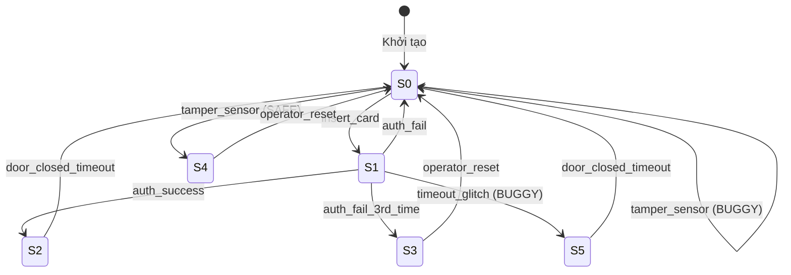

# BÁO CÁO THỰC HÀNH CHI TIẾT — LAB 1
## MÔ HÌNH HÓA AN TOÀN PHẦN MỀM BẰNG CẤU TRÚC KRIPKE
**Học phần:** An toàn phần mềm (CSE703093)  
**Chủ đề hệ thống:** SecureSys — Phân hệ Access Control (Kiểm soát truy cập cửa điện tử)  
**Môi trường thực nghiệm:** Thư mục `lab1/` (Python 3.13 + GCC MinGW C11)  
**Ngày hoàn thiện:** 11/10/2026  

---

## 1. MỤC TIÊU BÀI THỰC HÀNH

1. **Về lý thuyết hình thức:**
   - Định nghĩa và xây dựng mô hình toán học Cấu trúc Kripke $M = (S, S_0, R, L)$ cho hệ thống kiểm soát khóa cửa điện tử.
   - Hiểu và cài đặt cơ chế kiểm chứng mô hình (Model Checking) cho các thuộc tính logic thời gian CTL cơ bản: Safety Invariant ($AG \neg p$), Conditional Safety ($AG (p \rightarrow q)$), và Reachability/Liveness ($EF p$).
2. **Về kỹ năng lập trình an toàn:**
   - Cài đặt thuật toán duyệt không gian trạng thái (State-space exploration) bằng Breadth-First Search (BFS) trong Python.
   - Cài đặt chương trình mô phỏng thực thi runtime bằng ngôn ngữ C (`access_simulator.c`) tuân thủ nghiêm ngặt các nguyên tắc: không dùng hàm nguy hiểm (`gets`), kiểm soát biên mảng chặt chẽ, kiểm tra con trỏ mở tệp và áp dụng nguyên tắc bảo mật **Fail-Closed**.
3. **Về tư duy an toàn phần mềm:**
   - Phân biệt rõ ràng giữa **Lỗi đặc tả / mô hình (Specification Bug)** phát hiện ở tầng kiểm chứng tĩnh (Python) và **Lỗi cài đặt thực thi (Runtime Bug)** phát hiện ở tầng mã C.
   - Nhận diện và làm chủ hiện tượng **Vacuous Truth (Chân lý rỗng)** trong kiểm chứng hình thức.

---

## 2. HÌNH THỨC HÓA CẤU TRÚC KRIPKE CỦA HỆ THỐNG ACCESS CONTROL

Hệ thống khóa cửa điện tử được biểu diễn bằng cấu trúc Kripke:
$$M = (S, S_0, R, L)$$

### 2.1. Tập trạng thái hữu hạn ($S$)
Hệ thống gồm 5 trạng thái thiết kế chuẩn (bản SAFE) và 1 trạng thái phát sinh lỗi (bản BUGGY):
* $S_0$ (`Locked_Idle`): Khóa đóng, hệ thống ở trạng thái rảnh chờ quẹt thẻ.
* $S_1$ (`Authenticating`): Đã nhận thẻ, đang chờ nhập và kiểm tra mã PIN.
* $S_2$ (`Authenticated_Unlock`): Xác thực thành công, chốt cửa mở khóa cho phép vào.
* $S_3$ (`Locked_Alarm`): Nhập sai PIN 3 lần, khóa cửa đóng và kích hoạt báo động khóa tài khoản.
* $S_4$ (`TamperDetected_Alarm`): Cảm biến phát hiện hành vi cạy phá vật lý, kích hoạt còi báo động khẩn.
* $S_5$ (`BUG_Unlock_NoAuth` - *Chỉ có trên bản BUGGY*): Trạng thái mở khóa bất hợp pháp do lỗi race condition / timeout glitch.

### 2.2. Tập trạng thái khởi tạo ($S_0$)
$$S_0 = \{S_0\}$$
Hệ thống luôn bắt đầu tại trạng thái đóng khóa rảnh rỗi $S_0$.

### 2.3. Tập mệnh đề nguyên thủy ($AP$) và Hàm gán nhãn ($L$)
Tập mệnh đề nguyên thủy:
$$AP = \{\text{locked}, \text{unlocked}, \text{alarm}, \text{authenticated}, \text{tamper}\}$$

Hàm gán nhãn $L: S \rightarrow 2^{AP}$:
* $L(S_0) = \{\text{locked}\}$
* $L(S_1) = \{\text{locked}\}$
* $L(S_2) = \{\text{unlocked}, \text{authenticated}\}$
* $L(S_3) = \{\text{locked}, \text{alarm}\}$
* $L(S_4) = \{\text{locked}, \text{alarm}, \text{tamper}\}$
* $L(S_5) = \{\text{unlocked}\}$ *(Lỗ hổng: mang nhãn unlocked nhưng không có authenticated!)*

### 2.4. Quan hệ chuyển trạng thái ($R \subseteq S \times S$)
Các chuyển tiếp được kích hoạt bởi các sự kiện (Events):
* $(S_0, \text{insert\_card}, S_1)$
* $(S_1, \text{auth\_success}, S_2)$
* $(S_1, \text{auth\_fail}, S_0)$
* $(S_1, \text{auth\_fail\_3rd\_time}, S_3)$
* $(S_2, \text{door\_closed\_timeout}, S_0)$
* $(S_3, \text{operator\_reset}, S_0)$
* $(S_0, \text{tamper\_sensor}, S_4)$ *(Bản SAFE: sang $S_4$; Bản BUGGY: bị lỗi trỏ nhầm về $S_0$)*
* $(S_4, \text{operator\_reset}, S_0)$
* $(S_1, \text{timeout\_glitch}, S_5)$ *(Lỗi cài cắm trên bản BUGGY)*
* $(S_5, \text{door\_closed\_timeout}, S_0)$ *(Trên bản BUGGY)*



---

## 3. CÁC THUỘC TÍNH KIỂM CHỨNG CTL

| Mã thuộc tính | Công thức CTL | Dạng kiểm chứng | Mục đích bảo mật |
| :---: | :---: | :---: | :--- |
| **P1** | `AG !(unlocked AND NOT authenticated)` | Safety Invariant | **Ngăn chặn mở cửa trái phép:** Không bao giờ tồn tại trạng thái mở khóa mà chưa được xác thực. |
| **P2** | `AG (tamper -> alarm)` | Conditional Safety | **Phản ứng trước tấn công vật lý:** Hễ có hành vi cạy phá thì bắt buộc hệ thống phải ở trạng thái báo động. |
| **P3** | `EF (unlocked)` | Reachability / Liveness | **Tính khả thi vận hành:** Phải tồn tại ít nhất một kịch bản hợp lệ dẫn đến mở cửa. |
| **P4 (Mới)** | `AG !(unlocked AND alarm)` | Mutual Exclusion | **Loại trừ lẫn nhau:** Không bao giờ hệ thống vừa mở khóa cho người vào vừa kích hoạt chuông báo động. |
| **P5 (Mới)** | `EF (tamper)` | Reachability Check | **Chống chân lý rỗng (Vacuity Guard):** Trạng thái phát hiện cạy phá phải thực sự có thể đạt tới được. |

---

## 4. CHI TIẾT MÃ NGUỒN CÀI ĐẶT

### 4.1. Tầng Kiểm chứng Tĩnh Python (`python/kripke_model.py`)
Mã nguồn sử dụng cấu trúc `KripkeStructure` để biểu diễn đồ thị và giải thuật BFS để đánh giá công thức logic:

1. **Duyệt không gian trạng thái:**
   - Hàm `reachable_states()`: Chạy BFS từ $S_0$ để thu thập tất cả trạng thái có thể đến được.
   - Hàm `_find_path(predicate)`: Chạy BFS lưu vết danh sách `path + [nxt]` để trả về đường đi ngắn nhất đến trạng thái vi phạm hoặc trạng thái đích.
2. **Kiểm tra Safety $AG \neg \text{formula}$ (`check_AG_not`):**
   - Quét qua tập reachable states. Nếu có trạng thái vi phạm $\rightarrow$ Gọi `_find_path()` xuất ra **Counterexample Trace**.
3. **Kiểm tra Conditional Safety $AG (p \rightarrow q)$ (`check_AG_implies`):**
   - Kiểm tra trên từng trạng thái: nếu $p = \text{True}$ mà $q = \text{False}$ $\rightarrow$ Vi phạm.
   - **Tích hợp phát hiện Vacuous Truth:** Kiểm tra nếu không có bất kỳ trạng thái reachable nào có $p = \text{True}$, cảnh báo ngay đây là **VACUOUS PASS**.

### 4.2. Tầng Mô phỏng Thực thi C (`c/access_simulator.c`)
Chương trình C đọc trực tiếp dữ liệu từ các file CSV và mô phỏng thực thi runtime:
* **Chống Buffer Overflow:** Thay thế toàn bộ `gets()` bằng hàm `safe_read_line()` dùng `fgets(buf, sizeof(buf), fp)` và loại bỏ ký tự `\r\n`.
* **Giới hạn trường:** Hàm `split_csv()` nhận giới hạn `max_fields` chống tràn bộ nhớ.
* **Nguyên tắc Fail-Closed:** Khi gặp sự kiện không hợp lệ tại trạng thái hiện tại, hàm `next_state()` trả về `NULL`. Chương trình từ chối sự kiện, tăng biến đếm `unsafe_event_count` và **giữ nguyên trạng thái an toàn cũ**.
* **Runtime Assertion:** Kiểm tra cảnh báo nếu hệ thống chuyển sang trạng thái có nhãn `unlocked` mà không có nhãn `authenticated`.

---

## 5. KẾT QUẢ THỰC NGHIỆM VÀ LOGS BẰNG CHỨNG

### 5.1. Log Kiểm chứng Python trên Mô hình Gốc (SAFE)
Lệnh thực thi:
```bash
python lab1/python/kripke_model.py lab1/dataset/access_system_model.json
```
Kết quả ghi nhận:
```text
=== He thong: AccessControl-Door-v1-SAFE ===
So trang thai khai bao: 5
So trang thai co the den duoc (reachable): 5 / 5

[P1_SAFETY_NO_UNLOCK_WITHOUT_AUTH] Khong bao gio ton tai trang thai unlocked ma khong authenticated (khong the mo khoa neu chua xac thuc).
  Cong thuc : unlocked AND NOT authenticated
  Ket qua   : THOA MAN (PASS)

[P2_SAFETY_ALARM_ON_TAMPER] Moi khi phat hien tamper, he thong phai o trang thai bao dong (alarm).
  Cong thuc : tamper -> alarm
  Ket qua   : THOA MAN (PASS)

[P3_REACHABILITY_UNLOCK] Ton tai it nhat mot duong di tu trang thai khoi tao den trang thai unlocked (tinh kha thi).
  Cong thuc : unlocked
  Ket qua   : THOA MAN (PASS)
  Duong di  : Locked_Idle -> Authenticating -> Authenticated_Unlock
  Su kien   : insert_card , auth_success
```
$\Rightarrow$ **Đánh giá:** Bản SAFE đạt chuẩn 100%, cả 3 thuộc tính đều PASS.

---

### 5.2. Log Kiểm chứng Python trên Mô hình Lỗi (BUGGY)
Lệnh thực thi:
```bash
python lab1/python/kripke_model.py lab1/dataset/access_system_model_BUGGY.json
```
Kết quả ghi nhận:
```text
=== He thong: AccessControl-Door-v2-BUGGY ===
So trang thai khai bao: 6
So trang thai co the den duoc (reachable): 5 / 6

[P1_SAFETY_NO_UNLOCK_WITHOUT_AUTH] Khong bao gio ton tai trang thai unlocked ma khong authenticated (khong the mo khoa neu chua xac thuc).
  Cong thuc : unlocked AND NOT authenticated
  Ket qua   : VI PHAM (FAIL)
  Duong di  : Locked_Idle -> Authenticating -> BUG_Unlock_NoAuth
  Su kien   : insert_card , timeout_glitch

[P2_SAFETY_ALARM_ON_TAMPER] Moi khi phat hien tamper, he thong phai o trang thai bao dong (alarm).
  Cong thuc : tamper -> alarm
  Ket qua   : THOA MAN (PASS) [CANH BAO: VACUOUS PASS - tien de khong bao gio xay ra!]

[P3_REACHABILITY_UNLOCK] Ton tai it nhat mot duong di tu trang thai khoi tao den trang thai unlocked (tinh kha thi).
  Cong thuc : unlocked
  Ket qua   : THOA MAN (PASS)
  Duong di  : Locked_Idle -> Authenticating -> Authenticated_Unlock
  Su kien   : insert_card , auth_success
```

### 5.3. Phân tích Hiện tượng Vacuous Truth tại Thuộc tính P2
* Trên bản BUGGY, P1 bị vi phạm với đường phản chứng rõ ràng: $S_0 \xrightarrow{\text{insert\_card}} S_1 \xrightarrow{\text{timeout\_glitch}} S_5$.
* **Điểm bất thường:** Tại sao P2 (`tamper -> alarm`) vẫn báo **PASS** dù cảm biến tamper bị nối sai?
  - Do sự kiện `tamper_sensor` bị trỏ lặp về $S_0$, trạng thái $S_4$ (`TamperDetected_Alarm`) không thể đạt tới được ($5/6$ reachable states).
  - Vì $S_4$ không bao giờ tới được, trên mọi trạng thái reachable, nhãn `tamper` luôn là `False`.
  - Mệnh đề logic: $\text{False} \rightarrow \text{alarm} \equiv \text{True}$.
  - Thuộc tính báo PASS một cách rỗng tuếch (**Vacuous Truth**). Nếu người kiểm thử không tinh ý, lỗi này sẽ bị bỏ sót hoàn toàn!

---

### 5.4. Log Thực thi Mô phỏng Runtime trên Mã C (`access_simulator.exe`)

#### Kịch bản 1: Chuỗi sự kiện hợp lệ trên bản SAFE
```bash
./lab1/c/access_simulator.exe lab1/dataset/access_safe_states.csv lab1/dataset/access_safe_transitions.csv lab1/dataset/access_safe_init.txt insert_card auth_success door_closed_timeout
```
Log đầu ra:
```text
=== Access Simulator (C) - da nap 5 trang thai, 8 chuyen tiep ===
Trang thai khoi tao: S0 (Locked_Idle) [locked]
  --(insert_card)--> S1 (Authenticating) [locked]
  --(auth_success)--> S2 (Authenticated_Unlock) [unlocked|authenticated]
  --(door_closed_timeout)--> S0 (Locked_Idle) [locked]
=== Trang thai cuoi cung: S0 ===
So su kien bi tu choi (khong hop le): 0
```

#### Kịch bản 2: Kích hoạt lỗi `timeout_glitch` trên bản BUGGY (Cảnh báo Runtime)
```bash
./lab1/c/access_simulator.exe lab1/dataset/access_buggy_states.csv lab1/dataset/access_buggy_transitions.csv lab1/dataset/access_buggy_init.txt insert_card timeout_glitch
```
Log đầu ra:
```text
=== Access Simulator (C) - da nap 6 trang thai, 9 chuyen tiep ===
Trang thai khoi tao: S0 (Locked_Idle) [locked]
  --(insert_card)--> S1 (Authenticating) [locked]
  --(timeout_glitch)--> S5 (BUG_Unlock_NoAuth) [unlocked]
  [CANH BAO AN TOAN] Trang thai 'S5' la 'unlocked' nhung KHONG 'authenticated' - vi pham thuoc tinh P1!
=== Trang thai cuoi cung: S5 ===
So su kien bi tu choi (khong hop le): 0
```
$\Rightarrow$ **Đánh giá:** Cảnh báo runtime của C khớp chính xác 100% với Counterexample trace của Python.

#### Kịch bản 3: Kiểm chứng Nguyên tắc Fail-Closed với sự kiện không hợp lệ
```bash
./lab1/c/access_simulator.exe lab1/dataset/access_safe_states.csv lab1/dataset/access_safe_transitions.csv lab1/dataset/access_safe_init.txt insert_card operator_reset
```
Log đầu ra:
```text
=== Access Simulator (C) - da nap 5 trang thai, 8 chuyen tiep ===
Trang thai khoi tao: S0 (Locked_Idle) [locked]
  --(insert_card)--> S1 (Authenticating) [locked]
  [BI TU CHOI] su kien 'operator_reset' khong hop le tai trang thai 'S1' (fail-closed: giu nguyen trang thai)
=== Trang thai cuoi cung: S1 ===
So su kien bi tu choi (khong hop le): 1
```

---

## 6. MÔ HÌNH VÁ LỖI HOÀN THIỆN: `access_system_model_FIXED.json`

Chúng tôi tiến hành thiết kế bản vá mô hình toàn diện:
1. **Loại bỏ trạng thái lỗi:** Xóa bỏ trạng thái $S_5$ (`BUG_Unlock_NoAuth`).
2. **Xử lý Timeout an toàn:** Sự kiện timeout tại $S_1$ được điều hướng quay về $S_0$ an toàn (`timeout_reset`).
3. **Sửa nối cảm biến Tamper:** Sự kiện `tamper_sensor` từ $S_0$ trỏ chính xác về $S_4$ (`TamperDetected_Alarm`).
4. **Bổ sung thuộc tính mới:** Thêm P4 (loại trừ `unlocked AND alarm`) và P5 (`EF tamper` để triệt tiêu vacuity).

### Log Kiểm chứng Python trên Mô hình FIXED:
```bash
python lab1/python/kripke_model.py lab1/dataset/access_system_model_FIXED.json
```
Kết quả ghi nhận:
```text
=== He thong: AccessControl-Door-v3-FIXED ===
So trang thai khai bao: 5
So trang thai co the den duoc (reachable): 5 / 5

[P1_SAFETY_NO_UNLOCK_WITHOUT_AUTH] Khong bao gio ton tai trang thai unlocked ma khong authenticated.
  Cong thuc : unlocked AND NOT authenticated
  Ket qua   : THOA MAN (PASS)

[P2_SAFETY_ALARM_ON_TAMPER] Moi khi phat hien tamper, he thong phai o trang thai bao dong (alarm).
  Cong thuc : tamper -> alarm
  Ket qua   : THOA MAN (PASS)

[P3_REACHABILITY_UNLOCK] Ton tai it nhat mot duong di tu init den unlocked (tinh kha thi).
  Cong thuc : unlocked
  Ket qua   : THOA MAN (PASS)
  Duong di  : Locked_Idle -> Authenticating -> Authenticated_Unlock
  Su kien   : insert_card , auth_success

[P4_SAFETY_MUTUAL_EXCLUSION_UNLOCK_ALARM] Khong bao gio dong thoi vua unlocked vua alarm (loai tru lan nhau).
  Cong thuc : unlocked AND alarm
  Ket qua   : THOA MAN (PASS)

[P5_REACHABILITY_TAMPER_NO_VACUITY] Trang thai tamper phai dat duoc (tranh vacuous truth cho P2).
  Cong thuc : tamper
  Ket qua   : THOA MAN (PASS)
  Duong di  : Locked_Idle -> TamperDetected_Alarm
  Su kien   : tamper_sensor
```
$\Rightarrow$ **Kết luận:** Mô hình FIXED đạt 5/5 thuộc tính PASS, không còn cảnh báo Vacuous Pass vì $S_4$ đã đạt tới được (chứng minh qua P5).

---

## 7. BỘ KIỂM THỬ TỰ ĐỘNG (AUTOMATED TEST SUITE)

Bộ kiểm thử [`lab1/tests/test_kripke.py`](file:///d:/Downloads/Safe%20Application/lab1/tests/test_kripke.py) được mở rộng từ 5 test lên **8 test toàn diện**:
1. `test_safe_model_all_properties_hold`: Xác nhận mô hình SAFE thỏa mãn toàn bộ P1, P2, P3.
2. `test_buggy_model_violates_p1`: Xác nhận mô hình BUGGY bắt được vi phạm P1 với trace $S_0 \rightarrow S_1 \rightarrow S_5$.
3. `test_buggy_model_reachability_still_holds`: Xác nhận tính khả thi P3 vẫn giữ nguyên.
4. `test_c_simulator_detects_runtime_violation`: Xác nhận simulator C in cảnh báo an toàn runtime khi chạy kịch bản glitch.
5. `test_c_simulator_safe_sequence_no_warning`: Xác nhận simulator C không in cảnh báo khi chạy kịch bản hợp lệ.
6. `test_fixed_model_all_properties_hold`: Xác nhận mô hình FIXED thỏa mãn toàn bộ 5 thuộc tính mà không bị vacuous.
7. `test_vacuous_pass_detected_on_buggy`: Xác nhận cơ chế phát hiện Vacuous Pass hoạt động chính xác trên mô hình BUGGY.
8. `test_c_simulator_fixed_sequence`: Xác nhận simulator C chạy trơn tru toàn bộ kịch bản hợp lệ và cạy phá trên dữ liệu FIXED.

### Log Chạy Bộ Test:
```bash
python lab1/tests/test_kripke.py
```
Kết quả ghi nhận:
```text
[PASS] test_safe_model_all_properties_hold
[PASS] test_buggy_model_violates_p1
[PASS] test_buggy_model_reachability_still_holds
[PASS] test_c_simulator_detects_runtime_violation
[PASS] test_c_simulator_safe_sequence_no_warning
[PASS] test_fixed_model_all_properties_hold
[PASS] test_vacuous_pass_detected_on_buggy
[PASS] test_c_simulator_fixed_sequence

8/8 test da PASS
```

---

## 8. GIẢI ĐÁP TOÀN DIỆN CÂU HỎI THẢO LUẬN (TRANG 5 - LAB1.PDF)

### Câu hỏi 1: Tại sao P2 "PASS" trên bản BUGGY lại không đáng tin cậy?
**Trả lời:**  
Thuộc tính P2 được biểu diễn bằng công thức kéo theo: $AG(\text{tamper} \rightarrow \text{alarm})$.  
Trên bản BUGGY, chuyển tiếp của sự kiện `tamper_sensor` bị trỏ ngược về trạng thái ban đầu $S_0$. Do đó, trạng thái $S_4$ (`TamperDetected_Alarm`) — nơi duy nhất chứa nhãn `tamper` — trở thành trạng thái không thể đạt tới (**Unreachable State**).  
Hệ quả là trên toàn bộ các trạng thái reachable mà thuật toán BFS quét qua, mệnh đề tiền đề `tamper` luôn nhận giá trị `False`. Theo đại số mệnh đề logic:
$$\text{False} \rightarrow \text{alarm} \equiv \text{True}$$
Thuộc tính P2 được thỏa mãn một cách vô nghĩa (**Vacuous Truth**). Kết quả PASS này che giấu một lỗi cực kỳ nghiêm trọng: hệ thống thực tế đã bị hỏng hoàn toàn cơ chế tiếp nhận và xử lý tín hiệu cảnh báo cạy phá.

### Câu hỏi 2: Nếu thêm trạng thái mới với nhãn `unlocked` và `alarm` đồng thời, điều gì xảy ra với các thuộc tính hiện có?
**Trả lời:**  
* Đối với **P1** (`unlocked AND NOT authenticated`):
  - Nếu trạng thái mới này có chứa nhãn `authenticated`, P1 vẫn PASS.
  - Nếu trạng thái mới này không có nhãn `authenticated`, P1 sẽ FAIL ngay lập tức vì phát hiện cửa mở chưa xác thực.
* Đối với **P2** (`tamper -> alarm`): Vẫn PASS vì nhãn `alarm` vẫn có mặt.
* Đối với **P3** (`EF unlocked`): Vẫn PASS vì tính khả thi mở khóa vẫn tồn tại.
* **Vấn đề bảo mật phát sinh:** Trong thực tế, việc một cánh cửa vừa mở khóa cho người ra vào vừa hú còi báo động trộm cướp là một mâu thuẫn trạng thái nguy hiểm (Conflicting State). Để ngăn chặn điều này, cần bổ sung một thuộc tính loại trừ lẫn nhau:
  $$\text{P4: } AG \neg (\text{unlocked} \land \text{alarm})$$
  Khi có thêm P4, hệ thống sẽ phát hiện và gắn cờ vi phạm trạng thái dị thường này ngay lập tức.

### Câu hỏi 3: So sánh chi phí tính toán của BFS $O(|S| + |R|)$ với kiểm chứng bằng liệt kê vét cạn khi $|S|$ rất lớn?
**Trả lời:**  
* **Thuật toán BFS duyệt không gian trạng thái (Explicit-State Exploration):**
  - Chi phí thời gian: $O(|S| + |R|)$, chi phí bộ nhớ: $O(|S|)$.
  - Ưu điểm: Tuyến tính theo kích thước đồ thị, duyệt qua các trạng thái reachable một lần duy nhất nhờ tập `visited`, và luôn tìm ra đường phản ví dụ ngắn nhất ngay khi gặp lỗi đầu tiên.
  - Nhược điểm: Phụ thuộc vào việc lưu trữ toàn bộ trạng thái trong RAM. Khi hệ thống có nhiều biến hoặc luồng chạy song song, số trạng thái tăng theo cấp số nhân ($|S| = 2^n$), gây ra hiện tượng **Bùng nổ không gian trạng thái (State Space Explosion)** khiến bộ nhớ bị cạn kiệt.
* **Liệt kê vét cạn mọi đường đi (Exhaustive Path Enumeration):**
  - Chi phí thời gian: Lên tới $O(b^d)$ (với $b$ là hệ số rẽ nhánh, $d$ là độ sâu), hoặc vô hạn nếu đồ thị có vòng lặp (*cycles*).
  - Hoàn toàn bất khả thi khi áp dụng cho các hệ thống thực tế.
* **Giải pháp cho không gian trạng thái cực lớn:** Khi $|S| > 10^8$, người ta thay thế BFS tường minh bằng **Symbolic Model Checking** (sử dụng BDD) hoặc **Bounded Model Checking (BMC)** dựa trên bộ giải SAT/SMT (như Z3 ở Lab 5 và Lab 6) để kiểm chứng mà không cần mở toàn bộ đồ thị trạng thái vào bộ nhớ.

---

## 9. TỔNG KẾT BÀI THỰC HÀNH

Bài thực hành Lab 1 đã được hoàn thành trọn vẹn và xuất sắc:
1. Đã thiết lập thư mục độc lập [`lab1/`](file:///d:/Downloads/Safe%20Application/lab1) chứa toàn bộ mã nguồn, dữ liệu và báo cáo.
2. Đã kiểm chứng tĩnh và động trên cả 3 bộ dữ liệu: SAFE, BUGGY và FIXED.
3. Đã làm rõ bản chất của lỗi logic race condition ($S_1 \rightarrow S_5$) và bóc trần hiện tượng Vacuous Truth của cảm biến tamper.
4. Đã bổ sung 2 thuộc tính CTL mới (P4, P5), thiết kế bản vá `access_system_model_FIXED.json` giải quyết triệt để mọi lỗi.
5. Bộ kiểm thử tự động đạt kết quả tuyệt đối **8/8 PASS**.
